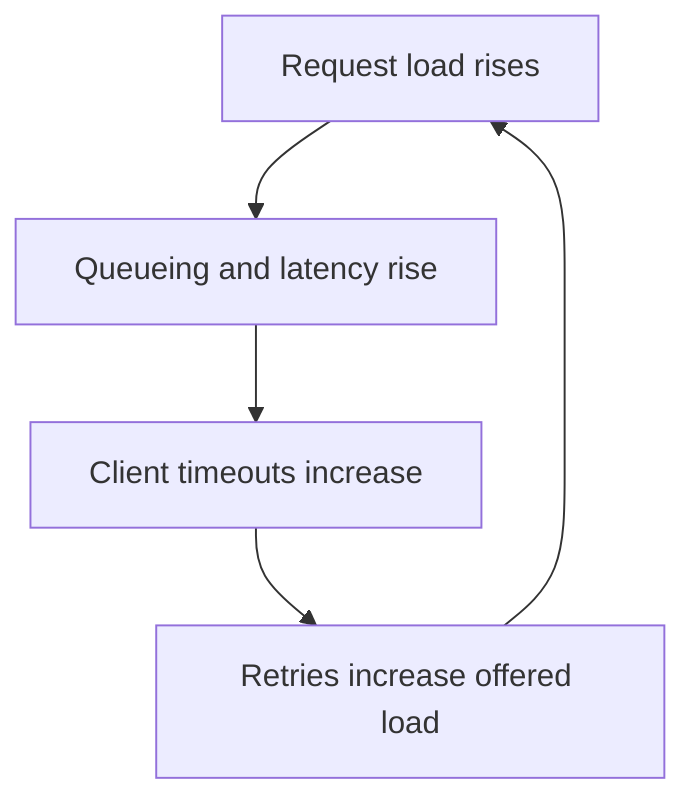
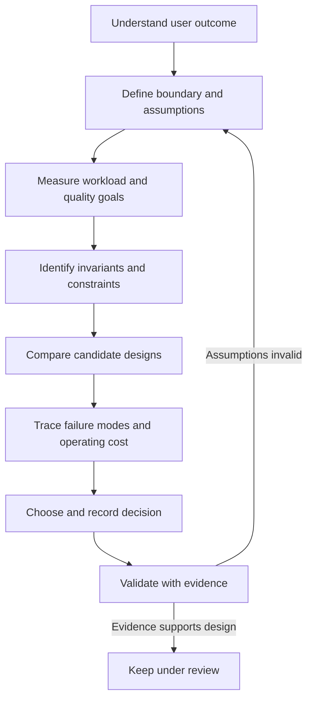
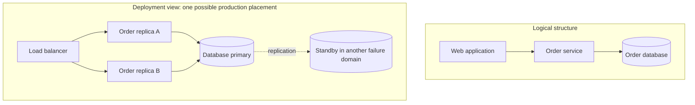

# 1. Thinking in Systems and Architecture

This chapter establishes the reasoning tools used throughout the textbook. System design is not primarily the act of drawing boxes; it is the disciplined process of deciding how responsibilities, state, communication, constraints, and failure should fit together.

## 1.1 What is a system?

A **system** is a set of interacting elements whose combined behavior produces outcomes. In software, the elements may include processes, services, databases, queues, users, external providers, operators, and deployment infrastructure.

A system has:
- **Inputs:** requests, events, files, commands, schedules, or environmental signals.
- **Transformations:** validation, computation, coordination, persistence, and routing.
- **State:** information that influences future behavior.
- **Outputs:** responses, events, side effects, reports, or externally visible changes.
- **Environment:** networks, hardware, identity providers, other systems, people, and operating conditions.
- **Constraints:** correctness, latency, throughput, cost, security, legal obligations, and team capacity.

A component cannot be understood entirely in isolation if its behavior depends on another component's latency, state, availability, or contract. System behavior emerges from interactions as well as from individual components.

### A simple example

An order service may validate an order, reserve inventory, charge a payment method, persist order state, and send a confirmation. Each operation can work correctly alone while the workflow still fails: inventory might be reserved but payment may time out; payment may succeed while the response is lost; a confirmation may be sent twice. System design reasons about the end-to-end outcome and the intermediate states—not only each API.

### Systems thinking: feedback loops, delays, and emergent behavior

A system's behavior is shaped not only by its components but also by the feedback between them. **Reinforcing feedback** amplifies a change; **balancing feedback** counteracts a deviation or moves the system toward a target. Neither is inherently good or bad: the effect depends on what is being amplified or controlled.

Consider an overloaded API:

This is a reinforcing loop: retries intended to improve an individual request's chance of success can increase total load and make the original overload worse. Google’s SRE guidance describes this retry-amplification mechanism and recommends randomized exponential backoff, bounded retries, and system-wide overload controls ([Addressing Cascading Failures](https://sre.google/sre-book/addressing-cascading-failures/)). A design should therefore bound retries, use deadlines and backoff with jitter, and avoid retrying non-idempotent operations without a safe deduplication strategy.

A balancing response might reject or shed low-priority work when saturation crosses a threshold, reducing the work accepted by the system. But feedback has a **delay**: autoscaling may react only after queues and latency have already grown, and aggressive scale-up/scale-down policies can oscillate. Thresholds, cooldowns, queue limits, and measurements should be chosen with these delays in mind.

This is why local optimizations can produce harmful system-wide outcomes. A component that retries more aggressively may look more resilient in isolation while reducing the availability of the whole dependency chain. When evaluating a design, trace the effects of a change through dependent components and ask whether the resulting feedback stabilizes the system or amplifies the problem.

## 1.2 Architecture is a set of consequential decisions

**Software architecture** describes the important structures and decisions that shape system behavior: component boundaries, responsibilities, communication paths, state ownership, deployment units, trust boundaries, failure domains, and rules that allow the system to evolve.

A diagram is one representation of architecture, not the architecture itself. Two diagrams can look identical while differing radically in transaction boundaries, consistency guarantees, retry behavior, security boundaries, or recovery behavior. Those properties often determine whether the system works in production.

**System design** is the reasoning process used to choose a structure that satisfies requirements within constraints. **High-Level Design (HLD)** focuses on major components, their responsibilities, interfaces, data flows, state ownership, and deployment relationships. **Low-Level Design (LLD)** focuses on internal classes/modules, algorithms, schemas, and detailed implementation. The boundary is contextual: a database schema may be low-level in one discussion but central to HLD when it determines partitioning, consistency, or service ownership.

Architecture decisions differ from ordinary implementation details because they tend to have broad consequences, affect multiple teams or components, and become expensive to reverse after data, clients, and operational processes depend on them.

## 1.3 Define the system boundary

A **system boundary** states what is inside the system being designed and what is treated as an external dependency. Without a boundary, scope expands indefinitely and responsibility becomes unclear.

For each boundary, identify:
- Which behavior the system owns.
- Which data it owns and may change.
- Which guarantees it promises to clients.
- Which dependencies it calls or receives events from.
- Which identity and trust assumptions apply.
- Who operates it and responds to failures.
- Which failure modes are inside versus outside its control.

An external provider can fail even if your code is correct. The system must define whether to fail the request, use cached data, queue work, degrade functionality, or retry within a deadline.

~~~mermaid
flowchart LR
  U[Users and external clients] -->|requests| G[System boundary]
  G --> A[Application capabilities]
  A --> D[(Owned data)]
  A --> X[External dependencies]
  O[Operations and security] -. governs .-> G
  O -. observes .-> A
  O -. protects .-> D
~~~

The dotted relationships matter: security, observability, deployment, and operational ownership cross component boundaries rather than living in a single box.

## 1.4 Start with the problem, not a technology

A reliable reasoning sequence is:

1. State the user or business outcome.
2. Define scope and explicit exclusions.
3. Identify functional behavior and quality attributes.
4. Identify important data, invariants, and access patterns.
5. Describe workload shape and growth.
6. Identify constraints and assumptions.
7. Compare viable structures and their trade-offs.
8. Specify failure behavior and operational ownership.
9. Validate with measurements, experiments, and review.

Choosing a database, broker, cloud, or microservice boundary before clarifying access patterns and correctness needs reverses this order. Technology can make some choices easier, but it cannot rescue a misunderstood requirement.

The requirements and constraints that most strongly shape the structure are called **architecture drivers**. They commonly include a small set of critical user capabilities, measurable quality goals (such as a p99 latency target or recovery objective), hard constraints (such as data residency), workload characteristics, and organizational or operational realities. Not every requirement is an architecture driver: the useful test is whether changing it could materially change the boundaries, data model, deployment, or failure strategy. Make the important drivers explicit so candidate designs can be evaluated against the same criteria.

### Separate facts, assumptions, and decisions

These categories should not be mixed:
- **Fact:** confirmed by observation, a contract, a standard, or an authoritative source.
- **Assumption:** believed to be true for planning but not yet verified.
- **Constraint:** a condition the design must obey, such as a legal retention rule or fixed platform.
- **Decision:** a choice made among alternatives.
- **Risk:** an uncertain event or condition that could harm an objective.
- **Open question:** information needed before a consequential choice can be made.

For example, “the service receives 10,000 requests/s” is a fact only if supported by measurements or a binding requirement. Otherwise it is an assumption. A good design records how important assumptions will be tested.

## 1.5 Model behavior with responsibilities, state, and contracts

A component should have a clear responsibility and a contract with its callers. A useful contract specifies inputs, outputs, errors, side effects, timing expectations, authorization, and the meaning of success.

State ownership is especially important. Ask:
- Which component is authoritative for this fact?
- Which component is allowed to change it?
- What invariants must always hold?
- Can copies become stale?
- How are changes propagated?
- What happens if propagation is delayed or duplicated?

If two components both believe they own the same invariant, they can make conflicting decisions. A common design is to assign one authoritative owner and expose controlled commands or events to other components. Replicas and caches may hold copies, but copies need explicit freshness and reconciliation rules.

### Invariants versus workflow steps

An **invariant** is a condition that must remain true across all valid states. Examples include “an order identifier is unique” or “the same inventory unit cannot be sold twice.” A workflow is a sequence of actions intended to move the system between states. Workflows can fail halfway; invariants must still be protected.

This distinction helps identify which operations require atomic transactions, serialization, conditional updates, uniqueness constraints, idempotency, or reconciliation.

## 1.6 Decompose by responsibility and change

A component boundary should make some kind of change easier or isolate a meaningful concern. Useful signals include distinct domain rules, ownership of data invariants, different scaling needs, security boundaries, independent release cadence, and separate failure containment.

Two useful design qualities are:
- **Cohesion:** how strongly the elements inside a component belong together.
- **Coupling:** how much one component depends on the details or behavior of another.

High cohesion and manageable coupling generally make change safer. Coupling is not automatically bad: components must cooperate to deliver behavior. The goal is to make dependencies explicit, stable, and proportionate to the benefit of separation.

Over-fragmentation creates network calls, distributed transactions, duplicated operational work, and unclear ownership. Under-fragmentation creates entangled code, shared release risk, and competing responsibilities. There is no universal optimal number of components.

A **monolith** is deployed as one application unit; it can still have clear internal modules. A **modular monolith** enforces boundaries inside a shared deployment. **Microservices** split capabilities into independently deployable services and introduce network and operational failure modes. A **distributed system** has components that communicate across a network and must handle independent execution and partial failure. These categories overlap but are not synonyms. Martin Fowler’s discussion of [microservice trade-offs](https://martinfowler.com/articles/microservice-trade-offs.html) likewise emphasizes that stronger module boundaries and independent deployment come with distribution and operational costs; neither style is automatically best.

### A boundary decision checklist

Before splitting a component into a separate service, ask:
1. Is there a clear capability or invariant it owns?
2. Is independent deployment or scaling genuinely valuable?
3. Is the interface stable enough to cross a network boundary?
4. Can its data ownership be defined without constant cross-service writes?
5. What happens when the network call times out or returns late?
6. Who owns alerts, on-call response, capacity, upgrades, and security?
7. Is the added operational cost justified by a measurable benefit?

If the answers are weak, a module inside one deployment may be the better boundary for now.

## 1.7 Architecture is multi-objective optimization

Typical objectives conflict:
- Lower latency can require more replicas, locality, or duplicated data.
- Stronger consistency can require coordination and increase write latency or reduce availability during partitions.
- Higher availability can require redundancy, graceful degradation, and careful dependency design.
- More isolation can reduce blast radius but increase cost and operational complexity.
- More abstraction can enable change but obscure behavior and add indirection.
- Longer retention can improve auditability and recovery but increase storage cost and privacy exposure.

A decision is meaningful only relative to a requirement and context. “Microservices scale better” is incomplete: a service can scale independently only if its bottlenecks and state boundaries allow it, and the organization can operate the resulting distributed system.

### Hard constraints, objectives, and trade-off frontiers

A **hard constraint** must be satisfied: for example, a legal data residency rule. An **objective** is something to optimize: for example, reduce p99 latency or infrastructure cost. A design that violates a hard constraint is not rescued by being excellent on another dimension.

Often there is no single design that is best on every dimension. A design is **Pareto-dominated** if another feasible design is at least as good on every considered objective and strictly better on at least one. The **Pareto frontier** contains feasible designs for which improving one objective requires sacrificing another. This is a useful way to compare options without pretending that every trade-off can be reduced to one universal score.

## 1.8 Reason about failure before implementation

A local function call often returns a result or throws an error within one process. A remote call has additional outcomes:
- The request never reaches the server.
- The server receives it but does not finish.
- The server commits the change but the response is lost.
- The response arrives after the caller's deadline.
- A dependency is slow rather than fully unavailable.
- A retry overlaps with the original operation.

Therefore, a timeout does **not** prove that an operation failed. It means the caller stopped waiting within a specified time. The result may be unknown. Safe recovery depends on operation semantics, idempotency, deduplication, status lookup, and transaction boundaries.

Design the failure contract for every critical dependency: timeout, retry policy, deadline, fallback, error mapping, and whether the caller can safely repeat the operation.

## 1.9 Use explicit decision records

An architecture decision record (ADR) should briefly capture:
- **Context:** the problem, constraints, and forces driving the choice.
- **Decision:** what was chosen and the scope of the choice.
- **Alternatives:** credible options considered and why they were not selected.
- **Consequences:** expected benefits, costs, and risks.
- **Assumptions:** what must remain true for the decision to be sound.
- **Validation:** measurements, experiments, or signals that will test it.
- **Revisit triggers:** changes in scale, requirements, team structure, or operational evidence that could invalidate it.

An ADR protects against hindsight bias and makes trade-offs visible. It is not a substitute for design detail, code, runbooks, or experiments. Record decisions at the level where they affect future choices; do not create paperwork for every trivial implementation detail. The [Azure Well-Architected guidance on architecture decision records](https://learn.microsoft.com/en-us/azure/well-architected/architect-role/architecture-decision-record) is a useful practitioner reference for recording context, rationale, consequences, and decision status.

## 1.10 A practical architecture reasoning loop

Architecture is not a one-time diagram. Requirements and constraints shape candidate designs; the design is validated against realistic workloads and failure modes; production evidence then informs the next decision.

~~~mermaid
flowchart TD
  A[Understand goals and constraints] --> B[Identify invariants and quality targets]
  B --> C[Model workload and dependencies]
  C --> D[Compare candidate designs]
  D --> E[Make trade-offs explicit]
  E --> F[Build and validate assumptions]
  F --> G[Operate and measure]
  G --> H{Assumptions still hold?}
  H -- Yes --> I[Continue and refine]
  H -- No --> A
~~~

The loop may be iterative rather than strictly sequential. A workload estimate may reveal that a requirement is too expensive; a security review may force a new boundary; a failure test may invalidate an availability assumption.

## 1.11 Common errors and how to detect them

- **Designing before understanding the problem:** requirements cannot be traced to design decisions.
- **Treating every quality attribute as equally important:** no explicit priorities or acceptable compromises exist.
- **Equating a diagram with correctness:** state transitions, retries, failure paths, and trust boundaries are missing.
- **Assuming remote calls behave like local calls:** timeouts, partial failure, and duplicate effects are not modeled.
- **Equating more services with better modularity:** ownership and operational costs are unclear.
- **Ignoring state ownership:** multiple components can mutate the same business fact without conflict rules.
- **Hiding uncertainty behind precise estimates:** assumptions are not written down and sensitivity is not checked.
- **Designing only the happy path:** no behavior is defined for timeouts, overload, partial completion, or recovery.
- **Failing to revisit decisions:** observed production behavior no longer matches the original model.

## 1.12 Self-check

You should be able to explain, in your own words:
1. Why architecture is more than a component diagram.
2. The difference between a requirement, constraint, assumption, decision, and risk.
3. Why state ownership and invariants affect component boundaries.
4. Why a modular monolith can have strong modularity without distributed-system overhead.
5. Why a remote timeout does not establish whether a write committed.
6. How a Pareto frontier helps compare feasible designs.
7. What evidence would cause you to revisit an architecture decision.

## 1.13 Reversible decisions and costly commitments

Some architecture choices are cheap to change; others create obligations that are difficult to unwind. A library behind a stable interface may be replaceable with modest effort. A public API, data ownership boundary, shard key, event schema, cryptographic format, or client-visible consistency guarantee can become expensive to change once data, integrations, and operating procedures depend on it.

When uncertainty is high, prefer a reversible choice or a small experiment if it can answer the important question. For a costly commitment, make the assumptions and migration path explicit before adoption. This does not mean waiting until uncertainty disappears: identify the assumptions with the greatest consequences, test them where practical, and limit the damage if they prove false.

An architecture decision is therefore a hypothesis about the workload, constraints, and team—not a permanent truth. Define the evidence that would invalidate it, such as sustained queue growth, an independent scaling need, a new regulatory boundary, or repeated operational failures. Revisit the decision when that evidence appears rather than because a particular architecture style has become fashionable.

## 1.14 Coupling can hide outside the code

Coupling is not only a code-import relationship. Two services may be **data-coupled** if they write the same tables, **temporally coupled** if every request requires both to be available, **operationally coupled** if they must deploy or recover together, or **semantically coupled** if a field change silently changes another service's interpretation.

These forms matter because a boundary that looks clean on a component diagram may still force teams to coordinate every release or keep several services on the same critical path. When evaluating a proposed split, trace the data, timing, meaning, deployment and recovery dependencies—not just the API between components.

A useful boundary lets an owner change its implementation while preserving a stable contract. If the split creates frequent cross-service writes, synchronous fan-out, or unclear responsibility for an invariant, the new boundary may increase coupling rather than reduce it.

## 1.15 Architecture views: one system, several useful models

An architecture diagram is a model built to answer a particular question. No single diagram can clearly communicate system scope, internal responsibilities, runtime interactions, data ownership, deployment topology, security boundaries and recovery behavior at the same time. Trying to place all of them on one page usually creates an unreadable picture that hides rather than reduces complexity.

Choose the view based on the question:

| View | Main question | Typical elements |
|---|---|---|
| System context | Who uses the system, and which external systems interact with it? | People, system boundary, external systems and major relationships |
| Container / high-level structure | What applications and data stores make up the system, and how do they communicate? | Web/mobile apps, services, databases, queues and external dependencies |
| Component | What responsibilities live inside one application or service? | Modules, adapters, domain components and their dependencies |
| Code / implementation | How is one component implemented? | Classes, interfaces, functions or package dependencies |
| Runtime sequence / dynamic view | What happens, and in what order, for one scenario? | Requests, responses, events, timeouts, retries and state transitions |
| Deployment / physical view | Where does software run, and which infrastructure relationships matter? | Nodes, processes, regions, zones, networks, replicas and routing |
| Data model / ownership view | Which facts exist, who owns them, and how are they related? | Entities, keys, constraints, authoritative owners and derived copies |
| Trust-boundary view | Where do identities, privileges or trust assumptions change? | Principals, security zones, authentication and authorization enforcement points |
| Failure / recovery view | What fails together, and how is service restored? | Failure domains, redundancy, promotion, restore paths and degraded modes |

The C4 model is one useful way to describe static software structure at different levels: system context, containers, components and code. Its official [diagram guide](https://c4model.com/diagrams) also identifies dynamic and deployment diagrams as supporting views. In that model, a “container” means an application or data store, not necessarily an operating-system or Docker container. A deployment diagram is a separate view because the same logical structure can be deployed differently in development, staging, one region, or multiple regions.

**Logical architecture** describes responsibilities, boundaries and relationships without committing to placement. **Physical architecture** (often represented by a deployment view) maps those logical components to processes, hosts or containers, network zones, regions, storage and replicas. One logical service may have many deployed instances, and one host may run several logical components. Keep the mapping explicit when reasoning about capacity, failure domains, identity and cost; the logical/physical distinction is about the question being answered, not a strict one-to-one mapping.

Do not force every diagram type into every design. Use the smallest set that answers the decision at hand. For most high-level discussions, context and container views establish scope and major responsibilities; sequence, deployment, data, or trust-boundary views are added when the decision depends on those details.

### Example: do not mix logical structure with deployment topology

A logical view might show Web application → Order service → Order database. It answers responsibility and communication questions. A deployment view may show three service replicas across two zones behind a load balancer, a database primary and standby, and a private subnet. It answers placement and failure-domain questions. Combining the two can be useful, but only if labels distinguish logical components from deployed instances.

This is an illustrative pair of views, not a claim that every order service should use this deployment. The logical relationship and physical topology must be validated independently: two replicas in the same failure domain do not protect against that domain's loss, and a standby does not guarantee safe failover without a tested promotion and fencing process.

### Diagram quality checklist

- State the question the diagram is intended to answer and its scope.
- Name each element consistently across related diagrams.
- Label important arrows with protocol, direction, data, or meaning where ambiguity matters.
- Distinguish synchronous calls from asynchronous events.
- Show trust boundaries and authoritative data ownership when they affect the decision.
- Include error, timeout, retry, or recovery paths when they change correctness.
- Mark assumptions and illustrative elements rather than implying they are deployed facts.
- Keep the view at one useful level of abstraction; split it when readers cannot follow the relationships.
- Update diagrams when the architecture changes; stale diagrams can be more harmful than missing diagrams.

## 1.16 Worked architecture evaluation: choose a boundary from evidence

Consider an illustrative event-registration application used by one product team. It manages events, registrations, a limited number of seats, confirmation messages and an integration with an external payment provider. Assume moderate traffic, one main release cadence, and a hard invariant that accepted registrations must not exceed available seats. The numbers and constraints are deliberately illustrative; a real decision requires measured workload and business requirements.

### Step 1: separate requirements from assumptions

| Item | Type | Consequence for the design |
|---|---|---|
| Never confirm more registrations than available seats | Business invariant | Seat allocation needs an atomic authoritative decision; eventual reconciliation alone may be insufficient |
| Payment provider can time out after processing a request | Dependency behavior to design for | Payment outcomes need idempotency and reconciliation; a timeout cannot be treated as proof of failure |
| One team owns the application and releases together | Organizational constraint | Independent deployment may have limited immediate value |
| Registration traffic may spike when popular events open | Workload assumption to validate | Capacity tests should model bursts and hot events, not just average daily traffic |
| Confirmation messages can be delayed briefly | Candidate quality trade-off | Notifications can be asynchronous if the accepted-registration state remains correct |

### Step 2: compare plausible structures

| Candidate | Strengths for this context | Costs and risks |
|---|---|---|
| Single-process modular monolith with one authoritative database | Simple local transaction boundary for seat allocation; one deployment; clear modules can still enforce ownership | Whole application may scale as a unit; module boundaries need discipline |
| Microservices for events, registration, payment coordination and notifications | Independent scaling/deployment and explicit service ownership can help when those needs are real | More network failure paths, distributed workflow states, cross-service observability and operational overhead; seat invariants need a clear owner |
| Serverless functions and managed services | Can fit bursty workloads and reduce server management | Limits, cold starts, workflow state, local testing and service-specific quotas need evaluation; does not remove correctness or idempotency requirements |

### Step 3: make a conditional decision

Under the stated assumptions, start with a **modular monolith**: separate event, registration, payment-workflow and notification modules behind explicit interfaces, but keep seat allocation and registration persistence in one authoritative transaction boundary. Write the durable state transition and a **transactional outbox** record together—the outbox is stored in the same database transaction as the business change, then relayed for asynchronous publication ([Chapter 12: Messaging and streams](../12-messaging-streams/README.md) explains the delivery and deduplication boundaries). Use a stable payment idempotency key, meaning the same key identifies retries of the same logical payment operation, and a reconciliation path for uncertain provider outcomes.

This is not a claim that modular monoliths are universally better. It is the simplest candidate that appears to satisfy the current invariants and team constraints without introducing distributed coordination prematurely. The payment idempotency key must identify the logical payment operation and remain stable across retries; persist the association with the registration/workflow state. Confirm the provider's key scope, retention window, and behavior for the same key with a different request payload. If retries may occur after the provider forgets the key, do not assume the key alone prevents a duplicate charge: reconcile against the provider's durable transaction reference or provide an explicit exception/manual-recovery path.

### Step 4: define evidence that would change the decision

Revisit service extraction if evidence shows a capability needs an independent release cadence, a distinct security boundary, a substantially different scaling profile, or a separate team with clear ownership. Before extracting registration, prove how seat allocation remains atomic and how callers handle timeout, retry, duplicate commands and partial workflow completion. Before extracting notifications, verify the outbox/consumer path is replay-safe and can tolerate delay.

### Architecture decision record, in miniature

- **Decision:** begin with a modular monolith and explicit module/data ownership.
- **Why:** one team and release cadence; a local transaction can protect the seat invariant; no measured need for independent deployment yet.
- **Accepted costs:** application modules share deployment and some runtime resources.
- **Validation:** burst/load test hot events; inject payment timeouts; test concurrent final-seat registrations; verify outbox replay and notification deduplication.
- **Revisit triggers:** sustained independent scaling needs, team ownership changes, deployment bottlenecks, or measured failure-isolation requirements that justify a network boundary.

### Self-check

- [ ] Can each requirement be distinguished from an assumption?
- [ ] Is the authoritative owner of the seat invariant explicit?
- [ ] Does the proposed structure handle a payment timeout after the provider commits?
- [ ] Are the benefits of a service boundary measurable rather than assumed?
- [ ] Are the validation evidence and revisit triggers stated before the decision is treated as permanent?

## Further reading

- [C4 model: diagrams](https://c4model.com/diagrams) and [introduction](https://c4model.com/introduction) — context, container, component, code, dynamic, and deployment views.
- [Google Cloud Architecture Framework](https://cloud.google.com/architecture/framework) — practitioner guidance for architecture quality.
- [Microsoft Cloud Design Patterns](https://learn.microsoft.com/en-us/azure/architecture/patterns/) — patterns and their contexts.
- [Martin Fowler on microservices](https://martinfowler.com/articles/microservices.html) — trade-offs and organizational implications.
- [Google SRE Book](https://sre.google/sre-book/table-of-contents/) — reliability, service operation, and production feedback.

---

[Back to textbook contents](../../README.md) · [Curriculum](../../CURRICULUM.md) · [Roadmap](../../ROADMAP.md)
