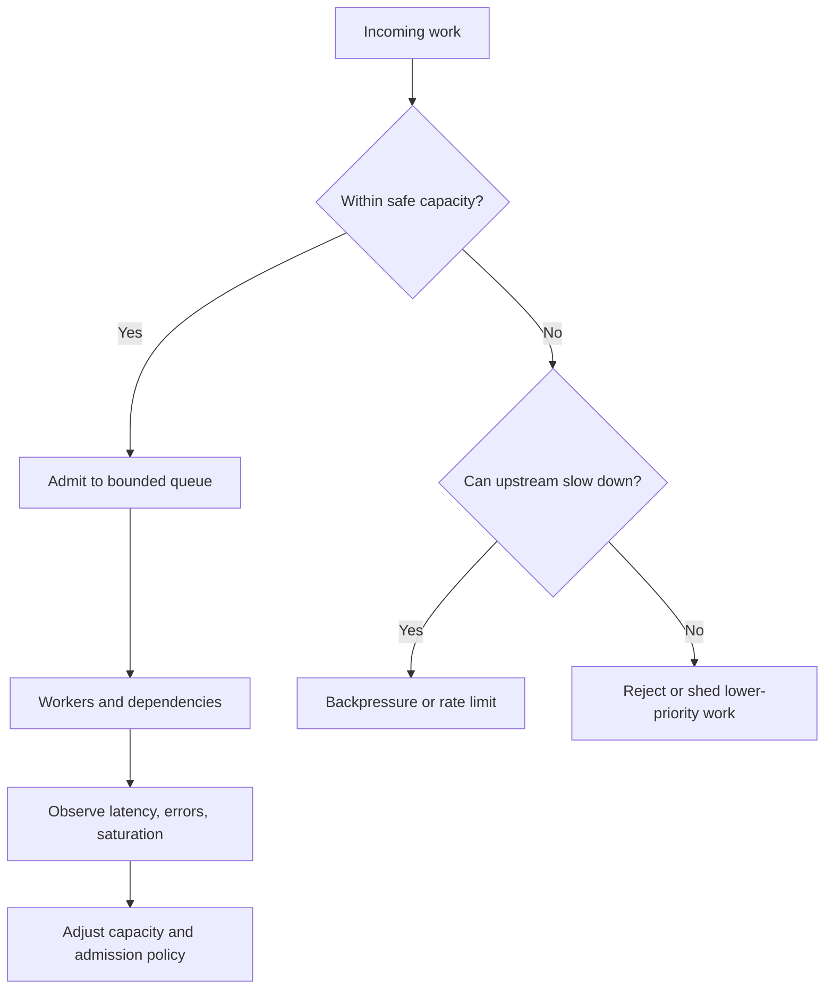

# 13. Scaling, Load Distribution, and Overload

## Scaling follows the constrained resource
Vertical scaling adds resources to a node; horizontal scaling adds nodes. Neither guarantees linear improvement. Shared locks, serial work, network traffic, hot keys, coordination and fixed-size dependencies limit gains. Amdahl's law captures one limit: accelerating only part of a workload cannot eliminate the serial fraction.

Stateless application instances are easier to scale because any healthy instance can serve a request. State still exists and needs deliberate shared or partitioned ownership.

## 13.1 Scaling mechanisms and operating limits

### Amdahl's law and the limits of parallelism

If fraction p of a workload can be parallelized and fraction 1−p remains serial, an idealized speedup with N processors is:

Speedup = 1 / ((1−p) + p/N)

If 90% of a task is parallelizable and 10% is serial, infinite parallelism cannot exceed 10× speedup under this model. Real systems add communication, synchronization, scheduling and contention overhead, so measured speedup can be lower.

This explains why adding application replicas may not help when every request serializes on one database row, global lock, coordinator, or downstream API quota. Identify the serial or shared bottleneck before scaling out.

### Load balancing, health, and locality

A load balancer chooses among candidate destinations using a policy such as round-robin, least connections, weighted routing, consistent hashing, or locality-aware selection. Each policy optimizes a different proxy for load. Least connections may be misleading when requests have very different costs; round-robin can distribute request counts evenly while CPU work is highly uneven.

Health checks have detection delay and can flap. A shallow process check may pass while the service cannot reach its database. A deep check may cause every instance to be marked unhealthy during a shared dependency outage, removing all destinations and worsening the incident. Use liveness and readiness for different purposes, apply hysteresis where supported, and avoid coupling restart policy to every transient downstream failure.

Locality-aware routing can reduce network latency and transfer costs but risks overloading a nearby zone while other capacity sits idle. Cross-zone failover should be included in capacity calculations, not treated as an unlimited escape path.

### Consistent hashing and virtual nodes

Consistent hashing maps keys and node identities into a circular or ordered hash space. A key is assigned according to a rule such as the next node clockwise. Adding or removing a node ideally remaps only a fraction of keys rather than reshuffling all keys.

Virtual nodes give each physical node multiple positions in the hash space, reducing placement imbalance when nodes have similar capacities. To account for heterogeneous capacity, assign proportionally more virtual nodes or weight to larger nodes; simply giving every node the same number of virtual nodes does not do that. Virtual nodes do not solve workload skew: a single very popular key can still overload its owner. Rebalancing may require data transfer, cache warm-up, state migration and careful handling of requests during ownership changes.

### Rate limiting algorithms

Common algorithms have different burst behavior:
- **Fixed window:** counts requests in fixed time buckets; traffic near a boundary can effectively double the allowed rate over a short interval.
- **Sliding log:** records request timestamps for a precise rolling window, at higher memory cost.
- **Sliding-window counter:** approximates a rolling window with bounded state.
- **Token bucket:** tokens accumulate up to a capacity; requests consume tokens, allowing controlled bursts while limiting long-term rate.
- **Leaky bucket:** smooths output or queue release toward a configured rate; implementations differ in whether excess work is queued or rejected.

A limit must define its key (user, tenant, API key, IP, resource), scope (instance or global), window, burst capacity, and rejection behavior. Per-instance limits multiply with instance count unless coordinated. A global distributed limiter adds coordination latency and can itself become a dependency.

### Retry storms and cascading failure

A slow dependency causes timeouts; clients retry; retries increase load; increased load makes the dependency slower; more requests time out. This positive feedback loop can cascade across services.

Controls include:
- Deadlines propagated across service boundaries.
- Exponential backoff with jitter.
- Retry budgets tied to original traffic.
- Concurrency limits and bounded queues.
- Circuit breakers where they fit the failure pattern.
- Load shedding for optional or low-priority work.
- Avoiding retries for permanent errors or unsafe operations.
- Staggering periodic jobs and refreshes.

A circuit breaker does not fix a dependency or guarantee correctness. It is a local policy that can stop repeatedly spending resources on a failing path; half-open probes, reset behavior and fallback semantics must be designed.

### Autoscaling signal design

CPU may be a poor autoscaling signal for a service waiting on database connections. Queue depth may be more useful for background workers, while request concurrency or latency may be useful for an API. Metrics should be causally related to the constrained resource and not so noisy that scaling oscillates.

Scaling delay includes metric collection, decision intervals, provisioning, image pull, application startup, cache warm-up and readiness. Scale-in also needs care: terminate workers gracefully, stop accepting new work, finish or release in-flight tasks, and avoid removing too much capacity simultaneously.

A useful autoscaling design includes minimum and maximum bounds, cooldown or stabilization behavior, scale-in safety, dependency capacity, and a fallback when the platform cannot provision new instances.

### Capacity and overload review

Test at normal load, expected peak, burst, overload, dependency slowdown, instance loss, and recovery. Record throughput, p50/p95/p99 latency, errors, queue wait, backlog age, CPU, memory, network, connection waits and downstream saturation. A test that measures only successful requests can hide requests rejected or timed out during the run.

## 13.2 Admission control, load shedding, and backpressure in depth

When arrival rate exceeds service capacity, work accumulates in queues. Queueing delays increase, requests time out, clients retry, and the added retries consume still more capacity. The goal of overload control is not to make every request succeed; it is to preserve useful service and protect recovery.

### Admission control versus rate limiting

Rate limiting caps request frequency over a window or token budget. Admission control decides whether the system can accept more work given current capacity, queue depth, deadlines, tenant budgets or operation cost. A fixed rate limit may be too permissive when requests become more expensive, and too restrictive when capacity is idle.

Admission can reject before expensive work begins, return a retry hint where meaningful, or reserve capacity for critical operations. Apply limits at multiple layers when needed: edge protection, per-tenant fairness, per-route concurrency, and dependency-specific budgets solve different problems.

### Token bucket and leaky bucket

A token bucket accrues tokens at a configured rate up to a burst capacity; each request consumes tokens. It permits bounded bursts while constraining long-run average rate. A leaky-bucket-style shaper releases work at a controlled rate, smoothing bursts; a policing variant can reject excess work. Sliding-window counters and approximate distributed limiters offer other trade-offs in accuracy, memory and coordination.

A distributed limiter must define whether limits are globally strict or approximate across instances. Per-instance limits multiply with replica count unless coordinated. Coordination improves aggregate accuracy but adds a dependency and latency; many systems deliberately use local budgets plus a global safety cap.

### Concurrency limits and queue bounds

A concurrency limit bounds active work rather than request arrivals. It is useful when operation cost and service time vary. Queue bounds cap waiting work; once the queue is full, new work is rejected or shed rather than allowed to consume unbounded memory and produce hopelessly late responses.

Set queue and concurrency limits from deadlines and service-time distributions, not only from available RAM. If a request cannot finish before its deadline, admitting it can waste capacity needed by requests that could succeed. Avoid hidden queues in thread pools, connection pools, load balancers and client libraries; the total queueing path matters.

### Backpressure across pipelines

Backpressure communicates that a downstream stage cannot accept work at the current rate. Depending on the architecture, it can slow the producer, reduce fetch/prefetch, pause partitions, bound buffers, spill to durable storage, or reject work. If the producer cannot slow down, the system must choose which work to buffer, persist, sample, drop or reject.

Buffering moves overload in time; it does not remove it. Every buffer needs a size limit, durability expectation, retention policy and overflow behavior. For streaming systems, measure queue age and lag because a large queue may remain technically finite while delivering uselessly stale results.

### Load shedding and graceful degradation

When capacity is insufficient, shed low-priority or optional work before critical operations. Examples include disabling expensive recommendations, reducing result detail, sampling nonessential telemetry, rejecting bulk exports, or serving a permitted stale response. The degradation contract must be explicit so that a partial response is not mistaken for a complete result.

Random rejection can be fair but may damage every user journey; priority-aware shedding can preserve critical work but requires trustworthy priorities and protection against priority abuse. Shed retries as well as first attempts when retries are contributing to overload.

### Autoscaling is delayed feedback control

Autoscalers observe metrics and add/remove capacity after detection, scheduling, image pull, startup and readiness delays. If scaling reacts only to CPU, it may miss queue buildup or an external bottleneck. If it reacts too aggressively, scale-up can create synchronized connection storms and scale-down can remove warm capacity or interrupt long-running work.

Choose signals that represent the constrained resource: queue age, in-flight work, request rate per ready replica, CPU, memory, concurrency or latency. Define stabilization windows, minimum/maximum replicas, warm capacity, scale-down behavior, and what happens when a quota prevents expansion. Autoscaling cannot solve a saturated database, a hot shard or an external provider's fixed limit.

### Retry amplification and cascading failure

Retries should be bounded, use exponential backoff with jitter, share an overall deadline, and occur only when repeating the operation is safe. Avoid retries at every layer: a client, gateway, service and database driver can multiply attempts dramatically. Coordinate one retry budget and record attempts separately from logical requests.

A circuit breaker can temporarily stop calls to a dependency that is failing, but it is not a capacity generator and can produce synchronized recovery bursts if every caller probes at once. Combine it with bounded concurrency, controlled half-open probes, timeouts, and fallback behavior that preserves correctness.

### Overload review checklist

- Where does work queue, and what bounds each queue?
- What is the maximum useful wait before the deadline expires?
- Which operations are critical and which can be shed?
- Are rate limits based on identity, cost and concurrency where needed?
- Can retries multiply across layers?
- Does backpressure reach producers or merely move work into another buffer?
- What happens when durable buffers fill?
- Does autoscaling observe the true bottleneck and account for startup delay?
- Can scale-out overload downstream dependencies?
- How does the system recover gradually after an overload event?

## 13.3 Tail-latency techniques: hedged requests and adaptive concurrency

Tail latency can be caused by a slow replica, queueing, garbage collection, noisy neighbors, network variation or an overloaded dependency. Replicating a request can reduce the chance that one slow attempt dominates the response, but it also creates additional work. These techniques should be used only after measuring the tail and understanding the failure mode.

### Hedged requests

A hedged request begins with one attempt to a suitable replica. If that attempt has not completed after a chosen delay, the client sends a duplicate to another eligible replica and uses the first acceptable result. It should cancel or suppress remaining attempts once a result is selected, where the client and server support cancellation.

The delay is a trade-off. A threshold near a high latency percentile can limit how often a second attempt is launched, while an aggressive threshold reduces latency for more requests but increases duplicate load. The correct threshold depends on the measured latency distribution, replica correlation, request cost and available headroom.

Hedging is safest for idempotent reads or operations with an explicit deduplication protocol. Do not hedge a non-idempotent write merely because it is slow: both attempts may commit. Even for reads, cancellation is not guaranteed to stop remote work already executing, so the losing attempt may continue consuming resources.

Hedging can make a partial outage worse if slow replicas are already overloaded. Use it only with bounded concurrency, request budgets, replica diversity, cancellation, and monitoring of hedge rate and duplicate work. If all replicas share the same saturated database or network path, sending more requests to another replica may not improve latency.

### Adaptive concurrency limits

A fixed concurrency limit is simple but may be too high when a dependency slows and too low when capacity is available. Adaptive concurrency mechanisms estimate a safe level from signals such as latency, queueing, or observed throughput, then adjust the maximum number of in-flight requests. Algorithms differ and can oscillate if signals are noisy or feedback is delayed.

A safe implementation needs:
- A hard upper bound and a conservative startup value.
- A signal that reflects the constrained dependency rather than unrelated latency.
- Stabilization and gradual adjustment to avoid oscillation.
- A fallback policy if telemetry is missing or misleading.
- Separate budgets for materially different operation classes.
- Tests during dependency slowdown, recovery and changing workload mix.

Adaptive limits do not replace timeouts, bounded queues, admission control or load shedding. They are another feedback mechanism and can fail if the observed signal does not represent the true bottleneck.

### Tail-latency review checklist

- Is the tail caused by queueing, resource contention, network variance or a slow replica?
- Are hedged operations safe to duplicate?
- Does the hedge target a genuinely independent replica or the same shared bottleneck?
- Is the hedge threshold based on measured distributions?
- Can the losing attempt be cancelled, and what happens if it continues?
- Is duplicate work counted in capacity and cost models?
- Are hedge rate and extra downstream load bounded?
- Does adaptive concurrency have hard limits and stable feedback?
- Has behavior been tested during both degradation and recovery?

## 13.4 Worked concurrency-limit decision from measured results

The following fictional measurements illustrate how to reason about a concurrency limit. They are not a recommended default. Assume a service is load-tested with the same representative request mix, dependency topology and hardware at each step.

| Maximum in-flight requests | Completed throughput | p99 latency | Error rate | Queue behavior |
|---:|---:|---:|---:|---|
| 20 | 600 requests/s | 110 ms | 0.02% | Stable, little waiting |
| 40 | 980 requests/s | 150 ms | 0.03% | Stable |
| 60 | 1,120 requests/s | 290 ms | 0.10% | Queue begins to grow during bursts |
| 80 | 1,150 requests/s | 800 ms | 1.8% | Queue age rises; retries increase |

### Interpret the knee, not just peak throughput

Raising the limit from 40 to 60 increases throughput by about 14%, but nearly doubles p99 latency and begins to create a queue. Raising it from 60 to 80 adds only about 3% throughput while p99 latency increases sharply and errors rise. The system is past the useful concurrency region: additional in-flight work mostly increases contention and queueing rather than useful completions.

An initial policy could cap normal in-flight work below the observed knee (for example, begin validating a limit around 40–50), keep a hard upper bound, and reject or shed excess work before it becomes an unbounded queue. This is a candidate to test, not a final answer from one benchmark.

### Validate the decision

1. Repeat the measurement at different times and with realistic hot-key, cache-miss and expensive-operation distributions.
2. Inspect the constrained dependency, connection-pool wait, CPU, lock wait, queue age and retry traffic to explain the observed knee.
3. Test the proposed limit when one replica or dependency is degraded; the healthy-state limit may be unsafe during failure.
4. Confirm that rejected work receives a clear retryable or non-retryable response and that clients do not immediately retry in a synchronized storm.
5. Recheck after scaling the application: per-instance limits multiply across replicas and can overwhelm a shared database.
6. If using adaptive concurrency, retain a hard ceiling/floor, smooth noisy feedback and test behavior during both slowdown and recovery.

### Decision checklist

- [ ] Choose the limit from useful throughput, tail latency, errors and queue stability together.
- [ ] Identify the resource that becomes constrained as concurrency rises.
- [ ] Count retry/hedge attempts as real work in the capacity model.
- [ ] Set bounded queues and explicit overload behavior.
- [ ] Recalculate aggregate concurrency across all replicas.
- [ ] Re-test during dependency degradation and after deployment/configuration changes.

## 13.5 Overload control should happen before queues explode

Adding instances can help only when the constrained resource scales with them. If a database, lock, hot key or downstream quota is the bottleneck, more application replicas can make the overload worse.

## Further reading
- Google SRE [Handling Overload](https://sre.google/sre-book/handling-overload/).
- Google SRE [Addressing Cascading Failures](https://sre.google/sre-book/addressing-cascading-failures/).
- Dean and Barroso, [The Tail at Scale](https://research.google/pubs/the-tail-at-scale/) — latency variability and hedged/tied requests.

---

[Back to textbook contents](../../README.md) · [Curriculum](../../CURRICULUM.md) · [Roadmap](../../ROADMAP.md)
