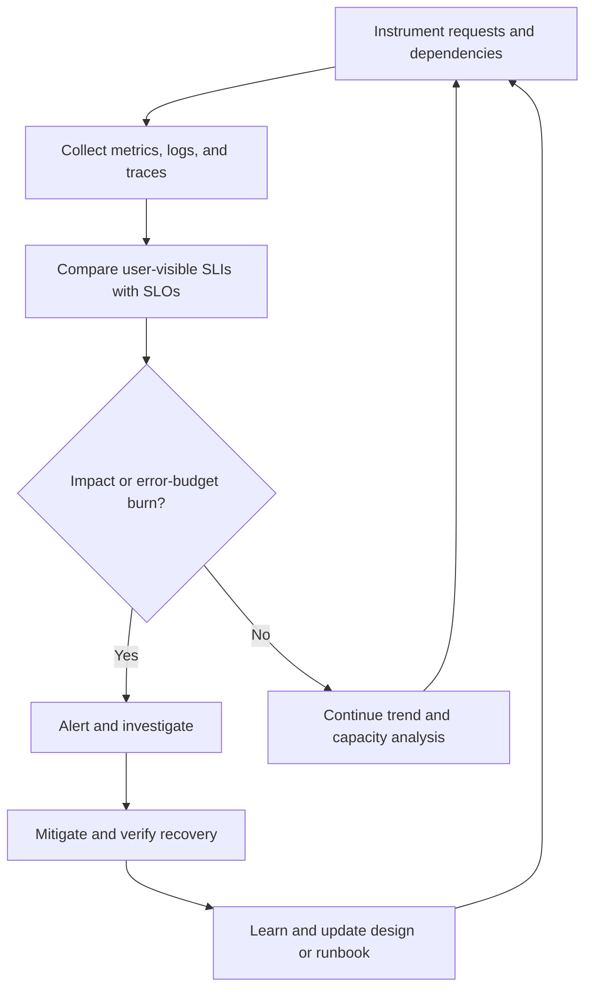

# 17. Observability and Operating Production Systems

## 17.1 Signals and their roles
- **Logs** record discrete events with context.
- **Metrics** aggregate numeric measurements over time.
- **Traces** connect spans across a request or workflow.

Structured logs make fields queryable. Correlation and trace IDs help connect events, but IDs should not contain secrets or unbounded user data. Context propagation must cross asynchronous boundaries and be handled safely at trust boundaries.

### 17.1A Instrumentation boundaries and context propagation

Observability data should preserve enough context to connect an external request to its internal work without turning identifiers into high-cardinality metric labels. A trace context can flow through HTTP headers, message metadata, and asynchronous task boundaries. At trust boundaries, validate or replace untrusted context rather than blindly accepting arbitrary baggage.

A trace ID correlates work; it is not an authentication credential. Do not use trace context to make authorization decisions. Background jobs and message consumers should link their processing to the originating operation where appropriate, while also representing long delays and retries accurately.

### 17.1B Metrics: counters, gauges, histograms, and cardinality

- **Counter:** monotonically increasing event total, such as requests or failures.
- **Gauge:** current value that can rise or fall, such as queue depth or active connections.
- **Histogram:** observations bucketed by value, useful for latency and size distributions.
- **Summary:** a metric type that may calculate quantiles locally; aggregation behavior depends on the implementation.

Use counters for rates after calculating deltas over time; do not interpret a process-reset counter as a negative event. Gauges require clear semantics about when they are sampled. Histograms should have buckets appropriate to the target thresholds, and fleet-wide quantiles should be calculated from aggregatable distribution data rather than averaging instance p99 values.

Cardinality multiplies across labels. A metric with labels for tenant, user, URL, and request ID can create an unbounded series count. Keep labels bounded and use logs or traces for high-cardinality details with access and privacy controls.

### 17.1C Histograms, percentiles, and tail interpretation

Percentiles depend on sample size, aggregation, time window, and bucket resolution. A p99 over ten requests is a weak indicator of rare tail behavior. Aggregating per-instance quantiles by arithmetic mean does not produce the fleet quantile. Use histograms or a suitable mergeable distribution.

Latency should be measured at meaningful boundaries: client-visible end-to-end duration, service handler duration, queue wait, connection acquisition, and dependency duration answer different questions. Instrument retries separately so a successful final response does not conceal repeated failed attempts or excessive work.

### 17.1D Logs and traces are evidence with limitations

Structured logs should include stable event names and useful fields such as operation, result, dependency, duration, and correlation identifiers. Avoid logging secrets, full tokens, and unnecessary personal data. Sampling, buffering, and dropped telemetry mean absence of a log line is not proof that an event did not occur.

A trace shows spans and causal relationships as instrumented, but instrumentation gaps, sampling, asynchronous work, and clock differences can complicate interpretation. A long span may include waiting rather than CPU execution. Correlate traces with resource metrics and application-level state transitions.

### 17.1E SLOs, alerting, and burn rate

An SLI needs an explicit good-event definition and eligible-event denominator. An SLO needs a target and window. Alerting should focus on user impact or rapid loss of error budget rather than every threshold crossing.

A burn rate compares the observed error rate with the allowed error rate implied by the SLO. Multi-window alerting can detect both fast severe incidents and slower sustained degradation. The right windows depend on traffic volume, service criticality, and response expectations; avoid alerts so sensitive that routine variation pages the team constantly.

A dashboard is not an alerting strategy. Each page should have an owner, an actionable next step, and enough context to assess impact. Alerts without a response path create noise rather than reliability.

### 17.1F Capacity and saturation observability

Monitor the constrained resource, not only CPU. Useful signals include queue depth and age, worker utilization, thread-pool rejection, connection acquisition latency, database lock waits, cache miss load, consumer lag, disk latency, network retransmissions, and rate-limit rejection.

A growing queue can indicate the system is accepting more work than it can complete. Queue depth alone is insufficient if arrival rate is low; queue age and drain rate provide context. A system may have low CPU while waiting on exhausted connections or a slow dependency.

### 17.1G Incident diagnosis and runbooks

For a significant or multi-team incident, establish explicit incident command rather than letting every responder coordinate informally. The incident commander tracks priorities and decisions; an operations lead coordinates technical mitigation; a communications lead keeps stakeholders informed; and a scribe records the timeline and decisions. One person may hold multiple roles for a small incident, but ownership and handoffs should remain clear. Separate coordination from hands-on debugging so the team retains a shared view of impact, risks and next actions.

A practical incident sequence is:
1. Establish customer impact, scope, and start time.
2. Check traffic, success rate, latency percentiles, and saturation.
3. Identify the first failing or slowing dependency in traces and logs.
4. Compare current behavior with a known baseline and recent changes.
5. Form a falsifiable hypothesis and test it with evidence.
6. Mitigate using a reversible, bounded action where possible.
7. Verify customer-facing recovery and data correctness.
8. Preserve evidence, communicate status, and track follow-up work.

Runbooks should state symptoms, safe checks, mitigation steps, expected signals, abort conditions, escalation paths, and verification criteria. Avoid blindly restarting components when doing so may destroy evidence, worsen a thundering herd, or interrupt recovery.

### 17.1H Operational readiness checklist

- Service owner and escalation path are known.
- SLIs/SLOs and error-budget policy are defined.
- Dashboards show user impact and constrained resources.
- Alerts are actionable and tested.
- Traces and logs carry safe correlation context.
- Capacity and dependency limits are documented.
- Rollout and rollback steps are rehearsed.
- Backup restore and disaster recovery have evidence.
- Secrets and access are controlled.
- Runbooks define verification and safe abort conditions.

### 17.1I RED and USE methods: choose signals by component

The **RED method** is useful for request-driven services:
- **Rate:** requests or operations per unit time.
- **Errors:** failed or incorrect requests under a defined denominator.
- **Duration:** latency distribution, usually including tail percentiles.

The **USE method** is useful for resources:
- **Utilization:** how busy the resource is.
- **Saturation:** queued or delayed work beyond immediate service capacity.
- **Errors:** resource-level errors, such as device or connection failures.

These methods complement rather than replace domain-specific indicators. A database may need lock waits, query duration, connection acquisition latency and replication lag. A message consumer may need lag age, processing rate and retry rate. A user journey may need a business success rate that cannot be inferred from HTTP status alone.

Avoid dashboards that show only averages. Pair rates with p95/p99 duration, queue depth and queue age, and annotate deployments or configuration changes. Use bounded metric labels for service, route template, status class and dependency; put high-cardinality identifiers in controlled logs or traces instead.

### 17.1J Synthetic checks, deployment markers and external perspective

Metrics from inside a service can miss failures that occur before instrumentation starts or between the service and its users. **Synthetic checks** execute a small, controlled user journey from a known vantage point—for example, resolving the public hostname, establishing TLS, authenticating with a dedicated test identity, and reading a non-destructive health resource. Use synthetic checks to test the actual public path, but keep them bounded, isolated from real customer data, and safe to repeat.

A synthetic check is not a substitute for real-user SLIs. It samples a narrow path at a scheduled interval, may miss failures affecting only some users or tenants, and can itself fail because its runner or credentials are broken. Alert on sustained or critical failures, monitor the check infrastructure, and distinguish “the check could not run” from “the user journey failed.”

Annotate dashboards and incident timelines with **deployment and configuration markers**: artifact version, rollout start/end, feature-flag changes, routing shifts and relevant infrastructure changes. Markers help correlate a change with a symptom; correlation is a hypothesis to test, not proof that the deployment caused the incident. Keep marker data consistent across services and avoid exposing secrets or customer identifiers.

Review checklist:
- Does the synthetic check traverse the real public path and use a dedicated, least-privilege identity?
- Is the journey safe, deterministic and non-destructive?
- Can the team distinguish check-runner failure from application failure?
- Are synthetic signals compared with real-user SLIs and regional/tenant dimensions?
- Are releases, configuration changes and traffic shifts visible on the same timeline?

## 17.2 Observability in practice: from symptom to cause

Observability is the ability to infer system behavior from emitted evidence. Logs, metrics and traces are complementary views, not interchangeable storage formats. A dashboard can show that latency rose; traces may reveal which dependency consumed time; structured logs may explain a particular rejected operation. None guarantees that the system emitted enough context or that sampling retained the relevant event.

### Metrics: dimensions, cardinality and histograms

A metric time series is identified by its metric name and label set. Labels such as route template, status class, service and region are usually bounded. User IDs, request IDs, raw URLs, search terms and arbitrary tenant names can create unbounded cardinality, increasing memory, storage, query cost and alert complexity. Put per-request identifiers in logs or traces where access and retention can be controlled.

Counters measure cumulative events; gauges represent current values; histograms capture distributions or buckets of observations. Averages hide tail behavior and can improve while a small fraction of requests become catastrophically slow. Percentiles must be calculated with a method appropriate to the telemetry system; averaging per-instance p99 values does not generally yield the fleet-wide p99.

### RED and USE are starting frameworks

RED focuses on request-driven services: rate, errors and duration. USE focuses on resources: utilization, saturation and errors. Neither is a complete dashboard. Add domain success rates, queue age, retry volume, connection acquisition latency, cache freshness, replication lag and dependency-specific signals where they explain the user journey.

A high CPU percentage is not itself an incident; a growing queue, rising tail latency and falling successful throughput may show that CPU is the constrained resource. Interpret signals together and compare them to a known baseline and service objective.

### Distributed tracing and context propagation

A trace connects spans across a request path. Context propagation must survive HTTP/RPC calls, message headers, async task boundaries and scheduled work. If a consumer starts a new trace without linking the producer context, the causal chain is lost. Sampling reduces cost but may discard rare failures; tail-based sampling or targeted error retention can help when supported and appropriately bounded.

Tracing can add overhead and can expose sensitive attributes if instrumentation is careless. Do not place secrets, raw tokens or unnecessary personal data in span attributes. A trace ID is correlation metadata, not an authentication credential.

### Alerting on user impact and error-budget burn

An alert should prompt a defined action. Page on conditions that require immediate human intervention; route lower urgency issues to tickets or dashboards. Avoid paging on every transient internal error when user-visible SLOs remain healthy, but ensure that a fast-burn outage is detected before the budget is exhausted.

A multi-window, multi-burn-rate approach compares recent error-budget consumption over different windows to balance fast detection with noise. Exact thresholds depend on the SLO period, service criticality and response process. Alert on symptoms first, then use component signals for diagnosis.

### Incident diagnosis as hypothesis testing

Start with impact and timeline: which user journeys, regions, tenants or operations are affected, and when did the change begin? Compare recent deployments, configuration changes, traffic shifts, dependency health, saturation, error rates and queue age. Form hypotheses, choose a signal that can falsify each hypothesis, and avoid changing many variables at once.

During mitigation, prefer reversible changes that reduce impact: rollback a bad release, disable a risky feature, shed optional work, or route around a proven failure. Verify that the user-visible SLI recovers and that the mitigation did not violate data correctness. A green process health check is not sufficient evidence of recovery.

### Runbooks and postmortems

A useful runbook includes symptoms, scope, diagnostic commands or dashboards, safe mitigations, escalation contacts, rollback criteria, and verification steps. Keep it versioned with the service and test it during exercises. A postmortem should document impact, contributing conditions, detection gaps, response timeline and follow-up actions without blaming individuals.

Actions should change the system or its operating environment: add a guardrail, improve capacity, make a dangerous state unrepresentable, add a missing signal, automate a safe recovery step, or clarify ownership. “Be more careful” is not a reliable corrective action.

### Observability checklist

- Can user-visible success, latency and availability be measured?
- Are labels bounded and sensitive data excluded?
- Do metrics expose saturation, queue age and tail latency?
- Does trace context survive async boundaries and messages?
- Is sampling appropriate for rare failures?
- Are alerts tied to actionable user impact or error-budget burn?
- Can on-call staff identify recent deployments and configuration changes?
- Are runbooks executable and recovery steps verified?
- Do postmortems produce measurable engineering changes?
- Is telemetry itself bounded, available and protected?

## 17.3 Worked alert design: from an SLO to an actionable page

An alert policy should connect a measurable user-impact signal to a response. The numerical values below illustrate the calculation; they are not universal paging thresholds.

### Define the SLI and budget

Assume an API has a request-based SLO of **99.9% successful eligible requests over a rolling 30-day window**. Define a good event precisely—for example, an eligible request that returns the expected successful outcome within the agreed latency threshold. Exclude only traffic that the SLO definition explicitly excludes; do not silently remove failures because they are inconvenient.

- Allowed bad-event fraction: `1 - 0.999 = 0.001 = 0.1%`.
- If the window contains 10,000,000 eligible requests, the illustrative error budget is `10,000,000 × 0.001 = 10,000` bad requests.
- If 2% of eligible requests are bad during a recent window, the observed error rate is 20 times the allowed rate: `0.02 / 0.001 = 20` times burn rate for that window.

A burn rate is a ratio, not a prediction that the monthly budget will definitely be exhausted. Its meaning depends on the window, traffic mix, and whether the recent rate persists.

### Turn the calculation into a response policy

| Signal | Possible response | Why it exists |
|---|---|---|
| Severe user-visible failure and rapid budget burn sustained across short windows | Page the on-call owner; show affected routes/regions and the top diagnostic signals | Detect an outage quickly while requiring enough evidence to reduce transient noise |
| Moderate degradation sustained across longer windows | Page or create an urgent ticket according to service criticality and response expectations | Catch slow budget erosion without paging on every brief fluctuation |
| A component metric is abnormal but the user SLI remains healthy | Dashboard, ticket, or diagnostic alert unless the metric implies imminent risk | Internal anomalies are often useful for diagnosis but are not automatically user incidents |
| Queue age, saturation or dependency latency is rising before SLI failure | Capacity or early-warning alert with a documented action | Allow mitigation before user-visible failures occur |

For production use, select the short and long windows, burn thresholds, minimum traffic requirements and notification route based on the SLO period, incident response objectives, traffic volume and observed noise. Use multi-window confirmation where appropriate; do not copy a threshold from another service without validating its behavior.

### Make the page actionable

A page should answer, or link directly to evidence answering:

1. What user journey or API is affected, and which regions or tenant cohorts are involved?
2. What changed in the SLI, over which windows, and how quickly is the budget being consumed?
3. Which recent deployment, dependency, queue, pool or saturation signals are the strongest diagnostic leads?
4. What safe mitigation is available, who owns it, and how will recovery be verified?

Keep metric dimensions bounded (for example, service, route template, region and result class). Do not create a unique time series for every user or request. Put request identifiers in controlled logs or traces, and ensure the alert does not expose sensitive data.

### Validation checklist

- [ ] The good-event definition and denominator are explicit and stable.
- [ ] Low-traffic behavior and minimum sample sizes are addressed.
- [ ] Alert windows and thresholds are replayed against historical incidents and quiet periods.
- [ ] Every page has an owner, an expected action, and a runbook.
- [ ] The alert is tested end-to-end, including notification delivery and escalation.
- [ ] Recovery is confirmed using the user-facing SLI, not merely a green process or dependency health check.

## Observability is a feedback loop

Metrics reveal patterns, logs add event context, and traces connect work across services. None is sufficient alone for every incident; correlation and low-cardinality labels matter.

## Further reading
- [OpenTelemetry documentation](https://opentelemetry.io/docs/).
- Google [Site Reliability Engineering book](https://sre.google/sre-book/table-of-contents/).

---

[Back to textbook contents](../../README.md) · [Curriculum](../../CURRICULUM.md) · [Roadmap](../../ROADMAP.md)
