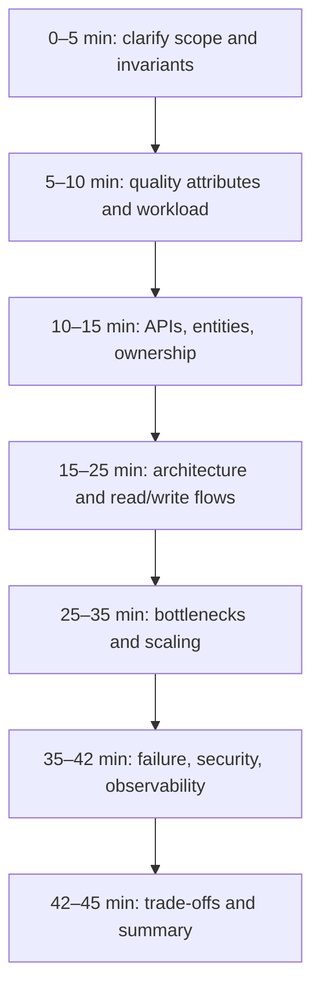

# 1. System Design Foundations

System design is the process of turning requirements and constraints into a system architecture. In a design discussion, the goal is not to draw the most complicated diagram; it is to show that you can identify the real problem, choose reasonable components, and explain the trade-offs.

## 1.1 Start with the requirements

Before choosing databases, caches, or queues, establish what the system must do.

### Functional requirements

These describe **what users can do**.

For a file-sharing service, examples might include:
- Upload a file.
- Download a file using a link.
- Set link expiration.
- Revoke access.

### Non-functional requirements

These describe **how well the system must work** or the constraints it must satisfy.

Common examples:
- **Latency:** How quickly should a request complete?
- **Availability:** How often should the service be usable?
- **Durability:** Once data is accepted, how likely is it to survive failures?
- **Consistency:** How fresh must reads be after writes?
- **Scale:** How much traffic and data must the system handle?
- **Security and privacy:** Who may access which data?
- **Cost:** What operational and infrastructure cost is acceptable?

Do not treat every quality attribute as equally important. Ask which are critical and where trade-offs are acceptable.

## 1.2 Clarify scope and assumptions

Design discussions are time-limited. Identify the requirements that change the design, then state reasonable assumptions for details that do not.

Clarify the inputs that can materially change the architecture:
- User groups and primary use cases.
- Approximate read/write ratio and traffic shape.
- Expected data and request scale.
- Tolerance for data loss and stale reads.
- Geographic reach and regional availability needs.
- Privacy, retention, and compliance constraints.

Avoid spending too much time asking questions whose answers would not affect the architecture.

## 1.3 Identify the main constraints

A design is shaped by constraints such as:
- Request volume and traffic peaks.
- Data size and growth.
- Latency targets.
- Consistency and durability needs.
- Failure tolerance.
- Budget and operational complexity.

These constraints help determine which components are necessary. For example, a small internal tool may not need a distributed cache or multiple regions. Introducing them without a requirement increases complexity without guaranteed benefit.

## 1.4 Build the simplest useful architecture

Start with the main request path:

`Client → API/Service → Database`

Then add a component only when it solves an identified problem:
- Add a **cache** when repeated reads or database load justify it.
- Add a **queue** when work can happen asynchronously or needs buffering.
- Add a **load balancer** when multiple service instances need to share traffic.
- Add **replicas** when read scale, availability, or recovery requirements justify them.
- Add **partitioning** when data or traffic exceeds what a single storage unit can handle.

This is a starting point, not a universal architecture. The correct design depends on requirements and bottlenecks.

## 1.5 A repeatable design workflow

1. **Clarify requirements** — functional and non-functional.
2. **Estimate scale** — users, requests per second, storage, and bandwidth.
3. **Define APIs and data model** — identify core entities and access patterns.
4. **Draw the high-level design** — clients, services, storage, and communication paths.
5. **Walk through critical flows** — explain how reads and writes work end to end.
6. **Find bottlenecks and failure points** — database saturation, hot keys, dependency failures, and traffic spikes.
7. **Improve selectively** — caching, queues, replication, partitioning, or redundancy only where justified.
8. **Discuss trade-offs** — explain what improves, what becomes harder, and what assumptions remain.

Do not jump straight to technologies. First explain the problem and the required behavior; then justify the technology choices.

## 1.6 Example: designing a file-sharing service

Suppose users can upload a file and share it through a link.

**Initial requirements**
- Upload and download files.
- Generate a shareable link.
- Optionally expire or revoke a link.
- Preserve uploaded content after a successful upload.

**Initial architecture**
- An API service authenticates users and manages file metadata.
- Object storage holds file bytes.
- A database stores metadata, ownership, and link permissions.
- A download request checks authorization before returning a download or a time-limited object-storage URL.

**Important design decisions**
- Keep large file bytes out of the metadata database unless there is a specific reason not to.
- Decide whether links are public bearer links or require authenticated access.
- Define what “upload succeeded” means and when the file is durable.
- If files are scanned asynchronously, define whether downloads are blocked until scanning completes.
- Add CDN delivery only if download patterns, geography, and cacheability justify it.

The example shows the method: requirements first, then the simplest architecture that satisfies them, then targeted improvements.

## Quick revision

- Requirements before technologies.
- Separate functional behavior from quality attributes.
- Make assumptions explicit and estimate scale.
- Start with the simplest architecture that meets the requirements.
- Add complexity only to address a concrete constraint or failure mode.
- Explain trade-offs, not just component names.

## Further reading

- [Google SRE Book: Embracing Risk](https://sre.google/sre-book/embracing-risk/)
- [AWS Well-Architected Framework](https://docs.aws.amazon.com/wellarchitected/latest/framework/welcome.html)

## Applying the workflow under a time budget

Use this as a starting allocation for a 45-minute design discussion, adjusting to the problem's complexity:

The important behavior is not the exact minute boundary. Keep the reasoning clear, state assumptions, and spend the most time on the parts that change the design.

## Scenario analysis

**Case:** A photo-sharing-service design begins with proposed technologies—Kafka, Redis, and microservices—before the requirements have been defined.

**Reasoning:** Resist choosing technologies before defining user actions, traffic shape, privacy, upload size, feed freshness, and durability expectations. Sketch the smallest architecture that supports the agreed scope. Add a queue for a specific asynchronous need, a cache for a measured read path, and service boundaries only when ownership or independent scaling justifies them.

## Further reading

- [Google SRE Book: Service Level Objectives](https://sre.google/sre-book/service-level-objectives/) — connecting product expectations to measurable objectives.
