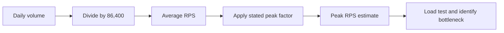

# 2. Capacity Estimation

Capacity estimation helps you check whether a proposed architecture is plausible. Interview estimates do not need to be exact; they need clear assumptions, correct units, and enough accuracy to guide decisions.

## 2.1 What should you estimate?

Start with only the quantities that affect the design:

- Requests per second (average and peak).
- Read/write ratio.
- Data stored per day and over the retention period.
- Approximate bandwidth.
- Rough concurrency or number of active connections.
- Replication and redundancy overhead, when relevant.

Do not calculate every quantity by default. Estimate what helps you choose or size components.

## 2.2 Convert daily requests to requests per second

`Average RPS = Requests per day ÷ 86,400`

Example: assume a service receives 100 million requests per day.

`100,000,000 ÷ 86,400 ≈ 1,157 average requests/second`

If peak traffic is assumed to be 3 times the average:

`Peak RPS ≈ 1,157 × 3 ≈ 3,471`

The peak multiplier is an assumption, not a universal constant. Real traffic can be much more bursty, so state the assumption and revise it if the workload suggests otherwise.

## 2.3 Estimate storage

A useful first approximation is:

`Daily storage = Records per day × Average stored size per record`

Example: 5 million records/day at an average of 2 KB each:

`5,000,000 × 2 KB ≈ 10 GB/day`

For 90 days, raw retained data is approximately 900 GB, before indexes, metadata, replication, compression, and storage-system overhead.

Be explicit about units:
- Decimal: 1 GB = 1,000 MB.
- Binary: 1 GiB = 1,024 MiB.

In interviews, approximate values are fine when the unit convention is consistent.

## 2.4 Estimate bandwidth

`Bandwidth ≈ Requests per second × Average bytes transferred per request`

If a service handles 2,000 responses/second averaging 50 KB each:

`2,000 × 50 KB = 100,000 KB/s ≈ 100 MB/s`

This is an approximate payload rate. Real network usage includes request bodies, headers, protocol overhead, retries, and traffic in both directions. If requests and responses differ greatly in size, estimate ingress and egress separately.

## 2.5 Estimate concurrency with Little’s Law

Little’s Law states:

`L = λ × W`

Where:
- `L` is the average number of items in the system.
- `λ` is the average arrival rate.
- `W` is the average time an item spends in the system.

If a service receives 1,000 requests/second and average response time is 0.2 seconds:

`Average in-flight requests ≈ 1,000 × 0.2 = 200`

This estimates average concurrency under stable conditions. It is not by itself a thread-pool size or server-count formula; resource usage and tail latency must also be considered.

## 2.6 Turn estimates into design decisions

Use the numbers to ask useful questions:
- Can one database instance plausibly handle the write rate and data size?
- Are reads frequent enough to justify caching?
- Are payloads large enough for bandwidth or object storage to dominate?
- Does traffic have peaks that require buffering or autoscaling?
- Does retained data require partitioning, archival, or expiration?
- Does the expected latency make synchronous fan-out risky?

Avoid pretending rough estimates produce exact infrastructure sizing. Actual capacity depends on workload shape, data distribution, query complexity, hardware, implementation, and performance testing.

## 2.7 Common mistakes

- Confusing average RPS with peak RPS.
- Forgetting the number of seconds in a day (86,400).
- Ignoring read/write ratios and request payload sizes.
- Treating KB, MB, GB and KiB, MiB, GiB as interchangeable without stating assumptions.
- Multiplying raw data size by an arbitrary overhead factor without explaining why.
- Assuming a single benchmark translates directly to production capacity.
- Giving a number without showing the assumptions or arithmetic.

## 2.8 Common interview questions

### Why do capacity estimation before choosing technologies?

It provides a rough scale for evaluating options. A simple database may be enough at one scale, while high write volume, large retained data, or global latency requirements may justify additional techniques. Estimation narrows the design space; it does not replace benchmarking.

### Should we estimate average or peak traffic?

Usually both. Average traffic helps understand overall demand and cost; peak traffic helps reason about saturation, latency, and headroom. For bursty systems, the peak shape and duration matter as well as the peak value.

### What is Little’s Law useful for?

It connects throughput, time in the system, and average concurrency. It helps estimate how many requests may be in flight, but it does not directly tell you how many servers or threads to deploy.

### How accurate should interview estimates be?

They should be directionally correct, transparent, and useful for decisions. Explain assumptions, keep units consistent, and avoid false precision. If a choice depends on an uncertain number, say what measurement or benchmark would validate it.

## Quick revision

- Average RPS = daily requests ÷ 86,400.
- Peak RPS = average RPS × an explicitly stated peak factor.
- Daily storage = records/day × average record size.
- Bandwidth ≈ RPS × bytes/request.
- Little’s Law: average concurrency = arrival rate × average time in system.
- Estimates guide architecture; measurements validate capacity.

## Further reading

- [Little's Law (overview)](https://en.wikipedia.org/wiki/Little%27s_law)
- [Google SRE Book: Handling Overload](https://sre.google/sre-book/handling-overload/)

## Worked concurrency example

Little's Law is (L = \lambda W): average work in the system equals throughput multiplied by average time in the system, when the system is stable and units match. At 600 requests/second and 0.2 seconds average response time, average in-flight requests are approximately (600 \times 0.2 = 120). This is not a thread-pool sizing rule: tail latency, bursts, queueing, and time spent holding scarce resources matter.

## Scenario practice

**Scenario:** A service averages 1,000 requests/second, but traffic spikes to 5,000 requests/second for short periods. Is provisioning for average traffic enough?

**Reasoning:** Not if the latency/availability objective must hold during the spike. Estimate the duration and burst shape, determine whether queues are acceptable, and measure per-instance capacity under realistic dependencies. Keep headroom or autoscale early enough; autoscaling cannot react instantly to every spike. If the database saturates first, adding API instances can worsen the incident.

## Interview questions

### Q1. Why estimate peak traffic instead of using only average RPS?
Averages hide bursts that drive queueing and tail latency. Peak estimates guide headroom, admission control, and whether asynchronous buffering is useful, but the peak factor must be justified by the workload.

### Q2. How do you turn RPS into a server count?
Do not divide by a generic requests-per-server constant. Benchmark representative requests at the required latency and error rate, include dependency limits and failure headroom, then validate the result under load.

## Further reading

- [Google SRE Book: Handling Overload](https://sre.google/sre-book/handling-overload/) — overload behavior and graceful protection.

