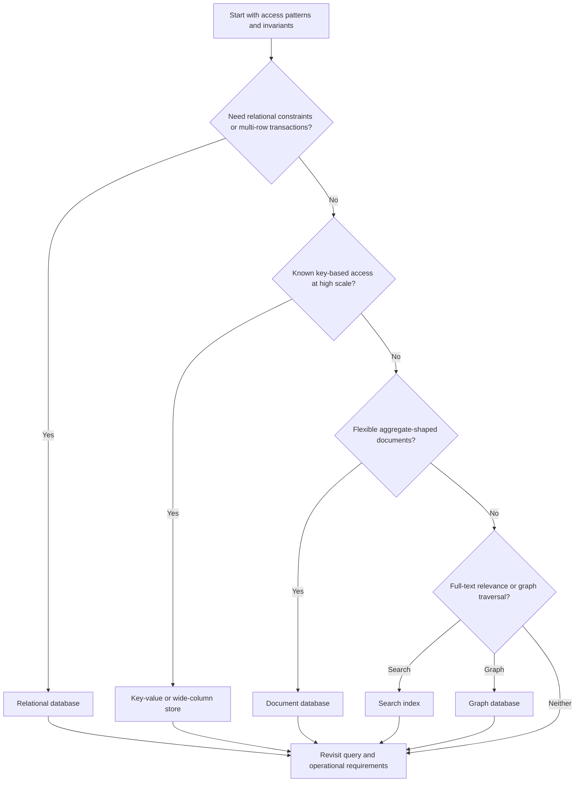

# 4. Data Modeling and Databases

Database choice should follow the data model, access patterns, consistency needs, and operational constraints—not popularity. Start by asking what data must be stored and how the system reads and writes it.

## 4.1 Model the access patterns

Before choosing a database, identify:
- The main entities and their relationships.
- The most common reads and writes.
- Query filters, sorting, and pagination requirements.
- Transaction boundaries and invariants.
- Data volume, growth, and retention.
- Consistency, latency, and availability expectations.

A schema that fits the data conceptually may still perform poorly if it does not support the application's access patterns.

## 4.2 Relational versus non-relational databases

| Database family | Often a good fit | Important trade-offs |
|---|---|---|
| Relational (SQL) | Relationships, joins, constraints, and multi-row transactions | Schema changes and horizontal scaling may require planning |
| Document | Aggregate-shaped records and flexible attributes | Cross-document transactions and joins may be less natural or more costly |
| Key-value | Simple lookup by key, sessions, counters, and cache-like access | Limited querying beyond the key model |
| Wide-column | Large distributed datasets with known query patterns and high write throughput | Data modeling is query-driven; ad hoc queries can be difficult |
| Graph | Relationship traversals and connected-data queries | Specialized operations and ecosystem may be unnecessary for simple relationships |
| Search engine | Full-text search, relevance ranking, and faceted search | Often an index/projection rather than the authoritative transactional store |

These are tendencies, not hard rules. Modern products overlap, so evaluate actual guarantees and workload behavior.

## 4.3 Normalize and denormalize

**Normalization** reduces duplicated facts and helps preserve consistency. It is often useful for transactional data with relationships and frequent updates.

**Denormalization** duplicates or precomputes data to make reads simpler or faster. It can be valuable for read-heavy access patterns, but updates must keep duplicated representations sufficiently current.

Do not denormalize merely because it sounds scalable. First identify the expensive query or consistency requirement that motivates it.

## 4.4 Indexes and query patterns

An index helps the database locate rows or documents without scanning all data, but indexes consume storage and make writes more expensive.

Design indexes around real query patterns:
- Filter columns and sort order matter.
- Composite-index column order matters.
- An index may not help a query if its predicates or ordering do not align with the index.
- Too many indexes increase write amplification and maintenance work.

For large datasets, pagination should be designed deliberately. Offset pagination is easy but can become expensive at high offsets and may shift under concurrent writes. Keyset/cursor pagination can be more efficient and stable when the sort key and tie-breaking rules are well defined.

## 4.5 Transactions and ownership

A transaction groups changes that must satisfy a set of invariants atomically within the database's transaction model. Keep related data together when strong transactional invariants require it.

When a workflow crosses independent services or databases, one local transaction generally cannot atomically commit every participant. Options include redesigning ownership, using an orchestration/saga workflow, or accepting and managing eventual consistency.

## 4.6 Choosing a database: practical method

1. List the access patterns and consistency requirements.
2. Identify which database capabilities are essential (transactions, joins, full-text search, graph traversal, etc.).
3. Estimate data size and read/write rates.
4. Consider operational expertise, backups, recovery, scaling, and cost.
5. Validate the choice with representative queries and load tests.

A relational database is a strong default for many business applications, but not a universal answer. Specialized storage is justified when it materially improves a required workload.

## Quick revision

- Start with access patterns and invariants.
- SQL and NoSQL are different modeling options, not a scalability ranking.
- Normalize for consistency; denormalize for justified read needs.
- Indexes trade faster reads for storage and write overhead.
- Use cursor pagination when deep offsets or concurrent changes matter.
- Cross-service transactions require explicit workflow and consistency design.

## Decision flow: choose storage from the workload

This is a shortlist, not an automatic selector. Operational maturity, query needs, consistency, migration cost, retention, and data ownership can outweigh a database category's theoretical fit. Search indexes and analytical stores are commonly derived from an authoritative source rather than used to enforce transactional invariants.

## Scenario analysis

**Case:** A team proposes a document database for a frequently changing product schema, while core operations require unique usernames, account balances, and atomic updates across related records.

**Reasoning:** Separate flexible attributes from hard invariants. A relational store may still support evolving schemas while providing unique constraints and transactions. Choose based on actual queries and transaction boundaries, not the frequency of adding optional fields. If multiple stores are introduced, document which one owns each fact and how derived copies are refreshed.

## Further reading

- [PostgreSQL documentation: Indexes](https://www.postgresql.org/docs/current/indexes.html) — index choices and query implications.
