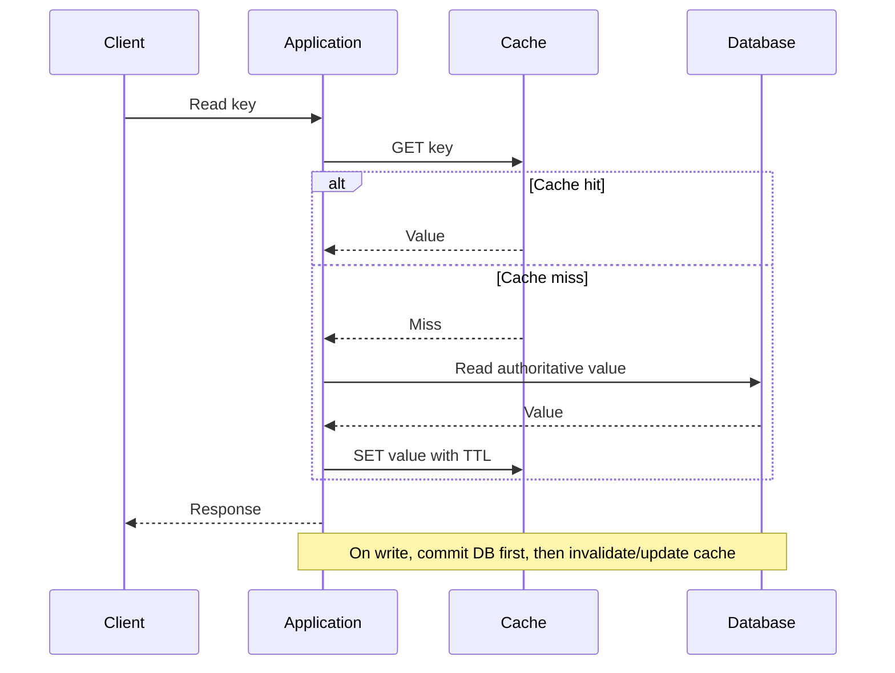

# 5. Caching

A cache stores a copy of data in a faster or closer-to-the-caller layer. It can reduce latency and load on a backing store, but introduces freshness, invalidation, capacity, and failure concerns.

## 5.1 How cache-aside works

In cache-aside, the application:
1. Looks up the key in the cache.
2. On a hit, returns the cached value.
3. On a miss, reads from the backing store.
4. Populates the cache and returns the value.

This is common because the application controls which data is cached. It also means cache misses and cache population must be handled safely.

## 5.2 Common caching strategies

| Strategy | Basic behavior | Trade-off |
|---|---|---|
| Cache-aside | Application loads on a miss | Simple, but application manages cache logic |
| Read-through | Cache layer loads missing data | Centralizes loading behavior, requires compatible cache integration |
| Write-through | Write path updates cache and backing store | Helps keep cache current, adds write-path latency and coordination |
| Write-behind | Cache acknowledges or buffers writes before persistence | Can improve write latency, but creates durability and recovery risks |

The names can be implemented differently by products. Verify exactly what is atomic, durable, and retried in a chosen implementation.

## 5.3 Invalidation and freshness

A cached value is a copy, so it can become stale when the source changes.

Common approaches:
- **TTL:** Let entries expire after a defined time. Simple, but stale data may remain until expiration.
- **Explicit invalidation:** Remove or refresh entries after writes. Requires reliable invalidation paths.
- **Versioned keys:** Include a version in the key so old entries become unreachable after the version changes.
- **Short-lived caching or no caching:** Appropriate when freshness is more important than read efficiency.

Cache invalidation is not solved simply by setting a TTL. Choose a freshness policy that matches the business requirement. If the application writes the database and then invalidates the cache, concurrent reads can still race with that sequence.

## 5.4 Eviction, hot keys, and stampedes

- **Eviction:** When capacity is full, a policy such as LRU or LFU decides which entries to remove. The best policy depends on access patterns.
- **Hot key:** A small number of keys receive disproportionate traffic. Replication, local caching, request coalescing, or sharding may help depending on the cache design.
- **Cache stampede:** Many requests miss the same expired key and overload the backing store. Mitigations include single-flight/request coalescing, early refresh, jittered TTLs, and controlled stale-while-revalidate behavior.
- **Cache penetration:** Repeated requests for nonexistent keys can bypass the cache. Carefully chosen negative caching or a Bloom filter can help, but negative-cache TTLs and correctness must be considered.

## 5.5 Cache failure and overload

A cache should not be treated as infinitely available or as the only copy of important data unless it is explicitly designed as a durable store.

If the cache fails:
- Decide whether requests should bypass it, fail fast, or use a degraded path.
- Protect the database from a sudden surge of cache misses.
- Use timeouts and bounded retries.
- Consider concurrency limits, rate limits, and load shedding.
- Avoid a recovery event that sends all traffic back to the database at once.

A cache outage can become a database outage if the architecture assumes every request will be a cache hit.

## 5.6 Where to cache

- **Browser/client cache:** Reduces repeated downloads; needs correct cache headers and invalidation/versioning.
- **CDN/edge cache:** Useful for cacheable content close to users; authorization and per-user content require care.
- **Application-local cache:** Very fast, but each instance may have a different copy.
- **Distributed cache:** Shared across instances, but adds a network hop and its own operational dependency.
- **Database buffer/cache:** Often built into the database; do not confuse it with an application-level cache.

## 5.7 Common interview questions

### When should you introduce caching?

When measurements or workload estimates show that repeated reads, latency, or backing-store load are a problem and the data can tolerate the chosen freshness policy. Caching adds complexity, so first identify the bottleneck and the acceptable staleness.

### How do you invalidate cached data?

Choose based on freshness needs. TTL is simple but permits stale reads until expiry. Explicit invalidation can be fresher but may race or fail. Versioned keys and event-driven invalidation can help in particular designs. Explain what happens if an invalidation event is lost.

### What is a cache stampede, and how do you prevent it?

It occurs when many requests simultaneously miss an entry and all query the backing store. Coalesce concurrent loads for the same key, stagger expiry, refresh before expiry, or serve a bounded stale value where acceptable.

### Should the database be queried when the cache is unavailable?

It depends on the database's capacity and the importance of the request. Blindly bypassing the cache can overwhelm the database. A design may use concurrency limits, rate limiting, graceful degradation, or fail-fast behavior to protect the system.

## Quick revision

- Caching improves performance at the cost of freshness and complexity.
- Pick a strategy based on read/write behavior and required freshness.
- TTL alone does not guarantee consistency.
- Plan for stampedes, hot keys, eviction, and cache outages.
- Protect the backing store during misses and cache recovery.

## Cache-aside request and invalidation flows

Invalidation after a database commit still has race conditions: a concurrent reader can load an old database value and repopulate the cache after invalidation. Depending on correctness needs, use versioned values, write-through coordination, short TTLs, or a design that prevents stale repopulation. No single invalidation pattern fits every workload.

## Scenario practice

**Scenario:** A popular product key expires, and thousands of requests simultaneously miss the cache. The database becomes overloaded.

**Reasoning:** Use request coalescing/single-flight so one request loads the value while peers wait briefly, add TTL jitter, and consider controlled warming for known hot keys. Bound waits and concurrency; stale-while-revalidate is acceptable only if the product tolerates stale values. If the cache is unavailable, protect the database rather than letting every request fall through without limits.

## Interview questions

### Q1. Is a cache the source of truth?
Usually not. It is a derived copy that may be evicted, stale, or unavailable. The authoritative store owns business correctness unless the architecture explicitly uses a durable cache as a data system with documented guarantees.

### Q2. What is a cache stampede and how do you mitigate it?
Many callers simultaneously reload the same missing/expired key. Coalesce concurrent loads, add expiry jitter, warm predictable hot keys, and cap fallback concurrency. Choose stale serving only when correctness permits it.

## Further reading

- [Redis documentation](https://redis.io/docs/latest/) — data structures, expiration, eviction, and deployment behavior.

