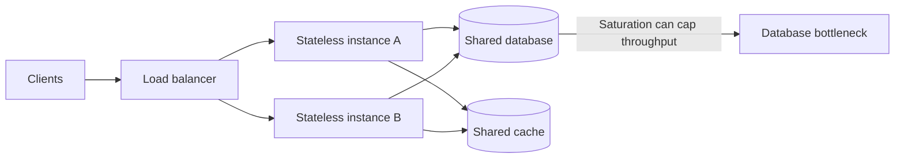

# 6. Scaling Traffic

Scaling means increasing the capacity of a system to handle demand while meeting its latency, availability, and cost goals. The first task is to identify the bottleneck; adding servers to the wrong layer may not improve capacity.

## 6.1 Vertical and horizontal scaling

- **Vertical scaling:** Give one machine more CPU, memory, or storage. It is simple to operate initially, but has hardware limits and may leave a large failure domain.
- **Horizontal scaling:** Add more instances and distribute work. It can increase capacity and resilience, but requires routing, coordination, and careful handling of shared state.

Horizontal scaling is not automatic. A service may still be constrained by a single database, a hot key, a shared lock, or an external dependency.

## 6.2 Stateless services and load balancing

A service is easier to scale horizontally when any healthy instance can handle a request without depending on in-memory session state from a particular instance.

A load balancer distributes requests among available instances. Common approaches include round robin, weighted routing, least connections, and latency-aware routing. The appropriate policy depends on request duration, instance capacity, and the load-balancer implementation.

Health checks should identify instances that cannot serve traffic, but overly aggressive checks can cause healthy instances to flap in and out during transient slowdowns.

## 6.3 Autoscaling and headroom

Autoscaling adjusts capacity based on observed or predicted demand. Useful signals can include CPU, memory, request rate, queue depth, or latency.

Important limitations:
- New instances take time to start and warm up.
- Metrics may lag behind sudden traffic changes.
- Scaling out application servers does not automatically scale databases or downstream services.
- Scaling in too quickly can disrupt in-flight work.
- Some workloads need scheduled or predictive capacity rather than reactive scaling alone.

Keep headroom for bursts and failures, and define what the system does if capacity cannot grow quickly enough.

## 6.4 Identify bottlenecks

Trace the request path and ask which resource saturates first:
- CPU-bound application code.
- Memory pressure or garbage collection.
- Database queries, locks, or connection pools.
- Network bandwidth or latency.
- Slow downstream dependencies.
- Queue consumers that process slower than producers.
- Uneven key or tenant distribution.

Measure before optimizing. A faster service tier may not improve end-to-end latency if most time is spent waiting on a database.

## 6.5 Load shedding and backpressure

When incoming work exceeds safe capacity, accepting everything can make the whole system fail.

- **Backpressure** slows or limits upstream production based on downstream capacity.
- **Load shedding** rejects lower-priority or excess work to preserve critical operations.
- **Rate limiting** bounds requests by identity, key, tenant, or resource.
- **Queueing** can smooth short bursts, but an unbounded queue converts overload into growing latency and memory/disk pressure.

Define overload behavior explicitly: return a clear retryable error, degrade nonessential features, or prioritize critical requests. Avoid retry storms by using backoff and retry budgets.

## Quick revision

- Find the bottleneck before adding capacity.
- Horizontal scaling needs safe state handling and routing.
- Autoscaling has reaction delays and cannot fix every bottleneck.
- Use backpressure, bounded queues, rate limits, and load shedding under overload.
- Protect downstream dependencies, not just the front-end service.

## Scaling architecture and bottleneck diagnosis

Adding application instances increases concurrency against shared dependencies. If database CPU, connections, locks, or I/O are already saturated, more instances can increase contention rather than throughput. Scale the limiting resource or reduce its work first.

## Scenario analysis

**Case:** Doubling the application fleet doubles database connections and increases p99 latency.

**Reasoning:** Check connection-pool sizes across all instances, query latency, lock waits, database CPU/I/O, and connection queueing. Bound the total pool budget against database capacity, optimize expensive queries, and use caching or read replicas only when the access pattern fits. Autoscaling should consider downstream saturation rather than CPU alone.

## Further reading

- [Google SRE Book: Addressing Cascading Failures](https://sre.google/sre-book/addressing-cascading-failures/) — overload and dependency protection.
