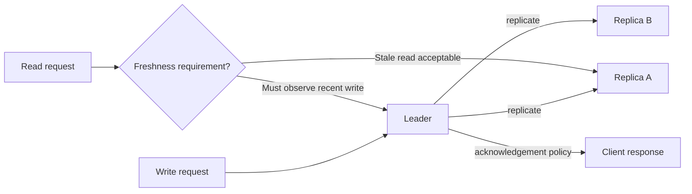

# 7. Replication and Partitioning

Replication keeps copies of data on multiple nodes. Partitioning splits data across nodes. They solve different problems and are often used together.

## 7.1 Replication

Replication can improve availability, recovery, and read capacity. The exact benefits depend on how replicas are placed, updated, and promoted.

- **Primary/leader and replicas:** Writes go through a leader; replicas copy changes. This simplifies write ordering but can make the leader a bottleneck and replicas may lag.
- **Multi-leader:** Multiple nodes accept writes. This can help geographically distributed writes but requires conflict handling.
- **Leaderless/quorum-based designs:** Clients or coordinators interact with multiple replicas according to the database's protocol. Guarantees depend on read/write quorums, versioning, and conflict-resolution rules.

Do not assume replication automatically gives strong consistency or zero data loss. Understand the product's acknowledgement, durability, and failover semantics.

## 7.2 Synchronous versus asynchronous replication

**Synchronous replication** waits for one or more replicas to acknowledge before confirming a write. This can reduce the risk of losing acknowledged data, but increases latency and can reduce write availability when required replicas are unreachable.

**Asynchronous replication** acknowledges before all replicas catch up. It often lowers write latency and tolerates replica lag, but a failover may lose recent writes that had not reached the promoted replica.

Real systems often use intermediate policies, such as waiting for a configured subset of replicas. Always check what the acknowledgement actually guarantees.

## 7.3 Partitioning (sharding)

Partitioning divides a dataset into smaller pieces, often by a partition key. Each shard owns a subset of the data.

Common approaches:
- **Range-based:** Nearby key values live together. Range queries can be efficient, but skew or monotonically increasing keys can create hot partitions.
- **Hash-based:** A hash distributes keys more evenly, but range queries become harder.
- **Directory-based:** A lookup maps keys to shards, giving flexibility but introducing routing metadata and another dependency.

A good partition key distributes both data and traffic. Consider cardinality, skew, query patterns, growth, and whether common queries can be routed to a small number of shards.

## 7.4 Hot partitions and rebalancing

A shard can become hot if many requests target the same key or range. Adding more shards does not necessarily help when traffic is concentrated on one partition.

Possible mitigations include:
- Choosing a better partition key.
- Splitting a hot range or moving selected keys.
- Adding a controlled suffix/bucket for extreme hot keys, with more complex reads and writes.
- Caching very hot data.
- Applying per-tenant limits when one tenant dominates load.

Rebalancing moves data and load between nodes. It consumes network, disk, and CPU resources, so plans should account for migration, routing changes, rollback, and temporary capacity.

## 7.5 Cross-shard queries and transactions

Partitioning makes scale-out possible, but queries spanning many shards can require fan-out and aggregation. Cross-shard transactions may be more expensive or may not be supported by the selected system.

Try to align the partition key with common access patterns and transactional ownership. If a use case requires frequent global joins or atomic multi-entity updates, that is an important input to the data model and database choice.

## 7.6 Common interview questions

### What is the difference between replication and partitioning?

Replication creates multiple copies of the same data; partitioning divides the dataset into subsets. Replication is commonly used for availability, recovery, and reads. Partitioning is commonly used to distribute data and load beyond one node's capacity. A system may use both.

### Does a read replica guarantee fresh reads?

No. Asynchronous replicas can lag. If a user must read their own recent write, the system may route that read to the primary, wait for replication to catch up, or use a consistency mechanism supported by the database.

### How do you choose a shard key?

Choose a key with good distribution and cardinality that aligns with common queries and ownership boundaries. Avoid keys that concentrate traffic or data. Evaluate both storage balance and request distribution; they can differ.

### What is a hot shard?

A partition receiving disproportionate traffic or work. It can saturate even when the cluster has spare total capacity. Diagnose the key/range distribution and address the hotspot rather than simply adding nodes.

## Quick revision

- Replication copies data; partitioning divides it.
- Replication guarantees depend on acknowledgement and failover semantics.
- Synchronous replication trades latency/availability for stronger acknowledgement guarantees.
- Asynchronous replication can lose unreplicated recent writes during failover.
- A good shard key balances data and traffic while supporting important queries.
- Cross-shard operations and rebalancing add complexity.

## Replication and sharding in practice

This diagram is intentionally simplified: the exact acknowledgement policy depends on the database. With asynchronous replication, a successful write can be acknowledged before a replica receives it. A failover can therefore expose stale data or lose recent acknowledged writes if the promoted replica is behind.

Sharding splits ownership across partitions; replication copies data within or across those partitions. A useful shard key distributes load while supporting common queries. A monotonically increasing key can create a hot range, while a tenant key can overload one partition when a tenant dominates traffic. Rebalancing changes data placement and consumes network and disk capacity, so it must be planned as an operational event.

## Scenario practice

**Scenario:** Read traffic is high and the primary database is near its read limit, but writes are healthy. Should you shard immediately?

**Reasoning:** First inspect query plans, indexes, caching opportunities, and whether stale reads are acceptable on read replicas. A read replica can help with read capacity but does not increase primary write throughput and can return stale data. Shard only when a single node remains a limiting factor or dataset placement requires it, because cross-shard queries and rebalancing add complexity.

## Interview questions

### Q1. What is the difference between replication and sharding?
Replication keeps copies of the same data to improve redundancy, recovery, or read capacity. Sharding divides the dataset across nodes to distribute storage and workload. A system often combines them: each shard has replicas.

### Q2. Does (R+W>N) automatically guarantee linearizability?
No. It can ensure quorum intersection under the stated replica model, but linearizability depends on the full protocol, write ordering, version handling, concurrent updates, and failover rules.

## Further reading

- [Designing Data-Intensive Applications: replication and partitioning concepts](https://dataintensive.net/) — background reading; verify concrete guarantees against the chosen database's documentation.

## 7.6 Consistent hashing and controlled rebalancing

A shard key decides which partition owns a record. A good key distributes load and storage while keeping common queries targeted. A key such as `tenantId` can work well when tenants are similarly sized, but one very large tenant can create a hot partition. A monotonically increasing timestamp can concentrate new writes on the newest range.

**Consistent hashing** maps keys and nodes onto a logical hash ring so adding or removing a node typically remaps only a portion of keys, rather than almost every key as with a simple `hash(key) % nodeCount`. Virtual nodes can improve balance when physical nodes differ in capacity. Consistent hashing does not automatically solve skew: a very hot key still maps to one owner unless the data model or routing strategy handles it.

A safe rebalancing plan should account for:
1. Copying existing data while normal reads and writes continue.
2. Tracking changes made during the copy, using a log, change stream, or dual-write protocol with explicit reconciliation.
3. Switching ownership/routing only after the target is sufficiently caught up.
4. Preventing old and new owners from accepting conflicting writes; epochs or fencing tokens can reject stale owners.
5. Monitoring replication lag, error rates, hot keys, and rollback conditions.

Do not describe shard movement as a single atomic copy. It is a migration protocol with a period of overlapping state, and its correctness depends on how writes are ordered and ownership is changed.

### Q3. Why is consistent hashing useful, and what does it not solve?

It limits how many keys need reassignment when the node set changes, which can reduce data movement during scaling. It does not guarantee perfectly even traffic, remove hot keys, or make migration safe by itself. Virtual nodes improve distribution, while hot-key handling and a correct ownership-switch protocol address different problems.

### Q4. How would you choose a shard key?

Start with dominant queries, tenant boundaries, data growth, and write distribution. Prefer keys that route common requests to one shard and distribute workload reasonably evenly. Check for high-volume tenants, time-correlated keys, and queries that would require expensive fan-out. Revisit the key only with a migration plan, because changing it can require substantial data movement.
