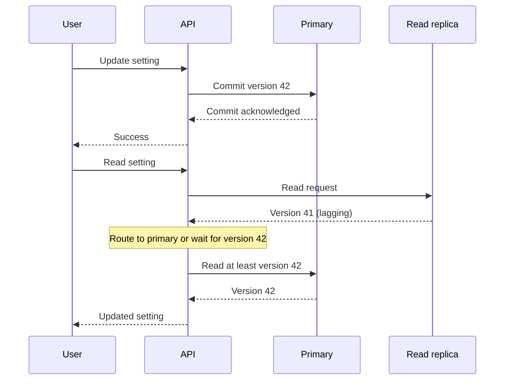

# 8. Consistency and Transactions

Consistency describes which values a read is allowed to observe relative to writes. Transactions describe how a group of operations behaves as a unit. In interviews, state the required user-visible behavior first; then choose the simplest mechanism that satisfies it.

## 8.1 Strong and eventual consistency

**Strong consistency** is an umbrella phrase that needs clarification. For example, linearizability means each operation appears to take effect at one instant between its invocation and response, respecting real-time order. It is a stronger guarantee than merely returning the latest value according to a replica's local history.

**Eventual consistency** means replicas may temporarily disagree but converge if updates stop and the system continues making progress under the model's assumptions. It does not, by itself, specify how long staleness lasts or which value a conflicting write wins.

Different databases offer different consistency levels. Avoid describing a product as simply “consistent” or “inconsistent” without specifying the operation and guarantee.

## 8.2 Read-your-writes and stale reads

A user may update a profile and immediately read an old value from a lagging replica or cache. If the product requires read-your-writes behavior, possible approaches include:
- Route the user's subsequent read to the primary.
- Use a session/causal token or version to ensure the read is at least as recent as the write.
- Wait for a replica to catch up.
- Update or invalidate the relevant cache safely.

Stronger guarantees may cost latency, availability, or operational complexity. Choose based on user-visible requirements.

## 8.3 ACID transactions

- **Atomicity:** The transaction's changes happen as a unit, or are rolled back under the database's transaction semantics.
- **Consistency:** A successful transaction preserves defined integrity constraints and application invariants.
- **Isolation:** Concurrent transactions are controlled according to an isolation level.
- **Durability:** Once committed under the stated durability guarantees, changes survive the failures the system claims to tolerate.

ACID does not mean every possible application invariant is automatically enforced. The schema, constraints, transaction boundaries, and isolation behavior matter.

## 8.4 Isolation anomalies

- **Dirty read:** A transaction observes another transaction's uncommitted change.
- **Non-repeatable read:** Re-reading a row yields a different committed value.
- **Phantom:** Repeating a predicate query sees a changed set of rows.
- **Lost update:** One concurrent update overwrites another's change.
- **Write skew:** Concurrent transactions read overlapping facts and write different rows, jointly violating an invariant.

Isolation-level names and exact guarantees differ across database engines. For correctness-sensitive designs, explain the invariant and verify the selected engine's behavior rather than relying only on the isolation-level label.

## 8.5 Optimistic and pessimistic concurrency control

**Optimistic concurrency control** allows concurrent work and detects conflicts at write time, often using a version column or conditional update. It works well when conflicts are relatively uncommon.

**Pessimistic locking** prevents conflicting work from proceeding simultaneously. It can be appropriate for high-contention invariants but can introduce blocking, deadlocks, and reduced throughput.

For a versioned update, a client might update a record only if its version still equals the version it read. If zero rows are updated, the application handles the conflict by rereading, retrying with limits, or asking the user to resolve it.

## 8.6 Distributed workflows and sagas

A database transaction usually cannot atomically commit arbitrary operations across independent services. A saga coordinates a sequence of local transactions; if a later step fails, compensating actions may attempt to reverse earlier business effects.

Compensation is not necessarily a literal rollback. A sent email cannot be unsent, and a payment refund is a new business operation with its own failure modes. Sagas need durable state, retries, idempotent steps, timeout handling, and a path for manual recovery.

## 8.7 Common interview questions

### Is eventual consistency the same as weak durability?

No. Consistency concerns which values reads can observe and how replicas converge. Durability concerns whether acknowledged changes survive failures. A system can have durable writes while reads temporarily observe stale replicas.

### When should a system use stronger consistency?

When incorrect or stale reads would violate important invariants—for example, account balances, unique reservations, or ownership changes. Some systems can use stronger guarantees only for critical operations and tolerate eventual consistency for feeds, analytics, or derived views.

### What is write skew?

Two concurrent transactions read a shared condition and update different rows, so each transaction's individual checks pass but their combined result violates a business invariant. Preventing it may require serializable isolation, explicit locking, constraints, or redesigning the invariant around a single atomic record, depending on the database.

### How do you handle a conflict in optimistic locking?

Detect that the expected version no longer matches. Then decide whether to retry from fresh state, merge changes, reject the operation, or ask the user to resolve it. Blindly retrying the same stale write can repeat the conflict indefinitely.

### What is a saga?

A saga is a distributed business workflow composed of local transactions with coordination and, when needed, compensating actions. It avoids pretending that independent services share one atomic transaction, but introduces eventual completion, durable orchestration, idempotency, and recovery requirements.

## Quick revision

- Define the exact consistency guarantee needed.
- Stronger consistency can cost latency and availability.
- ACID depends on transaction scope, constraints, and isolation semantics.
- Concurrency control prevents lost updates and invariant violations.
- Sagas coordinate distributed workflows but are not equivalent to a global rollback.

## Consistency is a user-visible contract

A read-your-writes requirement is narrower than global linearizability. For example, after updating a profile, the same user's next read may need to show that update even if other users can temporarily observe older data. Possible mechanisms include routing that session to the leader, using a version token, or coordinating cache invalidation. Choose the least expensive mechanism that satisfies the actual contract.

## Scenario practice

**Scenario:** Two users attempt to reserve the last seat at the same time. A cache shows one seat available to both. How do you prevent overselling?

**Reasoning:** Do not use a cached count as the authority for reservation. Use a conditional transactional update, row lock, or unique reservation constraint so only one operation can claim the final seat. The cache can display an approximate count, but the write path must enforce the invariant and return a clear conflict for the losing request.

## Interview questions

### Q1. Is eventual consistency always acceptable for read-heavy systems?
No. Read-heavy describes load, not correctness. Eventual consistency is acceptable only where temporary divergence does not violate user expectations or business invariants. Account balances, inventory reservations, and authorization changes may require stronger guarantees at the authoritative boundary.

### Q2. When would you use optimistic versus pessimistic concurrency?
Optimistic concurrency is useful when conflicts are rare: read a version and update only if it has not changed, retrying or reporting conflict otherwise. Pessimistic locking can fit high-contention critical sections but holds locks and can reduce throughput or create deadlocks. The decision depends on contention and the cost of retrying.

## Further reading

- [PostgreSQL documentation: Transaction Isolation](https://www.postgresql.org/docs/current/transaction-iso.html) — isolation behavior and anomalies.

