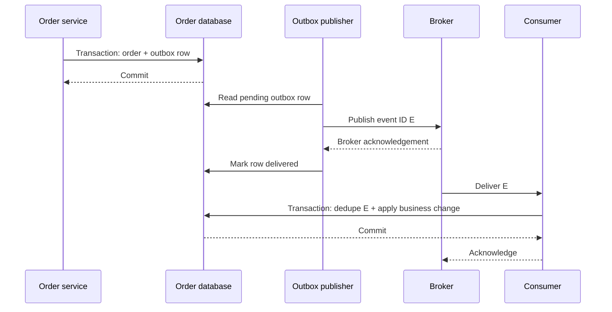

# 9. Asynchronous Processing

Asynchronous processing lets a caller hand off work without waiting for the full operation to finish. Queues and streams can absorb bursts, decouple components, and enable independent processing—but they introduce delayed results, duplicate handling, ordering questions, and operational complexity.

## 9.1 Queue versus stream

A **work queue** distributes tasks among workers; a task is typically handled by one worker in a consumer group, according to the queue's semantics.

An **event stream** records events for consumers to read, often allowing independent consumers to maintain their own progress and replay retained events.

These categories overlap in real products. Choose based on retention, replay, fan-out, ordering, throughput, and task-acknowledgement requirements rather than the product label alone.

## 9.2 Typical asynchronous flow

1. The API validates the request.
2. It records enough durable state to avoid losing accepted work.
3. It publishes or enqueues a task/event.
4. A worker reads and processes it.
5. The worker records completion or failure and acknowledges progress.
6. Retries, dead-letter handling, and monitoring manage failures.

A critical design question is whether the database write and message publish can fail independently. A transactional outbox can store the business change and an event record in one local transaction; a separate publisher delivers the event, usually with duplicate delivery possible and therefore requiring idempotent consumers.

## 9.3 Delivery semantics and idempotency

- **At-most-once:** A message is not redelivered under the configured semantics, but it may be lost.
- **At-least-once:** Messages may be redelivered, so consumers must tolerate duplicates.
- **Effectively-once business outcome:** Often achieved through idempotent processing, deduplication, and atomic state transitions within a defined scope.

“Exactly once” is not a universal end-to-end property. A broker's processing guarantee does not automatically make an external payment, email, or database side effect occur exactly once.

An idempotent operation can be repeated without changing the final business outcome beyond the first successful application. Common approaches include unique operation IDs, deduplication records, conditional writes, and state machines that reject duplicate transitions.

## 9.4 Ordering and partitioning

Global ordering is expensive and often unnecessary. Many systems need ordering only per entity, such as events for one account or order.

A partition key can preserve order within a partition in some streaming systems, but it can also create hot partitions. Multiple consumers increase throughput but may change completion order, especially when work duration varies.

Define which order matters: publish order, delivery order, processing-start order, or completion order are not the same guarantee.

## 9.5 Retries and dead-letter queues

Retry transient failures with bounded exponential backoff and jitter. Do not retry permanent validation errors indefinitely. A dead-letter queue or failure store can preserve repeatedly failing work for investigation, but it needs alerting, ownership, replay procedures, and safe reprocessing.

A poison message can repeatedly fail and block progress depending on the broker and consumer strategy. Decide whether to skip, quarantine, retry, or halt, based on the ordering and correctness requirements.

## 9.6 Backlog and consumer lag

If producers publish faster than consumers process, backlog grows. Monitor queue depth or stream lag, oldest-message age, processing latency, failure rate, and consumer capacity.

Adding consumers helps only if the broker's partitioning and the downstream dependencies allow more parallelism. A queue can smooth a short burst; it cannot solve a sustained workload where arrival rate exceeds service capacity.

## 9.7 Common interview questions

### Why use asynchronous processing?

It decouples the request path from slower work, absorbs bursts, and allows independent workers to scale. The costs are delayed completion, retry and duplicate handling, more complex observability, and the need to expose status or completion where users need it.

### How do you prevent losing an event after a database update?

A transactional outbox stores the business update and an event record in the same local database transaction. A publisher later sends the event. Since publishing and marking the outbox record can fail in between, consumers should still be idempotent.

### How do you achieve exactly-once processing?

First define the boundary. Broker-level transactional guarantees can help within that broker's supported scope, but external side effects still need idempotency or atomic coordination. In practice, robust systems often combine at-least-once delivery with deduplication and idempotent state changes.

### How do you handle a growing queue?

Check whether the backlog is caused by a temporary burst, insufficient consumer capacity, hot partitions, downstream limits, or poison messages. Scale consumers when parallelism is available, apply backpressure or producer limits, and protect downstream services. If arrivals permanently exceed processing capacity, adding a queue only delays failure.

## Quick revision

- Use async work for decoupling and buffering, not as automatic complexity.
- Acknowledge only after the required processing state is safely recorded.
- Design for duplicate delivery and idempotent effects.
- Be explicit about ordering scope and completion semantics.
- Monitor backlog age and consumer lag, not just queue depth.

## Outbox publication and duplicate-safe consumption

The publisher can crash after broker acknowledgement but before marking the outbox row delivered, so it may publish the same event again. The consumer must tolerate that duplicate. The outbox prevents losing the intent to publish when the business transaction commits; it does not create a distributed transaction between the database and broker.

## Scenario practice

**Scenario:** A consumer processes an event, commits its database update, then crashes before acknowledging the message. What should happen on redelivery?

**Reasoning:** The broker may deliver the event again. Give the event a stable ID and atomically record that ID with the business mutation in the consumer's local transaction. A duplicate should become a no-op. If the consumer triggers an external side effect, pass an idempotency key to that provider or reconcile ambiguous outcomes.

## Interview questions

### Q1. When should you choose a queue instead of a stream?
A work queue fits independent tasks that workers claim and acknowledge. A retained event stream fits multiple consumers with independent offsets, replay, and ordered records within defined partitions. Real products can support both patterns; choose from retention, ordering, fan-out, and recovery requirements.

### Q2. Does adding a queue solve overload?
It can absorb a temporary burst if the backlog is bounded and consumers later catch up. If arrivals persistently exceed successful processing, backlog grows without bound unless capacity increases, work is reduced, or admission control sheds load.

## Further reading

- [Transactional Outbox pattern](https://microservices.io/patterns/data/transactional-outbox.html) — implementation trade-offs and failure window.
- [Apache Kafka documentation](https://kafka.apache.org/documentation/) — broker-specific delivery and processing semantics.

