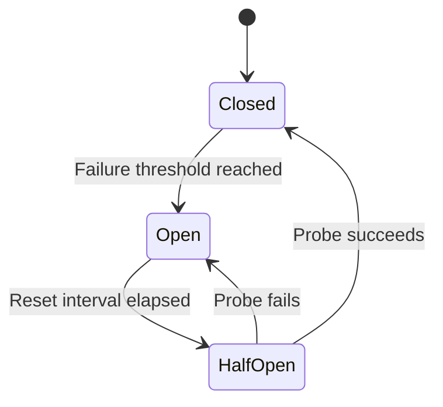

# 10. Reliability and Resilience

Reliability is the ability to provide the required behavior over time. Resilience is the ability to continue or recover when components fail. A reliable architecture does not assume failures can be eliminated; it limits their impact and makes recovery predictable.

## 10.1 Timeouts and deadlines

Every remote call should have a bounded wait. A timeout prevents a caller from waiting forever, but it does not prove that the remote operation failed. The operation may have completed while the response was delayed or lost.

A **deadline** is the total time budget for a request. Downstream calls should fit within the remaining budget rather than each receiving a fresh full timeout. Propagate cancellation when the caller no longer needs the result.

## 10.2 Retries, backoff, and jitter

Retry only failures likely to be transient. Use bounded exponential backoff and jitter to avoid synchronized retry waves.

Retries are dangerous when:
- The operation is not idempotent.
- The dependency is already overloaded.
- Multiple layers retry independently, multiplying attempts.
- A retry exceeds the caller's deadline.
- A timeout is mistaken for proof that no side effect occurred.

Set retry budgets and prefer one clearly owned retry policy per operation. State-changing requests need idempotency or reconciliation.

## 10.3 Circuit breakers and bulkheads

A **circuit breaker** temporarily stops calls to a failing dependency after a configured failure pattern, then allows limited probes to test recovery. It can prevent repeated calls from consuming resources, but thresholds and half-open behavior need careful tuning.

A **bulkhead** isolates resources so one workload or dependency cannot consume all threads, connections, or concurrency slots. Separate pools, per-tenant limits, and bounded queues are examples.

Neither technique fixes a broken dependency. They limit cascading failure and should be paired with timeouts, monitoring, and a fallback or clear failure response.

## 10.4 Rate limiting and graceful degradation

Rate limiting protects capacity and fairness by bounding work per identity, tenant, or resource. Common algorithms include token bucket and leaky bucket; fixed and sliding windows are also used.

Graceful degradation preserves the most important behavior when full service is impossible. For example, a product might temporarily disable recommendations while preserving checkout. Define which features are essential and ensure degraded modes do not violate security or data correctness.

## 10.5 Redundancy and failure domains

Redundancy helps only when replicas do not share the same failure cause. Two instances in one failure domain may both be lost to a host, rack, zone, credential, or network problem.

Identify the failure domains that matter and place replicas accordingly. More regions can improve disaster resilience but add cost, replication lag, data residency constraints, and more complex failover.

## 10.6 Recovery and disaster recovery

- **RTO (Recovery Time Objective):** How long recovery may take.
- **RPO (Recovery Point Objective):** How much data loss, measured in time, can be tolerated.

Backups are useful only if they can be restored within the required objectives. Test restoration, failover, and failback; verify dependencies such as keys, configuration, credentials, and DNS. A backup that has never been restored is an assumption, not demonstrated recovery capability.

## 10.7 Common interview questions

### Why are retries sometimes harmful?

They increase load and can duplicate side effects. When a dependency is overloaded, retries may make recovery harder. Use bounded attempts, backoff, jitter, idempotency, and a total deadline.

### What is a circuit breaker?

A mechanism that stops sending normal traffic to a dependency after a configured failure pattern, then tests whether it has recovered. It limits cascading failures but does not replace timeouts or fix the underlying cause.

### What is the difference between RTO and RPO?

RTO is the target time to restore service; RPO is the tolerated amount of data loss. They drive different decisions about failover automation, backups, replication, and recovery testing.

### Does running multiple instances guarantee high availability?

No. Instances may share a database, network, zone, credentials, or configuration that becomes a common failure point. Availability depends on the full request path and independent failure domains, not just replica count.

## Quick revision

- Bound waits with timeouts and end-to-end deadlines.
- Retry transient failures carefully, with backoff, jitter, and idempotency.
- Use circuit breakers and bulkheads to limit cascading failures.
- Define degraded behavior for overload and dependency failures.
- Design redundancy across relevant failure domains.
- Set RTO/RPO and test actual restoration.

## Circuit breaker and controlled retries

A circuit breaker limits calls to a dependency that is failing; it does not repair the dependency. Its thresholds, open interval, and half-open probes should match the call volume and failure mode. A shared dependency outage can make every caller's breaker open at once, so recovery traffic still needs limits.

Retries should be bounded by an end-to-end deadline and a retry budget. Exponential backoff with jitter spreads attempts over time. Avoid retrying non-idempotent operations unless the operation has a safe idempotency contract. Multiple layers retrying independently can multiply load dramatically.

## Scenario practice

**Scenario:** A downstream service slows down. Callers time out and retry, increasing load until healthy instances also fail. What changes would you make?

**Reasoning:** Propagate deadlines, cap concurrency, set one clear retry owner, use bounded exponential backoff with jitter, and apply circuit breaking or load shedding where appropriate. Separate optional work with bulkheads. Monitor saturation and retry volume; do not rely on autoscaling alone if the dependency is the bottleneck.

## Interview questions

### Q1. Why can retries reduce availability?
Retries add work precisely when a dependency is struggling. They can exhaust threads, connections, and CPU, causing a cascading failure. Retry only likely transient failures, use backoff/jitter and budgets, and ensure the operation is safe to repeat.

### Q2. What is the difference between high availability and disaster recovery?
High availability reduces interruption from common failures, often within a region using multiple zones and automatic failover. Disaster recovery addresses larger outages and data recovery using backups, replication, and tested procedures, with explicit RTO/RPO targets. Multi-region deployment can support both but adds cost and consistency complexity.

## Further reading

- [Google SRE Book: Addressing Cascading Failures](https://sre.google/sre-book/addressing-cascading-failures/) — overload, retries, and dependency protection.
- [AWS Well-Architected Reliability Pillar](https://docs.aws.amazon.com/wellarchitected/latest/reliability-pillar/welcome.html) — practical failure and recovery review guidance.

## 10.8 Multi-region deployment and failover

A multi-region design starts with a recovery objective and a data-ownership model—not with a decision to deploy every service everywhere.

| Pattern | Strength | Main cost or risk |
|---|---|---|
| Backup and restore | Lowest steady-state complexity and cost | Recovery can be slow; restore procedures must be tested |
| Pilot light | Critical data and minimal core services are ready | Capacity and dependencies still need scaling or activation |
| Warm standby | A smaller secondary environment can take traffic relatively quickly | Ongoing cost and replication lag |
| Active-passive | One region owns writes; another can take over | Failover coordination and fencing are essential |
| Active-active | Regions serve traffic concurrently | Conflict resolution, global routing, and business invariants become harder |

For each critical data set, state whether replication is synchronous or asynchronous, what acknowledged writes survive a regional loss, and who is allowed to accept writes after failover. Asynchronous replication can lose recent acknowledged writes if the primary region is lost before they replicate. Synchronous cross-region replication can increase write latency and may reduce write availability during a network partition.

Failover must also prevent **split brain**: the old primary may still be alive but isolated. Use a clear authority/lease/epoch mechanism or provider-supported failover protocol so a stale region cannot continue making authoritative writes. DNS or load-balancer routing alone does not establish database ownership.

A useful interview answer defines:
- RTO and RPO separately for each important workflow.
- Which region is authoritative for each write and how ownership changes.
- How secrets, keys, configuration, queues, identity, and third-party dependencies recover.
- How clients handle retries and ambiguous in-flight requests during failover.
- How failback, reconciliation, and restore testing work.

### Scenario: the primary region is unavailable

A payment service has a warm standby region and asynchronous database replication. The primary region disappears immediately after acknowledging a payment write. Do not claim that promoting the standby guarantees the latest payment is present. First establish the actual replication position and promotion guarantees, prevent the old primary from accepting writes if it returns, and reconcile uncertain operations with the payment provider or ledger before retrying side effects. The RPO determines whether some acknowledged data loss is acceptable; for financial invariants, the system may need a stronger commit/replication design instead.

### Q5. Does active-active automatically improve availability?

No. It can serve traffic during some regional failures, but shared identity, global dependencies, network partitions, or conflicting writes can still fail the system. Active-active is simplest for stateless or naturally partitioned workloads. For mutable business data, define conflict semantics and write authority before claiming independent regional availability.
