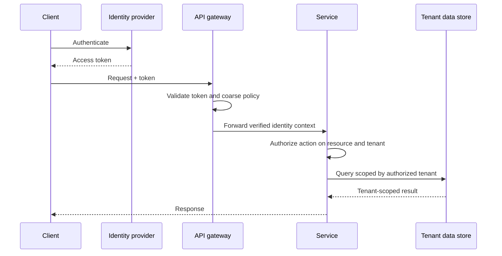

# 11. Security and Multi-Tenancy

Security is an architectural requirement, not a final checklist. A system must verify identity, enforce what that identity may do, protect sensitive data, and prevent one tenant from affecting or accessing another tenant's resources.

## 11.1 Authentication versus authorization

- **Authentication:** Establishes who or what is making a request.
- **Authorization:** Determines whether that identity may perform the requested action on the target resource.

A valid login or token does not mean the caller can access every resource. Authorization should consider the user, action, resource, tenant, and relevant policy.

## 11.2 Apply least privilege and trust boundaries

Grant each service, user, and workload only the permissions it needs. Identify trust boundaries between clients, gateways, services, workers, databases, and external providers.

Important practices include:
- Validate input at system boundaries.
- Enforce authorization on the server, not only in the UI.
- Use TLS for data in transit and suitable encryption for sensitive data at rest.
- Store secrets in a managed secret system and rotate them safely.
- Avoid logging credentials, tokens, or unnecessary personal data.
- Use secure defaults and keep dependencies patched.

A gateway can authenticate requests, but services must not blindly trust headers or identity claims unless the path and token validation make that trust explicit.

## 11.3 Multi-tenant isolation

Tenants may share infrastructure while requiring logical or physical separation. Common models include:
- **Shared tables with tenant ID:** Efficient, but every query and write must enforce tenant scoping.
- **Separate schema/database per tenant:** Stronger separation options and customization, with more operational overhead.
- **Dedicated infrastructure per tenant:** Useful for strict isolation or special requirements, but typically more expensive.

Isolation includes more than database rows: caches, object storage paths, search indexes, queues, logs, metrics, exports, and background jobs must also preserve tenant boundaries.

Use defense in depth: authorization checks, tenant-scoped data access, constraints where possible, and tests designed to detect cross-tenant access.

## 11.4 Abuse controls and sensitive operations

Rate limits and quotas can protect against accidental or malicious resource exhaustion. Apply them at appropriate scopes: user, tenant, API key, IP, or expensive resource. IP-only limits can be unfair behind shared networks; identity-only limits may not stop distributed abuse.

For high-impact operations, consider stronger authorization, audit logs, idempotency, and explicit confirmation where appropriate. Security logging should be useful without collecting secrets or excessive sensitive data.

## Quick revision

- Authentication answers who; authorization answers what they may do.
- Treat every service boundary as a place to validate trust.
- Tenant isolation must cover all data paths, not only primary database queries.
- Use least privilege, secret management, encryption, and privacy-aware logging.
- Apply quotas and rate limits to protect shared resources.

## Authentication and tenant isolation flow

A valid token establishes an identity and claims; it does not grant blanket access to every object. The service must authorize the requested action against the target resource and tenant. Tenant scoping should be enforced in data access paths and tested against cross-tenant identifier substitution. Gateway checks are useful, but they do not replace domain-level authorization.

## Scenario analysis

**Case:** A multi-tenant SaaS application stores tenants in shared tables, and a new endpoint trusts a tenant identifier supplied as a query parameter.

**Reasoning:** A caller may substitute another tenant's ID unless the server derives or validates tenant access from trusted identity and authorization policy. Apply tenant predicates consistently, enforce access in service/data layers, and test cross-tenant access. Add per-tenant quotas and resource isolation where noisy-neighbor risk warrants it. Shared tables reduce cost but increase the importance of consistent logical isolation.

## Further reading

- [OAuth 2.0 Security Best Current Practice (RFC 9700)](https://www.rfc-editor.org/rfc/rfc9700)
- [OpenID Connect Core](https://openid.net/specs/openid-connect-core-1_0.html)
