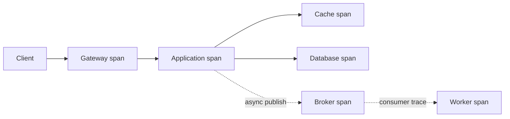

# 12. Observability and Design Trade-offs

Observability helps teams understand what a system is doing from its outputs. Design trade-off analysis helps explain why an architecture is appropriate for its requirements. Both are essential: a design should be measurable in production and defensible before it is built.

## 12.1 Logs, metrics, and traces

- **Logs** describe individual events and often provide detailed diagnostic context.
- **Metrics** aggregate measurements over time, such as request rate, error rate, latency, queue depth, and resource utilization.
- **Distributed traces** connect spans across a request path to show where time was spent and which dependencies were called.

Use correlation or trace identifiers to connect relevant signals. Avoid putting high-cardinality values such as arbitrary user IDs into every metric label; this can make monitoring expensive and hard to operate. Sensitive values should not be copied into logs or traces without a clear need and appropriate controls.

## 12.2 The four golden signals

A practical starting point for service monitoring is:
- **Latency:** How long requests take, including tail percentiles.
- **Traffic:** How much demand the system receives.
- **Errors:** Failed or incorrect outcomes, including relevant timeouts.
- **Saturation:** How close resources are to their effective limits.

Averages can hide poor experiences for a minority of users. Percentiles such as p95 or p99 can help reveal tail latency, but interpret them alongside request volume and the service's actual objective.

## 12.3 SLIs, SLOs, and error budgets

- **SLI (Service Level Indicator):** A measured property, such as the fraction of eligible requests that succeed within a latency target.
- **SLO (Service Level Objective):** The target for that indicator over a defined window.
- **SLA (Service Level Agreement):** A formal commitment, often with consequences if it is missed.

An error budget is the tolerated unreliability implied by an SLO. For a 99.9% success target over a suitable request population, the allowed failure fraction is 0.1%. The exact budget depends on the SLI definition and measurement window.

SLOs should represent user experience, not merely an infrastructure metric. A server can be “up” while requests fail or become too slow.

## 12.4 A repeatable trade-off framework

When comparing designs, state:
1. **Requirement:** What must the system achieve?
2. **Options:** Which plausible approaches meet the basic need?
3. **Benefits:** What does each option improve?
4. **Costs and risks:** What becomes slower, less available, harder to operate, or more expensive?
5. **Failure behavior:** What happens when a component or dependency fails?
6. **Decision and assumptions:** Why is one option best under current constraints?
7. **Revisit trigger:** What measurement or change would justify a different choice?

For example, a read replica may improve read capacity but introduce lag. If a use case requires read-your-writes, route those reads appropriately or choose a stronger mechanism. The right answer depends on the user-visible guarantee, not on a generic preference for replicas.

## Quick revision

- Logs explain events; metrics reveal trends; traces connect request paths.
- Monitor latency, traffic, errors, and saturation.
- Define user-centered SLIs and realistic SLOs.
- Compare designs using requirements, benefits, costs, failure modes, and assumptions.
- State what evidence would cause you to revisit an architectural choice.

## Trace a slow request and connect SLOs to operations

Trace context should connect related spans across service boundaries where propagation is supported. Async work may continue after the initiating request ends, so link the consumer trace to the originating operation using correlation/event identifiers rather than pretending it is synchronous latency.

An SLI is a measurement of user-relevant behavior, such as the fraction of valid requests completed successfully within a latency threshold. An SLO is the target for that SLI over a window. An SLA is an external commitment that may include consequences for missing the target. If an SLO permits 99.9% success over a 30-day window, the error budget is the remaining 0.1% of eligible events—not a general license to ignore incidents.

## Scenario analysis

**Case:** Average latency remains 100 ms, but users report intermittent slowness and p99 latency rises from 300 ms to 2 seconds.

**Reasoning:** Segment latency by route, dependency, region, tenant, and request size. Inspect traces for slow spans, plus pool waits, queueing, retries, cache misses, and saturation. The average hides the tail. Use high-cardinality identifiers in logs/traces when appropriate, not as unrestricted metric labels.

## Further reading

- [Google SRE Book: Monitoring Distributed Systems](https://sre.google/sre-book/monitoring-distributed-systems/)
- [Google SRE Book: Service Level Objectives](https://sre.google/sre-book/service-level-objectives/)
