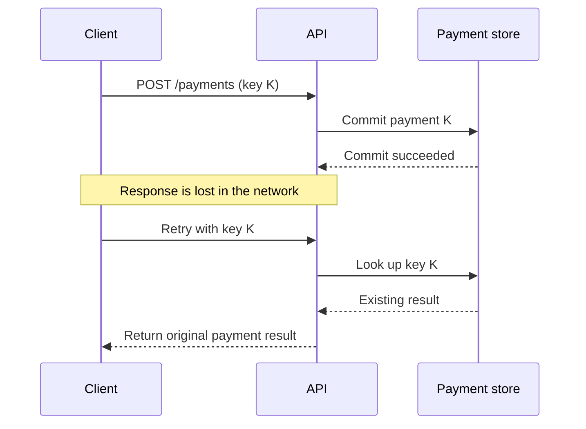
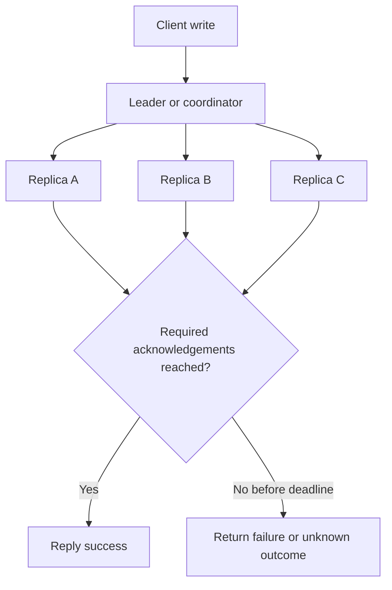
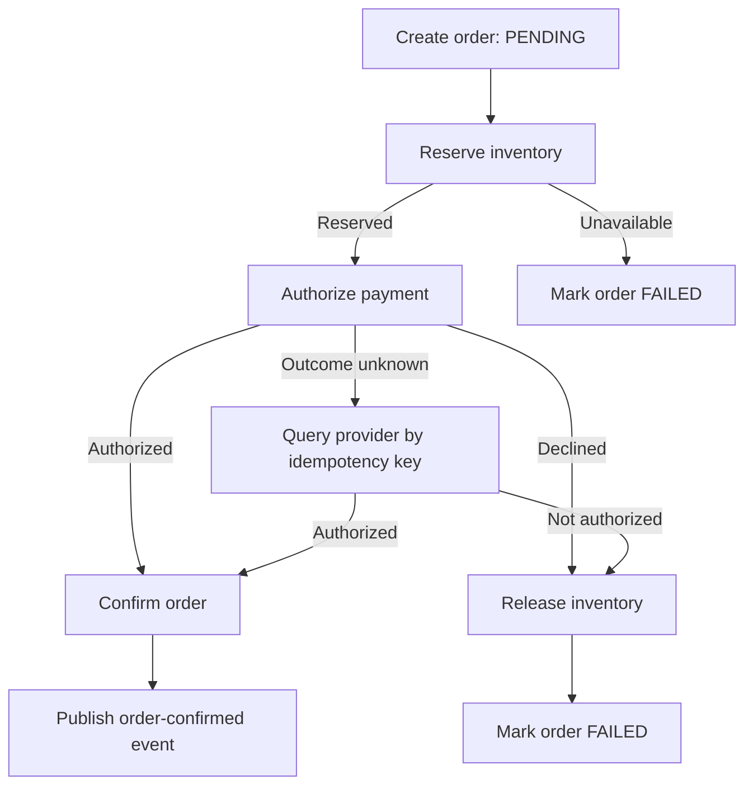

# 13. Distributed Systems and Business Correctness

Distributed systems make independent components coordinate over networks that can delay, duplicate, reorder, or lose messages. The central interview skill is to state the guarantee required, then explain which mechanism provides it—and where that guarantee ends.

## 13.1 Partial failure: timeout is not proof of failure

A local function call either returns or throws in the caller's process. A remote call has an ambiguous outcome: the server may commit the operation and lose the response, or the request may never reach the server.

The safe retry strategy is not “try again and hope.” Give the business operation a stable idempotency key, persist the key with the outcome under a uniqueness constraint, and return the stored result for repeats. The key must be scoped appropriately (for example, merchant plus key), and retention must cover the retry window. Idempotency prevents duplicate effects only within the boundary where it is enforced; it does not make every downstream system automatically idempotent.

## 13.2 Delivery semantics and effectively-once outcomes

- **At-most-once delivery:** a message is delivered zero or one times; loss is possible.
- **At-least-once delivery:** a message is retried until acknowledged under the system's assumptions; duplicates are possible.
- **Exactly-once processing:** meaningful only when the system defines the scope and atomic boundary. A broker may provide transactional processing within its own supported boundary, but an external payment or email side effect is not magically included.
- **Effectively-once business outcome:** duplicates may arrive, but a durable idempotency/deduplication mechanism and atomic state transition ensure the business effect happens once within a defined scope.

A consumer can crash after committing a database change but before acknowledging the message. The broker then redelivers. Use an inbox/deduplication record and the business mutation in the same local database transaction where possible.

## 13.3 CAP, PACELC, and consistency models

CAP is about behavior **during a network partition** in a distributed data system: a system cannot guarantee both linearizable consistency and successful responses from every non-failing node for every request in that partition. It is not a claim that systems choose consistency or availability all the time. Outside a partition, latency/consistency trade-offs still matter; PACELC captures the idea that when there is a partition, availability versus consistency matters, and else latency versus consistency matters.

- **Linearizability:** each operation appears to take effect at one instant between invocation and response, respecting real-time order.
- **Eventual consistency:** replicas converge if updates stop and the system continues to make progress; it alone does not specify a staleness bound or conflict winner.
- **Read-your-writes:** a client sees its own successful update on later reads.
- **Monotonic reads:** a client does not move backward to an older observed version.

Choose guarantees from user-visible invariants. A social like count may tolerate temporary divergence; a wallet balance or inventory reservation usually needs atomic conditional updates and a clearly defined authority.

## 13.4 Quorums and replica lag

For a replicated value with (N) replicas, a quorum design may use read quorum (R) and write quorum (W). The condition (R+W>N) makes the sets intersect, but intersection alone does **not** prove linearizability. The actual guarantee also depends on versioning, conflict resolution, concurrent writes, replica placement, and the protocol.

A successful acknowledgement means only what the configured write policy promises. Asynchronous replicas may still lag; promoting a replica that has not received acknowledged writes can lose data. Read replicas improve read capacity only when stale reads are acceptable and the primary is not the bottleneck elsewhere.

## 13.5 Leader election, split brain, and fencing

Leader election selects a coordinator; it does not by itself prevent an old, paused leader from resuming and issuing stale writes. A **fencing token** is a monotonically increasing epoch/version checked by the protected resource. The resource rejects operations from an older token. Leases without resource-side fencing can be unsafe when clocks pause or network delays exceed assumptions.

Safety means “nothing bad happens” (for example, two owners do not both commit the same exclusive reservation). Liveness means “something good eventually happens” (for example, a request eventually completes). A design may preserve safety during a partition by refusing writes, sacrificing availability.

## 13.6 Distributed transactions: keep invariants explicit

A local ACID transaction can atomically update rows in one transactional database. It does not automatically cover a broker, another service, or an external payment provider.

For multi-service workflows, a saga coordinates local transactions and compensating actions. Compensation is a new business action, not a time machine: a refund may reverse a charge economically, but does not erase the original charge or guarantee instant reversal.

Use explicit states such as PENDING, CONFIRMED, FAILED, and COMPENSATING. Make transitions conditional, persist workflow progress, retry transient failures, and reconcile stuck/ambiguous operations. For an inventory invariant, a conditional update such as “decrement only where available_quantity >= requested_quantity” or a unique reservation record is more important than adding a queue.

## Interview questions

### Q1. A payment API times out. Why shouldn't the client simply retry with a new request?
The original request may have succeeded and only the response was lost. A new request can charge the customer twice. Retry using the same idempotency key, persist the operation result, and query/reconcile with the payment provider when the outcome remains ambiguous.

### Q2. Does a quorum guarantee strong consistency?
No. Quorum intersection can help ensure reads and writes overlap, but strong guarantees also depend on the replication protocol, version ordering, concurrent-write resolution, and failover behavior. State the exact database guarantee rather than inferring it from (R+W>N).

### Q3. How do you prevent a consumer from applying the same event twice?
Assume redelivery can happen. Give each event a stable ID and atomically record its processing/deduplication state with the business mutation. Acknowledge only after commit. If the effect is external, propagate an idempotency key or build a reconciliation path.

### Q4. When is a saga preferable to two-phase commit?
A saga is often more practical across independently owned services where long-running work and eventual completion are acceptable. It requires explicit compensation and intermediate states, and compensation can fail. Two-phase commit offers a different atomicity model but couples participants to a coordinator/protocol and can block or reduce availability during failures.

## Scenario practice

**Scenario:** The order service commits an order and publishes an event separately. Occasionally the order exists but downstream inventory never receives the event. Design the fix.

**Reasoning:** The database commit and broker publish are two independent writes; either can succeed alone. Write the order and an outbox row in one local transaction. A publisher retries unsent rows, marks delivery progress safely, and accepts duplicate publication. Consumers deduplicate by event ID and apply their business update transactionally. Monitor outbox age and consumer lag, and add a reconciliation job for stuck records.

## Quick revision

- A timeout means “outcome unknown,” not “operation failed.”
- Idempotency is a scoped business guarantee, not a transport property.
- CAP applies during partitions; PACELC also highlights latency/consistency trade-offs otherwise.
- Replication is not partitioning; quorum math alone does not prove linearizability.
- Sagas need durable state, idempotent steps, compensations, and reconciliation.
- Preserve hard invariants in the authoritative transactional boundary.
