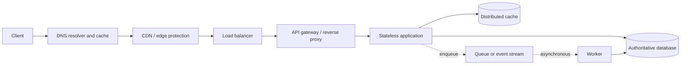
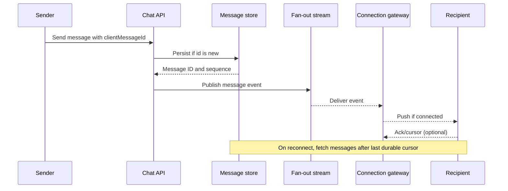

# 14. Networking, Request Routing, and Real-Time Systems

A request crosses multiple independently configured layers. Understanding that path helps explain latency, connection limits, trust boundaries, and where failures should be detected.

## 14.1 Follow the request

DNS maps names to records and responses can be cached; DNS changes therefore do not instantly move every client. A CDN can serve cacheable content close to users and absorb traffic, but dynamic personalized responses need careful cache keys and privacy controls. A reverse proxy receives requests on behalf of upstream services. An API gateway commonly adds API-oriented policies such as authentication, quotas, routing, and request shaping; it is not a replacement for domain authorization or service health.

## 14.2 Transport and protocol choices

- **TCP** provides an ordered byte stream with retransmission; applications still need timeouts and deadlines. **UDP** is datagram-based and leaves reliability/order to the application when needed.
- **TLS** protects confidentiality and integrity in transit and authenticates the server; mutual TLS can also authenticate clients/workloads.
- **HTTP/1.1** commonly uses persistent connections; HTTP/2 multiplexes streams over one connection, but packet loss can affect streams sharing a TCP connection. **HTTP/3** uses QUIC over UDP and avoids TCP-level cross-stream head-of-line blocking, while still having congestion control and network costs.
- **L4 load balancing** routes using transport-level information; **L7** can route based on HTTP host, path, headers, or other application information.
- **Connection pooling** avoids repeated handshakes but creates a finite resource. An undersized pool queues work; an oversized pool can overwhelm the database. Pool limits, request deadlines, and database capacity must be designed together.

## 14.3 Latency budget and timeouts

End-to-end latency includes client/network time, gateway processing, application work, and dependency calls. Sequential dependencies add latency; parallel independent calls are bounded roughly by the slowest call plus coordination overhead. A timeout should be shorter than the caller's remaining deadline and should leave time for cleanup or a response. Avoid giving each downstream call a fresh full timeout.

Cross-region calls can add significant round-trip latency. Put latency-sensitive services and their authoritative data close together unless correctness or residency requirements dictate otherwise.

## 14.4 Polling, SSE, WebSockets, and WebRTC

| Mechanism | Direction and fit | Main trade-offs |
|---|---|---|
| Short polling | Client repeatedly asks for updates | Simple, but repeated empty requests and update delay |
| Long polling | Server holds a request until an update/timeout | Fewer empty responses; connection/request lifecycle complexity |
| Server-sent events (SSE) | Server-to-client event stream over HTTP | Simple one-way updates and reconnect support; client-to-server uses another request |
| WebSockets | Persistent bidirectional messages | Good for chat/collaboration; connection state, fan-out, heartbeats, and reconnect recovery are required |
| WebRTC | Peer media/data with signaling and NAT traversal | Useful for low-latency real-time media; operationally more complex and may need relays |

A persistent connection is not a durable message store. For chat, persist messages first (or make the durable handoff explicit), then fan out notifications. Clients reconnect with a cursor/sequence number and fetch missed messages. Heartbeats detect stale connections imperfectly; reconnects should use jitter to avoid a thundering herd.

## Scenario analysis

**Case:** A live chat service restarts and thousands of clients reconnect at once, creating a reconnect storm and risking delivery gaps.

**Reasoning:** Apply exponential backoff with jitter, limit connection admission, and scale gateways based on connection count and message rate. Persist messages independently of sockets, publish through a durable stream when required, and resume from a durable cursor. Track reconnect rate, active connections, delivery lag, and per-tenant fan-out.

## Quick revision

- DNS and CDN caches affect routing/freshness; neither is instant global control.
- L4 and L7 load balancing solve different routing problems.
- Connection pools are capacity limits, not just performance optimizations.
- A WebSocket is a live channel, not durable storage.
- Design reconnect, replay, backpressure, and fan-out as first-class paths.

## Further reading

- [RFC 9110: HTTP Semantics](https://www.rfc-editor.org/rfc/rfc9110) — HTTP request/response semantics.
- [RFC 9000: QUIC Transport Protocol](https://www.rfc-editor.org/rfc/rfc9000) — transport behavior underlying HTTP/3.
- [RFC 6455: The WebSocket Protocol](https://www.rfc-editor.org/rfc/rfc6455) — WebSocket framing and handshake.
- [MDN: Server-sent events](https://developer.mozilla.org/en-US/docs/Web/API/Server-sent_events) — browser-facing SSE behavior.
