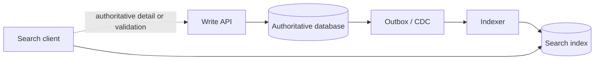

# 15. Specialized Infrastructure: Search, Files, Analytics, and Coordination

Specialized components are justified by a workload or product requirement. Start with the data's authoritative owner and access patterns; add a search engine, object store, stream processor, or coordination system only when its distinct capability is needed.

## 15.1 Search indexes are derived data

A relational database can support exact lookups and many filters, but full-text relevance, tokenization, stemming, and ranked retrieval often justify a search engine. The index is commonly asynchronous and therefore can lag behind the source of truth.

The write path should not pretend that the search index is immediately current unless the system synchronously coordinates that guarantee. For critical updates, expose indexing status, use version-aware indexing, or read the authoritative store for final validation. Rebuild indexes from source data/events when necessary. Search results are often suitable for discovery, not as the authority for inventory, payment state, or access control.

## 15.2 Object storage and file transfer

Store large binary objects in object storage and metadata (owner, permissions, size, checksum, object key, lifecycle state) in a transactional database. This avoids pushing large payloads through application servers and keeps metadata queries efficient.

Typical upload flow:
1. Authenticate and authorize the upload request.
2. Create an upload record and issue a short-lived, scoped presigned URL when supported.
3. Client uploads directly to object storage, possibly using multipart upload for large files.
4. Verify object existence, size, checksum, and policy before marking the upload complete.
5. Publish an event for scanning, thumbnailing, or indexing.
6. Deliver downloads through signed access or a CDN with cache policy appropriate to the data's privacy.

A presigned URL is a bearer capability: anyone holding it may use it within its scope and expiry. Do not log it or make it broader/longer-lived than necessary. Handle abandoned multipart uploads, malware scanning, retention, and deletion from replicas/derived indexes according to policy.

## 15.3 OLTP versus OLAP and batch versus streaming

| Workload | Typical shape | Suitable starting point |
|---|---|---|
| OLTP | Many short transactions, selective reads/writes, invariants | Transactional database |
| OLAP | Large scans, aggregations, historical analysis | Warehouse/lakehouse or analytical store |
| Batch | Process a bounded dataset on a schedule | Scheduled jobs over durable inputs |
| Streaming | Continuously process arriving events with freshness goals | Stream processor plus durable event log |

Do not run expensive analytical scans on the same transactional database without understanding contention. A warehouse is not automatically real-time; ingestion and transformation add lag. Streaming is not automatically better than batch: it introduces state, replay, late-event, and operational complexity.

## 15.4 Bloom filters and probabilistic structures

A Bloom filter can say “definitely not present” or “possibly present,” with false positives but no false negatives under its normal assumptions. It is useful as a cheap pre-check before an expensive lookup, such as reducing unnecessary disk reads. A positive result must still be verified against the authoritative structure. Size it for the expected number of elements and acceptable false-positive probability; account for rebuilds and deletions (ordinary Bloom filters do not support deletion without a variant).

## 15.5 Unique IDs, schedulers, and rate limiting

- **Unique IDs:** choose based on uniqueness scope, sortability, coordination, and exposure of internal information. Central sequences are simple but can bottleneck or leak volume; random IDs reduce coordination but require collision probability analysis; time/worker-based IDs require clock and worker-ID management.
- **Job schedulers:** persist scheduled work, claim it with bounded leases/visibility timeouts, retry transient failures, and make handlers idempotent. A scheduler firing twice must not duplicate a business effect.
- **Distributed rate limiting:** a local token bucket is cheap but only limits each instance. A shared counter/script or dedicated limiter can enforce a global quota at the cost of network latency and a new dependency. Define whether limits are approximate or strict and what happens when the limiter is unavailable.

## 15.6 When not to add a specialized component

Do not add Kafka, a graph database, a distributed lock manager, or a separate search cluster just because the technology is common in interviews. First establish the need: replay/fan-out, graph traversal, coordination, or relevance search. Every additional component adds deployment, monitoring, security, capacity, and failure-handling work.

## Interview questions

### Q1. Why not use the search index as the source of truth?
Search indexes optimize retrieval and may update asynchronously; their schema, refresh behavior, and consistency model may not enforce transactional business invariants. Keep authoritative state in the system designed to enforce those invariants.

### Q2. Why upload files directly to object storage?
It avoids making application servers proxy large bodies, reducing bandwidth and connection pressure. The trade-off is that authorization, upload completion, validation, malware scanning, and metadata consistency need explicit workflows.

### Q3. Is a Bloom filter a replacement for a database lookup?
No. A negative can safely skip a lookup under the filter's correctness assumptions, but a positive only means “possibly present.” Verify it against the authoritative data.

## Quick revision

- Search is commonly a derived, eventually updated index.
- Keep large blobs in object storage and ownership/permissions in a metadata store.
- Separate OLTP and OLAP when their workloads interfere.
- Bloom filters trade memory for probabilistic pre-checks.
- Add specialized infrastructure only when a clear workload justifies its operational cost.

## Further reading

- [Amazon S3 presigned URLs](https://docs.aws.amazon.com/AmazonS3/latest/userguide/using-presigned-url.html) — provider-specific bearer-capability behavior and expiry.
- [Apache Kafka documentation](https://kafka.apache.org/documentation/) — event-log, consumer, and delivery semantics.
- [Apache Spark Structured Streaming guide](https://spark.apache.org/docs/latest/structured-streaming-programming-guide.html) — stateful streaming, event time, and processing model.

