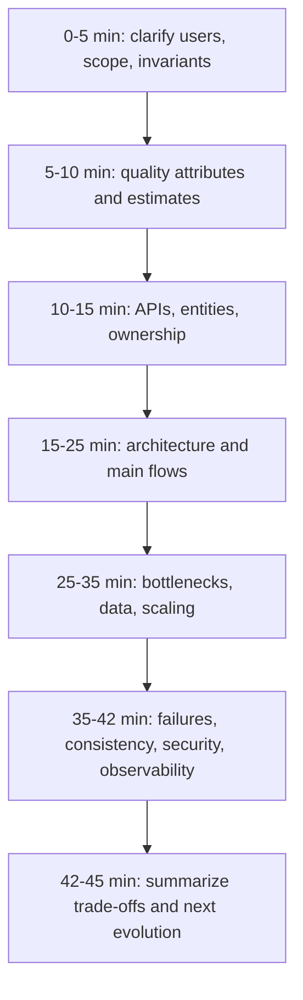
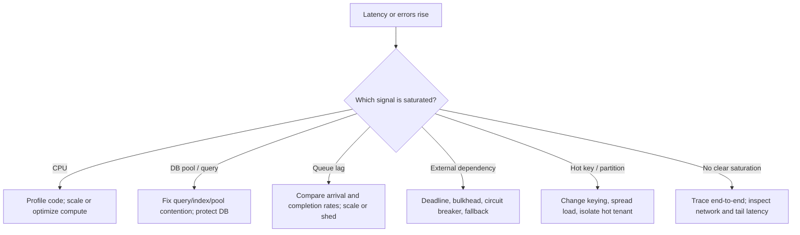

# 16. HLD Interview Method and Estimation Workshop

A strong interview is a sequence of explicit decisions, not a race to draw boxes. Keep the interviewer aligned by stating assumptions, connecting components to requirements, and explaining what changes when a constraint changes.

## 16.1 A practical 45-minute workflow

Treat this as a guide; follow the interviewer's pacing and spend more time where the problem demands it.

### Step 1 — Clarify requirements
Ask about primary users, key use cases, scope exclusions, read/write behavior, and critical business invariants. Say: “I’ll first establish the required behavior and constraints, then choose the simplest architecture that meets them.”

### Step 2 — Prioritize quality attributes
Ask for meaningful latency, availability, freshness, durability, privacy, and cost targets. If exact targets are unknown, state assumptions and explain which decisions depend on them.

### Step 3 — Estimate only what can change the design
Calculate average and peak traffic, read/write mix, data growth, payload bandwidth, and persistent connections where relevant. Do not manufacture precision; show units and a range.

### Step 4 — Define APIs, entities, and ownership
Name the main operations and entities. Identify which component is authoritative for each invariant. Avoid multiple services independently owning the same mutable fact.

### Step 5 — Draw the architecture and walk flows
Draw the simplest useful design. Trace one read and one write end-to-end, including responses, persistence, and async handoffs. Explain each box's reason for existing.

### Step 6 — Find the bottleneck
Ask which resource saturates first: CPU, database connections, disk I/O, hot partition, cache, external dependency, or consumer capacity. Scale that layer or remove the bottleneck before adding unrelated infrastructure.

### Step 7 — Add consistency and failure behavior
Explain stale reads, duplicate requests, ambiguous timeouts, retries, queue backlog, replica promotion, and recovery. Preserve hard invariants at the authoritative transactional boundary.

### Step 8 — Close with trade-offs and evolution
Summarize what the design optimizes, what it sacrifices, and what evidence would justify a more complex design. If requirements change, state which components or guarantees must change and why.

## 16.2 Capacity-estimation worked examples

### Example A: request rate

Assume 50 million API requests per day.

`Average RPS = 50,000,000 / 86,400 ≈ 579`

Assume a peak-to-average factor of 4:

`Peak RPS ≈ 579 × 4 = 2,316`

This is a traffic estimate, not an instance count. Instance capacity must be measured under representative payloads, dependency latency, and target tail latency; leave headroom for failures and bursts.

### Example B: storage growth

Assume 2 million records/day and 1.5 KB of raw payload per record.

`Raw daily growth = 2,000,000 × 1.5 KB = 3,000,000 KB ≈ 3 GB/day`

For 180 days, raw payload is about `3 × 180 = 540 GB`. Indexes, metadata, replicas, compression, backups, and temporary compaction space can materially change physical storage. Estimate them separately rather than applying an unexplained universal multiplier.

### Example C: bandwidth

At 2,000 requests/second and an average 20 KB response body:

`Egress ≈ 2,000 × 20 KB = 40,000 KB/s ≈ 40 MB/s`

That is approximately 320 Mb/s of payload egress using decimal units, before protocol overhead and other traffic. If responses are cacheable, CDN hit rate may reduce origin egress; if payloads vary by user, shared caching may be unsafe.

### Example D: concurrency with Little's Law

Little's Law: `L = λW`, where (L) is average work in the system, (λ) is throughput, and (W) is average time in the system, with consistent units and a stable system.

At 800 requests/second and 0.25 seconds average latency:

`Average in-flight requests ≈ 800 × 0.25 = 200`

This is average concurrency, not a pool-size prescription. Tail latency, bursts, queueing, and resource hold time affect actual sizing.

### Example E: queue stability

If 1,200 events/second arrive and consumers complete 1,000 events/second, backlog grows by about 200 events/second while that condition persists. After 10 minutes, that is roughly `200 × 600 = 120,000` additional events. A queue absorbs bursts; it cannot fix a sustained processing-rate deficit. Add consumer capacity, reduce work, apply backpressure/admission control, or change the workload.

## 16.3 A simple bottleneck diagnosis

## 16.4 Start, middle, and final-minute checklist

**Start**
- [ ] State scope and assumptions.
- [ ] Separate functional requirements from quality attributes.
- [ ] Identify invariants and unacceptable outcomes.
- [ ] Ask only clarifying questions that can change the design.

**Middle**
- [ ] Estimate the workload that affects architecture.
- [ ] Walk through one read and one write.
- [ ] Explain data ownership and authoritative storage.
- [ ] Identify the likely bottleneck and a failure path.
- [ ] Justify every cache, queue, replica, and service boundary.

**Final minutes**
- [ ] State the major trade-offs.
- [ ] Explain how the design degrades and recovers.
- [ ] Mention security, observability, and operational signals.
- [ ] Name the next scaling step and the evidence that would trigger it.

## Interview questions

### Q1. What do you do if the interviewer changes the requirement halfway through?
Restate the new requirement and identify which earlier assumptions it invalidates. Preserve the parts of the design that still fit, then adjust the smallest set of components or guarantees. For example, requiring read-your-writes may change read routing or session consistency without requiring a complete redesign.

### Q2. How do you avoid overengineering?
Start with requirements and workload, then add components only to solve identified constraints. State what the simpler design cannot handle and the measurable signal that would justify evolution. A modular monolith with a relational database may be more defensible than premature microservices and sharding.

### Q3. What makes an estimate useful if it is imprecise?
It narrows the order of magnitude and exposes the assumptions that drive the architecture. Correct units and a transparent range are more valuable than an unsupported exact server count.

## Quick revision

Clarify → quantify → define ownership → draw → walk flows → find bottlenecks → handle failures → explain trade-offs. State assumptions aloud. A queue buffers bursts, a replica copies data, a shard distributes ownership, and a cache stores a copy—none is a universal scaling fix.

## Further reading

- [Google SRE Book: Service Level Objectives](https://sre.google/sre-book/service-level-objectives/) — connecting user expectations to measurable reliability targets.
- [AWS Well-Architected Framework](https://docs.aws.amazon.com/wellarchitected/latest/framework/welcome.html) — a provider's architecture review framework; use it as guidance, not as a universal prescription.

