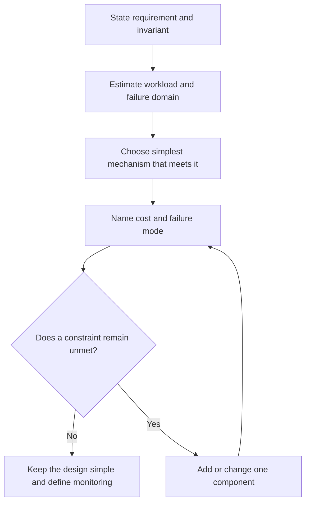

# 17. Senior Trade-offs and Case-Study Practice Path

Senior-level answers are conditional. Explain what changes the decision, not just which option is “better.” The right choice follows from workload, correctness, team ownership, operational capacity, and cost.

## 17.1 Decision guide

| Decision | Prefer A when… | Prefer B when… | Key question |
|---|---|---|---|
| SQL vs NoSQL | Relationships, constraints, joins, and transactions dominate | A specific access pattern needs a different distribution or data model | Which invariants and queries must be enforced? |
| Modular monolith vs microservices | Team and domain are small enough for one deployment boundary | Independent ownership, scaling, or isolation has clear value | Can the team operate the network and deployment complexity? |
| Sync call vs async event | Caller needs immediate result or rejection | Work can complete later and decoupling/replay matters | What does the user see while work is pending? |
| Queue vs stream | Tasks need work distribution and acknowledgement | Multiple consumers need retained events and replay | Is the record of events itself a product capability? |
| Strong vs eventual consistency | Stale data can violate a business invariant | Temporary divergence is acceptable | What exact stale outcome is allowed? |
| Replication vs sharding | Availability/recovery/read capacity is the issue | Dataset or write workload exceeds one node's capacity | Is the bottleneck storage, reads, or writes? |
| Read replica vs sharding | Reads dominate and stale reads are acceptable | A single primary/data node is the limiting factor | Does replication help the constrained resource? |
| Cache-aside vs write-through | Read-heavy access and app-controlled loading fit | Keeping cache updated on writes is worth the coordination | What staleness window can users tolerate? |
| Vertical vs horizontal scaling | A single node is simpler and still has headroom | Work can be partitioned across instances | Is state/shared dependency limiting scaling? |
| REST vs gRPC | Public interoperability, browser access, and simple debugging matter | Typed internal RPC and efficient service-to-service calls matter | What are client, tooling, and compatibility constraints? |
| Polling vs WebSockets | Updates are infrequent or simple request/response is enough | Frequent bidirectional low-latency messages matter | How many concurrent connections and reconnects? |
| Batch vs streaming | Minutes/hours of latency are acceptable and bounded processing is simpler | Continuous low-latency updates are required | Does freshness justify stateful streaming operations? |
| Optimistic vs pessimistic concurrency | Conflicts are rare and retries are safe | Contention is high and holding/ordering access is appropriate | Can conflict be detected and retried safely? |
| Single-region multi-zone vs multi-region | Regional outage risk/cost does not justify global complexity | Regional recovery or latency/residency requirements demand it | What RTO/RPO and budget are required? |
| Active-passive vs active-active | Simpler ownership and failover are valuable | Regions must serve writes concurrently and conflict strategy is sound | Who owns each write during partitions? |
| Normalize vs denormalize | Integrity and flexible updates dominate | Read paths need precomputed views and duplication is manageable | How are duplicated values refreshed and repaired? |
| Simplicity vs extensibility | Requirements are stable and delivery speed matters | Likely change points justify abstraction | What concrete change would this abstraction enable? |
| Performance vs cost | Latency/throughput is a binding requirement | Lower demand or looser SLO permits cheaper capacity | What is the cost per successful operation? |

## 17.2 Explain the trade-off in interview language

A good answer follows this shape:

1. “Given requirement X, I would start with option A.”
2. “It works because mechanism Y provides property Z.”
3. “The cost is limitation L.”
4. “If constraint C changes, I would consider option B.”
5. “I would validate the decision using metric or failure test M.”

**Example — read replica or sharding?** “I would add a read replica if reads are saturating the database and the product tolerates replica lag. It will not increase primary write capacity, and read-after-write requests may still need the leader. I would consider sharding only if a single data node remains the limiting factor after query/index optimization and appropriate vertical scaling.”

**Example — active-active or active-passive?** “I would not choose active-active just to claim higher availability. If writes can have a single regional owner, active-passive can be simpler to reason about. Active-active is justified when concurrent regional writes or latency requirements demand it, and only after defining conflict resolution, data ownership, failover fencing, and residency constraints.”

## 17.3 Curated case-study learning path

The case studies in `real-world-examples/` are canonical. Use this order: first attempt a design without reading the solution, then compare your requirements, estimates, ownership model, flows, failure handling, and trade-offs.

| Stage | Canonical case study | Concepts to practise | Follow-up variation |
|---|---|---|---|
| 1. Fundamentals | [URL shortener](../../../real-world-examples/001.url-shortener.md) | API, key generation, cache, read/write ratio, redirect latency | Custom aliases and abuse prevention |
| 2. Traffic protection | [Rate limiter](../../../real-world-examples/003.rate-limiter.md) | Token bucket, distributed counters, strict vs approximate limits | Limiter dependency outage |
| 3. Data distribution | [Key-value store](../../../real-world-examples/005.key-value-store.md) | Partition keys, replication, quorum, rebalancing | Node failure during write |
| 4. IDs and ordering | [Unique ID generator](../../../real-world-examples/006.unique-id-generator.md) | Coordination, uniqueness scope, clock/worker risks | Clock rollback or worker ID collision |
| 5. Async fan-out | [Notification system](../../../real-world-examples/011.notification-system.md) | Queue, retries, DLQ, idempotency, provider limits | Provider outage and backlog |
| 6. Social read scaling | [News feed](../../../real-world-examples/009.news-feed-system.md) | Fan-out on write/read, cache, hot users, freshness | Celebrity with millions of followers |
| 7. Real-time state | [Chat system](../../../real-world-examples/010.chat-system.md) | Persistent connections, durable history, ordering, reconnect | Multi-device synchronization |
| 8. Search | [Autocomplete](../../../real-world-examples/025.typeahead-suggestion.md) | Prefix index, cache, ranking, freshness | Popular-prefix hot key |
| 9. File systems | [File sync and storage](../../../real-world-examples/019.file-sync-and-storage.md) | Object storage, metadata, upload lifecycle, sync | Interrupted multipart upload |
| 10. Business correctness | [Payment gateway](../../../real-world-examples/029.payment-gateway.md) | Idempotency, ambiguous outcomes, ledger, reconciliation | Provider timeout after successful charge |
| 11. Contention | [Flash sale / ticketing](../../../real-world-examples/030.flash-sale-ticketing-system.md) | Inventory invariant, admission control, queues, hot partitions | Sudden 100x launch traffic |
| 12. Analytics | [Metrics monitoring](../../../real-world-examples/038.metrics-monitoring-and-alerting-system.md) | High-cardinality data, ingestion, retention, aggregation | Delayed consumer and storage pressure |
| 13. Scheduling | [Distributed job scheduler](../../../real-world-examples/041.distributed-job-scheduler.md) | Durable schedules, leases, retries, duplicate execution | Worker crash after side effect |
| 14. Global systems | [Distributed cache](../../../real-world-examples/039.distributed-cache.md) | Sharding, replication, hot keys, failure modes | Regional cache outage |
| 15. Collaboration | [Collaborative document editor](../../../real-world-examples/040.collaborative-document-editor.md) | Real-time fan-out, concurrent edits, reconnect | Offline edits and conflict handling |

**Repository link check note:** These paths are curated against the canonical case-study index; validate exact filenames against the current default branch before relying on the path list. The case studies remain separate; this guide does not duplicate their full designs.

## 17.4 Design review scenarios

### Scenario A: Cache outage
A read-heavy API normally serves 90% of requests from cache. The cache becomes unavailable and database latency rises sharply.

**Strong answer:** Do not blindly send all traffic to the database. Use bounded timeouts, concurrency limits, load shedding, and a controlled fallback policy. Serve stale data only if the domain permits it. Restore cache capacity and warm gradually. Monitor database pool saturation, cache errors, hit ratio, and tail latency. A cache is an optimization unless the system has explicitly made it part of its serving architecture.

### Scenario B: Queue backlog
Arrival rate is persistently higher than successful processing rate.

**Strong answer:** Measure arrival and completion rates, backlog age, and consumer failures. A larger queue only delays the failure. Scale consumers if downstream capacity allows; otherwise reduce work, apply admission control, prioritize critical messages, or increase downstream capacity. Protect against retries multiplying the load and define expiry/DLQ behavior.

### Scenario C: Stale read after update
A user updates an account setting and immediately sees the old value.

**Strong answer:** Determine whether read-your-writes is required. If yes, route the session to the primary, use a version/causal token, or update/invalidate the cache with a defined protocol. If eventual consistency is acceptable, communicate that behavior and bound it operationally where possible.

## Quick revision

- Decisions are conditional on requirements, invariants, workload, and operational capacity.
- Replicas primarily address redundancy/read scaling; shards distribute data and load.
- Queues buffer bursts, but sustainable throughput must match arrival rate.
- Full case studies live in `real-world-examples/`; use the notes to practise the method, not duplicate the solution.

## A repeatable decision path

## Interview questions

### Q1. How do you explain a trade-off without sounding indecisive?
Make a recommendation under explicit assumptions, explain the mechanism and its cost, then state which changed requirement would reverse the decision. Conditional reasoning is a strength: it shows that architecture follows constraints rather than personal preference.

### Q2. When should you introduce sharding?
When a single data node remains a real storage, throughput, or isolation bottleneck after query/index optimization and appropriate vertical scaling. Before sharding, define the partition key, query patterns, cross-shard operations, rebalancing plan, and failure model. Sharding early adds operational complexity without guaranteed benefit.

### Q3. What should a case-study answer include if time is limited?
Prioritize requirements, a rough workload estimate, APIs/entities, architecture, one read and one write flow, the likely bottleneck, and one important failure/correctness path. Then state trade-offs and next steps. Do not spend the whole round drawing boxes or listing every possible component.

## 17.5 Architecture evolution and migration safety

A senior design should explain how the system can evolve without requiring a risky all-at-once rewrite. Prefer incremental changes with observable checkpoints and a rollback or recovery strategy.

A common migration sequence is:
1. **Establish the baseline:** record correctness checks, latency, throughput, error rate, cost, and operational failure modes.
2. **Introduce the new path:** use a compatibility layer or an expand-and-contract schema change so old and new versions can coexist.
3. **Backfill safely:** process existing data in bounded batches, throttle to protect production, and make the backfill restartable.
4. **Compare results:** shadow reads or reconciliation can expose differences; shadow traffic must not repeat external side effects.
5. **Shift traffic gradually:** use a canary or percentage rollout with explicit stop conditions.
6. **Retire the old path:** remove it only after correctness, observability, rollback windows, and dependent consumers are verified.

Dual writes are a common trap: writing to two independent stores does not make the writes atomic. If the process crashes between writes, the stores diverge. Prefer one authoritative write plus an outbox/CDC pipeline where suitable, or define a reconciliation protocol and be explicit about temporary inconsistency.

### Scenario D: moving from one database to a sharded database

Before sharding, confirm the actual bottleneck with query plans, index health, connection saturation, write contention, and storage limits. If the database is constrained by poor indexes or inefficient queries, sharding may multiply operational complexity without fixing the root cause. If partitioning is justified, choose the shard key from access patterns, define how cross-shard operations work, rehearse data movement, and make ownership transitions safe against concurrent writes.

### Q4. When is a strangler migration safer than a rewrite?

When the old system can continue serving some responsibilities while a new path is introduced incrementally. Route a narrow capability at a time, compare behavior, and retain a rollback option. It is not automatically easy: shared data ownership, duplicated business rules, and inconsistent old/new behavior must be controlled.

### Q5. Why are shadow reads useful, and what must not be shadowed blindly?

Shadow reads compare a candidate implementation with production behavior without making it authoritative. They can reveal query or semantic differences before traffic is switched. Shadowing must avoid leaking sensitive data and must not replay mutations, charge payments, send emails, or trigger other non-idempotent side effects.
