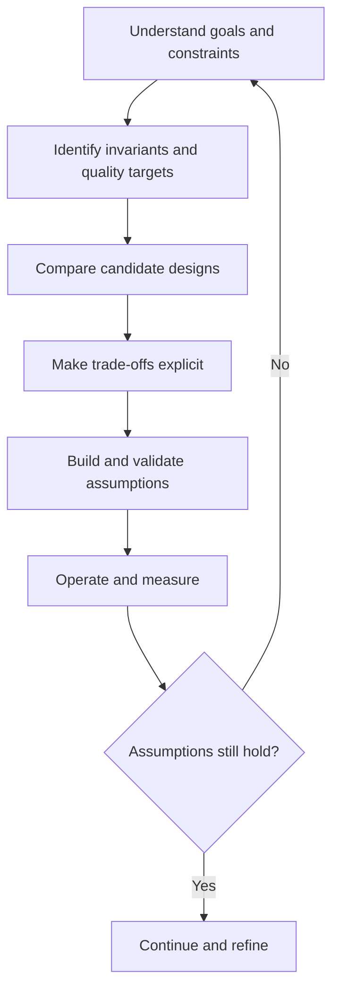

# 1. Thinking in Systems and Architecture

## 1.1 Architecture is a set of consequential decisions

A software system is a collection of interacting parts that transforms inputs into outcomes under constraints. Architecture describes the important structures and decisions that shape those interactions: component boundaries, responsibilities, communication paths, state ownership, deployment units, failure domains, and rules that allow the system to evolve.

A diagram is one representation of architecture, not the architecture itself. Two diagrams can look identical while differing radically in consistency guarantees, retry behavior, security boundaries, data ownership, or recovery behavior. Those properties often determine whether the system works in production.

**System design** is the reasoning process used to choose a system structure that satisfies requirements within constraints. **High-Level Design (HLD)** focuses on major components, their responsibilities, interfaces, data flows, and deployment relationships. **Low-Level Design (LLD)** focuses on internal class/module structures, algorithms, schemas, and detailed implementation. The boundary is contextual: a database schema may be low-level for one discussion but central to HLD when it determines partitioning or consistency.

## 1.2 Start with the problem, not a technology

A reliable reasoning sequence is:

1. State the user or business outcome.
2. Define scope and explicit exclusions.
3. Identify functional behavior and quality attributes.
4. Describe workload shape and important data.
5. Identify constraints and assumptions.
6. Compare viable structures and their trade-offs.
7. Specify failure behavior and operational ownership.
8. Validate with measurements, experiments, and review.

Choosing a database, broker, cloud, or microservice boundary before clarifying access patterns and correctness needs reverses this order. Technology can make some choices easier, but it cannot rescue a misunderstood requirement.

## 1.3 Decompose by responsibility and change

A component boundary should make some kind of change easier or isolate a meaningful concern. Useful signals include distinct domain rules, ownership of data invariants, different scaling needs, security boundaries, independent release cadence, and separate failure containment.

Over-fragmentation creates network calls, distributed transactions, duplicated operational work, and unclear ownership. Under-fragmentation creates entangled code, shared release risk, and competing responsibilities. There is no universal optimal number of components.

A **monolith** is deployed as one application unit; it can still have clear internal modules. A **modular monolith** enforces boundaries inside a shared deployment. **Microservices** split capabilities into independently deployable services and introduce network and operational failure modes. A **distributed system** has components that communicate across a network and must handle independent execution and partial failure. These categories overlap but are not synonyms.

## 1.4 Architecture is multi-objective optimization

Typical objectives conflict:
- Lower latency can require more replicas, locality, or duplicated data.
- Stronger consistency can require coordination and increase write latency or reduce availability during partitions.
- Higher availability can require redundancy, graceful degradation, and careful dependency design.
- More isolation can reduce blast radius but increase cost and operational complexity.
- More abstraction can enable change but obscure behavior and add indirection.

A decision is meaningful only relative to a requirement and context. “Microservices scale better” is incomplete: a service can scale independently only if its bottlenecks and state boundaries allow it, and the organization can operate the resulting distributed system.

## 1.5 Record assumptions and decisions

An architecture decision record (ADR) should briefly capture:
- Context and forces driving the decision.
- Decision and considered alternatives.
- Expected consequences and known risks.
- Assumptions that would invalidate the choice.
- How the decision will be evaluated or revisited.

This protects against hindsight bias and makes trade-offs visible. It is not a substitute for design detail or experiments.

## 1.6 A useful system boundary diagram

~~~mermaid
flowchart LR
  U[Users and external clients] --> E[System boundary]
  E --> A[Application capabilities]
  A --> D[Owned data]
  A --> X[External dependencies]
  O[Operations and security] -. governs .-> E
  O -. observes .-> A
  O -. protects .-> D
~~~

The dotted relationships matter: security, observability, deployment, and operational ownership cross component boundaries rather than living in a single box.

## 1.7 Common errors

- Designing a solution before identifying the problem.
- Treating every quality attribute as equally important.
- Assuming a network call behaves like a local function call.
- Equating more services with better modularity.
- Hiding uncertainty behind precise-looking estimates.
- Describing only the happy path.
- Treating a diagram as evidence that an architecture is correct.

## Further reading
- [Google Cloud Architecture Framework](https://cloud.google.com/architecture/framework) — practitioner guidance for architecture quality.
- [Microsoft Cloud Design Patterns](https://learn.microsoft.com/en-us/azure/architecture/patterns/) — patterns and their contexts.
- [Martin Fowler on microservices](https://martinfowler.com/articles/microservices.html) — trade-offs and organizational implications.

## Architecture as a feedback loop

Architecture is not a one-time diagram. Requirements and constraints shape candidate designs; the design is validated against realistic workloads and failure modes; production evidence then informs the next decision.

---

[Back to textbook contents](../../README.md) · [Curriculum](../../CURRICULUM.md) · [Roadmap](../../ROADMAP.md)
