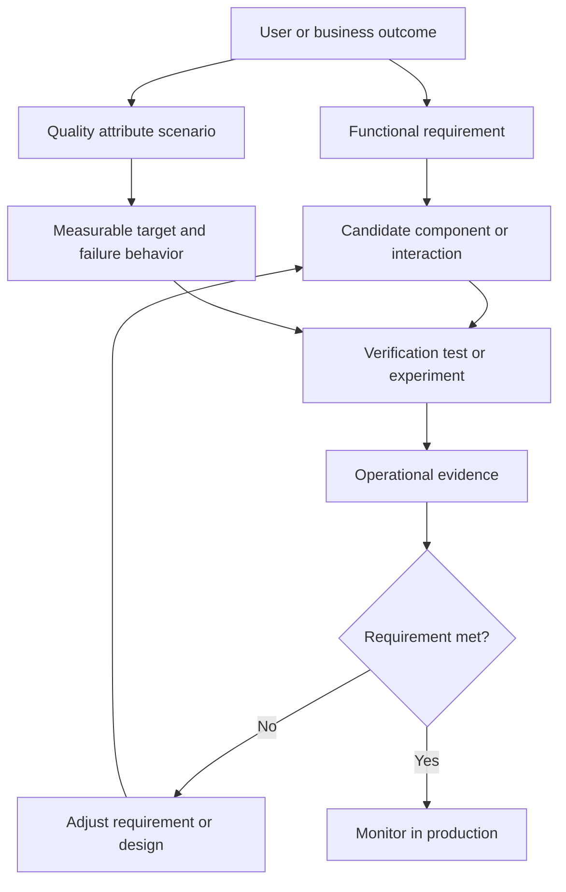

# 2. Requirements and Quality Attributes

Requirements define what success means. A design cannot be judged good or bad without knowing the required behavior, workload, constraints, measurement boundaries, and acceptable failure modes. This chapter turns vague wishes into explicit, testable statements that can guide architecture and validation.

## 2.1 Functional requirements and quality attributes

A **functional requirement** states what the system must do: create an order, retrieve a profile, publish a notification, or revoke access.

A **quality attribute** describes a property of that behavior, such as latency, throughput, availability, durability, privacy, or accessibility. These categories can overlap. “A user can export their data within 30 seconds” combines a function with a performance target.

Avoid treating “non-functional” as meaning optional. Security, privacy, accessibility, and recoverability can be essential acceptance conditions even though they do not describe the primary business operation.

A useful requirement statement identifies:
- Actor or system initiating the behavior.
- Trigger and preconditions.
- Expected result and externally visible side effects.
- Error and denied-operation behavior.
- Relevant quality target.
- Measurement boundary and validation method.

## 2.2 Scope, exclusions, and assumptions

Write down:
- Users, clients, and important workflows.
- In-scope and explicitly out-of-scope behavior.
- Data created, read, updated, deleted, retained, and exported.
- Expected traffic, burstiness, geography, and growth.
- Compliance, budget, team, technology, and migration constraints.
- Dependencies and the behavior expected when each is unavailable.
- Administrative, support, audit, and recovery workflows—not only the main user journey.

An assumption is not a fact. Record it with a validation path. If an assumption strongly affects architecture, model alternative values instead of silently committing to one. Explicit exclusions prevent a design from appearing incomplete merely because it intentionally omits a capability.

## 2.3 Classify requirements by role

| Category | Meaning | Example |
|---|---|---|
| Functional behavior | What operation is supported | A user can submit an order |
| Quality target | How well behavior must work | p99 submit latency below a stated threshold |
| Hard constraint | Condition that cannot be violated | Data must remain in an approved region |
| Preference/objective | A dimension to improve | Minimize operating cost at target traffic |
| Assumption | Unverified premise used for planning | Peak traffic is five times the daily average |
| Acceptance criterion | Observable condition for completion | A test verifies duplicate submissions do not create duplicate orders |
| Operational requirement | How the system is run and recovered | Restore service within a defined recovery objective |

These categories help prevent a preference from being mistaken for a mandatory requirement, or an unverified estimate from being treated as measured truth.

## 2.4 Define workload and user journeys

A request rate by itself is insufficient. Describe:
- Number and type of users or tenants.
- Operations per user journey.
- Read/write and operation-cost mix.
- Payload size and response size.
- Arrival pattern: steady, bursty, periodic, or event-driven.
- Geographic distribution and client network conditions.
- Data size, growth, retention, and hot/cold distribution.
- Synchronous dependencies and background work.
- Peak intervals and acceptable queueing delay.

Different workflows may have different objectives. A profile read, a payment submission, and a nightly report should not automatically share one latency target. The requirement should identify the operation and user-visible boundary.

## 2.5 Quality attributes: definitions and distinctions

| Attribute | Working meaning | Common confusion |
|---|---|---|
| Latency | Elapsed time for a defined operation | Low average does not imply low p99 |
| Throughput | Useful work completed per unit time | High throughput does not imply low latency |
| Availability | Fraction of time or requests meeting a defined success criterion | A running process may still fail user requests |
| Reliability | Ability to perform correctly over time and under stated conditions | Availability alone does not prove correctness |
| Durability | Persistence of acknowledged committed state under a defined failure model | A successful response does not automatically imply durable commit |
| Scalability | Ability to handle workload growth while preserving targets | Adding nodes does not guarantee linear scaling |
| Elasticity | Ability to adjust resources as demand changes | Scaling may lag behind sudden bursts |
| Consistency | Rules governing values and operation order visible to clients | “Consistent” can mean different guarantees |
| Resilience | Ability to withstand and recover from disruptions | Redundancy alone does not ensure recovery |
| Recoverability | Ability to restore service and data after disruption | Backups are not useful until restoration is tested |
| Maintainability | Ease and safety of understanding, changing, testing, and operating the system | Abstraction can help or hinder depending on design |
| Security | Protection against defined threats and unauthorized actions | Authentication alone does not provide authorization |
| Privacy | Appropriate collection, use, access, retention, and deletion of personal data | Encryption alone does not satisfy privacy obligations |
| Observability | Ability to infer internal behavior from emitted signals | More logs do not necessarily make a system diagnosable |
| Portability | Ability to move or operate across environments | Portability can conflict with use of provider-specific capabilities |
| Accessibility | Ability for people with varied sensory, motor, cognitive and assistive-technology needs to use the system | A visually usable interface can still fail keyboard, screen-reader or focus requirements |
| Usability | Ability for intended users to complete tasks accurately and efficiently | Fewer clicks do not necessarily mean fewer errors or lower cognitive load |
| Interoperability | Ability to exchange and correctly interpret data across systems | Syntactically valid payloads can still have incompatible meanings |
| Operability | Ability to deploy, observe, diagnose, maintain and recover the system | Automation without safe rollback or clear ownership can increase operational risk |
| Cost efficiency | Ability to meet required outcomes within a defined cost envelope | Lower unit cost may come at the expense of reliability, latency or engineering effort |
| Sustainability | Ability to deliver the required workload while considering resource and environmental impacts | Lower compute use alone may not represent the full lifecycle or data-transfer impact |

These terms need operational definitions in each project. A database may be durable but temporarily unavailable. A service can be available while returning stale results. A system can have high throughput but poor tail latency.

## 2.6 Make performance objectives measurable

A useful performance target identifies:
1. The operation and workload.
2. The measurement boundary.
3. The statistic, such as p50, p95, or p99.
4. The threshold and time window.
5. The expected success/error rate.
6. The test or telemetry method.

For example: “For authenticated profile reads at the public API boundary, p99 latency is below 250 ms at 2,000 requests/s under the defined request mix, excluding client-network time.” This is much more testable than “the API must be fast.” It still needs a measurement window, error budget, and test environment.

**Percentiles:** p99 is the value at or below which 99% of measured observations fall. It does not mean every request completes within that value. Always specify whether errors and timeouts are included in the measurement and how the sample is collected.

Percentiles are not generally additive across dependent calls. If a request invokes several services, each service's p99 cannot simply be added to calculate end-to-end p99. Correlation, parallel branches, retries, and the distribution tails matter.

## 2.7 Availability, reliability, and error budgets

Availability requires a defined success condition and denominator. Counting only server 5xx responses can conceal timeouts, incorrect responses, or failed client-visible workflows. An SLI should approximate what users experience.

For a simple time-based model:

`Availability = (Total time - Unavailable time) / Total time`

If a service has 99.9% availability over a 30-day month, the nominal unavailable-time budget is:
- 30 days × 24 hours/day = 720 hours.
- 720 hours × 0.001 = 0.72 hours = 43.2 minutes.

This is a mathematical illustration, not a universal SLA interpretation. A request-based SLI may produce a different result, and a provider contract may define exclusions and measurement rules.

A **Service Level Indicator (SLI)** is the measured signal; a **Service Level Objective (SLO)** is the target for that signal; a **Service Level Agreement (SLA)** is an external commitment, often with consequences if the commitment is missed. These terms are related but not interchangeable.

An **error budget** is the amount of unreliability permitted by an SLO over its measurement window. It supports explicit decisions about release risk, reliability work, and feature delivery. It is not permission to deliberately fail the system.

## 2.8 Durability, data loss, and recovery objectives

Durability concerns whether acknowledged data survives the failures included in the system's guarantee. Clarify:
- When a write is considered acknowledged.
- Whether data is only in memory, on local durable media, or replicated.
- Which failures must be survived: process crash, host loss, zone loss, region loss, or operator error.
- Whether replicas are synchronous or asynchronous.
- Whether backups are isolated from the primary failure domain.
- How corruption and accidental deletion are detected and repaired.

**Recovery Point Objective (RPO)** is the maximum acceptable data-loss window expressed in time. **Recovery Time Objective (RTO)** is the target time to restore service after a disruption. They are different: a system may restore quickly but lose recent writes, or preserve all writes while taking a long time to restore.

A backup strategy is incomplete until restoration is tested, permissions are verified, keys are available, dependencies are recoverable, and the restored data is validated.

## 2.9 Consistency and correctness requirements

“Fresh data” is ambiguous. Ask:
- Must a read immediately observe a successful write?
- Can a user read their own recent write while other users see older data?
- Can replicas return different values temporarily?
- Is the operation allowed to be reordered with another operation?
- Does the system need a single globally agreed order?
- Is temporary inconsistency acceptable if the system converges later?

Correctness also includes business invariants. A response may be available and fast while violating “never charge an order twice.” Define the business property first, then determine which transaction, constraint, idempotency, coordination, or reconciliation mechanism is needed.

## 2.10 Security and privacy requirements

Security requirements should identify assets, actors, trust boundaries, threats, and controls. Examples include:
- Only an authorized tenant member can read a tenant's record.
- Secrets must not be included in logs.
- Administrative actions must be auditable.
- Transport must be protected against network attackers.
- Credentials can be rotated without a prolonged outage.
- Access is revoked within a defined operational window.

Privacy requirements address purpose limitation, data minimization, access, retention, deletion, residency, and audit. “Encrypt the database” is not a complete security or privacy requirement; it does not address excessive authorization, compromised application credentials, data in logs, or retention obligations.

## 2.11 Requirements-to-design traceability

For each critical requirement, document:
1. Requirement and rationale.
2. Metric or invariant and threshold.
3. Architecture mechanism intended to satisfy it.
4. Assumptions and dependencies.
5. Validation method.
6. Failure mode if the mechanism does not hold.
7. Owner responsible for ongoing verification.

Example: a p99 latency target might motivate a bounded database connection pool, caching for repeated reads, and an end-to-end deadline. Each mechanism needs tests: cache-miss behavior, pool saturation, dependency timeout, cold start, and realistic traffic mix. A design decision is not validated merely because its component exists.

~~~mermaid
flowchart TD
  A[User or business outcome] --> B[Functional requirement]
  A --> C[Quality attribute]
  B --> D[Observable acceptance criterion]
  C --> D
  D --> E[Design decision and trade-off]
  E --> F[Test, metric, or operational check]
  F --> G{Target met?}
  G -- No --> E
  G -- Yes --> H[Review under realistic load and failures]
~~~

## 2.12 Prioritize conflicting requirements

A practical method is to distinguish:
- **Must satisfy:** legal, security, correctness, and contractual constraints.
- **Target:** measurable objectives that define acceptable service.
- **Optimize:** desirable improvements when cost and risk permit.
- **Defer or exclude:** capabilities intentionally outside current scope.

Then test the proposed design against competing scenarios. For example, synchronous fraud checks may improve risk control but increase latency and dependency coupling. The decision depends on risk, acceptable false outcomes, user impact, and fallback policy—not on a generic rule that synchronous or asynchronous is always better.

## 2.13 Questions that expose ambiguity

- What exactly counts as a successful operation?
- Is the read allowed to be stale? If so, by how much?
- Does a successful response mean data is durably committed?
- What happens if a request times out after the server commits it?
- Are workloads steady, bursty, seasonal, or synchronized?
- What is the impact of losing one host, one zone, one region, or a dependency?
- How are deletion, audit, retention, and recovery reconciled?
- Which failure is acceptable, and which must be prevented?
- Who measures the target, and where is the measurement boundary?
- What evidence would cause the requirement or design to change?

## 2.14 Self-check

You should be able to:
1. Turn “fast and highly available” into measurable objectives.
2. Explain why durability is different from availability.
3. Distinguish SLI, SLO, SLA, RTO, and RPO.
4. Explain why p99 latency cannot be inferred by adding downstream p99 values.
5. Identify the difference between a hard constraint and an optimization objective.
6. Trace a requirement to a design mechanism, test, metric, and owner.
7. Identify the ambiguity in a statement such as “all data must be consistent.”

## 2.15 Express quality attributes as scenarios

A quality attribute becomes useful when it describes a stimulus, context, response and measurable response criterion. “The system must be scalable” is not testable. “During a five-minute burst to 8,000 requests per second in one region, 99% of read requests complete within 250 ms, error rate remains below 0.5%, and the system returns to normal latency within two minutes after the burst” is much more actionable.

A quality scenario should identify:
- **Stimulus:** traffic burst, node loss, invalid input, dependency slowdown, data restore, or deployment.
- **Environment:** normal load, peak load, partial failure, region outage, or degraded network.
- **Affected element:** API, database, queue, cache, deployment system, or whole user journey.
- **Response:** continue, reject, degrade, fail over, recover, or alert.
- **Measure:** latency percentile, success rate, data-loss window, recovery time, cost ceiling, or detection time.

The exact numbers must come from business needs, workload estimates and operational capability—not from a generic “industry standard.”

## 2.16 Distinguish availability, reliability, durability and correctness

These qualities answer different questions:
- **Availability:** can the system successfully serve the required operation now?
- **Reliability:** does it continue to behave as required over time and under expected conditions?
- **Durability:** once data is acknowledged under the stated contract, how likely is it to survive specified failures?
- **Correctness:** does the result preserve the domain rules and promised semantics?

A service can be available but return stale or incorrect data. A database can be durable but unavailable during failover. A system can meet a latency SLO while silently dropping events. Define the user-visible success condition so a fast error or stale response is not counted as success unless the product contract allows it.

## 2.17 Requirement conflicts and prioritization

Quality attributes can conflict. Stronger consistency may add coordination latency or reduce availability during a partition; additional replicas can improve fault tolerance but increase cost and operational complexity; caching can improve latency while weakening freshness; richer synchronous fan-out can improve completeness while worsening tail latency.

Prioritize by identifying non-negotiable invariants, measurable user outcomes, acceptable degraded behavior, and budget constraints. Do not resolve a conflict with a vague phrase like “highly available and strongly consistent everywhere.” State the failure scenario and the operation's required guarantee.

## 2.18 Requirement review checklist

- Are functional outcomes and explicit non-goals stated?
- Are peak, burst, geographic and tenant workload assumptions visible?
- Are latency targets percentiles measured at a user-visible boundary?
- Does success mean a correct result, not merely an HTTP response?
- Are freshness and consistency expectations defined per operation?
- Are durability, RPO and RTO specified for important data?
- What behavior is acceptable during overload or dependency failure?
- Which security, privacy and retention constraints are mandatory?
- How will each requirement be tested and observed?
- Which assumptions would force an architectural redesign if wrong?

## 2.19 Accessibility, usability and internationalization are system requirements

Accessibility and usability are not merely front-end polish. They influence API and workflow design, identity recovery, error handling, document formats, notification channels, support processes and the ability to complete critical tasks during disruption.

An accessibility requirement should name the user journey, context, applicable standard or policy, and verification method. For web content, the W3C Web Content Accessibility Guidelines (WCAG) 2.2 defines testable success criteria across perceivable, operable, understandable and robust content. The appropriate conformance target depends on legal, contractual and product requirements; do not claim conformance solely because an automated scanner reports no findings.

Examples of measurable or testable requirements include:
- A critical checkout flow can be completed using keyboard-only interaction, with visible focus and no keyboard trap.
- Validation errors are programmatically associated with their fields and communicated to assistive technology.
- Authentication recovery does not depend exclusively on one sensory channel when an accessible alternative is required.
- Time-limited actions provide a compliant way to extend or avoid the limit where appropriate.
- The product is tested with the target browser/assistive-technology combinations and representative user workflows.

Usability asks whether intended users can complete tasks accurately, efficiently and with reasonable effort. Useful evidence includes task completion rate, error rate, abandonment, time-on-task and support contacts, segmented by meaningful user journeys rather than reduced to one universal score.

Internationalization prepares a system to support different languages, scripts, time zones, calendars, number formats, currencies and cultural conventions. Store timestamps with a clearly defined time model (commonly UTC instants plus relevant zone/context where needed); do not treat a local wall-clock time as a globally unique instant. Keep user-visible text separate from business logic, use locale-aware formatting, and test sorting/searching for supported scripts and languages. Localization is more than translating labels: it may change layouts, validation, legal notices, payment methods and user expectations.

## 2.20 Operability, portability, cost and sustainability

Quality attributes must cover the lifecycle after the first successful deployment. A system that meets its latency target but cannot be safely upgraded, diagnosed or restored is not a complete design.

### Operability and maintainability

Define requirements for deployment safety, configuration changes, observability, incident diagnosis, access review, backup restoration, capacity management and decommissioning. For example: “A failed release can be halted and the previous compatible version restored within ten minutes without losing acknowledged writes.” The exact target must be derived from the system's risk and operational capability.

Maintainability is affected by clear ownership, bounded dependencies, understandable state transitions, testability, schema and API compatibility, and the cost of operating each component. A service count or code metric is not a direct measure of maintainability.

### Portability and interoperability

Portability can mean moving between environments, regions, cloud providers, runtime versions or deployment platforms. It has a cost: avoiding all provider-specific capabilities may sacrifice managed reliability, performance or developer productivity. Define the portability boundary and the actual exit scenario instead of demanding abstract “cloud agnosticism.”

Interoperability concerns whether systems can exchange data and preserve its meaning. Define protocol versions, schema evolution, encoding, time/currency units, identity semantics, error behavior and compatibility expectations. Successful parsing does not prove semantic compatibility.

### Cost efficiency

A cost target should identify the workload, time window, cost boundary and what is included. Possible measures include cost per successful transaction, cost per million requests, cost per retained GB-month, or monthly cost at a defined peak and steady-state profile. Include relevant compute, storage, database I/O, network transfer, logs/metrics, backups, support, and operational labor when they materially affect the decision.

Cost estimates should distinguish fixed from usage-dependent cost and normal from failure-mode cost. Redundancy, cross-region replication, high-cardinality telemetry, cache misses, retries and data egress can change the bill. Optimizing cost per request while allowing retries to multiply or users to receive incorrect responses is not a valid improvement.

### Sustainability and resource efficiency

Environmental impact is influenced by resource utilization, idle capacity, data retention and movement, hardware/service choices, workload timing and the lifecycle of the system. Consider efficient algorithms and data representations, right-sized capacity, demand-aligned scaling, retention policies, cache effectiveness, and whether a workload genuinely needs always-on resources. Do not equate one metric—such as CPU utilization—with total environmental impact; measurement methods and available provider data vary.

AWS and Google Cloud publish sustainability architecture guidance, but their recommendations are provider-specific implementations of broader goals. Use the AWS Sustainability Pillar and Google Cloud Sustainability pillar as examples, not universal measurement standards.

### Quality-attribute scenario examples

| Attribute | Example stimulus and context | Observable response criterion | Verification evidence / accountable role |
|---|---|---|---|
| Accessibility | A user completes account recovery using keyboard navigation and a screen reader | The required journey is operable and its errors/status changes are programmatically exposed under the chosen accessibility standard | Automated checks plus manual keyboard/screen-reader testing; product/design and QA share verification ownership |
| Operability | A deployment introduces elevated errors | The rollout is automatically halted at a defined threshold and the on-call owner receives actionable evidence | Staging fault injection and rollout telemetry; service owner and on-call team |
| Portability | A region or hosting environment must be changed | Data, identity, dependencies and deployment configuration can be moved within an agreed time/cost budget | Timed migration/restore rehearsal with dependency inventory; platform owner and service owner |
| Cost efficiency | Traffic increases from steady state to a defined peak | The service meets its latency/error objectives within a stated cost envelope | Load-test cost report including egress, telemetry and failure headroom; service owner with finance/platform partners |
| Sustainability | Demand drops substantially overnight | Resources and background work reduce safely without violating latency, recovery or data-retention requirements | Measure resource consumption before/after scaling and check SLOs; platform owner and workload owner |

These scenarios must be adapted to the product. The target numbers, exclusions and verification method should be explicit rather than borrowed from an unrelated architecture.

## 2.21 Quality attributes interact across the lifecycle

Quality attributes are not independent checkboxes. A decision can improve one dimension while making another harder:
- Caching may reduce latency and database cost while increasing freshness complexity and invalidation risk.
- Synchronous replication may reduce the acknowledged-write loss window while increasing write latency or reducing progress when a replica is unreachable.
- Multi-region active-active deployment may improve regional serving availability while adding conflict handling, operational cost and data-governance complexity.
- Aggressive autoscaling may reduce steady-state cost while increasing cold-start latency and control-plane churn.
- Long retention can support audit and recovery while increasing storage expense, exposure and deletion obligations.
- Strong portability requirements may reduce provider lock-in while increasing engineering effort or giving up managed capabilities.

For each important trade-off, identify the affected user outcome, the failure scenario, the measurement, the owner, and the trigger for revisiting the decision. Avoid optimizing a local metric if it makes the end-to-end user journey worse.

### Quality-attribute review checklist

- Are accessibility and usability requirements defined for critical journeys?
- Are supported languages, time zones, currencies and formats explicit?
- Can the service be deployed, diagnosed, restored and decommissioned safely?
- Does portability name a realistic migration boundary and acceptable cost?
- Is interoperability semantic as well as syntactic?
- Is cost measured for a defined workload and successful outcome?
- Are failure-mode costs such as retries, egress, backups and telemetry considered?
- Are sustainability claims based on an explicit scope and available evidence?
- Are trade-offs between freshness, availability, cost, performance and operability documented?
- Does each target have an owner and a way to validate it continuously?

## Further reading

- [Google SRE Book](https://sre.google/sre-book/table-of-contents/) — reliability objectives and operational practice.
- [Google SRE: Service Level Objectives](https://sre.google/sre-book/service-level-objectives/) — SLI/SLO reasoning.
- [AWS Well-Architected Framework](https://docs.aws.amazon.com/wellarchitected/latest/framework/welcome.html) — quality attribute trade-offs.
- [NIST Privacy Framework](https://www.nist.gov/privacy-framework) — privacy risk management.
- [W3C Web Content Accessibility Guidelines (WCAG) 2.2](https://www.w3.org/TR/wcag/) — testable accessibility success criteria.
- [AWS Sustainability Pillar](https://docs.aws.amazon.com/wellarchitected/latest/sustainability-pillar/sustainability-pillar.html) and [Google Cloud Sustainability](https://docs.cloud.google.com/architecture/framework/sustainability) — provider-specific examples of resource-efficient design.

---

[Back to textbook contents](../../README.md) · [Curriculum](../../CURRICULUM.md) · [Roadmap](../../ROADMAP.md)
