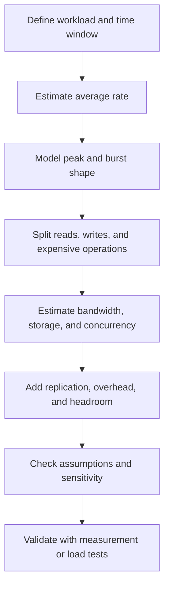

# 3. Workload Models and Capacity Reasoning

Capacity estimation is a way to expose scale and bottlenecks before choosing infrastructure. It is not a promise of production performance. The output is a model whose assumptions can be measured and revised.

## 3.1 Units and rates

Use consistent units. One byte is 8 bits. Decimal storage units commonly use KB = 1,000 bytes, MB = 10^6 bytes, GB = 10^9 bytes; binary units use KiB = 1,024 bytes, MiB = 2^20 bytes, GiB = 2^30 bytes. State which convention is used.

A rate is quantity divided by time. Requests/s, MB/s, and events/s are not interchangeable; each event may have a different payload size and processing cost.

## 3.2 Average traffic and peak traffic

Suppose a service receives 30 million requests per day.

- Seconds/day = 86,400.
- Average rate = 30,000,000 / 86,400 ≈ 347.22 requests/s.
- If a measured peak-to-average factor is 5, peak estimate ≈ 1,736 requests/s.

The factor 5 is an explicit assumption, not a universal property. Traffic may be more bursty around releases, notifications, or daily batch jobs. Use time-series data when available.

Averages hide synchronized bursts. Capacity must be sized against the workload interval that matters, not just the daily mean.

## 3.3 Read/write mix

If 70% of the estimated 1,736 requests/s are reads:
- Reads ≈ 1,215/s.
- Writes ≈ 521/s.

This arithmetic does not imply equal resource cost. One write may update several indexes and replicas; one read may scan millions of rows. Request mix is a starting point, and operation-weighted CPU, I/O and lock demand matter more.

## 3.4 Bandwidth

Assume peak traffic is approximately 1,736 requests/s and average response payload is 24 KiB = 24 × 1,024 = 24,576 bytes.

Payload egress ≈ 1,736 × 24,576 = 42,663,936 bytes/s ≈ 40.7 MiB/s ≈ 341.3 Mbit/s.

This excludes request payloads, protocol headers, TLS overhead, retransmissions, replication, and traffic between internal services. A network estimate that ignores response size can be wrong by orders of magnitude.

## 3.5 Storage growth

Assume 2 million new records/day, with 1.2 KiB of logical record data each.

Daily logical growth = 2,000,000 × 1.2 KiB = 2,400,000 KiB ≈ 2.29 GiB/day.
Annual logical growth ≈ 2.29 × 365 ≈ 835 GiB/year.

If a planning model uses a 2.5× multiplier for indexes, metadata, and operational overhead, one year's primary footprint is roughly 2.04 TiB before replicas and backups. The multiplier is a placeholder to be replaced by measurements from the selected schema and engine. If three full copies are retained, replicated capacity may approach 6.1 TiB, before backup retention and free-space requirements. Do not apply a replica multiplier twice if the original estimate already includes replicas.

## 3.6 Memory and cache sizing

If 5 million hot keys average 600 bytes of value data, raw values occupy 3,000,000,000 bytes, about 2.79 GiB. Real cache memory also includes key bytes, object/allocator overhead, hash-table slack, metadata, replication buffers, and fragmentation. The usable value capacity is therefore lower than physical RAM.

A cache hit ratio must specify what counts as a lookup. If 90% of 1,000 lookups/s hit, the backing store receives about 100 misses/s for that lookup class—unless misses trigger multiple backend operations or requests coalesce.

## 3.7 Concurrency and Little's Law

For a stable system, Little's Law states:

\[
L = \lambda W
\]

where L is average number of items in the system, λ is average arrival/completion rate, and W is average time in the system.

If a service completes 800 requests/s and average time in the system is 0.15 s, average in-flight requests are about 800 × 0.15 = 120. This is an average, not a maximum thread count or a safe pool size. Burstiness, queueing, service-time variance, and deadlines matter.

Little's Law applies to stable averages over a consistent boundary. If arrivals persistently exceed completions, backlog grows and the system is not in steady state.

## 3.8 Latency budgets and queueing

End-to-end latency includes network, queueing, application work, downstream calls, and response transfer. A budget might allocate 30 ms to edge/network, 40 ms to application work, 80 ms to data access, and 20 ms to serialization and response: total 170 ms. These are allocations, not guaranteed additive percentiles; correlated distributions and parallel branches make percentile composition subtle.

As utilization approaches a resource's effective capacity, queueing delay can rise sharply. Adding a queue does not create capacity; it can turn immediate rejection into delayed failure. Bound queues and deadlines, then decide which work to reject or shed.

## 3.9 Sensitivity and sanity checks

Ask which assumptions dominate the result:
- If payload size doubles, bandwidth approximately doubles.
- If record count doubles, logical storage approximately doubles if record shape is stable.
- If peak-to-average ratio rises, average-based capacity may under-provision.
- If one operation causes ten database writes, request rate is not database operation rate.

Check units, orders of magnitude, and implied physical limits. Compare estimates with observed metrics and benchmark realistic workload mixes before committing to capacity or cost.

## 3.10 Fan-out and amplification

An incoming request may trigger multiple internal operations. Estimate work at each layer rather than assuming one external request equals one database query or one message.

For example, if 1,000 API requests/s each cause 4 cache lookups and a cache hit rate of 90%, the approximate cache-miss rate is:
- Cache lookups = 1,000 × 4 = 4,000 lookups/s.
- Misses = 4,000 × 0.10 = 400 misses/s.

If each miss triggers 2 database operations, the database receives roughly 800 operations/s from this path. This is only a first-order model: retries, coalescing, batching, background work, and uneven key popularity can change the result.

An **amplification factor** is a useful shorthand for how much downstream work one unit of upstream work creates. Measure it per dependency and operation class. A retry storm can make amplification increase precisely when a dependency is unhealthy.

## 3.11 Workload shape and forecasting

Daily totals hide the shape of arrivals. Useful views include:
- Requests per second at multiple windows (for example, 1-second, 1-minute, and 15-minute).
- Peak-to-average ratio and burst duration.
- Day-of-week and seasonal patterns.
- Correlated traffic caused by cron jobs, synchronized clients, cache expiry, or batch releases.
- Growth in active users, stored records, payload size, and operation complexity.

A forecast should state its horizon and model. Linear growth, percentage growth, and step changes produce different capacity requirements. A system growing 5% monthly compounds: projected volume after n months is current volume multiplied by 1.05^n, if that growth assumption holds. The calculation is not a substitute for validating the business assumptions behind the rate.

Use ranges for uncertain inputs. If peak rate may be 1,500–2,200 requests/s and average response size may be 20–30 KiB, calculate low, central, and high scenarios instead of presenting one false-precision number.

## 3.12 Capacity, utilization, and headroom

A component's sustainable capacity is workload-dependent. A benchmark reporting 10,000 requests/s is meaningful only with its operation mix, payloads, hardware, error rate, latency distribution, and dependency configuration.

If a worker can sustain 500 operations/s for the target latency and error rate, a rough first estimate for 2,000 operations/s is four such worker-equivalents. This does not prove that four instances suffice: coordination, shared databases, load imbalance, autoscaling delay, failover, and nonlinear contention can change the result.

Headroom is capacity intentionally left unused to absorb bursts, failures, maintenance, and forecast error. There is no universal safe utilization percentage. The correct threshold depends on queueing behavior, burst shape, recovery objectives, and the cost of excess capacity. Size for the required failure scenario as well as normal operation: if one of four equal instances must be lost without violating the target, the remaining three must carry the required load.

## 3.13 Queueing, saturation, and tail latency

A queue forms when work arrives faster than the next stage can complete it, even temporarily. A bounded queue absorbs short bursts; a persistent arrival/completion mismatch causes backlog growth.

Little's Law, L = λW, relates average in-flight work to throughput and time in the system, but it does not by itself predict waiting-time distributions. Queueing delay depends on utilization, service-time variance, arrival burstiness, scheduling, and queue discipline.

As utilization approaches effective capacity, a small increase in arrival rate can cause a disproportionate increase in waiting time. This is why a system can appear healthy at moderate load and suddenly exhibit severe p99 latency near saturation. Monitor queue depth and queue-wait time, not just CPU utilization.

Useful controls include admission limits, bounded queues, deadlines, load shedding, backpressure, and priority classes. Each policy has a cost: rejecting work protects the system but reduces immediate success; queueing preserves work temporarily but increases latency and consumes memory.

## 3.14 Cost and resource-specific models

Capacity is multidimensional:
- CPU demand depends on operations and their computational complexity.
- Memory demand depends on resident data, in-flight requests, buffers, runtime overhead, and caches.
- Storage demand includes logical data, indexes, replicas, compaction/free-space needs, and retained backups.
- Network demand includes payloads, protocol overhead, retries, replication, and cross-zone or cross-region transfer.
- Connection demand depends on concurrency, reuse, idle lifetimes, and downstream limits.

Do not assume one resource scales in proportion to another. A cache can reduce database reads while increasing memory and network traffic. Compression can reduce bandwidth while increasing CPU. Replication can improve durability or read capacity while multiplying write traffic and storage.

For cost estimation, map each resource model to a billable unit (instance time, vCPU, memory, requests, stored byte-hours, operations, or transferred bytes), then apply the provider's actual pricing and discount model. Pricing changes and workload commitments must be checked against current provider documentation before making a purchase decision.

## 3.15 Capacity model review checklist

Before trusting an estimate, verify:
- Every quantity has a unit and time window.
- Average and peak are not confused.
- Burst duration is understood, not just peak magnitude.
- Payload sizes and operation mixes are explicit.
- Fan-out, retries, replication, indexes, and background work are counted.
- Resource capacity is based on a comparable workload benchmark.
- Failure capacity and headroom are included.
- Uncertainty is shown as ranges or scenarios.
- Results are sanity-checked against known physical limits and measured telemetry.

## 3.16 Worked capacity example: convert a product workload into resources

Assume a service has 20 million active users per day. Each active user generates an average of 15 API requests during the day. This is a hypothetical sizing example; production estimates should use measured request distributions, peak factors, payload sizes and actual service costs.

### Step 1: daily requests and average rate

Daily requests = 20,000,000 × 15 = 300,000,000 requests/day.

Average request rate:

300,000,000 ÷ 86,400 ≈ 3,472 requests/second.

Average rate is not the peak design rate. If a measured or assumed peak-to-average multiplier is 4, peak traffic is about 13,889 requests/second. The multiplier must be justified from real traffic shape; login events, campaigns, batch jobs and geographic time zones can create sharper peaks.

### Step 2: split by request class

Assume 80% reads and 20% writes. At the illustrative peak:
- Reads: about 11,111 requests/second.
- Writes: about 2,778 requests/second.

This split is only a starting point. A single API request may trigger multiple database queries, cache misses, downstream RPCs, events or analytics writes. Estimate work amplification separately for each request class.

### Step 3: estimate bandwidth

Assume the average response body is 12 KiB and average request body is 1 KiB. Ignoring protocol overhead and compression for the first estimate, application payload bandwidth is approximately:

13,889 requests/s × 13 KiB ≈ 176,000 KiB/s, or about 172 MiB/s.

This is roughly 1.44 Gbit/s of payload before transport overhead, encryption, retransmission, replication, internal traffic and burst headroom. Measure ingress and egress separately; response sizes and request rates may differ substantially by endpoint.

### Step 4: estimate concurrency using Little's Law

If the average end-to-end latency at peak is 120 ms, average in-flight requests are approximately:

L = λW = 13,889 requests/s × 0.12 s ≈ 1,667 concurrent requests.

This is average concurrency at the assumed arrival rate and average time. It is not a recommended thread count: requests may be asynchronous, latency distributions are not constant, and queueing near saturation can increase service time sharply. Pool sizes should be based on the constrained resource and measured service-time distribution.

### Step 5: account for cache and downstream amplification

If 70% of read requests are served by an eligible cache, the cache miss rate for that read class is 30%. At the illustrative peak, origin read traffic is approximately 11,111 × 0.30 ≈ 3,333 reads/second, before accounting for stampedes, refreshes, retries and non-cacheable endpoints.

If each origin request triggers an average of 2.5 database operations, the database may see roughly 8,333 operations/second from that path alone, plus writes, background jobs, replication, maintenance and other services. A cache hit ratio is therefore a major capacity input, but it must be measured under realistic keys and invalidation patterns.

### Step 6: capacity is not the same as instance count

To estimate instances, benchmark a representative build under realistic request mixes and target latency. If one ready instance sustains 800 requests/second at the required p99 latency, 13,889 / 800 ≈ 17.4 instances are needed before redundancy and headroom. If the design must tolerate losing 25% of instances without violating the SLO, the required fleet size is at least 13,889 / (800 × 0.75) ≈ 23.2, so round up and validate the actual load distribution. This simplified calculation assumes linear scaling; shared dependencies and uneven load often break that assumption.

### Step 7: write down uncertainty

Create low/base/high estimates for peak multiplier, payload size, cache hit ratio, downstream fan-out, request cost and failure headroom. Identify which assumption most affects the result and measure it first. A spreadsheet with precise arithmetic but unvalidated inputs is not a reliable capacity plan.

## Further reading
- [Google SRE Book: Handling Overload](https://sre.google/sre-book/handling-overload/).
- [Little's original law is often taught through queueing theory; a practical systems treatment appears in the SRE literature](https://sre.google/sre-book/table-of-contents/).

## A repeatable capacity-estimation path

The result is a range with explicit assumptions, not a magically precise prediction.

---

[Back to textbook contents](../../README.md) · [Curriculum](../../CURRICULUM.md) · [Roadmap](../../ROADMAP.md)
