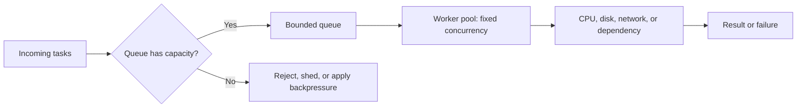

# 4. Execution, Concurrency, and Resource Limits

## 4.1 Processes, threads, and tasks

A process is an execution environment with its own virtual address space and operating-system resources. Threads within a process share memory but have separate execution state such as stacks and registers. Runtimes may also schedule lightweight tasks or coroutines over a smaller number of OS threads.

Process isolation can limit memory corruption and failure propagation but costs more resources and requires explicit inter-process communication. Threads share data efficiently but introduce synchronization hazards. Lightweight tasks reduce the cost of representing waiting work, but they do not remove CPU, memory, file descriptor, or downstream capacity limits.

## 4.2 Concurrency is not parallelism

Concurrency means multiple activities overlap in progress. Parallelism means work executes simultaneously on multiple execution resources. An asynchronous program can handle many waiting network operations without running all of them simultaneously. CPU-bound work benefits from parallel execution only when cores and runtime constraints permit it.

A single-threaded event loop can be efficient for I/O-heavy workloads but can stall every connection if one callback performs long CPU work. A thread-per-request server is conceptually simple but can exhaust memory or scheduling capacity under high concurrency.

## 4.3 Blocking and non-blocking I/O

Blocking I/O suspends the calling thread until an operation completes or fails. Non-blocking I/O returns control when the operation cannot currently progress, allowing the runtime to wait for readiness/completion and schedule other work. Asynchronous APIs can represent completion as callbacks, futures, promises, or coroutine suspension.

These terms are related but not identical: non-blocking describes an operation's behavior at the call boundary; asynchronous describes how completion is handled. The actual semantics depend on the OS, runtime, library, and resource.

## 4.4 Pools are queues with limits

Thread pools, connection pools, and worker pools bound concurrent use of expensive resources. They also create queues. When a pool is exhausted, requests may wait, time out, or fail fast.

Example: if a database pool allows 40 concurrent connections, that is not proof that 40 is optimal. Too many connections can increase database contention and context switching; too few can create application-side waiting. Measure active connections, wait time, database CPU, query duration, and queue length together.

Avoid unbounded queues and unbounded task creation. They can convert overload into memory exhaustion and extremely long tail latency.

## 4.5 Race conditions and synchronization

A race occurs when correctness depends on the relative timing of operations that are not properly coordinated. A read-modify-write counter can lose increments if two threads read the same old value and overwrite one another. Locks, atomics, immutability, message passing, and transactional storage can address different classes of races.

A deadlock can occur when tasks wait cyclically for resources. Common prevention strategies include consistent lock ordering, minimizing lock scope, avoiding blocking I/O while holding locks, and using timeouts where appropriate. Timeouts limit waiting but do not automatically restore invariant correctness.

## 4.6 CPU-bound and I/O-bound workloads

CPU-bound work spends most of its time computing. I/O-bound work spends substantial time waiting on network, disk, or another service. The distinction guides concurrency strategy:
- CPU-bound work is constrained by cores, algorithmic cost, and memory locality.
- I/O-bound work can often support more in-flight tasks, but remains constrained by connection limits and downstream throughput.
- Mixed workloads need isolation so expensive CPU work does not starve latency-sensitive requests.

## 4.7 Serialization and representation

Serialization converts in-memory values into a transport or storage representation; deserialization reconstructs them. Costs include CPU, allocation, memory copies, payload size, and compatibility rules. Binary formats may reduce size or parsing work but can be harder to inspect. Compression trades CPU for fewer bytes and may worsen latency for small payloads or CPU-saturated services.

Versioned schemas should define how unknown fields, missing fields, defaults, and type changes are handled. A wire format is a long-lived contract, not merely an implementation detail.

## 4.8 Architectural implications

Resource limits should be explicit: thread count, queue length, connection count, request deadline, memory, file descriptors, and payload size. When one limit is reached, the system needs a deliberate policy: wait briefly, reject, shed lower-priority work, or degrade.

~~~mermaid
flowchart TD
  R[Incoming requests] --> Q[Bounded admission queue]
  Q --> W[Worker pool]
  W --> C[Connection pool]
  C --> DB[Database]
  Q -->|queue full| Reject[Fast rejection or load shedding]
  C -->|pool exhausted| Wait[Bounded wait then timeout]
~~~

The diagram emphasizes that every queue and pool needs a capacity and overload policy. A queue without a bound can move the failure elsewhere rather than solve it.

## Further reading
- [Linux man-pages: pthreads](https://man7.org/linux/man-pages/man7/pthreads.7.html).
- [Java concurrency package documentation](https://docs.oracle.com/en/java/javase/21/docs/api/java.base/java/util/concurrent/package-summary.html).

## A bounded worker-pool model

A worker pool is a concurrency limit plus a queueing policy. It prevents unbounded task creation only if the queue is also bounded and admission behavior is explicit.

---

[Back to textbook contents](../../README.md) · [Curriculum](../../CURRICULUM.md) · [Roadmap](../../ROADMAP.md)
