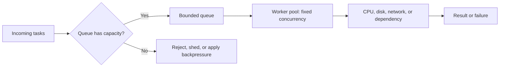

# 4. Execution, Concurrency, and Resource Limits

## 4.1 Processes, threads, and tasks

A process is an execution environment with its own virtual address space and operating-system resources. Threads within a process share memory but have separate execution state such as stacks and registers. Runtimes may also schedule lightweight tasks or coroutines over a smaller number of OS threads.

Process isolation can limit memory corruption and failure propagation but costs more resources and requires explicit inter-process communication. Threads share data efficiently but introduce synchronization hazards. Lightweight tasks reduce the cost of representing waiting work, but they do not remove CPU, memory, file descriptor, or downstream capacity limits.

## 4.2 Concurrency is not parallelism

Concurrency means multiple activities overlap in progress. Parallelism means work executes simultaneously on multiple execution resources. An asynchronous program can handle many waiting network operations without running all of them simultaneously. CPU-bound work benefits from parallel execution only when cores and runtime constraints permit it.

A single-threaded event loop can be efficient for I/O-heavy workloads but can stall every connection if one callback performs long CPU work. A thread-per-request server is conceptually simple but can exhaust memory or scheduling capacity under high concurrency.

## 4.3 Blocking and non-blocking I/O

Blocking I/O suspends the calling thread until an operation completes or fails. Non-blocking I/O returns control when the operation cannot currently progress, allowing the runtime to wait for readiness/completion and schedule other work. Asynchronous APIs can represent completion as callbacks, futures, promises, or coroutine suspension.

These terms are related but not identical: non-blocking describes an operation's behavior at the call boundary; asynchronous describes how completion is handled. The actual semantics depend on the OS, runtime, library, and resource.

## 4.4 Pools are queues with limits

Thread pools, connection pools, and worker pools bound concurrent use of expensive resources. They also create queues. When a pool is exhausted, requests may wait, time out, or fail fast.

Example: if a database pool allows 40 concurrent connections, that is not proof that 40 is optimal. Too many connections can increase database contention and context switching; too few can create application-side waiting. Measure active connections, wait time, database CPU, query duration, and queue length together.

Avoid unbounded queues and unbounded task creation. They can convert overload into memory exhaustion and extremely long tail latency.

## 4.5 Race conditions and synchronization

A race occurs when correctness depends on the relative timing of operations that are not properly coordinated. A read-modify-write counter can lose increments if two threads read the same old value and overwrite one another. Locks, atomics, immutability, message passing, and transactional storage can address different classes of races.

A deadlock can occur when tasks wait cyclically for resources. Common prevention strategies include consistent lock ordering, minimizing lock scope, avoiding blocking I/O while holding locks, and using timeouts where appropriate. Timeouts limit waiting but do not automatically restore invariant correctness.

## 4.6 CPU-bound and I/O-bound workloads

CPU-bound work spends most of its time computing. I/O-bound work spends substantial time waiting on network, disk, or another service. The distinction guides concurrency strategy:
- CPU-bound work is constrained by cores, algorithmic cost, and memory locality.
- I/O-bound work can often support more in-flight tasks, but remains constrained by connection limits and downstream throughput.
- Mixed workloads need isolation so expensive CPU work does not starve latency-sensitive requests.

## 4.7 Serialization and representation

Serialization converts in-memory values into a transport or storage representation; deserialization reconstructs them. Costs include CPU, allocation, memory copies, payload size, and compatibility rules. Binary formats may reduce size or parsing work but can be harder to inspect. Compression trades CPU for fewer bytes and may worsen latency for small payloads or CPU-saturated services.

Versioned schemas should define how unknown fields, missing fields, defaults, and type changes are handled. A wire format is a long-lived contract, not merely an implementation detail.

## 4.8 Architectural implications

Resource limits should be explicit: thread count, queue length, connection count, request deadline, memory, file descriptors, and payload size. When one limit is reached, the system needs a deliberate policy: wait briefly, reject, shed lower-priority work, or degrade.

~~~mermaid
flowchart TD
  R[Incoming requests] --> Q[Bounded admission queue]
  Q --> W[Worker pool]
  W --> C[Connection pool]
  C --> DB[Database]
  Q -->|queue full| Reject[Fast rejection or load shedding]
  C -->|pool exhausted| Wait[Bounded wait then timeout]
~~~

The diagram emphasizes that every queue and pool needs a capacity and overload policy. A queue without a bound can move the failure elsewhere rather than solve it.

## 4.9 Scheduling, context switching, and memory

The operating system schedules runnable threads onto CPU cores. A context switch saves one execution context and restores another. Switching is necessary for multitasking, but frequent switches can consume CPU time and disturb cache locality. The cost depends on hardware, operating system, workload, and whether the switch changes address spaces.

Each thread typically needs stack space and runtime bookkeeping. A large thread count therefore consumes memory even when many threads are waiting. Lightweight tasks can reduce per-task overhead, but their stacks, continuations, queued closures, request contexts, and retained payloads still consume resources. Count in-flight work and retained memory, not just OS threads.

A process's virtual address space is not identical to resident physical memory. Memory pressure can cause garbage collection, paging, allocation failure, or container-level termination. A concurrency design must account for the memory retained by each in-flight request.

## 4.10 Shared memory, visibility, and happens-before

When multiple threads access mutable state, correctness requires more than avoiding simultaneous writes. A thread may observe stale values unless synchronization establishes the memory-ordering guarantees required by the language/runtime.

A **data race** is an unsynchronized conflicting access under the language's memory model; in languages such as Java, data races can make visibility and ordering assumptions invalid. A **race condition** is broader: program correctness depends on timing, even if each individual access is technically synchronized.

A **happens-before** relation describes ordering guarantees established by program order and synchronization operations. In Java, examples include monitor unlock/lock on the same monitor and actions before Thread.start() being visible to the started thread. Use the Java Memory Model documentation when relying on specific guarantees rather than assuming that a write immediately becomes visible to all cores.

Common approaches:
- **Immutability:** shared values cannot be changed after construction.
- **Thread confinement:** one thread or task owns mutable state.
- **Synchronization/locks:** serialize access to a critical section.
- **Atomic operations:** perform a supported update indivisibly.
- **Message passing:** transfer ownership or communicate through queues.
- **Database transactions/conditional updates:** coordinate state across application processes.

These approaches solve different problems; an atomic counter does not make a multi-step business invariant atomic.

## 4.11 Locking, deadlock, starvation, and contention

A lock protects a critical section, but its scope matters. Holding a lock while performing network I/O or waiting for a database can make unrelated work queue behind a slow dependency.

- **Deadlock:** a set of activities wait on one another in a cycle.
- **Starvation:** an activity is repeatedly denied the resources or scheduling opportunity it needs.
- **Livelock:** activities continue changing state or retrying but make no useful progress.
- **Contention:** multiple activities compete for the same resource, increasing wait time or reducing throughput.

Consistent lock ordering can prevent common circular-wait deadlocks. Short critical sections and lower contention reduce waiting. Timeouts can bound waiting, but after a timeout the application must still decide whether it is safe to continue or retry. A timed-out operation may already have changed state.

## 4.12 Pool sizing and queueing boundaries

A pool is not only a maximum concurrency value; it defines where work waits and what happens at saturation. A request may wait in an admission queue, a worker queue, a connection pool, a database lock queue, and a remote service queue. Each queue adds delay and can hide the true bottleneck.

For a database connection pool:
- Too few connections can cause long application-side waits.
- Too many connections can overwhelm database CPU, memory, locks, or scheduler capacity.
- A connection held during unrelated processing reduces effective pool capacity.
- A connection leak gradually exhausts the pool.
- A long query can occupy a connection even when the application thread is otherwise idle.

Measure queue wait, active/idle connections, acquisition timeouts, query latency, and database saturation together. Increasing the pool size without identifying the bottleneck can worsen performance.

## 4.13 Backpressure and overload behavior

Backpressure communicates that a downstream stage cannot accept work at the current rate. It may slow producers, limit concurrency, reduce prefetch, reject requests, shed work, or cause upstream buffering. The mechanism depends on the protocol and architecture.

If every stage accepts unlimited work, overload migrates downstream until a queue, memory limit, connection limit, or timeout causes failure. Prefer explicit bounds and a documented policy:
- Wait for a bounded duration.
- Reject immediately with a retryable or non-retryable result.
- Shed low-priority work.
- Reduce optional work or response detail.
- Persist work for later processing only when durable queuing is part of the contract.

Retries need backoff, jitter, deadlines, and retry budgets. Retrying at every layer can multiply attempts: three layers each making up to three attempts can produce up to 27 downstream attempts in the worst case if the retry policies nest in that way.

## 4.14 Choosing an execution model

| Workload characteristic | Candidate approach | Important caveat |
|---|---|---|
| CPU-heavy independent work | Bounded worker pool sized against CPU capacity | More workers than useful CPU parallelism can increase contention |
| Many mostly-waiting network operations | Async I/O or lightweight tasks | Downstream connection and request limits still apply |
| Strict isolation for untrusted or failure-prone work | Separate process/container | Adds memory, startup, and communication overhead |
| Shared mutable state with simple critical sections | Locks or atomic primitives | Must reason about ordering, lock scope, and invariants |
| Work naturally represented as events | Message passing or queue | Ordering, duplication, buffering, and backpressure must be defined |

No execution model eliminates the need for bounded resource use, observability, and explicit failure handling.

## 4.15 Runtime resource limits that become architecture limits

A service consumes more than CPU and heap. It may be limited by memory, garbage-collection pauses, native memory, thread stacks, file descriptors, sockets, ephemeral ports, connection pools, disk I/O, kernel queues or downstream quotas. These limits interact: adding threads can increase memory and context switching; increasing connections can overload a database; increasing buffers can postpone overload while increasing tail latency.

### Thread-per-request versus event-loop models

A thread-per-request model is often straightforward for blocking code, but each active request consumes thread and stack resources. If requests spend most of their time waiting on I/O, a large number of blocked threads can reduce efficiency. Event-loop or asynchronous models can manage many waiting operations with fewer threads, but blocking one event-loop thread can delay unrelated requests. Async code does not eliminate CPU limits, memory limits, backpressure or the need to bound in-flight work.

Choose an execution model based on the libraries, workload, concurrency, latency target and team ability to diagnose it. A nonblocking API wrapped around a blocking database driver may simply move the queue to a different place.

### Pool sizing is a queueing and bottleneck decision

A worker pool, HTTP connection pool and database connection pool are queues and concurrency limits at different layers. If every layer allows large queues, requests can wait multiple times and exceed their deadline before the final operation begins. If every layer is unbounded, overload can consume memory and starve healthy work.

A practical pool-size process is:
1. Identify the resource the pool protects.
2. Measure service time and sustainable concurrency for that resource.
3. Set a bounded maximum active count and bounded wait queue.
4. Define acquisition timeout and rejection behavior.
5. Observe active, idle, queued, timed-out and rejected work.
6. Test under saturation and downstream slowdown.

Do not copy a generic pool-size formula without measuring the workload. For a database, more simultaneous connections can reduce throughput when lock contention and I/O become the bottleneck.

### Garbage collection and memory pressure

Managed runtimes allocate objects and reclaim unreachable memory, but collection consumes CPU and can create pauses or concurrent overhead. Allocation rate, live-set size, object lifetime, heap configuration, native allocations and container memory limits all affect behavior. A process can be terminated for exceeding a container limit even when the managed heap itself appears below its configured maximum because native memory, stacks, direct buffers and runtime overhead also consume memory.

Measure allocation rate, live-set/heap occupancy, pause duration, GC CPU, promotion and out-of-memory events. Increasing heap size may reduce collection frequency but increase pause or container pressure; reducing allocations or limiting in-flight payloads may be more effective.

### File descriptors, sockets and ephemeral ports

Open files, sockets and pipes consume file descriptors subject to process and operating-system limits. Leaked connections, excessive logging files, unbounded outbound sockets or too many concurrent connections can exhaust descriptors. Outbound connections also interact with ephemeral-port ranges, NAT mappings, connection reuse and TIME_WAIT behavior.

Connection pooling and keep-alive reduce setup cost but require lifecycle management, idle timeout alignment and stale-connection handling. Monitor connection churn, pool wait, socket errors and descriptor usage instead of diagnosing every connection failure as a network problem.

### Execution-model checklist

- Is the workload CPU-bound, I/O-bound or mixed?
- Which operations block threads or event-loop workers?
- Are active work and waiting queues bounded?
- Do pool sizes multiply across service replicas?
- What are heap, native memory, stack and container limits?
- Are GC pauses or allocation rates contributing to tail latency?
- Can file descriptors, sockets or ephemeral ports be exhausted?
- Are connection reuse and idle timeouts aligned across proxies and clients?
- What is rejected or shed when a resource limit is reached?
- Can telemetry identify the actual saturated resource?

## 4.16 Cancellation, task lifetime and structured concurrency

A request may stop being useful before its work completes. The client can disconnect, a deadline can expire, an upstream request can be cancelled, or a sibling task can fail. If the system does not propagate cancellation, expensive work can continue after the caller has abandoned it, consuming threads, connections, CPU and downstream quota.

### Timeout is not the same as cancellation

A timeout bounds how long a caller waits or how long a particular operation is allowed to run according to that API. It does not automatically stop work on another thread, cancel a database query, close a socket, or undo a committed side effect. Cancellation is a signal or operation requesting that work stop; whether it takes effect depends on the runtime and library.

A safe cancellation design asks:
- Is cancellation cooperative or immediate?
- Which resources are released when cancellation is observed?
- Can the operation already have committed a side effect?
- Is cleanup bounded and reliable?
- Does the caller know whether the result is cancelled, failed, or unknown?
- Can a late completion still publish a message or mutate state?

Cancellation must not be treated as transaction rollback. If a payment or database write may have committed before cancellation arrived, recovery needs idempotency, status lookup, transaction semantics or reconciliation.

### Propagate deadlines and cancellation across dependencies

When a request calls multiple dependencies, each child operation should have a budget bounded by the caller's remaining deadline. Giving every dependency the original full timeout can make the overall request exceed its intended deadline. Reserve time for response handling and cleanup, and avoid retrying when too little budget remains for a meaningful attempt.

Cancellation should flow to work that exists only to serve the abandoned request. However, some work is intentionally durable and outlives the request—for example, a job accepted into a persistent queue. In that case, the API should acknowledge durable acceptance and give the job its own lifecycle, cancellation policy and status rather than pretending it is part of the synchronous request.

### Structured concurrency and task ownership

Structured concurrency is a design approach in which child tasks are scoped to a parent operation or lexical/task scope, with explicit rules for waiting, failure propagation and cancellation. It makes task lifetime easier to reason about than launching detached background tasks with no owner.

The exact API and guarantees depend on the language/runtime. The general design goals are:
- A parent operation knows which child tasks it started.
- Child failure and cancellation have defined effects on siblings and the parent.
- The parent does not report completion while required child work is silently still running.
- Resources are released when the scope ends.
- Truly background work is moved into an explicit durable workflow or supervised service.

Parallel fan-out still needs a concurrency limit. Starting hundreds of child requests at once can overload a downstream service even if the parent waits for all results. Bound fan-out, share a deadline, and define whether one child failure fails the whole operation, produces a partial result, or triggers a fallback.

### Supervision and detached background work

Long-running workers need an owner responsible for restart policy, health, backoff, queue consumption, shutdown and observability. Restarting a crashed worker does not prove that an in-flight message was not processed before the crash; durable queues and idempotent handling are still necessary.

During shutdown, stop admitting new work, signal cancellation, allow a bounded drain period, persist or return uncompleted durable work to its queue, and then terminate. Forced termination may interrupt cleanup, so correctness cannot depend only on graceful shutdown succeeding.

### Cancellation review checklist

- Does work stop when the caller no longer needs the result?
- Are deadlines reduced as work crosses dependency boundaries?
- Can a timed-out task continue consuming scarce resources?
- Is cancellation distinct from rollback and from a definitive operation failure?
- Are child tasks scoped, supervised or explicitly durable?
- Is fan-out concurrency bounded?
- What happens to queued and in-flight work during shutdown?
- Can late results mutate state or publish events after cancellation?
- Are cancellation, deadline expiry, cleanup failures and orphaned work observable?

## Further reading
- [Linux man-pages: pthreads](https://man7.org/linux/man-pages/man7/pthreads.7.html).
- [Java concurrency package documentation](https://docs.oracle.com/en/java/javase/21/docs/api/java.base/java/util/concurrent/package-summary.html).
- [Java 21 Structured Concurrency guide (preview API)](https://docs.oracle.com/en/java/javase/21/core/structured-concurrency.html) — an implementation-specific API example; preview status and API details vary by JDK version.

## A bounded worker-pool model

A worker pool is a concurrency limit plus a queueing policy. It prevents unbounded task creation only if the queue is also bounded and admission behavior is explicit.

---

[Back to textbook contents](../../README.md) · [Curriculum](../../CURRICULUM.md) · [Roadmap](../../ROADMAP.md)
