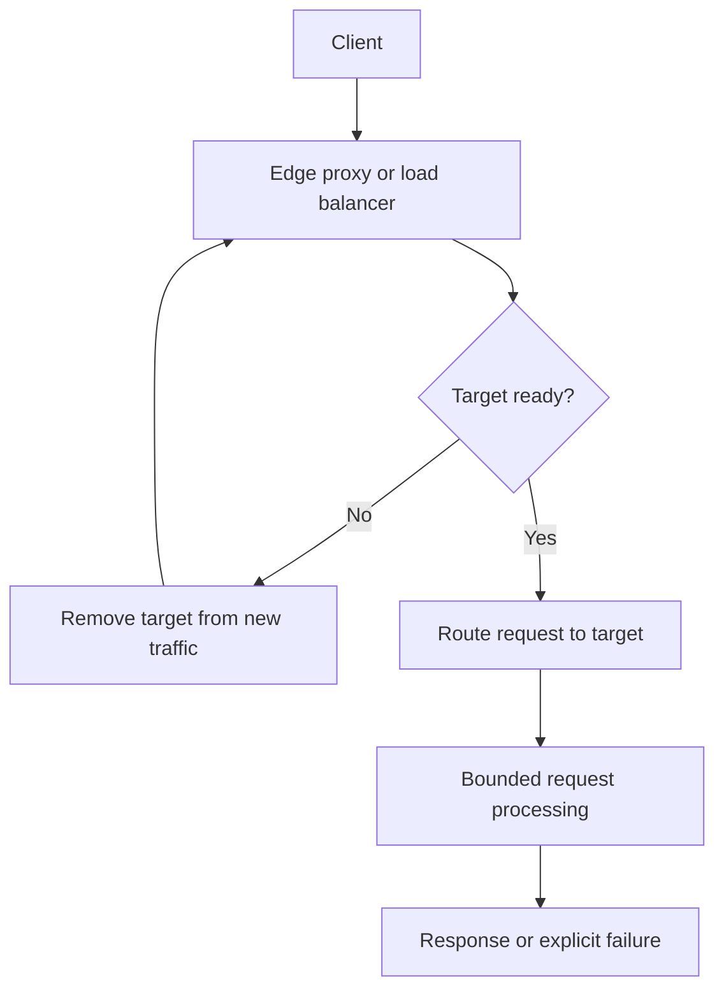
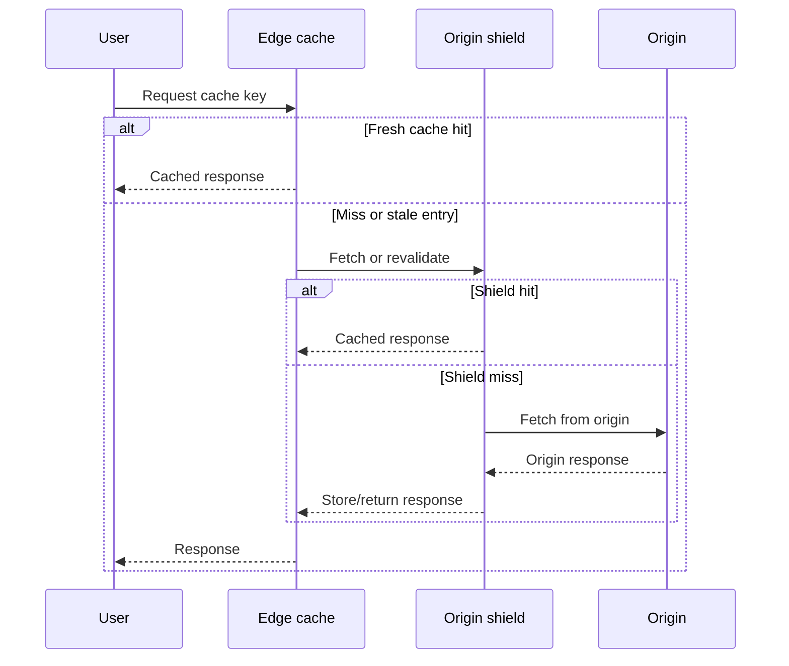
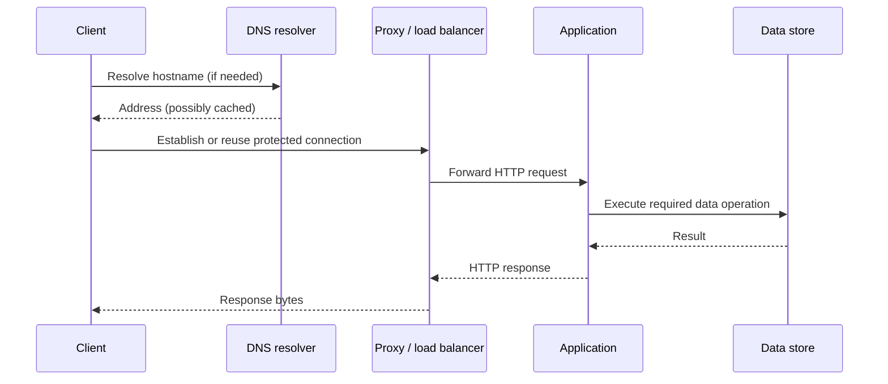

# 5. Networks and Request Journeys

## 5.1 Layering is a diagnostic model

The OSI model separates physical, link, network, transport, session, presentation, and application concerns. The Internet protocol suite is commonly described with link, internet, transport, and application layers. These are conceptual models, not exact diagrams of every implementation.

Layering helps locate responsibilities: IP routes packets; TCP provides an ordered byte stream; TLS protects a communication channel; HTTP defines application semantics. A failure at one layer can appear as a symptom at another, so diagnostics need correlation across layers.

## 5.2 IP, routing, subnetting, and NAT

IP addresses identify network interfaces within a routing system. Prefix length describes which bits identify a network. Routers forward packets based on routing tables; the path can change and is not necessarily symmetric. Network Address Translation (NAT) rewrites address/port information and maintains mappings, often allowing private-addressed hosts to share public addresses. NAT is not, by itself, a complete security boundary.

A network partition means some communicating components cannot exchange messages reliably within the relevant time assumptions. It does not require every packet to be permanently lost; delay and one-way reachability can be enough to make participants disagree about availability.

## 5.3 TCP and UDP

TCP provides a reliable, ordered byte stream between endpoints, with retransmission and congestion control. It does not preserve application message boundaries, and it does not guarantee that an application-level operation completed merely because bytes were acknowledged by the transport.

UDP sends datagrams without TCP's built-in reliability and ordering. Applications using UDP must decide what reliability, congestion control, and security behavior they need. QUIC, used by HTTP/3, implements transport features over UDP rather than relying on TCP's stream behavior.

TCP retransmissions can cause delay. Loss of a packet can affect delivery of later bytes on the same TCP stream until missing data is recovered. HTTP/2 multiplexes streams over a TCP connection, so TCP-level loss can delay multiple streams on that connection. HTTP/3 uses QUIC streams to reduce this cross-stream transport head-of-line blocking, though congestion and path problems can still affect traffic.

## 5.4 DNS is a distributed naming system

A typical DNS lookup may use a local cache, recursive resolver, root server, top-level-domain server, and authoritative server. Caching reduces lookup latency and load; TTL influences how long records may be reused. TTL expiry does not instantly guarantee global propagation, because resolvers and applications may have their own caches or stale-serving policies.

DNS provides name-to-record resolution, not instantaneous global traffic switching. A client may continue using an existing connection or cached address after DNS changes.

## 5.5 TLS and HTTPS

TLS provides confidentiality and integrity and can authenticate the server through certificates; mutual TLS can also authenticate clients. Correct deployment depends on certificate validation, trust roots, hostname checks, protocol configuration, key protection, and renewal. Encryption does not replace authorization: a securely encrypted request can still be unauthorized.

HTTPS identifies a secure HTTP origin. The HTTP semantics are described in [RFC 9110](https://www.rfc-editor.org/rfc/rfc9110.html); TLS 1.3 is specified in [RFC 8446](https://www.rfc-editor.org/rfc/rfc8446.html).

## 5.6 HTTP versions

- **HTTP/1.1** uses textual message syntax and supports persistent connections; parallelism often uses multiple connections.
- **HTTP/2** uses binary framing and multiplexed streams on a connection, with header compression.
- **HTTP/3** maps HTTP semantics onto QUIC, which uses UDP and provides independently progressing streams.

The versions share core HTTP semantics; the transport and framing differ. Newer does not mean every deployment is faster: handshake setup, network conditions, server support, proxy behavior, and client mix matter. See [RFC 9110](https://www.rfc-editor.org/rfc/rfc9110.html) and [RFC 9114](https://www.rfc-editor.org/rfc/rfc9114.html).

## 5.7 Proxies, load balancers, and CDNs

A forward proxy acts on behalf of clients; a reverse proxy receives traffic on behalf of origin services. A load balancer distributes work among backends. A CDN serves content from edge locations, often using cache policies and origin shielding. These roles may be combined in one product, but the responsibilities remain distinct.

Health checks are imperfect observations. A process responding to a health endpoint may still be unable to serve a real request. Readiness should reflect whether the instance can accept traffic; liveness should be used carefully because aggressive restart loops can worsen overload.

## 5.8 Trace a request

~~~mermaid
sequenceDiagram
  participant C as Client
  participant D as DNS Resolver
  participant E as Edge/Proxy
  participant A as Application
  participant DB as Data Store
  C->>D: Resolve service name if cache misses
  D-->>C: Address record
  C->>E: Establish transport and TLS as needed
  E->>A: Forward request with deadline/context
  A->>DB: Query using bounded connection
  DB-->>A: Result or error
  A-->>E: HTTP response
  E-->>C: Response
~~~

This is a simplified journey: DNS may be resolved by a local stub or proxy, TLS may terminate at the edge, and persistent connections may avoid repeating handshakes. Each hop adds potential queueing, timeouts, retries, and trust boundaries.

## 5.9 Timeouts and connection reuse

A connect timeout, TLS handshake timeout, request deadline, idle timeout, and downstream read timeout govern different phases. A total deadline should be propagated so downstream work does not continue indefinitely after the caller has abandoned the request. Connection pooling reduces handshake and setup costs but requires stale-connection handling, pool limits, and safe reuse.

## 5.10 Addressing, prefixes, and routing in practice

An IPv4 address contains 32 bits; IPv6 uses 128 bits. CIDR notation such as 192.0.2.0/24 specifies a prefix length: the first 24 bits identify the network prefix and the remaining bits identify addresses within that prefix. Real subnet allocation must account for reserved addresses and cloud/network-specific rules; do not blindly assume every bit pattern is assignable to a host.

Routing is a decision made at each hop using routing tables and forwarding rules. The route can change during a connection, and the forward and return paths need not be identical. Firewalls, security groups, network ACLs, NAT, service meshes, and proxies operate at different points and layers; troubleshoot the actual packet path instead of treating “the network” as one component.

## 5.11 TCP connection establishment and teardown

A typical TCP connection starts with a three-way handshake:
1. The client sends SYN with its initial sequence number.
2. The server responds with SYN-ACK.
3. The client sends ACK.

This establishes transport state and sequence-number agreement. It does not establish application identity or authorize an action; TLS and application authentication provide different guarantees.

TCP is a byte stream. If an application writes two messages, the receiver may read them as one chunk or several chunks. Application protocols must define message framing through lengths, delimiters, or their own framing format.

Connection teardown may involve FIN/ACK exchanges, while resets can abort a connection. A connection can also disappear because of host failure, NAT state expiry, middlebox behavior, or network disruption. An apparently established connection is not proof that the peer application is healthy.

## 5.12 Flow control versus congestion control

TCP flow control protects the receiver from being overwhelmed by a sender; the receiver advertises a window describing how much additional data it can accept. Congestion control responds to conditions in the network path to avoid injecting traffic faster than the path can handle. These solve different problems.

Application-level rate limiting and backpressure are separate again: they control work accepted by a service, not only bytes carried by TCP. A service can have a healthy TCP connection while its application queue is overloaded.

Packet loss may result in retransmission and reduced throughput. Head-of-line blocking is context-specific: TCP preserves byte order on one stream, so later bytes cannot be delivered to the application ahead of a missing earlier segment. HTTP/2 multiplexes streams over TCP, so a TCP loss event can delay data for multiple HTTP streams on that connection. QUIC streams in HTTP/3 avoid this particular cross-stream ordering dependency, though packet loss can still affect congestion control and shared connection capacity.

## 5.13 DNS records, caching, and change propagation

Common DNS record types include:
- **A:** IPv4 address.
- **AAAA:** IPv6 address.
- **CNAME:** alias to another DNS name.
- **MX:** mail exchanger.
- **TXT:** text data often used for verification and policy.
- **NS:** authoritative name-server information.
- **SRV:** service location and port information for protocols that use it.

Resolvers cache answers according to TTL and their policies. Applications and runtimes may add their own caching, and connection pools may continue using existing connections. Therefore changing a DNS record is not an instantaneous global cutover mechanism. Plan migrations with overlap, health checks, compatible backends, and a rollback path.

DNS resolution can fail independently from an already established connection. Conversely, successful DNS resolution does not prove that the destination is reachable or the application is healthy.

## 5.14 TLS identity and certificate validation

TLS establishes cryptographic protection for a connection, but correct authentication depends on validating the certificate chain and the intended hostname or identity. Important details include trust roots, certificate validity periods, key usage, name matching, revocation policy where applicable, protocol versions, and secure private-key storage.

A certificate being syntactically present is not enough. Clients must validate it correctly; disabling certificate verification to “fix” a connection error removes a key protection. Certificate expiry and renewal failures are operational availability risks. Mutual TLS adds client-certificate authentication, but authorization still determines which actions that identity may perform.

TLS termination at a proxy changes the trust path. If traffic from proxy to application crosses an untrusted network, that hop needs its own appropriate protection. Forwarded identity and client-address headers must only be trusted from known proxy boundaries.

## 5.15 HTTP request semantics and connection reuse

HTTP defines methods, status codes, fields, message semantics, caching behavior, and intermediary behavior. A transport connection is not the same thing as an HTTP request: one connection can carry many requests, and HTTP/2 or HTTP/3 can multiplex streams.

Connection reuse avoids repeated handshakes but requires correct pool behavior. Pools need maximum size, idle lifetime, stale-connection handling, and an acquisition timeout. Under overload, an unbounded wait for a connection can consume request threads and cause cascading timeouts.

HTTP method semantics matter for retries. A method defined as safe or idempotent has specific protocol meaning, but application behavior and intermediaries still matter. A POST that creates a payment is not made safe merely because the client retries only once. Application-level idempotency keys and durable deduplication may be necessary for non-idempotent business operations.

## 5.16 Proxies, load balancers, and client identity

A reverse proxy can terminate TLS, route requests, enforce limits, compress responses, or add headers. A layer-4 load balancer routes transport connections or packets based on transport-level information; a layer-7 load balancer can route based on application protocol details such as host, path, or headers. Actual capabilities vary by product.

When a proxy forwards a request, the backend may see the proxy's network address rather than the original client. Forwarded headers such as Forwarded or X-Forwarded-For are only trustworthy when inserted or sanitized by trusted proxies. Blindly trusting client-supplied values can enable IP spoofing in access-control or audit logic.

A CDN cache policy must account for cache keys, authorization, cookies, query parameters, freshness, and invalidation. Accidentally omitting a tenant or authorization dimension from the cache key can leak one user's response to another.

## 5.17 Timeout budgets and failure diagnosis

Different timeout settings protect different stages:
- DNS lookup timeout.
- TCP connection timeout.
- TLS handshake timeout.
- Proxy or load-balancer idle timeout.
- Connection-pool acquisition timeout.
- Application request deadline.
- Downstream read/write timeout.

These should be consistent with an overall deadline. If an upstream request has 500 ms remaining, a downstream call should not start a fresh 2-second timeout and continue after the caller has abandoned the request. Leave time for cancellation, cleanup, and response serialization.

A timeout is evidence that the expected result was not observed within the configured interval. It is not proof that the remote operation did not execute. For writes, reconcile uncertain outcomes with operation IDs, idempotency, or status lookup.

## 5.18 A layer-by-layer troubleshooting checklist

When a request fails, check the path in order:
1. **Name resolution:** did the client resolve the intended name and address?
2. **Routing/reachability:** can packets reach the destination and return?
3. **Transport:** was the connection established, reset, or stalled?
4. **TLS:** do protocol negotiation, certificate chain, and hostname validation succeed?
5. **HTTP/proxy:** which status, headers, routing decision, or timeout was observed?
6. **Application:** was the request accepted, authenticated, authorized, and processed?
7. **Dependency:** did the application wait on a database or another service?
8. **Response path:** was the result generated but lost or delayed before reaching the client?

Correlate timestamps, request IDs, proxy logs, connection metrics, and application traces. Avoid inferring the root cause from one symptom alone.

## 5.19 Load balancers in depth

A load balancer selects an eligible backend for a connection or request. Its job is to distribute work while respecting health, capacity, locality, security and the request's semantics. It cannot create capacity that does not exist, and a poor failover policy can overload the backends that remain healthy.

### Layer 4 and Layer 7 balancing

**Layer 4 balancing** routes using transport-level information such as source/destination addresses and ports. It can handle TCP or UDP without interpreting HTTP paths and headers. It is useful when protocol transparency and low per-request processing overhead matter.

**Layer 7 balancing** understands application protocols such as HTTP. It can route by host, path, method, header, cookie, or other request attributes; terminate TLS; apply request-aware policies; and emit HTTP-aware telemetry. Parsing requests and maintaining application-layer state adds processing and policy complexity.

A deployment can combine both: a transport load balancer distributes connections across edge proxies, and those proxies route individual HTTP requests. Do not assume the terms identify mutually exclusive products.

### Balancing algorithms and what they optimize

| Algorithm | Selection idea | Useful when | Main caveat |
|---|---|---|---|
| Round robin | Cycle through eligible targets | Targets have similar capacity and request cost | Equal request counts do not mean equal work |
| Weighted round robin | Allocate by configured weight | Targets differ in known capacity | Static weights may not reflect changing load |
| Least connections | Prefer fewer active connections | Connection duration roughly reflects work | One connection may be idle or multiplex many requests |
| Least requests / latency-aware | Prefer targets with less active work or observed delay | Work varies and telemetry is meaningful | Noisy/stale measurements can cause oscillation |
| Consistent hashing | Map a key to a target | Locality or affinity is valuable | Hot keys and membership changes can skew load |
| Locality-aware | Prefer nearby zone/region | Latency and transfer costs matter | A local overload can cascade if fallback is too aggressive |

Algorithm selection should be based on measured request cost, target capacity, connection duration, and failure behavior. Adaptive algorithms need smoothing, bounds, and safeguards against sending traffic away from a slow target so aggressively that the remaining targets collapse.

### Health checks, readiness, and draining

A health check is evidence, not a perfect prediction. **Liveness** asks whether restarting a process may help; **readiness** asks whether it should receive new work. A process can be alive but unable to serve because its worker pool is exhausted. Conversely, making readiness depend on every downstream dependency can cause all replicas to disappear when one shared dependency fails.

Active checks periodically probe targets; passive checks infer health from real traffic. Define thresholds, timeouts, recovery hysteresis, and what happens when every target is considered unhealthy. A fail-open policy may preserve partial service but risks sending traffic to broken targets; fail-closed behavior may produce an outage even when some targets could serve.

During rollout or scale-in, **connection draining** stops new assignments while allowing in-flight work to finish within a bounded grace period. Long-lived connections need explicit behavior: WebSockets may need reconnects, streams may need cursor-based resumption, and requests exceeding the drain deadline may be cancelled. Draining is effective only when application deadlines and shutdown hooks cooperate.

### Affinity, TLS, and client identity

Sticky sessions route a client repeatedly to one target, often by cookie or hash. Affinity can improve local-cache reuse but reduces flexibility and makes failover less predictable. If the target disappears, the session may still need to be recovered from shared storage or re-established.

TLS may terminate at the edge, at a gateway, or at the application. Termination centralizes certificate management and enables HTTP routing, but the proxy becomes a trust boundary. If it forwards client IP or identity in headers, it must remove untrusted inbound copies and set trusted values itself. Backend TLS or mutual TLS can protect and authenticate the next hop; validate certificates and service identities rather than merely encrypting bytes.

### Failure domains and global traffic management

A regional load balancer only distributes traffic among targets it can reach. Global traffic management chooses regions or sites using DNS, anycast, a global proxy, or provider-specific routing. DNS-based failover is affected by resolver and client caches, so a changed DNS record does not instantly move every client. Any global failover plan needs explicit health signals, capacity headroom, data-consistency assumptions, and a tested return-to-primary process.

Do not automatically spill all traffic from an unhealthy region into another region. The destination must have spare compute, connection, database and downstream capacity. Otherwise, failover turns one regional incident into a global cascading failure.

### Load-balancer review checklist

- Is balancing per connection, per request, per key, or per region?
- Which signal selects targets, and can it oscillate?
- What exactly do health checks prove?
- What happens if every target is marked unhealthy?
- Are retries safe, bounded, and counted against one deadline?
- Are sessions externalized or intentionally sticky?
- How are client identity headers and TLS handled?
- How are long-lived connections drained?
- Is there enough spare capacity for zone/region loss?
- Are per-target latency, errors, active connections, queue depth, and rejected work observable?

## 5.20 CDNs and edge delivery in depth

A Content Delivery Network (CDN) serves eligible content from edge locations closer to users. This can lower latency and reduce origin traffic. Depending on the product, edge platforms can also terminate TLS, filter requests, absorb some denial-of-service traffic, compress content, and execute edge logic. Those are distinct capabilities; an edge cache is not a replacement for application authorization or origin protection.

### Cache key and response correctness

The CDN cache key commonly includes the URL and may include selected request attributes. If the representation varies by language, encoding, tenant, device class or another input, the effective key must distinguish those variants. Otherwise, one request may receive another request's representation. Personalized or authorization-sensitive responses should not be shared-cacheable unless the policy and key are deliberately designed for that behavior.

HTTP directives such as `Cache-Control`, `ETag`, `Vary`, freshness lifetime, and conditional revalidation define important parts of this contract. See [RFC 9111 — HTTP Caching](https://www.rfc-editor.org/rfc/rfc9111.html) for normative caching semantics.

### Cache miss, shielding, stale responses, and invalidation

On a cache miss, an edge may fetch from the origin or from an intermediate **origin shield**. A shield can collapse many edge misses into fewer origin requests, but adds another cache layer and possible failure point. Request collapsing can reduce duplicate work for popular objects, while hot objects still need adequate origin and edge capacity.

When the origin is unavailable, serving stale content may be acceptable for public documentation or static assets, but not necessarily for authorization decisions, inventory, or rapidly changing financial data. Define stale-serving policy per content class rather than enabling it globally.

Purge propagation may take time and may not be atomic across every edge. Versioned asset URLs—such as content-hashed filenames—often make static asset updates safer because new content gets a new key. Mutable content requires explicit freshness, validation and invalidation rules.

### CDN, reverse proxy, and load balancer compared

- **CDN:** optimizes geographically distributed delivery and edge caching.
- **Reverse proxy:** receives requests on behalf of origins and may route, transform, authenticate or filter them.
- **Load balancer:** selects eligible targets to distribute connections or requests.
- **API gateway:** governs API-facing contracts and policies.
- **WAF:** inspects traffic against application-layer security rules.

One service can perform several of these functions. Architecture diagrams should still show the logical responsibilities and trust boundaries separately, so a failure or policy bypass can be reasoned about.

### CDN failure and security checklist

- Can a cache key accidentally mix tenants or authorization contexts?
- Which responses may be shared, and which must never be stored?
- How are stale responses handled during origin failure?
- What is the expected purge and propagation delay?
- Can a cache miss storm overwhelm the origin?
- Is the origin reachable directly, bypassing edge protections?
- Are request size, rate, bot and WAF policies applied consistently?
- Do logs distinguish edge hits, shield hits and origin fetches?
- Is the cost of egress, cache fill and invalidation understood?

## 5.21 Network boundaries, firewalls, and private connectivity

### Forward proxy, reverse proxy, firewall and WAF

A **forward proxy** makes requests on behalf of clients and can enforce outbound access policy, identity, filtering and logging. A **reverse proxy** receives requests on behalf of servers and forwards them to origins. A **network firewall** filters traffic using network/transport attributes and connection state according to policy. A **Web Application Firewall (WAF)** inspects application-layer requests for configured attack patterns or policy violations. These components overlap in some products but protect different boundaries.

A WAF is not a substitute for secure application code, object-level authorization, input validation or resource limits. A request can be syntactically normal and still perform an unauthorized business operation. Likewise, a network firewall that permits a TCP connection does not establish that the HTTP request is safe.

### Network segmentation and trust zones

Segment networks by workload, sensitivity and trust: public edge, application tier, data tier, management plane, build/deployment plane and outbound integration zones may need different access rules. Default-deny policies reduce accidental reachability, but overly broad shared subnets and permissive security groups can erase the intended boundary.

Model both ingress and egress. A service may need to call a payment provider or identity service but should not be able to reach arbitrary internal addresses. Restrict outbound destinations where practical, log denied traffic, and make the approved dependencies explicit. Network segmentation limits reachability; service identity and application authorization still decide who can perform an action.

### VPCs, subnets, routing and private endpoints

A virtual network provides an isolated address space and routing context. Subnets group addresses and are associated with route and security policy. A route table determines the next hop for destination prefixes; a security group or network ACL applies additional traffic policy according to the cloud/network model. Exact semantics differ among providers.

Private endpoints or private-link-style services can expose a managed service through private network connectivity without requiring a public endpoint. They reduce some exposure but do not remove the need for identity, authorization, DNS correctness, endpoint policy and data exfiltration controls. Private connectivity is not equivalent to “trusted caller.”

Peering and transit routing connect networks, but overlapping address ranges, route propagation, transitive-routing limitations, DNS resolution and firewall policy can complicate topology. Design the address plan and connectivity model before many teams create independent networks.

### NAT, egress and ephemeral capacity

Network Address Translation can allow private workloads to initiate outbound connections through shared public addresses. The shared NAT path has finite connection and port capacity and can become a bottleneck during high connection churn. Connection reuse, destination diversity, idle timeouts and ephemeral-port behavior influence the number of concurrent outbound flows.

A NAT gateway is not an application proxy: it typically does not understand user identity or HTTP operation cost. Use explicit egress proxies or policy enforcement where domain-aware allow-listing, authentication or request inspection is required. Monitor translation capacity, connection failures and egress cost.

### Network security review checklist

- Which trust zones exist, and which flows are explicitly allowed?
- Are ingress and egress both constrained?
- Can a public route bypass the intended gateway or WAF?
- Does a WAF complement, rather than replace, application authorization?
- Are private endpoints protected by identity and resource policy?
- Are route tables, peering and DNS behavior understood across networks?
- Can NAT or ephemeral ports exhaust under connection churn?
- Are management and deployment paths separated from user traffic?
- Are network denies and unexpected outbound destinations observable?
- Has reachability been tested from a compromised workload's perspective?

## 5.22 Protocol details and operational edge cases

### IPv4 and IPv6 coexistence

IPv4 uses 32-bit addresses; IPv6 uses 128-bit addresses and has different address representation, neighbor discovery and routing behavior. IPv6 is not simply IPv4 with longer addresses: assumptions about broadcast, address configuration, firewall defaults, ICMP behavior, DNS records and network tooling may differ. Dual-stack services can succeed over one family and fail over the other, making client fallback and observability important.

DNS commonly publishes A records for IPv4 and AAAA records for IPv6. A client may choose either path based on its resolver and connection strategy. If IPv6 is advertised but routing or firewall policy is broken, users may see intermittent or delayed connection failures. Test both address families from realistic client networks rather than assuming IPv4 success proves the service is reachable.

### DNS security, caching and change propagation

DNSSEC adds origin authentication and integrity validation for DNS data through a chain of trust; it does not encrypt ordinary DNS queries or hide queried names. DNS over TLS and DNS over HTTPS protect the transport between a client and its chosen resolver, but they do not by themselves prove that an answer is authoritative. These are distinct controls.

DNS changes propagate according to TTLs and resolver/client behavior, but a TTL is not a universal guarantee that all clients will switch at the same moment. Existing TCP connections, application DNS caches, proxy pools and service-discovery caches may continue using an old endpoint. For failover, consider the complete client-to-origin path, not only the DNS record. Validate DNSSEC deployment and key rollover with operational tooling; misconfiguration can make valid records fail validation.

### TLS certificate chains and mutual TLS

In server-authenticated TLS, the client validates that the certificate is valid for the intended hostname, chains to a trusted authority, is within its validity period, and satisfies relevant usage and policy requirements. A certificate being present does not prove that hostname verification is correct. Trust-store differences, missing intermediates, expiry, clock skew and incomplete rotation can cause failures for only some clients.

Mutual TLS (mTLS) additionally authenticates the client using a certificate. It is useful for workload-to-workload identity when certificate issuance, trust roots, identity mapping and rotation are well managed. A valid client certificate establishes an authenticated peer identity; the application still needs authorization for the requested action. Certificate revocation and short-lived credentials have deployment-specific trade-offs, so document what the runtime actually checks.

### HTTP/2, HTTP/3 and head-of-line blocking

HTTP/2 multiplexes multiple request streams over one TCP connection. Because TCP delivers an ordered byte stream, packet loss can delay progress for multiple HTTP/2 streams sharing that connection until missing bytes are recovered. HTTP/3 maps HTTP semantics onto QUIC, which multiplexes independent streams over UDP and can avoid transport-level cross-stream blocking from loss on another stream. HTTP/3 still experiences congestion, loss and connection-level limits; it does not make the network lossless or every request independent of all shared resources.

QUIC integrates TLS 1.3 handshake mechanisms and supports connection migration in appropriate circumstances. UDP-based transport may encounter different firewall, NAT and middlebox behavior from TCP. Real performance depends on client support, path conditions, deployment and fallback behavior; protocol version alone is not a latency guarantee.

### L4 and L7 routing, health and affinity

Layer 4 balancing uses transport-level information such as addresses and ports, while Layer 7 balancing can route using application information such as HTTP host, path, headers or method. L7 routing enables richer policy but requires the proxy to understand the protocol and may add parsing, TLS termination and per-request processing overhead.

Round-robin distributes eligible requests in sequence; least-connections considers active connection counts; weighted policies reflect capacity or rollout intent; consistent hashing tries to preserve key-to-target mapping as membership changes. No algorithm automatically balances actual work cost. A long-lived WebSocket, a large report query and a tiny read request are not equivalent units of load.

Health checks should test the condition relevant to routing, not indiscriminately require every downstream dependency to be healthy. If a transient database problem causes every application target to fail readiness at once, a load balancer may remove all capacity and amplify the outage. Separate process liveness, readiness to accept work, and deeper dependency diagnostics.

### DDoS and resource-exhaustion boundaries

Distributed denial-of-service attacks can consume network bandwidth, connection state, TLS handshake capacity, request parsing, application concurrency or expensive downstream operations. Protection therefore spans provider/network capacity, edge filtering, connection and request limits, WAF rules, per-identity quotas, payload limits, and application-level cost controls. A WAF alone cannot absorb traffic that saturates an upstream link before reaching it.

Design graceful overload behavior for legitimate flash crowds as well as hostile traffic. Protect scarce resources early, bound work at every layer, keep health endpoints lightweight, and ensure emergency controls do not accidentally block administrative recovery paths. Rate limits should account for authenticated identity and operation cost where possible; IP-only limits can be unfair behind NAT and ineffective against distributed sources.

### Network protocol review checklist

- Are IPv4 and IPv6 both supported and tested where advertised?
- Are DNS record changes, TTLs, client caches and persistent connections considered during failover?
- Is DNSSEC distinguished from encrypted DNS transport?
- Are certificate hostname checks, chains, expiry and rotation tested?
- Does mTLS identity map to an explicit authorization policy?
- Are HTTP/2 and HTTP/3 behavior and fallback understood for the target clients?
- Are balancing algorithms evaluated against request cost and long-lived connections?
- Can readiness checks accidentally remove all targets during a dependency incident?
- Which layer absorbs volumetric traffic, and which protects expensive application work?
- Are emergency traffic controls observable and reversible?

## 5.23 Practical network troubleshooting: symptoms, evidence, and hypotheses

Troubleshooting should narrow the failure boundary using evidence rather than immediately changing infrastructure. A timeout is an observation, not a root cause: it can arise from name resolution, connection establishment, TLS negotiation, request processing, a downstream dependency, or a response path.

### Start by classifying the failed phase

| Symptom or phase | Evidence to collect | Common hypotheses | Important caveat |
|---|---|---|---|
| Name resolution fails | Resolver response code, queried record/type, authoritative answer, TTL, resolver path | NXDOMAIN, SERVFAIL, stale cache, split-horizon configuration, DNSSEC validation failure | A successful lookup from one resolver does not prove every client sees the same answer |
| Connection cannot be established | Destination IP/port, route, SYN/SYN-ACK/RST observations where available, connection errors | Wrong address, firewall/security-group rule, listener absent, route failure, exhausted connection state | A client-side timeout alone cannot distinguish a dropped packet from a silent or unreachable server |
| TLS handshake fails | Client/server error, SNI hostname, certificate SAN/chain/expiry, negotiated protocol, trust store | Hostname mismatch, missing intermediate, expired certificate, incompatible protocol/cipher, incorrect SNI, mTLS identity failure | Do not disable certificate validation as a production fix |
| Request reaches edge but not service | Proxy/LB access logs, target health, routing rule, upstream connection metrics | Incorrect route, no healthy targets, policy rejection, upstream connection exhaustion | Edge health and application readiness are different signals |
| Request reaches service but is slow | Per-hop spans, queue wait, pool wait, CPU, downstream latency, saturation | Queueing, slow dependency, lock contention, overloaded connection pool, expensive query | The slowest visible span may be a symptom of queueing earlier in the path |
| Client times out but server logs success | Request/trace ID, server completion time, response-write errors, retry history | Response delayed/lost, deadline too short, proxy timeout, caller abandoned work after commit | The operation may have committed; retry safety depends on idempotency and outcome reconciliation |
| Intermittent failures after DNS/LB changes | DNS TTLs, client-side caches, persistent connections, endpoint draining, health transitions | Long-lived connections to old endpoints, uneven propagation, premature target removal | DNS changes do not forcibly migrate existing TCP connections |
| Failures only for large or expensive requests | Payload size, response size, route, request duration, rate-limit and resource metrics | Body-size limits, proxy buffering, slow-client behavior, request-cost imbalance, resource exhaustion | Limits can differ at CDN, gateway, ingress, application and downstream layers |

### A disciplined investigation sequence

1. **Define the scope.** Identify affected clients, regions, endpoints, tenants, protocol versions and start time. Separate total outage from elevated latency or a small failure cohort.
2. **Check the exact destination and name path.** Confirm the hostname, resolved addresses, address family, port and whether a proxy or service mesh changes the route.
3. **Separate connection setup from application time.** Where telemetry permits, distinguish DNS, connect, TLS, time-to-first-byte and response-transfer durations.
4. **Follow one request across boundaries.** Use a correlation or trace identifier; compare client, edge, service and dependency timestamps. Account for clock skew before interpreting cross-host event order.
5. **Check saturation and limits.** Inspect connection counts, queue depth, pool waits, CPU/memory, file descriptors, ephemeral ports, request limits and throttling—not only CPU utilization.
6. **Form and test one hypothesis at a time.** Prefer a narrow, reversible change and define what evidence would confirm or reject it.
7. **Verify recovery and side effects.** Check error rate, latency, retries, duplicate operations, backlog and whether the mitigation moved overload to another layer.

### Worked example: “The API started timing out after deployment”

Assume client requests time out after two seconds. The service logs show some successful writes at 2.4 seconds, while the load balancer reports upstream timeouts around two seconds.

- **Observation:** client and edge deadlines expire before some server operations finish.
- **First checks:** compare the configured timeout at each hop; inspect trace spans for connection-pool wait, database time and response-write duration; check whether the deployment changed query shape, pool sizing or dependency latency.
- **Unsafe shortcut:** simply increase every timeout. This can increase in-flight work and queueing during overload.
- **Safer response:** establish a coherent end-to-end deadline, bound queues and concurrency, optimize the demonstrated bottleneck, and make retries conditional on operation semantics. For writes, use an idempotency key or status-reconciliation path where appropriate.
- **Acceptance evidence:** the targeted latency percentile is within its objective under representative load, timed-out operations have understood outcomes, retry volume is bounded, and downstream saturation does not worsen.

### Troubleshooting review checklist

- [ ] Is the failure phase identified, or are we treating every timeout as a network problem?
- [ ] Do client, edge and server timings share a correlation identifier and compatible time interpretation?
- [ ] Have IPv4 and IPv6, proxy paths, TLS identity and DNS cache behavior been considered?
- [ ] Are health, readiness, routing and connection-draining signals distinguished?
- [ ] Have queueing, connection-pool wait and downstream latency been measured?
- [ ] Could the request have committed even though the caller timed out?
- [ ] Does the mitigation reduce user impact without amplifying retries or moving overload downstream?

## Follow one request through the network

This simplified sequence highlights the logical stages. Implementations reuse connections and caches, so DNS, TCP, and TLS may not run for every request.

Transport acknowledgment proves delivery of bytes at a transport boundary, not completion of the application operation. See the timeout and idempotency discussion in [Interfaces and Communication](../06-interfaces-communication/README.md).

## Further reading
- IETF, [RFC 8200 — IPv6 Specification](https://www.rfc-editor.org/rfc/rfc8200.html).
- IETF, [RFC 4033 — DNS Security Introduction and Requirements](https://www.rfc-editor.org/rfc/rfc4033.html).
- IETF, [RFC 8446 — TLS 1.3](https://www.rfc-editor.org/rfc/rfc8446.html).
- IETF, [RFC 9000 — QUIC Transport](https://www.rfc-editor.org/info/rfc9000/).
- IETF, [RFC 9110 — HTTP Semantics](https://www.rfc-editor.org/rfc/rfc9110.html) and [RFC 9114 — HTTP/3](https://www.rfc-editor.org/rfc/rfc9114.html).
- AWS, [Elastic Load Balancing overview](https://docs.aws.amazon.com/elasticloadbalancing/latest/userguide/what-is-load-balancing.html) for product-specific load-balancer behavior.
- Cloudflare, [Origin Cache Control](https://developers.cloudflare.com/cache/concepts/cache-control/) and [CDN-Cache-Control](https://developers.cloudflare.com/cache/concepts/cdn-cache-control/) for CDN-specific cache behavior; use RFC 9111 for general HTTP semantics.
- IETF [RFC 9293 — TCP](https://www.rfc-editor.org/rfc/rfc9293.html).
- IETF [RFC 8446 — TLS 1.3](https://www.rfc-editor.org/rfc/rfc8446.html).
- IETF [RFC 9000 — QUIC](https://www.rfc-editor.org/info/rfc9000/).
- IETF [RFC 9114 — HTTP/3](https://www.rfc-editor.org/rfc/rfc9114.html).

---

[Back to textbook contents](../../README.md) · [Curriculum](../../CURRICULUM.md) · [Roadmap](../../ROADMAP.md)
