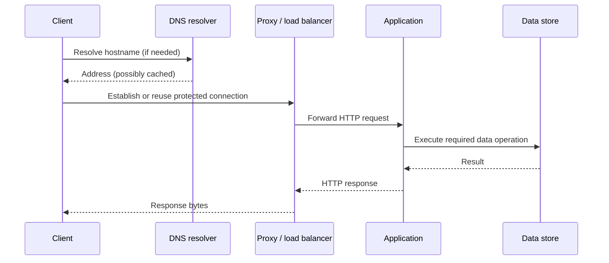

# 5. Networks and Request Journeys

## 5.1 Layering is a diagnostic model

The OSI model separates physical, link, network, transport, session, presentation, and application concerns. The Internet protocol suite is commonly described with link, internet, transport, and application layers. These are conceptual models, not exact diagrams of every implementation.

Layering helps locate responsibilities: IP routes packets; TCP provides an ordered byte stream; TLS protects a communication channel; HTTP defines application semantics. A failure at one layer can appear as a symptom at another, so diagnostics need correlation across layers.

## 5.2 IP, routing, subnetting, and NAT

IP addresses identify network interfaces within a routing system. Prefix length describes which bits identify a network. Routers forward packets based on routing tables; the path can change and is not necessarily symmetric. Network Address Translation (NAT) rewrites address/port information and maintains mappings, often allowing private-addressed hosts to share public addresses. NAT is not, by itself, a complete security boundary.

A network partition means some communicating components cannot exchange messages reliably within the relevant time assumptions. It does not require every packet to be permanently lost; delay and one-way reachability can be enough to make participants disagree about availability.

## 5.3 TCP and UDP

TCP provides a reliable, ordered byte stream between endpoints, with retransmission and congestion control. It does not preserve application message boundaries, and it does not guarantee that an application-level operation completed merely because bytes were acknowledged by the transport.

UDP sends datagrams without TCP's built-in reliability and ordering. Applications using UDP must decide what reliability, congestion control, and security behavior they need. QUIC, used by HTTP/3, implements transport features over UDP rather than relying on TCP's stream behavior.

TCP retransmissions can cause delay. Loss of a packet can affect delivery of later bytes on the same TCP stream until missing data is recovered. HTTP/2 multiplexes streams over a TCP connection, so TCP-level loss can delay multiple streams on that connection. HTTP/3 uses QUIC streams to reduce this cross-stream transport head-of-line blocking, though congestion and path problems can still affect traffic.

## 5.4 DNS is a distributed naming system

A typical DNS lookup may use a local cache, recursive resolver, root server, top-level-domain server, and authoritative server. Caching reduces lookup latency and load; TTL influences how long records may be reused. TTL expiry does not instantly guarantee global propagation, because resolvers and applications may have their own caches or stale-serving policies.

DNS provides name-to-record resolution, not instantaneous global traffic switching. A client may continue using an existing connection or cached address after DNS changes.

## 5.5 TLS and HTTPS

TLS provides confidentiality and integrity and can authenticate the server through certificates; mutual TLS can also authenticate clients. Correct deployment depends on certificate validation, trust roots, hostname checks, protocol configuration, key protection, and renewal. Encryption does not replace authorization: a securely encrypted request can still be unauthorized.

HTTPS identifies a secure HTTP origin. The HTTP semantics are described in [RFC 9110](https://www.rfc-editor.org/rfc/rfc9110.html); TLS 1.3 is specified in [RFC 8446](https://www.rfc-editor.org/rfc/rfc8446.html).

## 5.6 HTTP versions

- **HTTP/1.1** uses textual message syntax and supports persistent connections; parallelism often uses multiple connections.
- **HTTP/2** uses binary framing and multiplexed streams on a connection, with header compression.
- **HTTP/3** maps HTTP semantics onto QUIC, which uses UDP and provides independently progressing streams.

The versions share core HTTP semantics; the transport and framing differ. Newer does not mean every deployment is faster: handshake setup, network conditions, server support, proxy behavior, and client mix matter. See [RFC 9110](https://www.rfc-editor.org/rfc/rfc9110.html) and [RFC 9114](https://www.rfc-editor.org/rfc/rfc9114.html).

## 5.7 Proxies, load balancers, and CDNs

A forward proxy acts on behalf of clients; a reverse proxy receives traffic on behalf of origin services. A load balancer distributes work among backends. A CDN serves content from edge locations, often using cache policies and origin shielding. These roles may be combined in one product, but the responsibilities remain distinct.

Health checks are imperfect observations. A process responding to a health endpoint may still be unable to serve a real request. Readiness should reflect whether the instance can accept traffic; liveness should be used carefully because aggressive restart loops can worsen overload.

## 5.8 Trace a request

~~~mermaid
sequenceDiagram
  participant C as Client
  participant D as DNS Resolver
  participant E as Edge/Proxy
  participant A as Application
  participant DB as Data Store
  C->>D: Resolve service name if cache misses
  D-->>C: Address record
  C->>E: Establish transport and TLS as needed
  E->>A: Forward request with deadline/context
  A->>DB: Query using bounded connection
  DB-->>A: Result or error
  A-->>E: HTTP response
  E-->>C: Response
~~~

This is a simplified journey: DNS may be resolved by a local stub or proxy, TLS may terminate at the edge, and persistent connections may avoid repeating handshakes. Each hop adds potential queueing, timeouts, retries, and trust boundaries.

## 5.9 Timeouts and connection reuse

A connect timeout, TLS handshake timeout, request deadline, idle timeout, and downstream read timeout govern different phases. A total deadline should be propagated so downstream work does not continue indefinitely after the caller has abandoned the request. Connection pooling reduces handshake and setup costs but requires stale-connection handling, pool limits, and safe reuse.

## 5.10 Addressing, prefixes, and routing in practice

An IPv4 address contains 32 bits; IPv6 uses 128 bits. CIDR notation such as 192.0.2.0/24 specifies a prefix length: the first 24 bits identify the network prefix and the remaining bits identify addresses within that prefix. Real subnet allocation must account for reserved addresses and cloud/network-specific rules; do not blindly assume every bit pattern is assignable to a host.

Routing is a decision made at each hop using routing tables and forwarding rules. The route can change during a connection, and the forward and return paths need not be identical. Firewalls, security groups, network ACLs, NAT, service meshes, and proxies operate at different points and layers; troubleshoot the actual packet path instead of treating “the network” as one component.

## 5.11 TCP connection establishment and teardown

A typical TCP connection starts with a three-way handshake:
1. The client sends SYN with its initial sequence number.
2. The server responds with SYN-ACK.
3. The client sends ACK.

This establishes transport state and sequence-number agreement. It does not establish application identity or authorize an action; TLS and application authentication provide different guarantees.

TCP is a byte stream. If an application writes two messages, the receiver may read them as one chunk or several chunks. Application protocols must define message framing through lengths, delimiters, or their own framing format.

Connection teardown may involve FIN/ACK exchanges, while resets can abort a connection. A connection can also disappear because of host failure, NAT state expiry, middlebox behavior, or network disruption. An apparently established connection is not proof that the peer application is healthy.

## 5.12 Flow control versus congestion control

TCP flow control protects the receiver from being overwhelmed by a sender; the receiver advertises a window describing how much additional data it can accept. Congestion control responds to conditions in the network path to avoid injecting traffic faster than the path can handle. These solve different problems.

Application-level rate limiting and backpressure are separate again: they control work accepted by a service, not only bytes carried by TCP. A service can have a healthy TCP connection while its application queue is overloaded.

Packet loss may result in retransmission and reduced throughput. Head-of-line blocking is context-specific: TCP preserves byte order on one stream, so later bytes cannot be delivered to the application ahead of a missing earlier segment. HTTP/2 multiplexes streams over TCP, so a TCP loss event can delay data for multiple HTTP streams on that connection. QUIC streams in HTTP/3 avoid this particular cross-stream ordering dependency, though packet loss can still affect congestion control and shared connection capacity.

## 5.13 DNS records, caching, and change propagation

Common DNS record types include:
- **A:** IPv4 address.
- **AAAA:** IPv6 address.
- **CNAME:** alias to another DNS name.
- **MX:** mail exchanger.
- **TXT:** text data often used for verification and policy.
- **NS:** authoritative name-server information.
- **SRV:** service location and port information for protocols that use it.

Resolvers cache answers according to TTL and their policies. Applications and runtimes may add their own caching, and connection pools may continue using existing connections. Therefore changing a DNS record is not an instantaneous global cutover mechanism. Plan migrations with overlap, health checks, compatible backends, and a rollback path.

DNS resolution can fail independently from an already established connection. Conversely, successful DNS resolution does not prove that the destination is reachable or the application is healthy.

## 5.14 TLS identity and certificate validation

TLS establishes cryptographic protection for a connection, but correct authentication depends on validating the certificate chain and the intended hostname or identity. Important details include trust roots, certificate validity periods, key usage, name matching, revocation policy where applicable, protocol versions, and secure private-key storage.

A certificate being syntactically present is not enough. Clients must validate it correctly; disabling certificate verification to “fix” a connection error removes a key protection. Certificate expiry and renewal failures are operational availability risks. Mutual TLS adds client-certificate authentication, but authorization still determines which actions that identity may perform.

TLS termination at a proxy changes the trust path. If traffic from proxy to application crosses an untrusted network, that hop needs its own appropriate protection. Forwarded identity and client-address headers must only be trusted from known proxy boundaries.

## 5.15 HTTP request semantics and connection reuse

HTTP defines methods, status codes, fields, message semantics, caching behavior, and intermediary behavior. A transport connection is not the same thing as an HTTP request: one connection can carry many requests, and HTTP/2 or HTTP/3 can multiplex streams.

Connection reuse avoids repeated handshakes but requires correct pool behavior. Pools need maximum size, idle lifetime, stale-connection handling, and an acquisition timeout. Under overload, an unbounded wait for a connection can consume request threads and cause cascading timeouts.

HTTP method semantics matter for retries. A method defined as safe or idempotent has specific protocol meaning, but application behavior and intermediaries still matter. A POST that creates a payment is not made safe merely because the client retries only once. Application-level idempotency keys and durable deduplication may be necessary for non-idempotent business operations.

## 5.16 Proxies, load balancers, and client identity

A reverse proxy can terminate TLS, route requests, enforce limits, compress responses, or add headers. A layer-4 load balancer routes transport connections or packets based on transport-level information; a layer-7 load balancer can route based on application protocol details such as host, path, or headers. Actual capabilities vary by product.

When a proxy forwards a request, the backend may see the proxy's network address rather than the original client. Forwarded headers such as Forwarded or X-Forwarded-For are only trustworthy when inserted or sanitized by trusted proxies. Blindly trusting client-supplied values can enable IP spoofing in access-control or audit logic.

A CDN cache policy must account for cache keys, authorization, cookies, query parameters, freshness, and invalidation. Accidentally omitting a tenant or authorization dimension from the cache key can leak one user's response to another.

## 5.17 Timeout budgets and failure diagnosis

Different timeout settings protect different stages:
- DNS lookup timeout.
- TCP connection timeout.
- TLS handshake timeout.
- Proxy or load-balancer idle timeout.
- Connection-pool acquisition timeout.
- Application request deadline.
- Downstream read/write timeout.

These should be consistent with an overall deadline. If an upstream request has 500 ms remaining, a downstream call should not start a fresh 2-second timeout and continue after the caller has abandoned the request. Leave time for cancellation, cleanup, and response serialization.

A timeout is evidence that the expected result was not observed within the configured interval. It is not proof that the remote operation did not execute. For writes, reconcile uncertain outcomes with operation IDs, idempotency, or status lookup.

## 5.18 A layer-by-layer troubleshooting checklist

When a request fails, check the path in order:
1. **Name resolution:** did the client resolve the intended name and address?
2. **Routing/reachability:** can packets reach the destination and return?
3. **Transport:** was the connection established, reset, or stalled?
4. **TLS:** do protocol negotiation, certificate chain, and hostname validation succeed?
5. **HTTP/proxy:** which status, headers, routing decision, or timeout was observed?
6. **Application:** was the request accepted, authenticated, authorized, and processed?
7. **Dependency:** did the application wait on a database or another service?
8. **Response path:** was the result generated but lost or delayed before reaching the client?

Correlate timestamps, request IDs, proxy logs, connection metrics, and application traces. Avoid inferring the root cause from one symptom alone.

## Further reading
- IETF [RFC 9293 — TCP](https://www.rfc-editor.org/rfc/rfc9293.html).
- IETF [RFC 8446 — TLS 1.3](https://www.rfc-editor.org/rfc/rfc8446.html).
- IETF [RFC 9000 — QUIC](https://www.rfc-editor.org/rfc/rfc9000.html).
- IETF [RFC 9114 — HTTP/3](https://www.rfc-editor.org/rfc/rfc9114.html).

## Follow one request through the network

This simplified sequence highlights the logical stages. Implementations reuse connections and caches, so DNS, TCP, and TLS may not run for every request.

Transport acknowledgment proves delivery of bytes at a transport boundary, not completion of the application operation. See the timeout and idempotency discussion in [Interfaces and Communication](../06-interfaces-communication/README.md).

---

[Back to textbook contents](../../README.md) · [Curriculum](../../CURRICULUM.md) · [Roadmap](../../ROADMAP.md)
