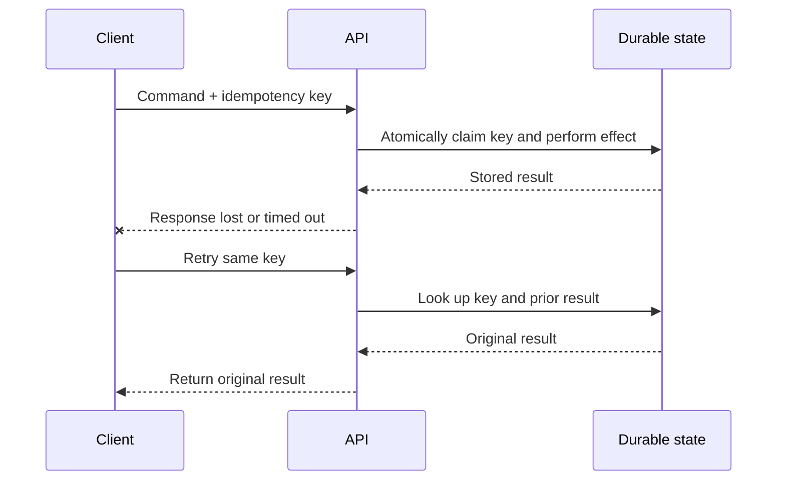

# 6. Interfaces and Communication Semantics

## 6.1 An interface is a contract

An API contract defines operations, inputs, outputs, errors, authorization rules, and compatibility expectations. A stable interface lets implementations evolve independently. A weak contract leaks internal structure, leaves error semantics ambiguous, or requires clients to coordinate every deployment.

REST models resources and their representations using HTTP semantics. RPC models invoking operations on a remote service. GraphQL lets clients request a shaped graph of data through a schema. These are not interchangeable labels for JSON: they differ in contract shape, caching, tooling, authorization design, and coupling.

## 6.2 Communication choices

| Mechanism | Useful when | Costs and caveats |
|---|---|---|
| HTTP request/response | Broad interoperability, resource-oriented APIs | Caller waits; timeouts create uncertain outcomes |
| RPC/gRPC | Typed service contracts and efficient internal calls | Schema/tooling coupling; network failures still apply |
| GraphQL | Clients need flexible selection across related data | Query cost control, authorization and caching require care |
| WebSocket | Bidirectional, long-lived interaction | Connection lifecycle, fan-out and backpressure |
| Server-Sent Events | Server-to-client event stream over HTTP | One-way stream; reconnect and replay semantics must be designed |
| Long polling | Compatibility where streaming is unavailable | Repeated request overhead and timeout management |
| Message broker | Decouple producers and consumers in time | Eventual processing, duplicates, lag and replay complexity |

Choose based on interaction semantics and operational constraints, not solely payload size or fashion.

## 6.3 Synchronous versus asynchronous

A synchronous call makes the caller wait for a result. It simplifies immediate feedback but couples the request's latency and often its availability to downstream dependencies. Asynchronous interaction lets a producer hand off work and return before processing completes; it introduces status tracking, delayed errors, retries, ordering and duplicate handling.

“Asynchronous” does not necessarily mean a broker is involved; an application runtime can schedule work asynchronously. Likewise, an HTTP endpoint can accept a command and process it asynchronously if the contract clearly communicates acceptance versus completion.

## 6.4 Timeouts, retries and uncertain outcomes

A timeout means the caller did not observe completion within its deadline. The remote operation may not have started, may be running, may have committed, or may have completed while the response was lost.

Retries can improve success under transient faults but amplify load and duplicate side effects. Use bounded attempts, exponential backoff, jitter, an end-to-end deadline, and retry budgets. Retry only when the operation is safe to repeat or protected by an idempotency mechanism. Avoid retries at every layer: three layers each making four attempts can generate up to 4³ = 64 downstream attempts for one original request.

## 6.5 Idempotency

An operation is idempotent if repeating it has the same intended effect as performing it once within a defined scope. HTTP method semantics are relevant, but application side effects still need careful design.

For a payment-like command, a client-generated idempotency key can identify one logical attempt. The server stores the key, request identity or hash, and result under a defined retention policy. Concurrent duplicates must be serialized or resolved transactionally. A key reused with a different payload should be rejected. Expiry of the key limits the duration of the guarantee.

Idempotency does not mean the operation has no side effects; it means duplicate submissions map to one logical effect under the stated contract.

## 6.6 Deadlines, cancellation and propagation

Use a total deadline rather than unrelated per-hop timeouts that can exceed the user's patience. Propagate remaining budget to downstream calls. Cancellation is cooperative in many systems: cancelling a client future may not stop a remote database query or committed transaction. Design explicit cancellation and compensation semantics where needed.

## 6.7 Versioning and compatibility

Backward-compatible evolution often adds optional fields or new operations while preserving existing meanings. Removing fields, changing units, narrowing accepted values, or changing error semantics can break clients even if the JSON schema still parses. Consumers should tolerate unknown fields where the format and contract allow it; producers should not assume every consumer upgrades at once.

Use consumer-driven contract tests, staged rollout, deprecation windows, and telemetry to learn which clients still use an old contract.

## 6.8 Pagination and query cost

Offset pagination is simple but can become expensive for deep pages and can skip/duplicate records when the underlying dataset changes. Cursor/keyset pagination uses a stable ordering key and can behave better at scale, but cursor design and filter changes require care. APIs should bound page size, query complexity, payload size, and execution time.

## 6.9 Communication failure path

~~~mermaid
sequenceDiagram
  participant Client
  participant API
  participant Service
  participant Store
  Client->>API: Command + idempotency key + deadline
  API->>Service: Validated command
  Service->>Store: Transactionally check key and apply effect
  Store-->>Service: Commit result
  Service-->>API: Result
  API-->>Client: Response
  Note over Client,Store: If the response is lost after commit, retry must return the recorded result rather than repeat the effect.
~~~

The durable idempotency record must be coordinated with the business effect; storing the key separately without atomicity can leave a duplicate window.

## Further reading
- IETF [RFC 9110 — HTTP Semantics](https://www.rfc-editor.org/rfc/rfc9110.html).
- [gRPC concepts](https://grpc.io/docs/what-is-grpc/core-concepts/).
- [GraphQL specification](https://spec.graphql.org/).
- [OpenAPI specification](https://spec.openapis.org/oas/latest.html).

## Retry safely when the outcome is uncertain

The key must be scoped, retained for a defined period, and bound to a request fingerprint so a different command cannot accidentally reuse the same key. The state change and the deduplication record must share a reliable transactional boundary.

---

[Back to textbook contents](../../README.md) · [Curriculum](../../CURRICULUM.md) · [Roadmap](../../ROADMAP.md)
