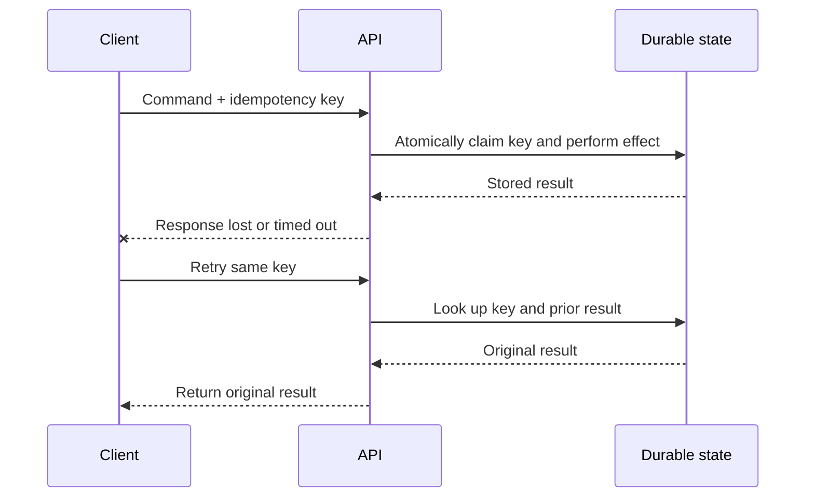

# 6. Interfaces and Communication Semantics

## 6.1 An interface is a contract

An API contract defines operations, inputs, outputs, errors, authorization rules, and compatibility expectations. A stable interface lets implementations evolve independently. A weak contract leaks internal structure, leaves error semantics ambiguous, or requires clients to coordinate every deployment.

REST models resources and their representations using HTTP semantics. RPC models invoking operations on a remote service. GraphQL lets clients request a shaped graph of data through a schema. These are not interchangeable labels for JSON: they differ in contract shape, caching, tooling, authorization design, and coupling.

## 6.2 Communication choices

| Mechanism | Useful when | Costs and caveats |
|---|---|---|
| HTTP request/response | Broad interoperability, resource-oriented APIs | Caller waits; timeouts create uncertain outcomes |
| RPC/gRPC | Typed service contracts and efficient internal calls | Schema/tooling coupling; network failures still apply |
| GraphQL | Clients need flexible selection across related data | Query cost control, authorization and caching require care |
| WebSocket | Bidirectional, long-lived interaction | Connection lifecycle, fan-out and backpressure |
| Server-Sent Events | Server-to-client event stream over HTTP | One-way stream; reconnect and replay semantics must be designed |
| Long polling | Compatibility where streaming is unavailable | Repeated request overhead and timeout management |
| Message broker | Decouple producers and consumers in time | Eventual processing, duplicates, lag and replay complexity |

Choose based on interaction semantics and operational constraints, not solely payload size or fashion.

## 6.3 Synchronous versus asynchronous

A synchronous call makes the caller wait for a result. It simplifies immediate feedback but couples the request's latency and often its availability to downstream dependencies. Asynchronous interaction lets a producer hand off work and return before processing completes; it introduces status tracking, delayed errors, retries, ordering and duplicate handling.

“Asynchronous” does not necessarily mean a broker is involved; an application runtime can schedule work asynchronously. Likewise, an HTTP endpoint can accept a command and process it asynchronously if the contract clearly communicates acceptance versus completion.

## 6.4 Timeouts, retries and uncertain outcomes

A timeout means the caller did not observe completion within its deadline. The remote operation may not have started, may be running, may have committed, or may have completed while the response was lost.

Retries can improve success under transient faults but amplify load and duplicate side effects. Use bounded attempts, exponential backoff, jitter, an end-to-end deadline, and retry budgets. Retry only when the operation is safe to repeat or protected by an idempotency mechanism. Avoid retries at every layer: three layers each making four attempts can generate up to 4³ = 64 downstream attempts for one original request.

## 6.5 Idempotency

An operation is idempotent if repeating it has the same intended effect as performing it once within a defined scope. HTTP method semantics are relevant, but application side effects still need careful design.

For a payment-like command, a client-generated idempotency key can identify one logical attempt. The server stores the key, request identity or hash, and result under a defined retention policy. Concurrent duplicates must be serialized or resolved transactionally. A key reused with a different payload should be rejected. Expiry of the key limits the duration of the guarantee.

Idempotency does not mean the operation has no side effects; it means duplicate submissions map to one logical effect under the stated contract.

## 6.6 Deadlines, cancellation and propagation

Use a total deadline rather than unrelated per-hop timeouts that can exceed the user's patience. Propagate remaining budget to downstream calls. Cancellation is cooperative in many systems: cancelling a client future may not stop a remote database query or committed transaction. Design explicit cancellation and compensation semantics where needed.

## 6.7 Versioning and compatibility

Backward-compatible evolution often adds optional fields or new operations while preserving existing meanings. Removing fields, changing units, narrowing accepted values, or changing error semantics can break clients even if the JSON schema still parses. Consumers should tolerate unknown fields where the format and contract allow it; producers should not assume every consumer upgrades at once.

Use consumer-driven contract tests, staged rollout, deprecation windows, and telemetry to learn which clients still use an old contract.

## 6.8 Pagination and query cost

Offset pagination is simple but can become expensive for deep pages and can skip/duplicate records when the underlying dataset changes. Cursor/keyset pagination uses a stable ordering key and can behave better at scale, but cursor design and filter changes require care. APIs should bound page size, query complexity, payload size, and execution time.

## 6.9 Communication failure path

~~~mermaid
sequenceDiagram
  participant Client
  participant API
  participant Service
  participant Store
  Client->>API: Command + idempotency key + deadline
  API->>Service: Validated command
  Service->>Store: Transactionally check key and apply effect
  Store-->>Service: Commit result
  Service-->>API: Result
  API-->>Client: Response
  Note over Client,Store: If the response is lost after commit, retry must return the recorded result rather than repeat the effect.
~~~

The durable idempotency record must be coordinated with the business effect; storing the key separately without atomicity can leave a duplicate window.

## 6.10 HTTP semantics beyond the endpoint handler

HTTP method semantics influence caching, retries, intermediaries, and client expectations:
- **Safe** methods are intended not to request a state change; incidental effects such as logging may still occur.
- **Idempotent** methods have the same intended effect when repeated, even if the response differs.
- **Cacheable** responses may be stored only under the protocol's caching rules and applicable directives.

A method being idempotent does not mean every implementation is free from side effects. A PUT can replace a resource idempotently while still emitting duplicate audit events unless the implementation designs those events carefully. A POST can be made retry-safe with a durable idempotency key, but this is an application contract rather than a universal property of POST.

Use HTTP status codes consistently. Distinguish malformed input, unauthenticated requests, forbidden operations, missing resources, conflicts, failed preconditions, rate limiting, and server errors. Do not expose internal stack traces or secrets in error bodies. Error responses should be stable enough for clients to react without parsing human-readable text.

## 6.10A Conditional requests and optimistic concurrency

HTTP conditional requests can prevent stale overwrites. An entity tag (ETag) can identify a representation version. A client may send an If-Match condition with the version it previously read; the server applies the update only if the current version matches, otherwise it returns a precondition failure.

This is an API-level form of optimistic concurrency control. The check and mutation must be atomic at the authoritative store. If the service checks a version and later writes without a transactional condition, two clients can both pass the check and overwrite one another.

Conditional GET requests using If-None-Match can avoid transferring an unchanged representation. Validators must represent the intended resource version and authorization scope; they are not authorization credentials.

## 6.10B Pagination contracts and stable traversal

Offset pagination often uses LIMIT and OFFSET. Large offsets can require the engine to scan and discard many rows. Concurrent inserts or deletes can shift page boundaries, causing duplicates or omissions across requests.

Keyset pagination uses a stable sort key and a cursor representing the last observed position. For example, order by the pair (created_at, id) and request records after the last pair. The unique tie-breaker matters when timestamps are equal. The cursor should be opaque or validated, bound to the filter/sort context, and should not grant access by itself.

Cursor pagination improves traversal under many workloads but does not automatically provide a consistent snapshot. If the product requires a snapshot across pages, the API needs a snapshot/version strategy or a documented weaker contract.

## 6.10C API evolution and compatibility matrix

Compatibility is directional:
- A new consumer reading old producer data may fail if it assumes newly added fields always exist.
- An old consumer reading new producer data may fail if it rejects unknown fields.
- A new producer may emit enum values an old consumer cannot interpret.
- A schema can remain syntactically valid while field meaning, units, defaults, or error behavior changes incompatibly.

Prefer additive changes with safe defaults, preserve existing meanings, and deploy tolerant readers before producers emit new forms. For event streams, consider retained historical messages as well as current traffic. For public APIs, document deprecation policy and use telemetry to determine whether old versions are still used.

## 6.10D API security and resource governance

Authentication answers who is calling; authorization answers what the caller may do. Enforce object-level authorization for every resource identifier, not just at a list endpoint or UI. Validate input structure and semantics, constrain payload sizes and query complexity, and avoid reflecting untrusted content into logs or responses.

Rate limits should be designed around identity and cost. A request count alone may not protect a GraphQL query that expands into hundreds of database operations. Use query depth/complexity limits, pagination caps, concurrency bounds, and per-tenant budgets where needed. Return a documented throttling response and, where appropriate, a retry hint without promising that every client should retry immediately.

## 6.10E Choosing RPC, REST, GraphQL, and asynchronous commands

REST is often useful for durable resource-oriented contracts and broad client interoperability. RPC is useful for explicit operation contracts and typed internal communication. GraphQL can reduce over-fetching across related data but makes query-cost enforcement, caching, and field-level authorization more involved. Messaging is useful when completion can be delayed and producer availability should not be coupled to consumer availability.

A common hybrid is an HTTP command endpoint that returns an operation identifier and an accepted status, with a status resource or event stream for completion. The contract must distinguish accepted for processing from completed successfully, define duplicate submissions, and explain how callers discover terminal failures.

## 6.10F WebSockets, SSE, and reconnect correctness

Long-lived connections introduce lifecycle concerns beyond message format. Clients disconnect, proxies time out idle connections, servers restart, and networks change. Define heartbeat behavior, reconnect backoff, authentication renewal, per-connection resource limits, and what happens to messages produced while a client is offline.

Server-Sent Events can use event IDs and reconnection semantics, but the server needs a retention/replay strategy if clients must catch up. WebSockets provide bidirectional frames but do not automatically supply durable delivery, ordering across reconnects, or backpressure. If missing a message is unacceptable, pair the connection with a durable cursor or message history.

## 6.10G End-to-end deadline budgeting

A request deadline should cover queue wait, connection acquisition, processing, downstream calls, serialization, and response transit. If an upstream caller has 800 ms remaining, a downstream call cannot safely be given a fresh 800 ms budget after 500 ms has already elapsed.

Propagate a deadline or remaining budget, reserve time for cleanup and response generation, and avoid retries that cannot finish before the deadline. Client cancellation may not cancel remote work already running, so servers should stop unnecessary work where cancellation is supported and preserve correctness if cancellation arrives after commit.

## 6.10H Communication contract review checklist

- Is the response acceptance, completion, or a durable operation result?
- Which methods and operations are safe or idempotent?
- What does a timeout mean, and how can an unknown outcome be resolved?
- Are conditional updates and concurrency conflicts explicit?
- Is pagination stable under concurrent changes?
- Are schema and error changes backward compatible?
- Are authentication and object-level authorization enforced?
- Are payload, query, concurrency, and tenant costs bounded?
- Can streaming clients reconnect and recover missed events?
- Are deadlines and retry budgets propagated end to end?

## Further reading
- IETF [RFC 9110 — HTTP Semantics](https://www.rfc-editor.org/rfc/rfc9110.html).
- [gRPC concepts](https://grpc.io/docs/what-is-grpc/core-concepts/).
- [GraphQL specification](https://spec.graphql.org/).
- [OpenAPI specification](https://spec.openapis.org/oas/latest.html).

## Retry safely when the outcome is uncertain

The key must be scoped, retained for a defined period, and bound to a request fingerprint so a different command cannot accidentally reuse the same key. The state change and the deduplication record must share a reliable transactional boundary.

---

[Back to textbook contents](../../README.md) · [Curriculum](../../CURRICULUM.md) · [Roadmap](../../ROADMAP.md)
