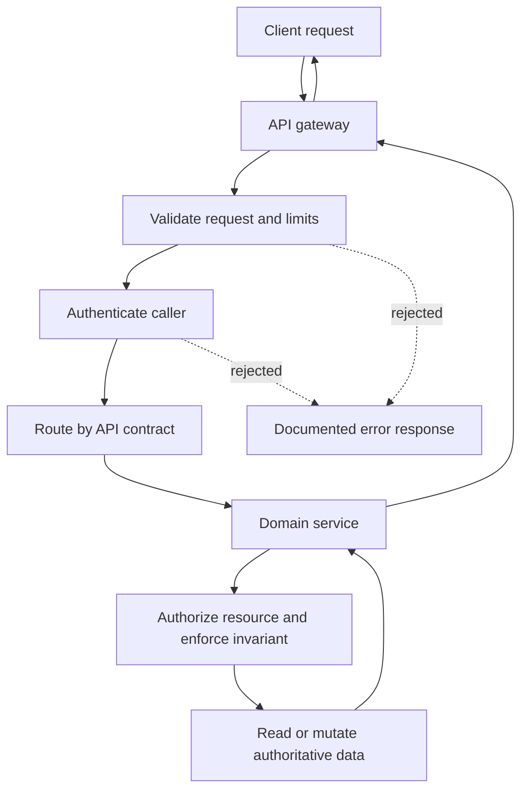

# 6. Interfaces and Communication Semantics

## 6.1 An interface is a contract

An API contract defines operations, inputs, outputs, errors, authorization rules, and compatibility expectations. A stable interface lets implementations evolve independently. A weak contract leaks internal structure, leaves error semantics ambiguous, or requires clients to coordinate every deployment.

REST models resources and their representations using HTTP semantics. RPC models invoking operations on a remote service. GraphQL lets clients request a shaped graph of data through a schema. These are not interchangeable labels for JSON: they differ in contract shape, caching, tooling, authorization design, and coupling.

## 6.2 Communication choices

| Mechanism | Useful when | Costs and caveats |
|---|---|---|
| HTTP request/response | Broad interoperability, resource-oriented APIs | Caller waits; timeouts create uncertain outcomes |
| RPC/gRPC | Typed service contracts and efficient internal calls | Schema/tooling coupling; network failures still apply |
| GraphQL | Clients need flexible selection across related data | Query cost control, authorization and caching require care |
| WebSocket | Bidirectional, long-lived interaction | Connection lifecycle, fan-out and backpressure |
| Server-Sent Events | Server-to-client event stream over HTTP | One-way stream; reconnect and replay semantics must be designed |
| Long polling | Compatibility where streaming is unavailable | Repeated request overhead and timeout management |
| Message broker | Decouple producers and consumers in time | Eventual processing, duplicates, lag and replay complexity |

Choose based on interaction semantics and operational constraints, not solely payload size or fashion.

## 6.3 Synchronous versus asynchronous

A synchronous call makes the caller wait for a result. It simplifies immediate feedback but couples the request's latency and often its availability to downstream dependencies. Asynchronous interaction lets a producer hand off work and return before processing completes; it introduces status tracking, delayed errors, retries, ordering and duplicate handling.

“Asynchronous” does not necessarily mean a broker is involved; an application runtime can schedule work asynchronously. Likewise, an HTTP endpoint can accept a command and process it asynchronously if the contract clearly communicates acceptance versus completion.

## 6.4 Timeouts, retries and uncertain outcomes

A timeout means the caller did not observe completion within its deadline. The remote operation may not have started, may be running, may have committed, or may have completed while the response was lost.

Retries can improve success under transient faults but amplify load and duplicate side effects. Use bounded attempts, exponential backoff, jitter, an end-to-end deadline, and retry budgets. Retry only when the operation is safe to repeat or protected by an idempotency mechanism. Avoid retries at every layer: three layers each making four attempts can generate up to 4³ = 64 downstream attempts for one original request.

## 6.5 Idempotency

An operation is idempotent if repeating it has the same intended effect as performing it once within a defined scope. HTTP method semantics are relevant, but application side effects still need careful design.

For a payment-like command, a client-generated idempotency key can identify one logical attempt. The server stores the key, request identity or hash, and result under a defined retention policy. Concurrent duplicates must be serialized or resolved transactionally. A key reused with a different payload should be rejected. Expiry of the key limits the duration of the guarantee.

Idempotency does not mean the operation has no side effects; it means duplicate submissions map to one logical effect under the stated contract.

## 6.6 Deadlines, cancellation and propagation

Use a total deadline rather than unrelated per-hop timeouts that can exceed the user's patience. Propagate remaining budget to downstream calls. Cancellation is cooperative in many systems: cancelling a client future may not stop a remote database query or committed transaction. Design explicit cancellation and compensation semantics where needed.

## 6.7 Versioning and compatibility

Backward-compatible evolution often adds optional fields or new operations while preserving existing meanings. Removing fields, changing units, narrowing accepted values, or changing error semantics can break clients even if the JSON schema still parses. Consumers should tolerate unknown fields where the format and contract allow it; producers should not assume every consumer upgrades at once.

Use consumer-driven contract tests, staged rollout, deprecation windows, and telemetry to learn which clients still use an old contract.

## 6.8 Pagination and query cost

Offset pagination is simple but can become expensive for deep pages and can skip/duplicate records when the underlying dataset changes. Cursor/keyset pagination uses a stable ordering key and can behave better at scale, but cursor design and filter changes require care. APIs should bound page size, query complexity, payload size, and execution time.

## 6.9 Communication failure path

~~~mermaid
sequenceDiagram
  participant Client
  participant API
  participant Service
  participant Store
  Client->>API: Command + idempotency key + deadline
  API->>Service: Validated command
  Service->>Store: Transactionally check key and apply effect
  Store-->>Service: Commit result
  Service-->>API: Result
  API-->>Client: Response
  Note over Client,Store: If the response is lost after commit, retry must return the recorded result rather than repeat the effect.
~~~

The durable idempotency record must be coordinated with the business effect; storing the key separately without atomicity can leave a duplicate window.


## 6.10 HTTP semantics beyond the endpoint handler

HTTP method semantics influence caching, retries, intermediaries, and client expectations:
- **Safe** methods are intended not to request a state change; incidental effects such as logging may still occur.
- **Idempotent** methods have the same intended effect when repeated, even if the response differs.
- **Cacheable** responses may be stored only under the protocol's caching rules and applicable directives.

A method being idempotent does not mean every implementation is free from side effects. A PUT can replace a resource idempotently while still emitting duplicate audit events unless the implementation designs those events carefully. A POST can be made retry-safe with a durable idempotency key, but this is an application contract rather than a universal property of POST.

Use HTTP status codes consistently. Distinguish malformed input, unauthenticated requests, forbidden operations, missing resources, conflicts, failed preconditions, rate limiting, and server errors. Do not expose internal stack traces or secrets in error bodies. Error responses should be stable enough for clients to react without parsing human-readable text.

### 6.10A Conditional requests and optimistic concurrency

HTTP conditional requests can prevent stale overwrites. An entity tag (ETag) can identify a representation version. A client may send an If-Match condition with the version it previously read; the server applies the update only if the current version matches, otherwise it returns a precondition failure.

This is an API-level form of optimistic concurrency control. The check and mutation must be atomic at the authoritative store. If the service checks a version and later writes without a transactional condition, two clients can both pass the check and overwrite one another.

Conditional GET requests using If-None-Match can avoid transferring an unchanged representation. Validators must represent the intended resource version and authorization scope; they are not authorization credentials.

### 6.10B Pagination contracts and stable traversal

Offset pagination often uses LIMIT and OFFSET. Large offsets can require the engine to scan and discard many rows. Concurrent inserts or deletes can shift page boundaries, causing duplicates or omissions across requests.

Keyset pagination uses a stable sort key and a cursor representing the last observed position. For example, order by the pair (created_at, id) and request records after the last pair. The unique tie-breaker matters when timestamps are equal. The cursor should be opaque or validated, bound to the filter/sort context, and should not grant access by itself.

Cursor pagination improves traversal under many workloads but does not automatically provide a consistent snapshot. If the product requires a snapshot across pages, the API needs a snapshot/version strategy or a documented weaker contract.

### 6.10C API evolution and compatibility matrix

Compatibility is directional:
- A new consumer reading old producer data may fail if it assumes newly added fields always exist.
- An old consumer reading new producer data may fail if it rejects unknown fields.
- A new producer may emit enum values an old consumer cannot interpret.
- A schema can remain syntactically valid while field meaning, units, defaults, or error behavior changes incompatibly.

Prefer additive changes with safe defaults, preserve existing meanings, and deploy tolerant readers before producers emit new forms. For event streams, consider retained historical messages as well as current traffic. For public APIs, document deprecation policy and use telemetry to determine whether old versions are still used.

### 6.10D API security and resource governance

Authentication answers who is calling; authorization answers what the caller may do. Enforce object-level authorization for every resource identifier, not just at a list endpoint or UI. Validate input structure and semantics, constrain payload sizes and query complexity, and avoid reflecting untrusted content into logs or responses.

Rate limits should be designed around identity and cost. A request count alone may not protect a GraphQL query that expands into hundreds of database operations. Use query depth/complexity limits, pagination caps, concurrency bounds, and per-tenant budgets where needed. Return a documented throttling response and, where appropriate, a retry hint without promising that every client should retry immediately.

### 6.10E Choosing RPC, REST, GraphQL, and asynchronous commands

REST is often useful for durable resource-oriented contracts and broad client interoperability. RPC is useful for explicit operation contracts and typed internal communication. GraphQL can reduce over-fetching across related data but makes query-cost enforcement, caching, and field-level authorization more involved. Messaging is useful when completion can be delayed and producer availability should not be coupled to consumer availability.

A common hybrid is an HTTP command endpoint that returns an operation identifier and an accepted status, with a status resource or event stream for completion. The contract must distinguish accepted for processing from completed successfully, define duplicate submissions, and explain how callers discover terminal failures.

### 6.10F WebSockets, SSE, and reconnect correctness

Long-lived connections introduce lifecycle concerns beyond message format. Clients disconnect, proxies time out idle connections, servers restart, and networks change. Define heartbeat behavior, reconnect backoff, authentication renewal, per-connection resource limits, and what happens to messages produced while a client is offline.

Server-Sent Events can use event IDs and reconnection semantics, but the server needs a retention/replay strategy if clients must catch up. WebSockets provide bidirectional frames but do not automatically supply durable delivery, ordering across reconnects, or backpressure. If missing a message is unacceptable, pair the connection with a durable cursor or message history.

### 6.10G End-to-end deadline budgeting

A request deadline should cover queue wait, connection acquisition, processing, downstream calls, serialization, and response transit. If an upstream caller has 800 ms remaining, a downstream call cannot safely be given a fresh 800 ms budget after 500 ms has already elapsed.

Propagate a deadline or remaining budget, reserve time for cleanup and response generation, and avoid retries that cannot finish before the deadline. Client cancellation may not cancel remote work already running, so servers should stop unnecessary work where cancellation is supported and preserve correctness if cancellation arrives after commit.

### 6.10H Communication contract review checklist

- Is the response acceptance, completion, or a durable operation result?
- Which methods and operations are safe or idempotent?
- What does a timeout mean, and how can an unknown outcome be resolved?
- Are conditional updates and concurrency conflicts explicit?
- Is pagination stable under concurrent changes?
- Are schema and error changes backward compatible?
- Are authentication and object-level authorization enforced?
- Are payload, query, concurrency, and tenant costs bounded?
- Can streaming clients reconnect and recover missed events?
- Are deadlines and retry budgets propagated end to end?


## 6.11 API gateways and API management

An API gateway is an API-facing entry point that applies shared routing and policy before forwarding requests to backend services. Depending on the product, it can provide TLS termination, route selection, authentication integration, coarse-grained authorization, quotas, rate limiting, request-size limits, schema validation, transformation, API version routing, and access telemetry.

The gateway is not automatically the system's only security enforcement point. It may authenticate a caller and enforce a coarse scope, but the service that owns a resource must still enforce object-level authorization and domain invariants. A caller allowed to invoke an endpoint is not necessarily allowed to read every object identifier supplied to it.

### Gateway versus adjacent components

| Component | Primary responsibility | What it does not automatically guarantee |
|---|---|---|
| Reverse proxy | Receive requests on behalf of origins and forward or transform them | API product lifecycle or domain authorization |
| Load balancer | Select eligible targets and distribute traffic | Correct API contracts or business-level access control |
| API gateway | Govern API entry, routing, consumer policy and API-facing concerns | Correct authorization inside every domain service |
| Ingress controller | Apply platform-specific routing into a cluster | Global traffic management or complete API governance |
| Service mesh | Commonly govern service-to-service identity, traffic policy and telemetry | Consumer-facing API design or business correctness |
| WAF | Inspect requests against security rules | Proof that a permitted request is authorized for its target object |

These roles can overlap in a product, but they should remain distinct in the architecture's reasoning.

### Gateway responsibilities and placement

Good gateway responsibilities are cross-cutting and boundary-oriented: mapping public routes to backend destinations, authenticating requests according to a defined trust model, applying coarse quotas, rejecting oversized or malformed requests, propagating correlation and deadline metadata, and producing route-level telemetry.

Domain-specific decisions that require authoritative business state should remain with the domain owner. If the gateway accumulates account rules, order orchestration, customer policy, and data transformations, it can become a centralized distributed monolith: every release depends on the gateway, and a gateway defect affects unrelated services.

### Rate limits, quotas, and resource protection

A simple per-IP rate limit can be insufficient behind NAT, and it may be bypassed by distributed callers. Limits may be scoped by user, tenant, API key, route, operation cost, or global service capacity. A request-count limit alone may not protect expensive operations such as broad searches, GraphQL queries, exports or report generation. Use payload limits, pagination caps, query complexity limits, concurrency budgets and downstream cost controls where appropriate.

Local gateway counters are fast but each replica may allow its own quota; distributed counters can enforce a more global policy but add latency and a dependency. Define the behavior if the limiter's state store is unavailable: fail-open may protect availability but allow abuse; fail-closed may block legitimate traffic. Security-sensitive policies may need fail-closed behavior, while carefully bounded low-risk operations may use a different fallback.

### Authentication, authorization, and trust boundaries

A gateway can validate an access token's issuer, audience, expiry and required claims according to the token profile. It should not treat a decoded JWT as trusted merely because it is syntactically valid. Key rotation, allowed algorithms, clock skew, issuer metadata and token purpose matter. If identity is propagated to backend headers, the gateway must strip client-supplied versions and generate trusted values; backend services should authenticate the gateway or use service identity/mTLS when appropriate.

Authorization checks must be performed at the resource boundary. OWASP identifies broken object-level authorization and unrestricted resource consumption among major API risks; see the [OWASP API Security Top 10](https://api-security.owasp.org/editions/2023/en/0x00-header/). Gateway authentication does not remove the need for per-object and per-property authorization.

### Routing, transformations, and compatibility

Gateways can route by host, path, header, API version, tenant or canary cohort. Transformations can help migrate clients, but hidden rewrites make debugging and contract ownership harder. Record the external request, selected route/version, upstream outcome and relevant transformation version without logging secrets or sensitive payloads.

A gateway canary can send a small percentage of traffic to a new backend, but the data model and contracts must remain compatible while old and new versions coexist. Routing policy is not a substitute for backward-compatible schema changes or safe database migration.

### Gateway resilience and observability

The gateway is on the critical path and often has a large blast radius. Run multiple instances across failure domains, set bounded connection pools and concurrency, apply per-route deadlines, and ensure retries do not multiply downstream load. Retry only when the operation's semantics allow it and the remaining deadline can accommodate another attempt.

Monitor request rate, status/error class, route latency, upstream latency, rejected requests, throttling, active connections, queueing, configuration version, certificate expiry and dependency health. Distinguish a live process from a gateway able to authenticate, resolve routes and reach required backends. Roll out policy changes progressively and retain a rollback path.



### API gateway design checklist

- Which cross-cutting concerns belong here, and which stay in domain services?
- Is gateway authentication distinct from resource authorization?
- Are quotas based on caller identity and operation cost?
- What happens if authentication, rate-limit state, DNS or routing dependencies fail?
- Are deadlines and correlation context propagated?
- Are retries safe and bounded?
- Can configuration and certificate changes be rolled back?
- Can the gateway be bypassed to reach a protected origin directly?
- Are route-level and upstream metrics sufficient to diagnose failures?
- Does the gateway risk becoming a centralized business-logic bottleneck?


## 6.12 Webhooks: secure, retryable event delivery

A webhook is an HTTP callback in which a publisher sends an event notification to a subscriber-controlled endpoint. It is asynchronous delivery over HTTP, not proof that the subscriber has durably processed the event. The publisher and subscriber need an explicit contract for authentication, retries, duplicates, ordering, timeout, payload schema and redelivery.

### Signing and authenticating deliveries

A common design signs the exact request body with a shared secret using an HMAC-based signature and sends the signature in a header. The subscriber verifies the signature over the original bytes before trusting the event. Re-serializing JSON before verification can change whitespace or field ordering and produce a different signature. Compare signatures using a constant-time comparison and keep signing secrets out of logs.

A signature proves that the sender possessed the signing secret for the signed material; it does not by itself prevent replay. Where the provider's protocol supports them, verify a signed timestamp within a documented tolerance and deduplicate an authenticated event ID. Do not assume every provider signs the same fields or provides the same replay guarantees—follow the provider's protocol.

### Retry, acknowledgement and idempotency

The endpoint should return success only after it has accepted responsibility for the delivery, commonly by durably recording or enqueueing the event. Doing expensive downstream work before responding can cause unnecessary timeouts and retries. A durable inbox or deduplication record can couple the event ID with local processing state.

Retries should use bounded exponential backoff with jitter and a maximum delivery horizon. The publisher may retry after a timeout even when the subscriber completed the operation but its response was lost. Therefore, the subscriber must make duplicate delivery harmless, especially when processing causes payments, fulfillment, account changes or notifications.

A successful HTTP response means only what the webhook contract defines—often that the delivery was accepted, not that every downstream effect is complete. Expose delivery state and provide a safe replay mechanism with audit history.

### Ordering and schema evolution

Publishers may deliver events out of order, particularly when retrying older failures while newer events continue. Include event IDs, event types, occurrence timestamps and aggregate/version identifiers where needed. If order matters, define a sequence or version and reject, buffer or reconcile stale events explicitly; timestamps alone are not always a reliable total order.

Version payload schemas compatibly where possible. Consumers should tolerate additive optional fields, validate required fields, and have a clear path for unknown event types. Do not silently interpret an unknown event as a known one. Document deprecation windows and test consumers against representative old and new payloads.

### Webhook SSRF and endpoint abuse

A publisher that sends requests to user-configured URLs is an outbound HTTP client controlled in part by untrusted input. Restrict schemes and destinations, block loopback, link-local and private ranges as required by the product, validate resolved addresses at connection time, and re-check redirects so a public URL cannot redirect to an internal service. DNS rebinding and alternative address encodings mean a simple string-prefix check is insufficient.

On the subscriber side, enforce payload-size limits, method and content-type expectations, signature verification, rate limits and bounded asynchronous processing. Do not expose detailed verification errors that help attackers. Protect event logs and dead-letter storage from secrets and sensitive payloads.

### Webhook design checklist

- Is the exact signed material documented and verified before processing?
- Are secrets rotated and revoked safely?
- Does the protocol provide authenticated timestamps and event IDs, and are they used correctly?
- Can duplicate delivery repeat a business side effect?
- Is success returned only after durable acceptance?
- Are retries bounded, observable and jittered?
- Is ordering required, and how is stale or out-of-order delivery handled?
- Can payload schema evolve without breaking old consumers?
- Are publisher callback URLs protected against SSRF and redirect bypasses?
- Can operators inspect delivery history and replay safely?

## 6.13 Worked API evolution example: change a contract without surprising clients

Assume an existing GET /v1/orders/{orderId} response contains order ID and status. Several clients deploy independently, and one client may not be updated for months. The API owner wants to add an estimated-delivery timestamp.

### Current contract excerpt

```yaml
openapi: 3.1.0
info:
  title: Orders API
  version: 1.0.0
paths:
  /v1/orders/{orderId}:
    get:
      operationId: getOrder
      parameters:
        - name: orderId
          in: path
          required: true
          schema:
            type: string
      responses:
        '200':
          description: Order found
          content:
            application/json:
              schema:
                type: object
                required: [id, status]
                properties:
                  id:
                    type: string
                  status:
                    type: string
                    enum: [PENDING, CONFIRMED, CANCELLED]
```

The contract describes more than the URL: it specifies parameter requirements, response shape, required fields and the allowed status values. A client may generate code from this schema, so changes that look harmless to a human can break generated clients.

### Proposed change: add an optional timestamp

Adding an optional field such as estimatedDeliveryAt is often a compatible evolution if old clients tolerate unknown response fields and new clients handle its absence. But compatibility is a property of the whole producer/consumer set, serializer, generated code and validation policy—not merely of the word optional.

Safer sequence:

1. Update the contract and compatibility tests to define the field's format, timezone semantics, nullability and absence behavior.
2. Deploy server code that can return the field without requiring clients to send it.
3. Verify old clients tolerate the additional field and new clients handle responses where it is absent.
4. Begin populating the field only when the value is known; do not invent a timestamp or silently change its meaning.
5. Monitor parsing errors, client failures and adoption before depending on the field in a critical workflow.

### Changes that need more caution

| Change | Why it can break clients | Safer strategy |
|---|---|---|
| Rename or remove a response field | Existing clients may require the old name | Add replacement, migrate clients, observe usage, then deprecate and remove after a defined window |
| Make an optional field required | Old requests or historical responses may omit it | Introduce a default/transition period and validate every active client version |
| Add a new enum value | Generated clients may use exhaustive switches or reject unknown values | Define unknown-value behavior or coordinate a new version/compatibility window before emitting it |
| Change units or meaning while keeping the same type | Payload remains syntactically valid but business interpretation changes | Use explicit documentation and usually a new field or version; test semantic compatibility |
| Change pagination or ordering behavior | Clients may skip or repeat records even if the schema is unchanged | Preserve stable traversal semantics or introduce an explicit cursor/contract version |

### Contract testing and rollout gates

- The embedded OpenAPI 3.1 example in this chapter has passed `openapi-spec-validator` in CI run [40104445824](https://github.com/kowlutla/System-Design/actions/runs/40104445824). Keep the specification under version control and rerun the validator after each contract change; generated-client compatibility and consumer/provider contract tests are separate checks.
- Compare proposed schemas against the supported compatibility policy; static schema checks cannot prove all runtime behavior.
- Run provider tests for required fields, status codes, error bodies, pagination, authentication and documented side effects.
- Run consumer contract tests for clients that depend on the response shape and semantics.
- Test old and new client/server combinations during rolling deployment.
- Define deprecation communication, usage telemetry, support window and removal criteria before removing a public contract.

### Review checklist

- [ ] Is the change syntactically and semantically compatible with supported clients?
- [ ] Are null, missing, empty and unknown values distinguished?
- [ ] Are enum expansion, generated code and strict deserializers considered?
- [ ] Are pagination, idempotency, errors and authorization semantics unchanged or explicitly versioned?
- [ ] Can old and new server/client versions coexist during rollout?
- [ ] Is deprecation based on measured usage and a communicated support policy?

## Further reading
- OWASP, [Webhook Security Cheat Sheet](https://cheatsheetseries.owasp.org/cheatsheets/Webhook_Security_Cheat_Sheet.html), covering signatures, replay protection, duplicate processing and SSRF risks.
- AWS API Gateway, [HTTP API throttling](https://docs.aws.amazon.com/apigateway/latest/developerguide/http-api-throttling.html) as an implementation-specific token-bucket example.
- OWASP, [API Security Top 10](https://api-security.owasp.org/editions/2023/en/0x00-header/) for common API threat categories.
- IETF [RFC 9110 — HTTP Semantics](https://www.rfc-editor.org/rfc/rfc9110.html).
- [gRPC concepts](https://grpc.io/docs/what-is-grpc/core-concepts/).
- [GraphQL specification](https://spec.graphql.org/).
- OpenAPI Initiative, [current OpenAPI Specification](https://spec.openapis.org/oas/latest.html) and [OpenAPI 3.1.0 specification](https://spec.openapis.org/oas/v3.1.0.html), the version used in the worked example.


---

[Back to textbook contents](../../README.md) · [Curriculum](../../CURRICULUM.md) · [Roadmap](../../ROADMAP.md)
