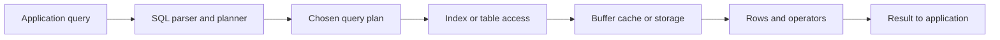

# 7. Data Modeling and Relational Systems

## Model the domain before optimizing storage
A data model expresses entities, relationships, constraints, and facts the system must preserve. Start with the questions the system must answer and changes it must make. A schema designed only around an ORM object graph may perform poorly for high-volume filtering, aggregation, or transactional updates.

Relational systems represent data as relations with defined attributes and constraints. SQL is declarative: it describes the desired result, while the optimizer chooses a physical plan.

## Keys, constraints, normalization
A primary key identifies a row. Foreign keys enforce relationships. Unique, check and not-null constraints encode invariants near the data, protecting against multiple application instances and alternate write paths. Surrogate keys simplify identity; natural keys express domain meaning. Key choice can affect index size, locality, distribution and migration.

Normalization reduces duplication and update anomalies. Denormalization deliberately duplicates or precomputes information to reduce joins or make reads cheaper. It moves work from reads to writes and creates a freshness or reconciliation obligation. Duplicated values need a source of truth and a repair strategy.

## Indexes and query plans
An index helps locate rows without scanning a full table. B-trees support ordered traversal and range queries; hash indexes target equality lookups where supported. Other index types serve specialized operations such as spatial or full-text search. Indexes cost storage, memory and write work.

Composite index column order matters. An index on tenant identifier then creation time may support filtering by tenant and ordering by time better than the reverse, depending on the query and engine. Inspect actual plans and statistics. An optimizer can choose a sequential scan when it estimates that cheaper, and skew or stale statistics can make estimates wrong. See [PostgreSQL indexes](https://www.postgresql.org/docs/current/indexes.html) and [EXPLAIN](https://www.postgresql.org/docs/current/using-explain.html).

## Transactions and ACID
- **Atomicity:** changes apply as a unit or are not applied.
- **Consistency:** correctly defined transactions preserve declared invariants.
- **Isolation:** concurrent transactions interact according to an isolation model.
- **Durability:** committed changes survive failures covered by the system contract.

ACID does not imply every transaction is serializable or that acknowledged data survives every imaginable disaster. Durability depends on configuration, replication, storage and the failure model.

Isolation anomalies include dirty reads, non-repeatable reads, phantoms, lost updates and write skew. Their definitions and guarantees vary by engine and isolation level. Locks can block, deadlock and reduce concurrency. MVCC supports concurrent reads and writes through versions but still needs conflict handling and storage maintenance. Optimistic version checks detect stale updates; they do not eliminate conflicts.

## Replicas, shards and migrations
Read replicas can distribute load but asynchronous replication introduces lag. A read immediately after a successful write may return an older value. Read-your-writes requires an explicit mechanism such as routing, waiting for a version, or session affinity.

Sharding adds capacity but complicates routing, rebalancing, cross-shard queries and transactions. A shard key should distribute storage and dominant workload; high cardinality alone does not prevent skew if a few values dominate traffic.

Schema changes must support old and new application versions during rollout. Expand-and-contract migrations add compatible structures, deploy compatible code, backfill safely, verify, then remove obsolete structures. Backfills need throttling and observability.

A backup is useful only if it can be restored within objectives. Test restore, integrity, schema, logs, keys and configuration. Retention and deletion must account for replicas, backups and derived data.

## Further reading
- PostgreSQL [transaction isolation](https://www.postgresql.org/docs/current/transaction-iso.html), [indexes](https://www.postgresql.org/docs/current/indexes.html), [EXPLAIN](https://www.postgresql.org/docs/current/using-explain.html), [point-in-time recovery](https://www.postgresql.org/docs/current/continuous-archiving.html).
- SQLite [atomic commit](https://www.sqlite.org/atomiccommit.html).

## How a relational query travels

The planner uses schema, indexes, statistics and cost estimates. A logically simple query can still be expensive when estimates are wrong, selectivity is poor, or a suitable index is absent. Inspect real execution plans with representative data.

---

[Back to textbook contents](../../README.md) · [Curriculum](../../CURRICULUM.md) · [Roadmap](../../ROADMAP.md)
