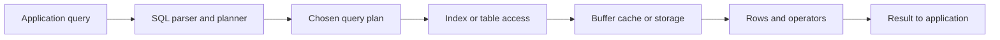

# 7. Data Modeling and Relational Systems

A relational database is more than a place to store rows: its schema, constraints, transactions and query planner help preserve business invariants while serving real workloads. Start from the facts the product must represent and the operations it must support, then choose constraints, indexes and transaction boundaries that make those operations correct and affordable.

The sections below develop the main decisions in depth: modeling and constraints, concurrency and isolation, query plans, maintenance, replicas, migrations and sharding. The worked examples return to the same principle: correctness must hold under concurrent requests and operational change, not only in a single successful request.

## 7.1 Relational fundamentals

### Functional dependencies and normalization reasoning

A functional dependency X → Y means that, within the modeled relation, the value of X determines the value of Y. If employee_id determines employee_name, storing employee_name repeatedly on every assignment row may create update anomalies when the name changes. Normalization decomposes relations to reduce such anomalies while preserving the intended information and dependencies.

Normalization is not an instruction to split every attribute into its own table. The model should represent domain facts and enforce meaningful constraints. Denormalization can be appropriate when it is deliberate, measured, and paired with a source of truth plus a strategy to update, invalidate, or reconcile copies.

### Constraints are concurrency controls for invariants

Application validation alone is insufficient when multiple instances or alternate write paths can race. Suppose two requests both check that a username is unused and then insert it. Without a unique constraint, both may pass the check. The database constraint serializes the invariant at the authoritative boundary.

Use primary keys, unique constraints, foreign keys, check constraints, and not-null constraints to express invariants where supported. Understand the engine's exact semantics: nullable unique columns, deferred constraints, collation, and partial indexes can affect behavior. A constraint failure is an expected concurrency outcome to handle, not necessarily an infrastructure failure.

### Isolation anomalies and practical consequences

- **Dirty read:** a transaction reads data another transaction has not committed.
- **Non-repeatable read:** the same row read twice changes because another transaction committed an update.
- **Phantom:** repeating a predicate query returns a different set because concurrent transactions changed matching rows.
- **Lost update:** concurrent changes overwrite one another without detecting the conflict.
- **Write skew:** transactions read overlapping state and update different rows, jointly violating an invariant that neither individually observed as violated.

Isolation-level names do not map identically to every database implementation. MVCC implementations may avoid blocking readers while still permitting anomalies such as write skew at some isolation levels. Serializable execution aims to make concurrent transactions equivalent to some serial order, but may abort transactions that must be retried.

Choose isolation based on invariants, not a generic preference for highest or lowest. If an invariant spans multiple rows, determine whether a constraint, explicit locking, serializable transaction, or redesigned data model is needed.

### Optimistic versus pessimistic concurrency

Pessimistic locking acquires locks before modifying contested state. It can prevent conflicting work but causes waits, deadlocks, and reduced concurrency. Optimistic concurrency reads a version and writes only if the version is unchanged; conflicts are detected and must be retried or surfaced.

A version update can be expressed conceptually as: update the row where id equals the requested ID and version equals the version previously read, then increment the version. If zero rows are updated, the caller used a stale version or the row no longer exists. The version check and mutation must occur in one atomic database operation.

Retries should repeat the business decision from fresh state, not blindly repeat the same stale values. Some operations cannot be safely auto-retried because a conflict requires user or domain resolution.

### Transactions, locks, and deadlocks

A transaction should be as short as practical and should avoid network calls while holding database locks. Long transactions retain locks or old MVCC versions, consume connections, increase contention, and can delay vacuum or cleanup in some engines.

A deadlock occurs when transactions form a wait cycle. Databases commonly detect a cycle and abort one participant. Applications need a bounded retry policy for recognized transient deadlock/serialization errors, with jitter where appropriate and an idempotent transaction boundary. Consistent lock ordering can reduce deadlock risk but does not eliminate all causes.

### Query planning, selectivity, and composite indexes

The optimizer estimates row counts and operator costs using statistics, then selects a plan. If data distribution is skewed or statistics are stale, estimated cardinalities can differ from reality and lead to poor join order, scans, or memory use.

A composite index can support queries that constrain a leading prefix and then order or range-filter on later columns, depending on the engine. An index on tenant_id, created_at, and id may help a tenant-scoped chronological keyset query. It may not help a query filtering only by created_at equally well. Index design should start from representative predicates, sort order, selectivity, and write overhead.

Use execution-plan tooling to compare estimated and actual rows, scan types, join algorithms, sort operations, and buffer/disk behavior. Do not assume an index is always faster: low-selectivity predicates or small tables may be cheaper to scan.

### Joins, pagination, and N+1 queries

Joins express relationships in the query engine, but join cost depends on cardinality, indexes, join algorithm, memory, and data distribution. A nested-loop join may be excellent for a small outer input with indexed lookups and disastrous for a large one. Hash and merge joins have their own memory, sorting, and ordering trade-offs.

An N+1 query pattern performs one query for a parent list and then one additional query per parent. ORM convenience can hide this behavior. Batching, joins, prefetching, or purpose-built read models can reduce round trips, but fetching everything in one huge join may multiply rows and memory use. Measure actual query count, payload, and execution plan.

### MVCC, vacuum, and storage maintenance

Multi-version concurrency control (MVCC) lets transactions observe versions according to an isolation snapshot rather than requiring every reader to block every writer. Updates and deletes may leave old versions that cannot be reclaimed while active transactions still need them. Long-running transactions can therefore increase storage and maintenance pressure.

The details differ by engine. PostgreSQL uses vacuum-related maintenance to reclaim or reuse space and maintain visibility information; other engines have different cleanup and compaction mechanisms. Operational health includes transaction age, dead tuples or equivalent version backlog, index bloat, checkpoint behavior, replication lag, and maintenance workload.

### Read replicas, lag, and read-your-writes

A replica may lag behind the primary because replication is asynchronous, apply is delayed, or the replica is under load. Routing a user immediately to a lagging replica after a successful write can violate read-your-writes expectations.

Possible strategies include primary reads for a session, waiting until a replica reaches a required log position/version, sticky routing, or returning a version token that the read path can honor. Each has latency and availability costs. Read from a replica is a routing choice, not a consistency guarantee.

### Shard keys and distributed relational design

A shard key determines routing and often defines the unit of local transactions and queries. A good key supports dominant access patterns, distributes both data and work, and avoids hotspots. High cardinality alone is insufficient: a tenant key may have many possible values but one large tenant can dominate traffic.

Cross-shard joins, uniqueness constraints, transactions, and rebalancing are harder because no single local index or transaction necessarily covers all participants. Application-level uniqueness may need a routing strategy or coordination service. Choose the shard key with data volume, request distribution, tenant isolation, and migration path in mind.

### Safe schema migration and backfill

A rolling deployment means old and new application versions may access the database simultaneously. Use an expand-and-contract sequence: add compatible schema, deploy code that can handle old and new forms, backfill in bounded batches, verify, switch behavior, then remove obsolete structures only after old versions and consumers are gone.

Backfills need throttling, progress checkpoints, idempotency, retry behavior, observability, and a pause/rollback plan. Large unbounded updates can cause lock contention, replication lag, transaction-log growth, or I/O saturation. A migration is a production workload and should be capacity-planned accordingly.

### Relational data review checklist

- What are the domain invariants and which constraints enforce them?
- What isolation anomalies could violate those invariants?
- Are optimistic version checks or locks needed?
- Which queries dominate load and what do actual plans show?
- Are indexes helping reads enough to justify write and storage cost?
- Can long transactions or version retention affect maintenance?
- What read-after-write guarantees do replicas provide?
- Does the shard key distribute actual work, not just row counts?
- Are schema changes compatible during rolling deployment?
- Can backfills pause, resume, and be safely repeated?

## 7.2 Relational systems in practice: invariants, query paths, and migrations

### Worked invariant: preventing overselling

Suppose inventory has 3 units and two requests attempt to reserve 2 units each. A naive application reads quantity = 3 in both requests, independently decides the reservation is valid, and then writes quantity = 1. One reservation is lost or both orders may be accepted without a correct stock decrement.

The invariant is that available inventory must never become negative and each successful reservation consumes exactly its quantity. One approach is an atomic conditional update that decrements only when available quantity is at least the requested amount, checking the affected-row count. Another is a transaction with appropriate locking/isolation and a reservation record. The correct implementation depends on the database and data model, but the check and state change must be one atomic boundary.

A unique constraint can prevent duplicate reservation identifiers; it does not by itself enforce the aggregate inventory invariant. Correctness often needs both database constraints and a transaction protocol.

### Connection pools are admission control

A database connection pool bounds concurrent database work and reuses expensive connections. Too-small pools can create application-side queueing; too-large pools can overwhelm the database with concurrent queries, memory use, lock contention and context switching. Across many application replicas, pool sizes multiply. If 40 replicas each allow 50 active database connections, the database may face 2,000 connections before administrative and other workloads are counted.

Set pool limits from database capacity, query cost, service concurrency and the total replica count. Observe acquisition wait separately from query execution latency. Use bounded acquisition timeouts and fail predictably rather than building an invisible unbounded queue in the application.

## 7.3 Partitioning, sharding, and replication are different dimensions

These terms are related, but they solve different problems:

- **Partitioning** divides a logical dataset into subsets according to a rule. Depending on the database and its terminology, partitions may be stored and managed inside one database cluster or distributed across nodes.
- **Sharding** is horizontal partitioning in which different subsets of the data are assigned to different shards, commonly to distribute storage, write throughput, or operational load across nodes. A shard may itself contain multiple tables or indexes.
- **Replication** keeps additional copies of data. Replicas can improve read capacity or availability and support recovery, but they do not by themselves divide ownership of the write workload.
- **Vertical partitioning** separates columns or groups of attributes, often to isolate access patterns or large fields; it is different from horizontal partitioning, which separates rows.

A database can use partitioning, sharding, and replication together. For example, tenant-keyed shards may each have a primary and one or more replicas, while each shard's largest table is partitioned by time. Do not count those as interchangeable scaling mechanisms: table partitions on one host may help pruning and maintenance without increasing the host's CPU or network capacity, while replicas may increase read capacity but leave a single-writer bottleneck unchanged.

The partition key determines where rows live and therefore affects both performance and correctness. A good key distributes expected load, supports important queries, and keeps common transactions local where possible. A poor key creates **skew** (uneven data distribution), **hot partitions** (a small subset receives disproportionate traffic), or expensive cross-shard operations. Adding more shards does not fix a hot key if all requests for that key still land on the same shard.

Before choosing a strategy, answer four questions: what unit is assigned to a partition, how placement is determined, how queries find all relevant partitions, and how data moves when capacity or key distribution changes. Then plan for rebalancing, uniqueness constraints, cross-partition transactions, index locality, and failure recovery—not just the initial routing function.

## 7.4 Sharding and resharding: a worked design example

Sharding divides a dataset across multiple independently managed partitions. It can increase storage and write capacity, but adds routing, rebalancing, cross-shard query, transaction and operational complexity. Do not shard simply because the table is large; first establish which resource is constrained and whether indexing, query redesign, archiving, vertical capacity or read replicas can meet the requirement.

### Choose a shard key from access patterns and invariants

Imagine an order service with records identified by order ID and commonly queried by customer ID and creation time. Sharding by a random order ID can distribute writes, but customer history queries may need to scatter across many shards. Sharding by customer ID makes customer history efficient and keeps a customer's orders colocated, but a very large customer can become a hot shard and global time-based queries remain expensive.

A useful shard key should be evaluated against:
- **Distribution:** does the key spread traffic and storage across shards?
- **Query locality:** can common queries target one or a small number of shards?
- **Growth:** can large tenants or hot keys dominate a shard?
- **Invariant locality:** do transactions that must be atomic remain within one shard?
- **Operational change:** can the key be changed or data rebalanced without unacceptable downtime?

There is rarely a key that optimizes every query. Record which query paths will scatter and how their fan-out is bounded.

### Hash, range and directory-based placement

**Hash-based placement** can distribute uniformly when keys are well behaved, but makes range scans and ordered locality harder. **Range-based placement** can support range queries but can create hot partitions when new writes cluster at the end of a range. **Directory-based placement** uses a mapping service to locate a tenant or key group, offering flexibility at the cost of directory availability, caching and migration coordination.

Consistent hashing and virtual nodes can reduce how many keys move when membership changes, but they do not by themselves rebalance uneven data volume or hot traffic. A key distribution can be numerically balanced while one shard handles much more work because its keys are more active or queries are more expensive.

### Cross-shard operations

A query that touches multiple shards may need fan-out, merge, global sort, pagination coordination and partial-failure policy. A transaction that writes multiple shards may require a distributed transaction protocol or a redesign that makes the invariant local. Cross-shard uniqueness is difficult if the database cannot enforce a global unique constraint; common alternatives include globally unique IDs, a dedicated uniqueness registry, or a domain model that scopes uniqueness.

Do not silently return partial query results when a shard fails. Either the API contract supports partial results with explicit status, or the operation should fail in a way the caller can understand and safely retry.

### Resharding and migration

Resharding changes data placement or the number of partitions. A safe plan may involve dual routing, copy/backfill, change capture for concurrent writes, validation, a cutover point and cleanup. Every stage needs idempotency and a way to resume after interruption.

A generic migration sequence is:
1. Define the new placement map and version it.
2. Begin copying existing records in bounded batches.
3. Capture and apply concurrent mutations to the destination.
4. Compare counts and checksums or domain-level invariants.
5. Route reads to the new placement under a controlled rollout.
6. Switch writes only when the consistency protocol makes it safe.
7. Retain rollback/reconciliation capability until confidence is established.
8. Remove old copies only after validation and a defined retention window.

The hard part is not copying bytes; it is defining the source of truth while writes continue. Dual-writing without a durable reconciliation mechanism can produce silent divergence.

### Sharding review checklist

- Which measured bottleneck requires sharding?
- Which key gives good distribution and locality for the dominant queries?
- Can a tenant, range or key become hot?
- Which transactions or uniqueness rules cross shard boundaries?
- How are cross-shard queries, pagination and partial failures handled?
- How are placement metadata and routing versions kept consistent?
- How will resharding copy concurrent writes and validate correctness?
- What is the cutover and rollback strategy?
- Are backup, restore, monitoring and incident procedures shard-aware?
- What evidence would justify adding another shard rather than optimizing the existing design?

## 7.5 Worked concurrency lab: write skew and invariant protection

Consider an on-call rota with two doctors, Alice and Ben. The invariant is: **at least one doctor must remain on call**. Both rows initially have on_call = true. Two requests arrive concurrently, one asking Alice to go off call and the other asking Ben to go off call.

### The unsafe interleaving

| Step | Transaction A | Transaction B |
|---|---|---|
| 1 | Reads count of on-call doctors = 2 | |
| 2 | | Reads count of on-call doctors = 2 |
| 3 | Decides Alice can go off call | |
| 4 | | Decides Ben can go off call |
| 5 | Updates Alice's row to false | |
| 6 | | Updates Ben's row to false |
| 7 | Commits | |
| 8 | | Commits |

Each transaction changed a different row. A row-level write conflict may therefore be absent even though the combined result violates the business invariant. This is **write skew**: local decisions based on overlapping reads create a global state that no valid serial execution would allow.

### Why “use a transaction” is not enough

A transaction groups operations atomically, but the guarantee depends on its isolation level and the database implementation. A stable snapshot is not automatically serializable. Likewise, checking the rule in application code and then updating a row is unsafe if concurrent requests can make the same decision.

### Candidate protections and their trade-offs

| Approach | How it protects the invariant | Trade-offs and caveats |
|---|---|---|
| Declarative constraint | Encodes the rule in a database constraint when the schema can express it | A simple row-level CHECK cannot generally enforce an aggregate condition across arbitrary rows; engine-specific features matter |
| Shared coordination row | Every transition locks or atomically updates one shared row that represents rota state | Can serialize a hot invariant; every path must follow the same protocol |
| Serializable transaction | The database rejects a set of concurrent commits that cannot be equivalent to a serial execution | Applications must retry the whole transaction from fresh state after serialization failure |
| Data-model redesign | Represents assignments so the invariant can be enforced by a unique key or a single atomic transition | May change query shape and domain model; must still model time windows and valid transitions correctly |

No option is universally best. Choose the least complex mechanism that enforces the actual invariant under the chosen database's documented semantics.

### Retry correctly

When a serialization failure or deadlock is explicitly identified as retryable:

1. Roll back the failed transaction completely.
2. Start a new transaction and re-read current state.
3. Re-evaluate the business rule; do not reuse a stale decision.
4. Apply bounded retries with jitter where appropriate.
5. Return a clear conflict or temporary-failure response when the retry budget is exhausted.

Do not blindly retry every database error. Constraint violations may represent a genuine business conflict, and an uncertain client outcome after commit requires idempotency or reconciliation rather than assuming rollback.

### Test matrix

- [ ] Start two concurrent requests that each try to remove one doctor from the rota.
- [ ] Verify the invariant after both requests finish, including when one is retried.
- [ ] Force a transaction abort and confirm the entire decision is recomputed from fresh state.
- [ ] Test every write path, including administrative tools and background jobs.
- [ ] Record serialization/deadlock retries, transaction duration, lock waits and invariant violations.
- [ ] Repeat the test against the actual database engine and configured isolation level; do not infer behavior from the isolation-level name alone.

## 7.6 How a relational query travels

The planner uses schema, indexes, statistics and cost estimates. A logically simple query can still be expensive when estimates are wrong, selectivity is poor, or a suitable index is absent. Inspect real execution plans with representative data.

## Further reading
- PostgreSQL [transaction isolation](https://www.postgresql.org/docs/current/transaction-iso.html), [indexes](https://www.postgresql.org/docs/current/indexes.html), [EXPLAIN](https://www.postgresql.org/docs/current/using-explain.html), [point-in-time recovery](https://www.postgresql.org/docs/current/continuous-archiving.html).
- SQLite [atomic commit](https://www.sqlite.org/atomiccommit.html).

---

[Back to textbook contents](../../README.md) · [Curriculum](../../CURRICULUM.md) · [Roadmap](../../ROADMAP.md)
