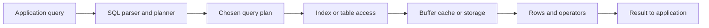

# 7. Data Modeling and Relational Systems

## Model the domain before optimizing storage
A data model expresses entities, relationships, constraints, and facts the system must preserve. Start with the questions the system must answer and changes it must make. A schema designed only around an ORM object graph may perform poorly for high-volume filtering, aggregation, or transactional updates.

Relational systems represent data as relations with defined attributes and constraints. SQL is declarative: it describes the desired result, while the optimizer chooses a physical plan.

## Keys, constraints, normalization
A primary key identifies a row. Foreign keys enforce relationships. Unique, check and not-null constraints encode invariants near the data, protecting against multiple application instances and alternate write paths. Surrogate keys simplify identity; natural keys express domain meaning. Key choice can affect index size, locality, distribution and migration.

Normalization reduces duplication and update anomalies. Denormalization deliberately duplicates or precomputes information to reduce joins or make reads cheaper. It moves work from reads to writes and creates a freshness or reconciliation obligation. Duplicated values need a source of truth and a repair strategy.

## Indexes and query plans
An index helps locate rows without scanning a full table. B-trees support ordered traversal and range queries; hash indexes target equality lookups where supported. Other index types serve specialized operations such as spatial or full-text search. Indexes cost storage, memory and write work.

Composite index column order matters. An index on tenant identifier then creation time may support filtering by tenant and ordering by time better than the reverse, depending on the query and engine. Inspect actual plans and statistics. An optimizer can choose a sequential scan when it estimates that cheaper, and skew or stale statistics can make estimates wrong. See [PostgreSQL indexes](https://www.postgresql.org/docs/current/indexes.html) and [EXPLAIN](https://www.postgresql.org/docs/current/using-explain.html).

## Transactions and ACID
- **Atomicity:** changes apply as a unit or are not applied.
- **Consistency:** correctly defined transactions preserve declared invariants.
- **Isolation:** concurrent transactions interact according to an isolation model.
- **Durability:** committed changes survive failures covered by the system contract.

ACID does not imply every transaction is serializable or that acknowledged data survives every imaginable disaster. Durability depends on configuration, replication, storage and the failure model.

Isolation anomalies include dirty reads, non-repeatable reads, phantoms, lost updates and write skew. Their definitions and guarantees vary by engine and isolation level. Locks can block, deadlock and reduce concurrency. MVCC supports concurrent reads and writes through versions but still needs conflict handling and storage maintenance. Optimistic version checks detect stale updates; they do not eliminate conflicts.

## Replicas, shards and migrations
Read replicas can distribute load but asynchronous replication introduces lag. A read immediately after a successful write may return an older value. Read-your-writes requires an explicit mechanism such as routing, waiting for a version, or session affinity.

Sharding adds capacity but complicates routing, rebalancing, cross-shard queries and transactions. A shard key should distribute storage and dominant workload; high cardinality alone does not prevent skew if a few values dominate traffic.

Schema changes must support old and new application versions during rollout. Expand-and-contract migrations add compatible structures, deploy compatible code, backfill safely, verify, then remove obsolete structures. Backfills need throttling and observability.

A backup is useful only if it can be restored within objectives. Test restore, integrity, schema, logs, keys and configuration. Retention and deletion must account for replicas, backups and derived data.

## 7.1A Functional dependencies and normalization reasoning

A functional dependency X → Y means that, within the modeled relation, the value of X determines the value of Y. If employee_id determines employee_name, storing employee_name repeatedly on every assignment row may create update anomalies when the name changes. Normalization decomposes relations to reduce such anomalies while preserving the intended information and dependencies.

Normalization is not an instruction to split every attribute into its own table. The model should represent domain facts and enforce meaningful constraints. Denormalization can be appropriate when it is deliberate, measured, and paired with a source of truth plus a strategy to update, invalidate, or reconcile copies.

## 7.1B Constraints are concurrency controls for invariants

Application validation alone is insufficient when multiple instances or alternate write paths can race. Suppose two requests both check that a username is unused and then insert it. Without a unique constraint, both may pass the check. The database constraint serializes the invariant at the authoritative boundary.

Use primary keys, unique constraints, foreign keys, check constraints, and not-null constraints to express invariants where supported. Understand the engine's exact semantics: nullable unique columns, deferred constraints, collation, and partial indexes can affect behavior. A constraint failure is an expected concurrency outcome to handle, not necessarily an infrastructure failure.

## 7.1C Isolation anomalies and practical consequences

- **Dirty read:** a transaction reads data another transaction has not committed.
- **Non-repeatable read:** the same row read twice changes because another transaction committed an update.
- **Phantom:** repeating a predicate query returns a different set because concurrent transactions changed matching rows.
- **Lost update:** concurrent changes overwrite one another without detecting the conflict.
- **Write skew:** transactions read overlapping state and update different rows, jointly violating an invariant that neither individually observed as violated.

Isolation-level names do not map identically to every database implementation. MVCC implementations may avoid blocking readers while still permitting anomalies such as write skew at some isolation levels. Serializable execution aims to make concurrent transactions equivalent to some serial order, but may abort transactions that must be retried.

Choose isolation based on invariants, not a generic preference for highest or lowest. If an invariant spans multiple rows, determine whether a constraint, explicit locking, serializable transaction, or redesigned data model is needed.

## 7.1D Optimistic versus pessimistic concurrency

Pessimistic locking acquires locks before modifying contested state. It can prevent conflicting work but causes waits, deadlocks, and reduced concurrency. Optimistic concurrency reads a version and writes only if the version is unchanged; conflicts are detected and must be retried or surfaced.

A version update can be expressed conceptually as: update the row where id equals the requested ID and version equals the version previously read, then increment the version. If zero rows are updated, the caller used a stale version or the row no longer exists. The version check and mutation must occur in one atomic database operation.

Retries should repeat the business decision from fresh state, not blindly repeat the same stale values. Some operations cannot be safely auto-retried because a conflict requires user or domain resolution.

## 7.1E Transactions, locks, and deadlocks

A transaction should be as short as practical and should avoid network calls while holding database locks. Long transactions retain locks or old MVCC versions, consume connections, increase contention, and can delay vacuum or cleanup in some engines.

A deadlock occurs when transactions form a wait cycle. Databases commonly detect a cycle and abort one participant. Applications need a bounded retry policy for recognized transient deadlock/serialization errors, with jitter where appropriate and an idempotent transaction boundary. Consistent lock ordering can reduce deadlock risk but does not eliminate all causes.

## 7.1F Query planning, selectivity, and composite indexes

The optimizer estimates row counts and operator costs using statistics, then selects a plan. If data distribution is skewed or statistics are stale, estimated cardinalities can differ from reality and lead to poor join order, scans, or memory use.

A composite index can support queries that constrain a leading prefix and then order or range-filter on later columns, depending on the engine. An index on tenant_id, created_at, and id may help a tenant-scoped chronological keyset query. It may not help a query filtering only by created_at equally well. Index design should start from representative predicates, sort order, selectivity, and write overhead.

Use execution-plan tooling to compare estimated and actual rows, scan types, join algorithms, sort operations, and buffer/disk behavior. Do not assume an index is always faster: low-selectivity predicates or small tables may be cheaper to scan.

## 7.1G Joins, pagination, and N+1 queries

Joins express relationships in the query engine, but join cost depends on cardinality, indexes, join algorithm, memory, and data distribution. A nested-loop join may be excellent for a small outer input with indexed lookups and disastrous for a large one. Hash and merge joins have their own memory, sorting, and ordering trade-offs.

An N+1 query pattern performs one query for a parent list and then one additional query per parent. ORM convenience can hide this behavior. Batching, joins, prefetching, or purpose-built read models can reduce round trips, but fetching everything in one huge join may multiply rows and memory use. Measure actual query count, payload, and execution plan.

## 7.1H MVCC, vacuum, and storage maintenance

Multi-version concurrency control (MVCC) lets transactions observe versions according to an isolation snapshot rather than requiring every reader to block every writer. Updates and deletes may leave old versions that cannot be reclaimed while active transactions still need them. Long-running transactions can therefore increase storage and maintenance pressure.

The details differ by engine. PostgreSQL uses vacuum-related maintenance to reclaim or reuse space and maintain visibility information; other engines have different cleanup and compaction mechanisms. Operational health includes transaction age, dead tuples or equivalent version backlog, index bloat, checkpoint behavior, replication lag, and maintenance workload.

## 7.1I Read replicas, lag, and read-your-writes

A replica may lag behind the primary because replication is asynchronous, apply is delayed, or the replica is under load. Routing a user immediately to a lagging replica after a successful write can violate read-your-writes expectations.

Possible strategies include primary reads for a session, waiting until a replica reaches a required log position/version, sticky routing, or returning a version token that the read path can honor. Each has latency and availability costs. Read from a replica is a routing choice, not a consistency guarantee.

## 7.1J Shard keys and distributed relational design

A shard key determines routing and often defines the unit of local transactions and queries. A good key supports dominant access patterns, distributes both data and work, and avoids hotspots. High cardinality alone is insufficient: a tenant key may have many possible values but one large tenant can dominate traffic.

Cross-shard joins, uniqueness constraints, transactions, and rebalancing are harder because no single local index or transaction necessarily covers all participants. Application-level uniqueness may need a routing strategy or coordination service. Choose the shard key with data volume, request distribution, tenant isolation, and migration path in mind.

## 7.1K Safe schema migration and backfill

A rolling deployment means old and new application versions may access the database simultaneously. Use an expand-and-contract sequence: add compatible schema, deploy code that can handle old and new forms, backfill in bounded batches, verify, switch behavior, then remove obsolete structures only after old versions and consumers are gone.

Backfills need throttling, progress checkpoints, idempotency, retry behavior, observability, and a pause/rollback plan. Large unbounded updates can cause lock contention, replication lag, transaction-log growth, or I/O saturation. A migration is a production workload and should be capacity-planned accordingly.

## 7.1L Relational data review checklist

- What are the domain invariants and which constraints enforce them?
- What isolation anomalies could violate those invariants?
- Are optimistic version checks or locks needed?
- Which queries dominate load and what do actual plans show?
- Are indexes helping reads enough to justify write and storage cost?
- Can long transactions or version retention affect maintenance?
- What read-after-write guarantees do replicas provide?
- Does the shard key distribute actual work, not just row counts?
- Are schema changes compatible during rolling deployment?
- Can backfills pause, resume, and be safely repeated?

## Further reading
- PostgreSQL [transaction isolation](https://www.postgresql.org/docs/current/transaction-iso.html), [indexes](https://www.postgresql.org/docs/current/indexes.html), [EXPLAIN](https://www.postgresql.org/docs/current/using-explain.html), [point-in-time recovery](https://www.postgresql.org/docs/current/continuous-archiving.html).
- SQLite [atomic commit](https://www.sqlite.org/atomiccommit.html).

## How a relational query travels

The planner uses schema, indexes, statistics and cost estimates. A logically simple query can still be expensive when estimates are wrong, selectivity is poor, or a suitable index is absent. Inspect real execution plans with representative data.

---

[Back to textbook contents](../../README.md) · [Curriculum](../../CURRICULUM.md) · [Roadmap](../../ROADMAP.md)
