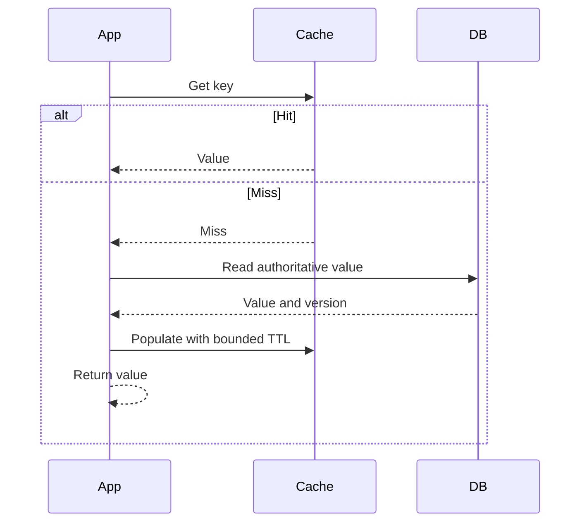

# 9. Caching and Data Locality

## Why cache?
A cache stores reusable data closer to the consumer or in a faster access layer. It can reduce latency, repeated database work and network transfer. Benefit depends on reuse: caching rarely requested data may add complexity without meaningful savings. A cache is usually not the source of truth; if treated as authoritative, durability and consistency need explicit design.

## Quantifying cache benefit

If 90% of 2,000 lookups per second hit the cache, about 200 lookups per second reach the source for that lookup class. If each miss triggers three database queries, that path still creates roughly 600 database queries per second. A hit ratio is therefore useful only when combined with the cost of a miss, request fan-out, and burst behavior; synchronized expiration can send many misses to the source at once.

This is the basic read path. Concurrent misses, stale fills and invalidation races need the additional controls discussed below.

## 9.1 Cache correctness and mechanisms

### Cache correctness begins with a freshness contract

A cache policy should state what freshness the consumer requires. Some data can be stale for minutes; other data, such as authorization decisions, account balances, or inventory reservations, may require stricter validation. A TTL of 30 seconds means an entry may be reused within a time policy; it does not mean it is guaranteed to be at most 30 seconds behind the source under every failure or clock condition.

Define whether stale data is allowed during source outages, whether stale values can be served while revalidating, and whether cache bypass is safe. Cache keys must include all dimensions that affect the result, including tenant, locale, representation version, and authorization context where relevant. Omitting a dimension can leak data or return the wrong representation.

### Invalidation and stale-fill races

Consider this race:
1. Request A reads version 10 from the source.
2. A concurrent update commits version 11.
3. The update invalidates the cache.
4. Request A finishes late and populates version 10 after invalidation.

The cache is now stale even though invalidation occurred. Possible defenses include version-aware writes, compare-and-set, ordered invalidation, or re-reading after a suspected race. A short TTL can limit how long an incorrectly repopulated value remains in the cache, but it does not guarantee a maximum age relative to the source update: the stale value's TTL may start after the update has already committed. Strict freshness requirements need a version/ordering protocol or an authoritative read. The correct approach depends on the cache and source capabilities.

Event-driven invalidation introduces another delay and failure path: the source commits, but the invalidation event is delayed, duplicated, or lost. A durable event path and reconciliation process may be required when freshness matters. Consumers should tolerate duplicate events, detect gaps where possible, and apply versions monotonically so an older event cannot undo a newer cache state.

### Cache-aside write ordering and read-after-write behavior

Cache-aside is simple, but the order of a source write and cache invalidation matters. A common sequence is: commit the source-of-truth update, then invalidate the cache. Invalidating before the source commit can allow a concurrent reader to reload the old value and repopulate it. Even commit-then-invalidate has a window in which readers can see the old cached value, and an in-flight read can repopulate stale data after invalidation; use versioning or coordination when that window is not acceptable.

For read-your-writes behavior, return the committed result to the writer and consider bypassing or version-checking the cache on subsequent reads. If reads go to a lagging replica, invalidating the cache and immediately reloading from that replica can still cache an older version. Use a primary/consistent read, a minimum-version token, or another source-specific mechanism when read-after-write consistency is required. Do not describe ordinary cache-aside as strongly consistent unless the complete write, invalidation, and read paths actually enforce that guarantee.

Deletes need the same care. A delayed in-flight read can repopulate a deleted object; a versioned tombstone or generation check can prevent older values from being accepted. Ensure a recreated object cannot accidentally inherit stale negative-cache or old-generation entries.

### Stampede prevention and request coalescing

A stampede occurs when many requests miss the same key and independently load or compute the same value. Mitigations include:
- **Single-flight/request coalescing:** one in-flight load serves multiple waiting callers.
- **TTL jitter:** spreads expirations across time.
- **Refresh ahead:** refreshes popular values before expiry where prediction is reliable.
- **Stale-while-revalidate:** serves a permitted stale value while one caller refreshes.
- **Concurrency limits:** bounds source load when many keys miss.
- **Negative caching:** briefly caches confirmed absence where absence is safe to reuse.

A lock or single-flight mechanism must handle loader failure and lock expiry. Do not let all waiting requests hold unbounded memory or wait beyond their deadline. Negative caching must be invalidated when a new resource is created and should not turn authorization failures into shared cached results.

### Hot keys need a separate plan

A hot key is one item or partition receiving a disproportionate share of traffic. A cache can have a healthy overall hit ratio and still overload one shard, one origin record, or one network path. Treat hot-key pressure as a distribution problem, not merely a cache-capacity problem.

Start by measuring traffic and latency per key or a privacy-safe key class; avoid exporting raw identifiers into high-cardinality metrics. Then choose a mitigation that preserves the data's correctness:

- **Serve from a nearer cache:** a bounded process-local cache can absorb repeated reads, but its copies multiply and may have different freshness windows. State the maximum tolerated staleness and provide an invalidation or expiry strategy.
- **Coalesce and precompute:** combine concurrent misses for the same key and refresh expensive values before demand peaks. Bound waiters and refresh concurrency so the mitigation cannot itself exhaust memory or workers.
- **Replicate read-only results:** deliberately fan out copies of a popular, immutable or versioned value when the extra memory and invalidation cost is justified. This does not automatically solve a hot write path.
- **Partition only when semantics allow it:** splitting a key across buckets helps when the underlying work can be partitioned and recombined. Randomly salting a key is unsafe for counters, inventory, uniqueness constraints, or other values that require one authoritative update order unless a correct aggregation or coordination protocol is added.
- **Protect the source:** apply per-key or per-tenant concurrency limits, quotas and admission control. If a single key is still overloaded, reject or degrade work explicitly rather than allowing an unbounded queue to form.

For a hot write key, identify the invariant first. Options may include serializing updates through one owner, using an atomic database primitive, aggregating independent increments, or changing the data model. Replicating a mutable value across caches is not a substitute for a write-consistency design.

A useful test deliberately drives one key far above the average distribution while keeping total traffic constant. Observe per-shard load, queue depth, p99 latency, source pressure and correctness under concurrent updates; an average hit ratio will not reveal the hotspot.

### Cache outage and origin protection

A cache outage can convert a large hit workload into a sudden source-of-truth workload. The source should have a defined safe fallback: bounded bypass, degraded reads, admission control, or rejection. Blindly sending all requests to the database can turn a cache incident into a database outage.

Protect the origin with concurrency limits, connection budgets, request coalescing, rate limits, and gradual cache warm-up. During recovery, avoid loading the entire keyspace at once. A cache should not be treated as infinitely available or as free capacity.

### Eviction, admission, and workload pollution

Eviction decides which entries leave when capacity is exhausted; admission decides whether a new value should enter. LRU and LFU describe different replacement signals, but pure policies can be vulnerable to scans or changing popularity. Some systems use frequency estimates or admission filters to avoid polluting the cache with one-time reads.

Cache sizing should account for metadata, object overhead, fragmentation, replication, and headroom. A high hit ratio is not automatically good if it hides expensive refreshes, stale results, or a small number of critical misses. Measure hit ratio alongside source load, miss latency, eviction rate, memory pressure, freshness violations, and tail latency. Segment these measurements by cache tier and important workload/data class; an aggregate metric can hide a failing tenant, hot key, or critical endpoint.

### Multi-level caches and invalidation topology

A local cache in each process can provide very low latency but creates multiple independent copies. A distributed cache centralizes some state but adds a network hop and a shared failure domain. A CDN adds geographic locality but makes cache-key and invalidation semantics more complex.

For every level, define who owns invalidation, how versions propagate, what happens when an invalidation message is missed, and whether lower levels can serve stale data. Cache coherence protocols can be expensive; many web systems instead accept bounded staleness and use TTLs plus explicit invalidation for critical updates.

### HTTP caching details

HTTP caches consider method, status, freshness metadata, validators, and request/response directives. Cache-Control: no-store instructs caches not to store a response; no-cache generally means a stored response must be revalidated before reuse, not that it may never be stored. private restricts storage to private caches, while public can allow shared caching under applicable conditions. Requests carrying an `Authorization` header have additional shared-cache restrictions: RFC 9111 generally requires an explicit response directive such as `public`, `s-maxage`, or `must-revalidate` before a shared cache may store the response. Do not treat a CDN override or a cache hit as a substitute for current authorization.

Vary identifies request headers that affect the representation and therefore participate in the cache key. Incorrect use can fragment cache efficiency or, more seriously, serve the wrong representation. Authenticated responses need deliberate shared-cache policy. ETags and Last-Modified validators can support conditional revalidation without retransmitting unchanged bodies.

Consult [RFC 9111](https://www.rfc-editor.org/rfc/rfc9111.html) for normative HTTP caching behavior; do not infer security from a cache directive without reviewing the complete response and deployment.

### Cache design checklist

- What is the source of truth?
- What freshness and stale-serving contract is acceptable?
- Does the cache key include tenant and representation dimensions?
- How are invalidation events delivered and repaired?
- Can an old in-flight read repopulate stale data?
- What read-after-write guarantee is required, and can a lagging replica refill the cache with an older version?
- What happens during cache outage or cold start?
- How are stampedes and hot keys controlled?
- Are negative results safe to cache?
- What do hit ratio, miss latency, origin load, and freshness metrics show?
- Can cached sensitive data be deleted or invalidated across all layers?

## 9.2 Cache access patterns and failure modes

### Read-through, write-through, write-behind and write-around

- **Cache-aside:** the application checks the cache, loads from the source on a miss, and populates the cache. It is flexible but leaves invalidation and stale-fill races to the application.
- **Read-through:** the cache layer loads missing values from a configured source. It centralizes loading behavior but couples the cache to the loader integration.
- **Write-through:** a write updates the cache and source as part of the write path according to the cache product's contract. Understand what happens if one side succeeds and the other fails; the label alone does not guarantee a distributed transaction.
- **Write-behind/write-back:** writes are acknowledged to the cache before later propagation to the source. This can improve write latency but makes the cache part of the durability path; loss or delayed flush can lose acknowledged changes.
- **Write-around:** writes go directly to the source and may bypass cache population, reducing pollution for write-once/read-rarely data but causing a later read miss.

The correct pattern depends on whether the cache is disposable derived state or part of the acknowledged write path. Never assume a cache is durable because it replicates memory; define persistence and recovery guarantees explicitly.

### Cache penetration and avalanche

**Cache penetration** occurs when repeated requests target keys that do not exist or bypass the cache, causing repeated origin work. Validate inputs, apply rate limits, and consider short-lived negative caching for confirmed absence. Negative entries must be invalidated when a resource is created; do not cache authorization failures as globally reusable absence.

A **cache avalanche** is a burst of misses caused by many entries expiring together or a cache restart. TTL jitter, gradual warm-up, admission controls, and origin protection reduce the risk. During a cache outage or cold start, use bounded fallback and concurrency limits rather than sending every request directly to the source.

For same-key concurrent misses, use request coalescing and the other stampede controls described in Section 9.1.
## 9.3 Cache security, tenant isolation and freshness strategies

Caching changes where data is served from and which checks run on each request. A cache hit can bypass database work, but it must not bypass authorization, tenant isolation, privacy policy, or correctness checks that are required for the response. Cache correctness is therefore both a performance concern and a security boundary.

### Cache-key correctness and tenant isolation

A cache key must include every input that can change the response's meaning or the caller's permission to see it. Depending on the endpoint, that may include tenant ID, resource ID, locale, representation version, relevant query parameters, authorization scope, or content-negotiation headers. Omitting a relevant dimension can cause one user's or tenant's response to be served to another.

Do not blindly include a raw bearer token in a cache key: it can leak credentials into cache metadata, logs or metrics and creates poor reuse. Instead, design a safe authorization-aware caching policy. For sensitive or user-specific responses, private/no-store behavior or a cache partition keyed by a stable, non-secret identity/scope may be more appropriate. Authorization must still be enforced according to the application's contract; possession of a cache key is not authorization.

### Worked example: tenant-safe cache keys and revocation

Suppose `GET /tenants/{tenantId}/projects/{projectId}` returns a project representation with fields visible only to members. A key such as `project:{projectId}` is unsafe if the representation or authorization differs by tenant, membership, locale, or API version. One user's cached representation could be reused for another caller if the request path, cache key, and authorization policy do not agree.

A safer design separates two questions:

1. **Can this caller access this project now?** Resolve tenant scope from authenticated identity and enforce the current policy at the required consistency boundary. A client-supplied tenant ID is a selector, not proof of membership.
2. **Which representation can be reused?** Either cache a policy-independent project payload and authorize before selecting protected fields, or include all representation-varying dimensions in a carefully defined key. If caching per-principal results, account for role/membership changes and avoid unbounded cardinality.

For example, a representation key might include tenant, project, locale and representation version. That still does not prove access is currently allowed. If a user's membership is revoked after a cache entry is populated, the system needs an explicit policy: synchronously recheck authorization for protected reads, use a versioned decision with reliable invalidation, or document and enforce a bounded revocation window. A short TTL alone does not satisfy an immediate-revocation requirement.

Test with two tenants that deliberately use the same project identifier, two users with different project roles, a locale/API-version change, a membership removal during a cache hit, and a lost invalidation event. Assert not only that response bodies are isolated, but also that status codes, result counts, pagination, ETags and cache-hit behavior do not reveal protected data. Include both direct-origin and CDN/proxy paths. Keep raw identity tokens and sensitive data out of cache keys and telemetry.

### Cache poisoning and untrusted input

A cache-poisoning vulnerability occurs when an attacker can influence the response stored under a key that other users will later request. Risks include inconsistent interpretation of Host or forwarding headers, unkeyed request headers that affect origin output, unsafe URL normalization, and differences between the cache and origin's parsing rules.

Defenses include:
- Make cache-key inputs explicit and align them with every request attribute that can alter the response.
- Normalize URLs and headers consistently across the edge and origin.
- Do not let untrusted forwarding headers determine security-sensitive output unless they are overwritten by a trusted proxy.
- Avoid caching responses whose variation or authorization behavior is not understood.
- Test cache behavior with different tenants, roles, locales, encodings and query parameters.
- Monitor unexpected cache-key cardinality, cache status changes and suspicious response variation.

A related cache-deception problem occurs when an attacker tricks a cache into storing sensitive dynamic content under a URL it treats as static. Cache policy should be based on response semantics and explicit rules, not only file extensions or superficial path patterns.

### Freshness policies: TTL, stale-while-revalidate and stale-if-error

A TTL defines when an entry becomes stale according to a particular cache's clock and policy; it does not guarantee immediate invalidation at the source. Freshness windows should be derived from the business meaning of the data. A product description may tolerate minutes of staleness; an authorization decision or account balance may require stronger controls or no shared caching.

**Stale-while-revalidate** allows a cache to serve a stale response while refreshing it asynchronously for a bounded interval. This can reduce latency and origin load during refresh, but users may temporarily see old content. **Stale-if-error** can allow stale content to be served during an origin failure under a defined policy. Neither is universally safe: a stale public article differs from a revoked credential, current inventory count or permission check.

Document:
- Maximum permitted staleness by data class.
- Whether stale responses are allowed during origin failure.
- How invalidation and refresh interact with in-flight requests.
- What happens when refresh fails repeatedly.
- Whether the caller can identify a stale response when that matters.
- Which data must never be served stale for security or business reasons.

### Deletion, revocation and privacy

Deleting a record from the primary database does not automatically remove it from local caches, distributed caches, CDN edges, search indexes, replicas, snapshots or backups. Define which copies are in scope, how invalidation propagates, how long stale copies may remain, and how deletion interacts with legal retention or backup recovery.

Permission revocation is particularly sensitive. If access checks are cached, the system needs a bounded revocation delay or an authoritative check on critical paths. A short TTL may reduce exposure but is not equivalent to immediate revocation. If the product promises immediate revocation, use a mechanism that enforces that promise rather than relying on an assumed cache expiry time.

### Cross-tenant and cache-poisoning test matrix

Run these tests against the actual cache/proxy configuration, not only a mocked cache client. The expected outcome depends on the API's documented authorization and freshness contract, but a cache hit must never bypass it.

| Test setup | Attack or race | Expected result |
|---|---|---|
| Tenant A warms a cache entry, then tenant B requests the same logical resource ID | Cross-tenant key collision | B receives only data B is authorized to see; a shared key is used only if the cached representation is truly tenant-independent |
| User with role X warms a response, then a lower-privilege user requests it | Role/permission variation omitted from cache policy | No privileged representation is served to the lower-privilege user |
| Request uses a spoofed Host or forwarding header that changes origin output | Cache and origin interpret request dimensions differently | Untrusted values cannot poison a shared response; trusted edge normalization is enforced |
| Same path is requested with different locale, content negotiation or query filters | A response-varying dimension is missing from the key or Vary policy | Each request receives the correct representation, or the response is not shared-cached |
| Permission is revoked while a previously authorized response remains cached | Revocation/invalidation race | Revocation takes effect within the documented bound; if immediate revocation is promised, stale cached authorization cannot grant access |
| Record is deleted while a cache fill is in flight | Stale-fill race repopulates deleted data | The invalidation/version protocol prevents an older read from repopulating a forbidden or deleted value |
| Attacker requests a dynamic sensitive URL that resembles a static asset path | Cache deception | Sensitive content is not stored or served as a shared static object |
| Cache is unavailable or invalidation delivery is delayed | Fallback path bypasses authorization or overloads origin | Correct authorization remains enforced; fallback is bounded and stale-serving follows the data-class policy |

Record the cache key/policy decision, response status and cache status for each case without logging raw credentials or sensitive payloads. Include the tests in release validation whenever proxy rules, authorization, URL normalization or response variation changes.

### Cache-security review checklist

- Does the key include tenant, identity scope and every response-varying dimension that matters?
- Can an attacker influence a shared cached response through headers, URL parsing or origin behavior?
- Are authorization and tenant checks preserved on cache hits?
- Are sensitive responses marked and partitioned appropriately?
- Is the stale-data window explicit for each data class?
- Can stale content be served during an origin error, and is that safe?
- How quickly must permission revocation take effect?
- How do deletion and invalidation reach every relevant cache layer?
- Are cache keys, values and logs free of secrets and unnecessary personal data?
- Are cross-tenant and cache-poisoning tests part of release validation?

## Further reading
- [RFC 9111 — HTTP Caching](https://www.rfc-editor.org/rfc/rfc9111.html).
- [Redis eviction documentation](https://redis.io/docs/latest/develop/reference/eviction/).
- [AWS Caching Best Practices](https://aws.amazon.com/caching/best-practices/) — cacheability, TTLs and thundering-herd considerations.
- [OWASP Web Cache Security Cheat Sheet](https://cheatsheetseries.owasp.org/cheatsheets/Web_Cache_Security_Cheat_Sheet.html) — shared-cache risks, key design and tenant isolation.

---

[Back to textbook contents](../../README.md) · [Curriculum](../../CURRICULUM.md) · [Roadmap](../../ROADMAP.md)
