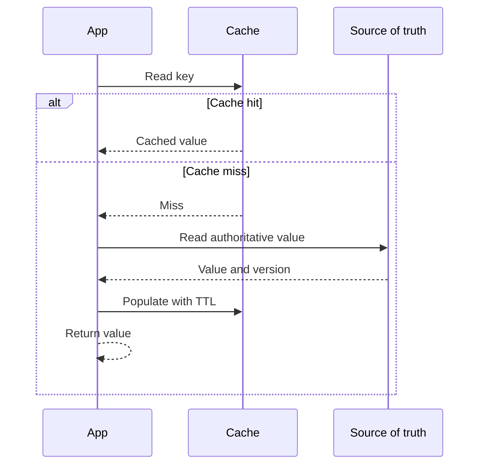

# 9. Caching and Data Locality

## Why cache?
A cache stores reusable data closer to the consumer or in a faster access layer. It can reduce latency, repeated database work and network transfer. Benefit depends on reuse: caching rarely requested data may add complexity without meaningful savings. A cache is usually not the source of truth; if treated as authoritative, durability and consistency need explicit design.

## Common patterns
- **Cache-aside:** application checks cache, loads source on miss, then populates cache. Simple, but concurrent misses can stampede and invalidation belongs to the application.
- **Read-through:** cache abstraction loads from source on miss.
- **Write-through:** update cache and source in the write path; ordering and partial failure matter.
- **Write-behind:** acknowledge before asynchronously persisting. This can reduce latency but requires durable buffering and recovery.
- **Write-around:** writes bypass cache; subsequent reads populate it.

Pattern labels alone do not define atomicity; inspect the implementation contract.

## TTL and invalidation
A time-to-live limits how long an entry remains eligible. It does not guarantee freshness relative to every source update. Invalidation can be explicit, version-based, event-driven or time-based. A stale-fill race occurs when an older read finishes after invalidation and repopulates stale data. Version checks or ordering mechanisms may be needed.

## Eviction and sizing
LRU approximates recency; LFU approximates frequency. Scan-heavy workloads can pollute recency-based caches, while frequency-based policies can retain formerly popular entries. Usable cache capacity is lower than physical RAM because keys, values, object/allocator overhead, metadata, fragmentation and replication consume memory.

## Failure modes
- **Stampede:** many requests fetch/recompute one expired key.
- **Penetration:** absent keys repeatedly hit the backing store.
- **Avalanche:** many expirations or cache outage suddenly overloads the source.
- **Hot key:** one key receives disproportionate traffic.
- **Stale fill race:** old data repopulates after a newer update.
- **Cache outage:** fallback traffic overwhelms the backing system.

Mitigations include request coalescing, jittered TTLs, negative caching, bounded concurrency, stale-while-revalidate where safe, and rate limiting. Negative caching can hide a newly created record until expiry or invalidation.

## Local, distributed and CDN caches
Process-local caches avoid network latency but each instance has separate entries and invalidation state. Distributed caches share entries but add network and operational dependency. Multi-level caches reduce latency but complicate coherence.

CDNs cache near users. Keys must include every dimension that changes the representation, such as locale or authorization context; missing a dimension can serve incorrect or private content. HTTP caching behavior is defined by [RFC 9111](https://www.rfc-editor.org/rfc/rfc9111.html); stale response extensions are described in [RFC 5861](https://www.rfc-editor.org/rfc/rfc5861.html).

## Quantifying benefit
If 90% of 2,000 lookups/s hit cache, about 200 lookups/s reach the source for that lookup class. If each miss causes three database queries, the source sees about 600 queries/s. Average hit ratio can hide correlated expiration bursts.

~~~mermaid
sequenceDiagram
  participant App
  participant Cache
  participant DB
  App->>Cache: Get key
  alt Hit
    Cache-->>App: Value
  else Miss
    Cache-->>App: Miss
    App->>DB: Read authoritative value
    DB-->>App: Value and version
    App->>Cache: Populate with bounded TTL
    App-->>App: Return value
  end
~~~

The diagram omits concurrent misses and invalidation races; real designs must address them.

## 9.1A Cache correctness begins with a freshness contract

A cache policy should state what freshness the consumer requires. Some data can be stale for minutes; other data, such as authorization decisions, account balances, or inventory reservations, may require stricter validation. A TTL of 30 seconds means an entry may be reused within a time policy; it does not mean it is guaranteed to be at most 30 seconds behind the source under every failure or clock condition.

Define whether stale data is allowed during source outages, whether stale values can be served while revalidating, and whether cache bypass is safe. Cache keys must include all dimensions that affect the result, including tenant, locale, representation version, and authorization context where relevant. Omitting a dimension can leak data or return the wrong representation.

## 9.1B Invalidation and stale-fill races

Consider this race:
1. Request A reads version 10 from the source.
2. A concurrent update commits version 11.
3. The update invalidates the cache.
4. Request A finishes late and populates version 10 after invalidation.

The cache is now stale even though invalidation occurred. Possible defenses include version-aware writes, compare-and-set, ordered invalidation, short TTLs as a safety bound, or re-reading after a suspected race. The correct approach depends on the cache and source capabilities.

Event-driven invalidation introduces another delay and failure path: the source commits, but the invalidation event is delayed, duplicated, or lost. A durable event path and reconciliation process may be required when freshness matters.

## 9.1C Stampede prevention and request coalescing

A stampede occurs when many requests miss the same key and independently load or compute the same value. Mitigations include:
- **Single-flight/request coalescing:** one in-flight load serves multiple waiting callers.
- **TTL jitter:** spreads expirations across time.
- **Refresh ahead:** refreshes popular values before expiry where prediction is reliable.
- **Stale-while-revalidate:** serves a permitted stale value while one caller refreshes.
- **Concurrency limits:** bounds source load when many keys miss.
- **Negative caching:** briefly caches confirmed absence where absence is safe to reuse.

A lock or single-flight mechanism must handle loader failure and lock expiry. Do not let all waiting requests hold unbounded memory or wait beyond their deadline. Negative caching must be invalidated when a new resource is created and should not turn authorization failures into shared cached results.

## 9.1D Cache outage and origin protection

A cache outage can convert a large hit workload into a sudden source-of-truth workload. The source should have a defined safe fallback: bounded bypass, degraded reads, admission control, or rejection. Blindly sending all requests to the database can turn a cache incident into a database outage.

Protect the origin with concurrency limits, connection budgets, request coalescing, rate limits, and gradual cache warm-up. During recovery, avoid loading the entire keyspace at once. A cache should not be treated as infinitely available or as free capacity.

## 9.1E Eviction, admission, and workload pollution

Eviction decides which entries leave when capacity is exhausted; admission decides whether a new value should enter. LRU and LFU describe different replacement signals, but pure policies can be vulnerable to scans or changing popularity. Some systems use frequency estimates or admission filters to avoid polluting the cache with one-time reads.

Cache sizing should account for metadata, object overhead, fragmentation, replication, and headroom. A high hit ratio is not automatically good if it hides expensive refreshes, stale results, or a small number of critical misses. Measure hit ratio alongside source load, miss latency, eviction rate, memory pressure, freshness violations, and tail latency.

## 9.1F Multi-level caches and invalidation topology

A local cache in each process can provide very low latency but creates multiple independent copies. A distributed cache centralizes some state but adds a network hop and a shared failure domain. A CDN adds geographic locality but makes cache-key and invalidation semantics more complex.

For every level, define who owns invalidation, how versions propagate, what happens when an invalidation message is missed, and whether lower levels can serve stale data. Cache coherence protocols can be expensive; many web systems instead accept bounded staleness and use TTLs plus explicit invalidation for critical updates.

## 9.1G HTTP caching details

HTTP caches consider method, status, freshness metadata, validators, and request/response directives. Cache-Control: no-store instructs caches not to store a response; no-cache generally means a stored response must be revalidated before reuse, not that it may never be stored. private restricts storage to private caches, while public can allow shared caching under applicable conditions.

Vary identifies request headers that affect the representation and therefore participate in the cache key. Incorrect use can fragment cache efficiency or, more seriously, serve the wrong representation. Authenticated responses need deliberate shared-cache policy. ETags and Last-Modified validators can support conditional revalidation without retransmitting unchanged bodies.

Consult [RFC 9111](https://www.rfc-editor.org/rfc/rfc9111.html) for normative HTTP caching behavior; do not infer security from a cache directive without reviewing the complete response and deployment.

## 9.1H Cache design checklist

- What is the source of truth?
- What freshness and stale-serving contract is acceptable?
- Does the cache key include tenant and representation dimensions?
- How are invalidation events delivered and repaired?
- Can an old in-flight read repopulate stale data?
- What happens during cache outage or cold start?
- How are stampedes and hot keys controlled?
- Are negative results safe to cache?
- What do hit ratio, miss latency, origin load, and freshness metrics show?
- Can cached sensitive data be deleted or invalidated across all layers?

## 9.2 Cache patterns and failure modes in practice

### Read-through, write-through, write-behind and write-around

- **Cache-aside:** the application checks the cache, loads from the source on a miss, and populates the cache. It is flexible but leaves invalidation and stale-fill races to the application.
- **Read-through:** the cache layer loads missing values from a configured source. It centralizes loading behavior but couples the cache to the loader integration.
- **Write-through:** a write updates the cache and source as part of the write path according to the cache product's contract. Understand what happens if one side succeeds and the other fails; the label alone does not guarantee a distributed transaction.
- **Write-behind/write-back:** writes are acknowledged to the cache before later propagation to the source. This can improve write latency but makes the cache part of the durability path; loss or delayed flush can lose acknowledged changes.
- **Write-around:** writes go directly to the source and may bypass cache population, reducing pollution for write-once/read-rarely data but causing a later read miss.

The correct pattern depends on whether the cache is disposable derived state or part of the acknowledged write path. Never assume a cache is durable because it replicates memory; define persistence and recovery guarantees explicitly.

### Cache stampede, penetration and avalanche

A **stampede** occurs when many callers load the same expired key simultaneously. Request coalescing, TTL jitter, refresh-ahead, bounded concurrency and stale-while-revalidate can help.

**Cache penetration** occurs when repeated requests target keys that do not exist or bypass the cache; negative caching, input validation and rate limits can reduce repeated origin work. Negative entries need short, appropriate lifetimes and must not cache authorization failures as globally reusable absence.

A **cache avalanche** is a burst of misses caused by many entries expiring together or a cache restart. TTL jitter, gradual warm-up, admission controls and origin protection reduce the risk. A cache outage can itself create a massive miss event, so the source must have a defined fallback rather than accepting unbounded traffic.

### Cache invalidation is a consistency protocol

When the source changes, the cache can be updated synchronously, invalidated by an event, or allowed to expire. Synchronous updates may add latency and partial-failure cases; event-driven invalidation introduces delivery delay, duplication and loss; TTL bounds some stale windows but may not satisfy strict correctness.

An out-of-order event can invalidate or overwrite a newer value. Version-aware cache writes can reject older versions if the source provides comparable versions. For important data, define the maximum stale interval, event repair/reconciliation strategy, and behavior when freshness cannot be proven.

### Cache correctness example: price and permissions

A product description may tolerate a few seconds of staleness. A price used to display an estimate may tolerate bounded staleness if checkout revalidates it. A permission revocation often requires much faster enforcement because a stale allow decision can disclose data. These are different freshness contracts and should not share a cache policy just because they return JSON.

Cache keys must include every dimension that changes the representation: tenant, locale, authorization scope, currency, feature version or request header as appropriate. Avoid caching a sensitive response under a key that omits the identity or authorization context. Cache invalidation must include CDN, local process, distributed cache and derived read-model layers where applicable.

### Cache hit ratio is not the goal

A high hit ratio can coexist with poor user latency if misses are extremely slow, hot keys are overloaded, or stale values cause repeated revalidation. Track hit/miss rate, miss latency, origin QPS, eviction, memory pressure, stampede suppression, refresh failures, stale-serving rate, and data-freshness violations. Measure latency at the user-visible boundary.

### Cache review checklist

- Is this cache disposable derived data or part of the durability path?
- Which freshness contract applies to this data class?
- What are the read/write patterns and invalidation path?
- Can old in-flight reads repopulate stale values?
- What happens when a key is absent or many keys expire together?
- Are keys partitioned by tenant, authorization, locale and representation?
- What happens to origin load during cache failure or cold start?
- Does a high hit ratio hide tail latency or stale results?
- Can deletion and revocation propagate to all cache layers?
- Is there a repair path when invalidation messages are lost?

## 9.3 Cache security, tenant isolation and freshness strategies

Caching changes where data is served from and which checks run on each request. A cache hit can bypass database work, but it must not bypass authorization, tenant isolation, privacy policy, or correctness checks that are required for the response. Cache correctness is therefore both a performance concern and a security boundary.

### Cache-key correctness and tenant isolation

A cache key must include every input that can change the response's meaning or the caller's permission to see it. Depending on the endpoint, that may include tenant ID, resource ID, locale, representation version, relevant query parameters, authorization scope, or content-negotiation headers. Omitting a relevant dimension can cause one user's or tenant's response to be served to another.

Do not blindly include a raw bearer token in a cache key: it can leak credentials into cache metadata, logs or metrics and creates poor reuse. Instead, design a safe authorization-aware caching policy. For sensitive or user-specific responses, private/no-store behavior or a cache partition keyed by a stable, non-secret identity/scope may be more appropriate. Authorization must still be enforced according to the application's contract; possession of a cache key is not authorization.

### Cache poisoning and untrusted input

A cache-poisoning vulnerability occurs when an attacker can influence the response stored under a key that other users will later request. Risks include inconsistent interpretation of Host or forwarding headers, unkeyed request headers that affect origin output, unsafe URL normalization, and differences between the cache and origin's parsing rules.

Defenses include:
- Make cache-key inputs explicit and align them with every request attribute that can alter the response.
- Normalize URLs and headers consistently across the edge and origin.
- Do not let untrusted forwarding headers determine security-sensitive output unless they are overwritten by a trusted proxy.
- Avoid caching responses whose variation or authorization behavior is not understood.
- Test cache behavior with different tenants, roles, locales, encodings and query parameters.
- Monitor unexpected cache-key cardinality, cache status changes and suspicious response variation.

A related cache-deception problem occurs when an attacker tricks a cache into storing sensitive dynamic content under a URL it treats as static. Cache policy should be based on response semantics and explicit rules, not only file extensions or superficial path patterns.

### Freshness policies: TTL, stale-while-revalidate and stale-if-error

A TTL defines when an entry becomes stale according to a particular cache's clock and policy; it does not guarantee immediate invalidation at the source. Freshness windows should be derived from the business meaning of the data. A product description may tolerate minutes of staleness; an authorization decision or account balance may require stronger controls or no shared caching.

**Stale-while-revalidate** allows a cache to serve a stale response while refreshing it asynchronously for a bounded interval. This can reduce latency and origin load during refresh, but users may temporarily see old content. **Stale-if-error** can allow stale content to be served during an origin failure under a defined policy. Neither is universally safe: a stale public article differs from a revoked credential, current inventory count or permission check.

Document:
- Maximum permitted staleness by data class.
- Whether stale responses are allowed during origin failure.
- How invalidation and refresh interact with in-flight requests.
- What happens when refresh fails repeatedly.
- Whether the caller can identify a stale response when that matters.
- Which data must never be served stale for security or business reasons.

### Deletion, revocation and privacy

Deleting a record from the primary database does not automatically remove it from local caches, distributed caches, CDN edges, search indexes, replicas, snapshots or backups. Define which copies are in scope, how invalidation propagates, how long stale copies may remain, and how deletion interacts with legal retention or backup recovery.

Permission revocation is particularly sensitive. If access checks are cached, the system needs a bounded revocation delay or an authoritative check on critical paths. A short TTL may reduce exposure but is not equivalent to immediate revocation. If the product promises immediate revocation, use a mechanism that enforces that promise rather than relying on an assumed cache expiry time.

### Cross-tenant and cache-poisoning test matrix

Run these tests against the actual cache/proxy configuration, not only a mocked cache client. The expected outcome depends on the API's documented authorization and freshness contract, but a cache hit must never bypass it.

| Test setup | Attack or race | Expected result |
|---|---|---|
| Tenant A warms a cache entry, then tenant B requests the same logical resource ID | Cross-tenant key collision | B receives only data B is authorized to see; a shared key is used only if the cached representation is truly tenant-independent |
| User with role X warms a response, then a lower-privilege user requests it | Role/permission variation omitted from cache policy | No privileged representation is served to the lower-privilege user |
| Request uses a spoofed Host or forwarding header that changes origin output | Cache and origin interpret request dimensions differently | Untrusted values cannot poison a shared response; trusted edge normalization is enforced |
| Same path is requested with different locale, content negotiation or query filters | A response-varying dimension is missing from the key or Vary policy | Each request receives the correct representation, or the response is not shared-cached |
| Permission is revoked while a previously authorized response remains cached | Revocation/invalidation race | Revocation takes effect within the documented bound; if immediate revocation is promised, stale cached authorization cannot grant access |
| Record is deleted while a cache fill is in flight | Stale-fill race repopulates deleted data | The invalidation/version protocol prevents an older read from repopulating a forbidden or deleted value |
| Attacker requests a dynamic sensitive URL that resembles a static asset path | Cache deception | Sensitive content is not stored or served as a shared static object |
| Cache is unavailable or invalidation delivery is delayed | Fallback path bypasses authorization or overloads origin | Correct authorization remains enforced; fallback is bounded and stale-serving follows the data-class policy |

Record the cache key/policy decision, response status and cache status for each case without logging raw credentials or sensitive payloads. Include the tests in release validation whenever proxy rules, authorization, URL normalization or response variation changes.

### Cache-security review checklist

- Does the key include tenant, identity scope and every response-varying dimension that matters?
- Can an attacker influence a shared cached response through headers, URL parsing or origin behavior?
- Are authorization and tenant checks preserved on cache hits?
- Are sensitive responses marked and partitioned appropriately?
- Is the stale-data window explicit for each data class?
- Can stale content be served during an origin error, and is that safe?
- How quickly must permission revocation take effect?
- How do deletion and invalidation reach every relevant cache layer?
- Are cache keys, values and logs free of secrets and unnecessary personal data?
- Are cross-tenant and cache-poisoning tests part of release validation?

## Further reading
- [RFC 9111 — HTTP Caching](https://www.rfc-editor.org/rfc/rfc9111.html).
- [Redis eviction documentation](https://redis.io/docs/latest/develop/reference/eviction/).

## Cache-aside read path

A production design must also handle concurrent misses, stale-fill races, invalidation, and a cache outage. Caching changes where work happens; it does not remove the need to define freshness and correctness.

---

[Back to textbook contents](../../README.md) · [Curriculum](../../CURRICULUM.md) · [Roadmap](../../ROADMAP.md)
