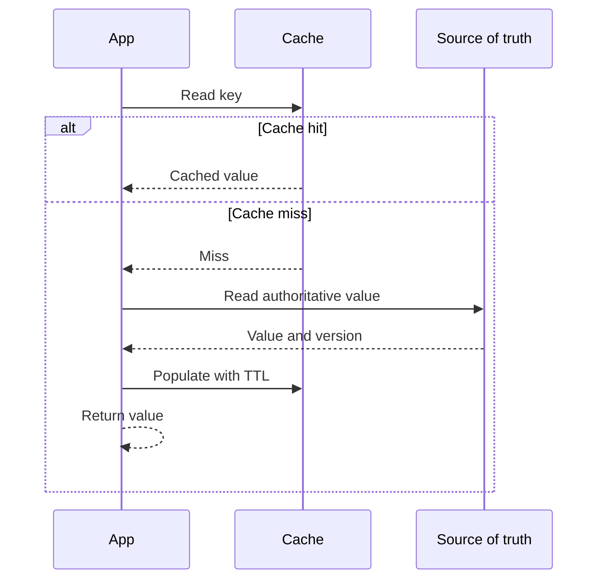

# 9. Caching and Data Locality

## Why cache?
A cache stores reusable data closer to the consumer or in a faster access layer. It can reduce latency, repeated database work and network transfer. Benefit depends on reuse: caching rarely requested data may add complexity without meaningful savings. A cache is usually not the source of truth; if treated as authoritative, durability and consistency need explicit design.

## Common patterns
- **Cache-aside:** application checks cache, loads source on miss, then populates cache. Simple, but concurrent misses can stampede and invalidation belongs to the application.
- **Read-through:** cache abstraction loads from source on miss.
- **Write-through:** update cache and source in the write path; ordering and partial failure matter.
- **Write-behind:** acknowledge before asynchronously persisting. This can reduce latency but requires durable buffering and recovery.
- **Write-around:** writes bypass cache; subsequent reads populate it.

Pattern labels alone do not define atomicity; inspect the implementation contract.

## TTL and invalidation
A time-to-live limits how long an entry remains eligible. It does not guarantee freshness relative to every source update. Invalidation can be explicit, version-based, event-driven or time-based. A stale-fill race occurs when an older read finishes after invalidation and repopulates stale data. Version checks or ordering mechanisms may be needed.

## Eviction and sizing
LRU approximates recency; LFU approximates frequency. Scan-heavy workloads can pollute recency-based caches, while frequency-based policies can retain formerly popular entries. Usable cache capacity is lower than physical RAM because keys, values, object/allocator overhead, metadata, fragmentation and replication consume memory.

## Failure modes
- **Stampede:** many requests fetch/recompute one expired key.
- **Penetration:** absent keys repeatedly hit the backing store.
- **Avalanche:** many expirations or cache outage suddenly overloads the source.
- **Hot key:** one key receives disproportionate traffic.
- **Stale fill race:** old data repopulates after a newer update.
- **Cache outage:** fallback traffic overwhelms the backing system.

Mitigations include request coalescing, jittered TTLs, negative caching, bounded concurrency, stale-while-revalidate where safe, and rate limiting. Negative caching can hide a newly created record until expiry or invalidation.

## Local, distributed and CDN caches
Process-local caches avoid network latency but each instance has separate entries and invalidation state. Distributed caches share entries but add network and operational dependency. Multi-level caches reduce latency but complicate coherence.

CDNs cache near users. Keys must include every dimension that changes the representation, such as locale or authorization context; missing a dimension can serve incorrect or private content. HTTP caching behavior is defined by [RFC 9111](https://www.rfc-editor.org/rfc/rfc9111.html); stale response extensions are described in [RFC 5861](https://www.rfc-editor.org/rfc/rfc5861.html).

## Quantifying benefit
If 90% of 2,000 lookups/s hit cache, about 200 lookups/s reach the source for that lookup class. If each miss causes three database queries, the source sees about 600 queries/s. Average hit ratio can hide correlated expiration bursts.

~~~mermaid
sequenceDiagram
  participant App
  participant Cache
  participant DB
  App->>Cache: Get key
  alt Hit
    Cache-->>App: Value
  else Miss
    Cache-->>App: Miss
    App->>DB: Read authoritative value
    DB-->>App: Value and version
    App->>Cache: Populate with bounded TTL
    App-->>App: Return value
  end
~~~

The diagram omits concurrent misses and invalidation races; real designs must address them.

## 9.1A Cache correctness begins with a freshness contract

A cache policy should state what freshness the consumer requires. Some data can be stale for minutes; other data, such as authorization decisions, account balances, or inventory reservations, may require stricter validation. A TTL of 30 seconds means an entry may be reused within a time policy; it does not mean it is guaranteed to be at most 30 seconds behind the source under every failure or clock condition.

Define whether stale data is allowed during source outages, whether stale values can be served while revalidating, and whether cache bypass is safe. Cache keys must include all dimensions that affect the result, including tenant, locale, representation version, and authorization context where relevant. Omitting a dimension can leak data or return the wrong representation.

## 9.1B Invalidation and stale-fill races

Consider this race:
1. Request A reads version 10 from the source.
2. A concurrent update commits version 11.
3. The update invalidates the cache.
4. Request A finishes late and populates version 10 after invalidation.

The cache is now stale even though invalidation occurred. Possible defenses include version-aware writes, compare-and-set, ordered invalidation, short TTLs as a safety bound, or re-reading after a suspected race. The correct approach depends on the cache and source capabilities.

Event-driven invalidation introduces another delay and failure path: the source commits, but the invalidation event is delayed, duplicated, or lost. A durable event path and reconciliation process may be required when freshness matters.

## 9.1C Stampede prevention and request coalescing

A stampede occurs when many requests miss the same key and independently load or compute the same value. Mitigations include:
- **Single-flight/request coalescing:** one in-flight load serves multiple waiting callers.
- **TTL jitter:** spreads expirations across time.
- **Refresh ahead:** refreshes popular values before expiry where prediction is reliable.
- **Stale-while-revalidate:** serves a permitted stale value while one caller refreshes.
- **Concurrency limits:** bounds source load when many keys miss.
- **Negative caching:** briefly caches confirmed absence where absence is safe to reuse.

A lock or single-flight mechanism must handle loader failure and lock expiry. Do not let all waiting requests hold unbounded memory or wait beyond their deadline. Negative caching must be invalidated when a new resource is created and should not turn authorization failures into shared cached results.

## 9.1D Cache outage and origin protection

A cache outage can convert a large hit workload into a sudden source-of-truth workload. The source should have a defined safe fallback: bounded bypass, degraded reads, admission control, or rejection. Blindly sending all requests to the database can turn a cache incident into a database outage.

Protect the origin with concurrency limits, connection budgets, request coalescing, rate limits, and gradual cache warm-up. During recovery, avoid loading the entire keyspace at once. A cache should not be treated as infinitely available or as free capacity.

## 9.1E Eviction, admission, and workload pollution

Eviction decides which entries leave when capacity is exhausted; admission decides whether a new value should enter. LRU and LFU describe different replacement signals, but pure policies can be vulnerable to scans or changing popularity. Some systems use frequency estimates or admission filters to avoid polluting the cache with one-time reads.

Cache sizing should account for metadata, object overhead, fragmentation, replication, and headroom. A high hit ratio is not automatically good if it hides expensive refreshes, stale results, or a small number of critical misses. Measure hit ratio alongside source load, miss latency, eviction rate, memory pressure, freshness violations, and tail latency.

## 9.1F Multi-level caches and invalidation topology

A local cache in each process can provide very low latency but creates multiple independent copies. A distributed cache centralizes some state but adds a network hop and a shared failure domain. A CDN adds geographic locality but makes cache-key and invalidation semantics more complex.

For every level, define who owns invalidation, how versions propagate, what happens when an invalidation message is missed, and whether lower levels can serve stale data. Cache coherence protocols can be expensive; many web systems instead accept bounded staleness and use TTLs plus explicit invalidation for critical updates.

## 9.1G HTTP caching details

HTTP caches consider method, status, freshness metadata, validators, and request/response directives. Cache-Control: no-store instructs caches not to store a response; no-cache generally means a stored response must be revalidated before reuse, not that it may never be stored. private restricts storage to private caches, while public can allow shared caching under applicable conditions.

Vary identifies request headers that affect the representation and therefore participate in the cache key. Incorrect use can fragment cache efficiency or, more seriously, serve the wrong representation. Authenticated responses need deliberate shared-cache policy. ETags and Last-Modified validators can support conditional revalidation without retransmitting unchanged bodies.

Consult [RFC 9111](https://www.rfc-editor.org/rfc/rfc9111.html) for normative HTTP caching behavior; do not infer security from a cache directive without reviewing the complete response and deployment.

## 9.1H Cache design checklist

- What is the source of truth?
- What freshness and stale-serving contract is acceptable?
- Does the cache key include tenant and representation dimensions?
- How are invalidation events delivered and repaired?
- Can an old in-flight read repopulate stale data?
- What happens during cache outage or cold start?
- How are stampedes and hot keys controlled?
- Are negative results safe to cache?
- What do hit ratio, miss latency, origin load, and freshness metrics show?
- Can cached sensitive data be deleted or invalidated across all layers?

## Further reading
- [RFC 9111 — HTTP Caching](https://www.rfc-editor.org/rfc/rfc9111.html).
- [Redis eviction documentation](https://redis.io/docs/latest/develop/reference/eviction/).

## Cache-aside read path

A production design must also handle concurrent misses, stale-fill races, invalidation, and a cache outage. Caching changes where work happens; it does not remove the need to define freshness and correctness.

---

[Back to textbook contents](../../README.md) · [Curriculum](../../CURRICULUM.md) · [Roadmap](../../ROADMAP.md)
