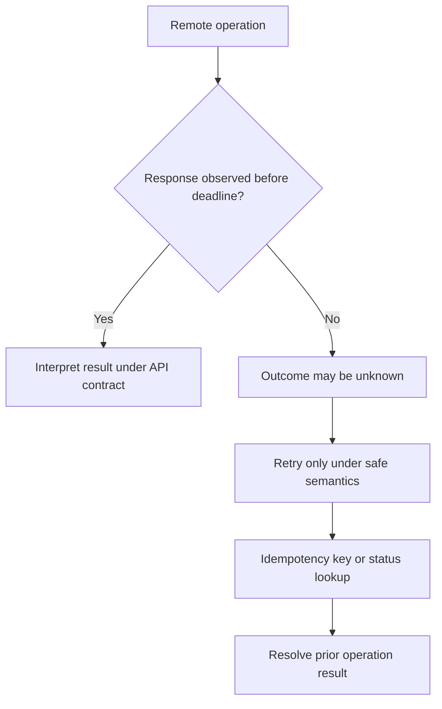

# 10. Distribution, Failure, and Consistency

## Distribution changes the failure model
A remote call can be delayed, duplicated by retries, rejected, partially processed, or completed while its response is lost. A caller may not distinguish a slow process from a failed process. Failures are partial: one node can fail while others work, or a process can be alive but unable to reach its database. In asynchronous systems, delay alone cannot prove permanent failure.

State the fault model: crash-stop processes, network loss/delay/partition, disk failure, correlated infrastructure failure, or Byzantine behavior. Most service designs assume non-Byzantine components but still need crash and communication failure handling.

## Safety and liveness
**Safety** means nothing forbidden happens, such as conflicting values both being committed as the unique decision. **Liveness** means something good eventually happens, such as a request completing. A system can preserve safety by refusing writes during uncertainty and lose liveness; it can accept conflicting writes to preserve availability and later reconcile them.

## Consistency models
- **Linearizability:** each operation appears atomic between invocation and response and respects real-time order.
- **Sequential consistency:** operations appear in a total order respecting each process's program order, but not necessarily real-time order.
- **Causal consistency:** causally related operations are observed in causal order; concurrent operations may differ.
- **Eventual consistency:** if updates stop and reconciliation continues under the model's assumptions, replicas converge. Interim read behavior is not defined by this phrase alone.
- **Read-your-writes:** a client sees its own successful updates within the defined session scope.

These are not merely stronger/weaker marketing labels; they define what clients can observe and what coordination may be required.

## CAP and PACELC
CAP says that during a network partition, a distributed read/write object cannot guarantee both linearizability and availability for every request under the formal model. Partition tolerance is not something a real networked system can turn off. The practical question is which operations can proceed and what consistency is promised during a partition.

CAP does not mean a system permanently chooses only two letters, nor does it cover all normal-operation trade-offs. PACELC highlights that even without a partition, latency-versus-consistency trade-offs can matter. Treat these as reasoning tools, not product labels.

Primary source: Gilbert and Lynch, [CAP paper](https://groups.csail.mit.edu/tds/papers/Gilbert/Brewer2.pdf).

## Replication and quorum intuition
Replication stores copies across nodes. Synchronous replication waits for specified acknowledgments; asynchronous replication acknowledges earlier and catches replicas up later. Always state which replicas and what acknowledgment means.

For N replicas, read quorum R and write quorum W with R + W > N intersect in a simple fixed-membership model. Intersection alone does not guarantee linearizability: version selection, concurrent writes, leader rules, reconfiguration and failure semantics matter.

## Clocks and causality
Wall clocks can differ through skew, drift and adjustment. Timestamps do not automatically prove causal order. Lamport clocks preserve the implication that if A causally precedes B, then L(A) < L(B), but the reverse does not prove causality. Vector clocks can help distinguish causal order from concurrency when metadata is propagated correctly. Use monotonic clocks for elapsed time.

## Conflict resolution and CRDTs
Multi-writer systems may accept concurrent updates. Conflict resolution can use application-specific merge logic, last-writer-wins registers, version vectors or CRDTs. CRDT guarantees depend on the data type and operation algebra; they do not make arbitrary business operations conflict-free. Last-writer-wins can discard a legitimate update if timestamps or tie-breaking do not reflect domain intent.

## Timeout after commit
~~~mermaid
sequenceDiagram
  participant C as Client
  participant S as Service
  participant D as Database
  C->>S: Submit command
  S->>D: Commit transaction
  D-->>S: Commit acknowledged
  S--xC: Response lost
  Note over C,D: Timeout does not reveal whether commit happened
  C->>S: Retry with same idempotency key
  S->>D: Resolve prior result safely
  D-->>S: Original result
  S-->>C: Return original result
~~~

Uncertainty must be handled in the API and state model, not merely by increasing timeout values.

## 10.7 Failure models: crash, omission, partition, and Byzantine behavior

A distributed protocol should state which failures it tolerates. A **crash-stop** process halts and does not return. A **crash-recovery** process may restart with durable state. An **omission** failure drops a message or action. A **network partition** prevents some participants from communicating while other parts may continue. A **Byzantine** participant may send arbitrary or contradictory messages; most ordinary service architectures do not provide Byzantine fault tolerance and should not imply they do.

The chosen model affects what guarantees are possible. A consensus protocol designed for crash failures does not automatically tolerate malicious nodes. Durable local state, message authentication, membership, quorum rules, and recovery behavior are part of the model.

## 10.8 Failure detectors and suspicion

A timeout-based failure detector produces suspicion, not certainty. Short timeouts detect failures quickly but can falsely suspect slow or paused nodes; long timeouts reduce false suspicion but delay failover. Adaptive detectors can use observed latency, but still need safe protocol behavior when a suspicion is wrong.

Heartbeats are useful signals but are not proof that the full request path is healthy. A process can send heartbeats while its database connection pool is exhausted. Separate process liveness, readiness to serve, and end-to-end synthetic checks according to the decision each signal drives.

## 10.9 Happens-before and causal reasoning

The happens-before relation captures causal order. It includes program order within one process and message send-before-receive relationships, then takes the transitive closure. If neither event happens before the other, they are concurrent in this model—even if their wall-clock timestamps differ.

Lamport clocks preserve causal order but may order concurrent events arbitrarily. Vector clocks can represent more causal information but can grow with participants and are not a universal fit for large dynamic systems. Physical clocks with uncertainty bounds can support specialized ordering systems, but only when their synchronization assumptions and error bounds are part of the design.

## 10.10 Consistency versus isolation

Consistency in distributed systems describes what values and operation order clients can observe across replicas. Database isolation describes how concurrent transactions interact relative to one another. The terms are related but not interchangeable.

A linearizable key-value store can still be used incorrectly by an application that performs a read, makes a decision, and then issues an unrelated write without an atomic condition. Conversely, a transaction may have strong local isolation while reads from a lagging replica violate a client's read-your-writes expectation. State the operation boundary and invariant explicitly.

## 10.11 Linearizability, sequential consistency, and serializability

Linearizability requires each operation to appear at one point between invocation and response, respecting real-time order. Sequential consistency requires a single total order consistent with each process's program order but need not respect real-time order between processes. Serializability requires a concurrent database transaction execution to be equivalent to some serial execution; it does not by itself require that serial order to respect real-time order.

Strict serializability combines serializability with real-time order. These properties answer different questions: operation-level histories, process ordering, and transaction schedules. A system's guarantee must be named at the right level rather than summarized as strong.

## 10.12 Read and session guarantees

Applications may need narrower guarantees than global linearizability:
- **Read-your-writes:** after a client successfully updates a value, its later reads see that update or a newer one.
- **Monotonic reads:** once a client observes a version, it does not later observe an older version.
- **Monotonic writes:** a client's writes are applied in the order the client issued them.
- **Writes-follow-reads:** a write that depends on a previously read value respects the required causal order.

These guarantees can be implemented with session routing, version tokens, causal metadata, or waiting for replicas to catch up. They must specify scope and behavior when the necessary replica or metadata is unavailable.

## 10.13 Quorums and their hidden assumptions

The familiar condition R + W > N gives read/write quorum intersection for a fixed set of N replicas under a simple counting model. It is not a complete consistency proof. The protocol also needs to determine which version is returned, how concurrent writes are ordered or merged, how replicas persist values, and how membership changes preserve safety.

For example, a read quorum may intersect a write quorum at a replica that has not yet durably applied the newest version under the actual protocol. A stale leader may accept writes unless epochs and fencing prevent it. A configuration change can invalidate old quorum assumptions. Always reason from the full protocol and acknowledgment contract.

## 10.14 CAP, PACELC, and per-operation policy

During a partition, a service can reject or delay operations that require a single coherent history, or accept operations on separated sides and reconcile later. The latter behavior cannot guarantee linearizability for all those operations during the partition. In the formal CAP statement, availability means each request to a non-failing node receives a response; it does not guarantee that the response is fresh or useful for the business operation. Availability in the theorem is a formal response guarantee, not a promise of business usefulness.

PACELC emphasizes the normal-operation trade-off between latency and consistency when no partition is occurring. Different endpoints may choose different policies: cached catalog reads can tolerate bounded staleness, while inventory reservation or financial transfers may require coordination. A product is not necessarily one uniform CAP category.

## 10.15 Conflict resolution and CRDT limits

Concurrent updates can be handled through serialization, application-specific conflict resolution, last-writer-wins, version metadata, or CRDTs. Each has a distinct contract. Last-writer-wins is deterministic only when its ordering and tie-breaking rules are defined; it may discard a legitimate domain update.

CRDT convergence relies on the data type's algebra and delivery assumptions. Convergence does not guarantee that a business invariant holds at every point. If two regions independently allocate the last available seat, merging counters later cannot undo the oversell. The system must reserve capacity, coordinate the invariant, or define an acceptable conflict/compensation policy.

## 10.16 Distributed design reasoning checklist

- Which failure model is assumed?
- What does the caller know after a timeout?
- What safety property must never be violated?
- What liveness behavior is required during partitions?
- What consistency or session guarantee does each operation need?
- Where are acknowledged writes durable?
- How are leadership epochs and stale writers handled?
- Do quorum assumptions still hold during reconfiguration?
- What happens when operations are concurrent?
- Does conflict resolution preserve business invariants?
- How is the behavior tested under delay, loss, restart, and partition?

## 10.17 Multi-region systems: latency, consistency and failover

Multi-region architecture is not one design choice. A system may replicate data to another region for disaster recovery, serve read traffic from multiple regions, accept writes in one home region, or accept writes concurrently in several regions. Each model has different latency, conflict, failover and operational consequences.

### Single-writer and multi-writer models

A **single-writer/home-region** model simplifies write ordering and conflict resolution but can make writes from distant users slower and requires a failover plan if the home region is lost. A **multi-writer** model can reduce write latency and improve regional autonomy, but concurrent updates require coordination, conflict resolution or a data model that safely merges them. Not every business invariant can be merged after the fact.

For example, profile preferences may tolerate a defined last-writer-wins policy. Inventory reservation, unique username allocation or financial balance transfers may require coordination around the invariant. The right model is operation-specific, not just a database-wide label.

### Replication lag and read routing

Routing a user to the nearest region can reduce latency but may return stale data if that region has not applied a recent write. Session guarantees such as read-your-writes can be supported by routing a session to its home region, carrying a version/commit token, or waiting until a replica has applied a required position. These strategies add latency or reduce routing flexibility when the replica is behind.

Define what a successful write acknowledgment means: local durable commit, remote replica acknowledgment, or a quorum/consensus condition. Then explain what data can be lost if a region fails immediately after acknowledgment.

### Clock uncertainty and ordering

Wall-clock timestamps are not a reliable universal total order across machines. Clock synchronization has finite error; clocks can drift, jump or be adjusted. If a system uses physical time to choose winners, it must define timestamp source, error bounds, tie-breaking, and what happens when clocks are outside the expected bounds.

Logical clocks capture ordering relationships rather than exact elapsed time. Lamport clocks preserve the happens-before relation in the sense that if event A causally precedes event B, A's Lamport timestamp is smaller; the reverse implication does not hold. Vector clocks can distinguish some concurrent versions, but their metadata and participant-management costs grow with the system's shape.

### Failover is a state transition, not just a DNS update

A regional failover plan must establish which region is authoritative, fence the former writer, determine the recovery point, promote or restore the target, redirect traffic, and verify correctness. DNS TTLs do not force every client to switch immediately. A returning region may contain divergent or stale data and must not automatically resume writes without reconciliation.

Capacity must be planned for the surviving region to handle the required load. If two regions each normally run at 50% capacity and one fails, the other may be unable to take all traffic. Consider dependency capacity, quotas, cache warm-up, connection storms and the ability to degrade optional features during recovery.

### Multi-region design checklist

- Is the architecture single-writer, home-region, or multi-writer?
- Which operations require coordination to preserve invariants?
- What does a successful write acknowledgment guarantee across regions?
- How are read-your-writes and stale reads handled?
- What is the conflict-resolution policy for concurrent updates?
- How are clock uncertainty and ordering represented?
- How is the former writer fenced during failover?
- What is the data recovery point and how is divergence reconciled?
- Can the surviving region serve required load and dependencies?
- Has failover and failback been tested with real data and clients?

## 10.18 Worked consistency timeline: write, timeout, and read

Consider a client writing a new shipping address to a service that replicates data to another region. The client sends the write; the primary commits it; the response is lost; and the client times out. The client cannot infer whether the write committed from the timeout alone. Retrying with the same idempotency key can avoid creating a second logical operation, but the read behavior still depends on the system's consistency contract.

### Three possible read paths

1. **Read from the primary or authoritative leader:** after the committed write, a subsequent read may return the new value, subject to the system's transaction and session guarantees.
2. **Read from an asynchronous replica:** the replica may not yet have applied the write, so the client can observe the older address.
3. **Read with a session/version token:** the client supplies evidence of the required write version, and the service routes to an appropriate replica or waits until that version is visible. If no replica can satisfy the token, the system must define whether it waits, routes elsewhere, or returns an explicit failure.

A system should not promise read-your-writes while routing every read to an arbitrary lagging replica unless it has a mechanism that enforces that promise.

### Quorum arithmetic is not a full consistency proof

For a fixed set of (N) replicas, read and write quorum sizes (R) and (W) are often discussed using the intersection condition (R + W > N). This arithmetic helps show that read and write sets intersect under the assumed membership and failure model. It does not, by itself, prove linearizability.

The actual guarantee depends on how versions are ordered, which replica acknowledges a write, whether writes are concurrent, how conflicting values are resolved, whether replicas can acknowledge stale state, how membership changes, and whether the read protocol chooses the newest valid committed version. Some systems use consensus or leader-based rules rather than simple independent read/write quorums.

### Distinguish the operation's guarantee

- **Eventual consistency:** if updates stop and the system continues making progress, replicas are expected to converge under the model; this does not promise when a particular read sees a write.
- **Read-your-writes:** a client sees its own successful prior writes in later reads within the guarantee's defined scope.
- **Monotonic reads:** a client does not move backward to an older state according to the system's version/order model.
- **Linearizability:** each operation appears to take effect atomically at a point between invocation and response, respecting real-time order for non-overlapping operations.
- **Serializability:** transactions behave as if executed in some serial order; it does not by itself imply that the order respects real-time ordering.

These guarantees answer different questions. State which operations receive which guarantee, what happens after a timeout, and how a client can safely retry.

### Consistency review checklist

- What does the write acknowledgment mean: local commit, quorum, or consensus commit?
- Can a timeout occur after the operation has committed?
- Is the retry idempotent and how is its result recovered?
- Which reads may use stale replicas?
- Are read-your-writes or monotonic-read guarantees required?
- What does a session/version token represent and how is it validated?
- What are the assumptions behind quorum intersection?
- How are concurrent writes and conflict resolution handled?
- Does the stated guarantee hold during failover and membership changes?
- Can tests demonstrate the guarantee under delay, duplicate requests and replica lag?

## Further reading
- Gilbert and Lynch, [CAP paper](https://groups.csail.mit.edu/tds/papers/Gilbert/Brewer2.pdf).
- Lamport, [Time, Clocks, and the Ordering of Events](https://lamport.azurewebsites.net/pubs/time-clocks.pdf).
- Brewer, [CAP Twelve Years Later](https://doi.org/10.1109/MC.2012.37).
- [Raft paper and resources](https://raft.github.io/).

## From uncertainty to explicit guarantees

The absence of a response is an observation about the communication path, not proof that the remote operation did not commit. This distinction is foundational to retry-safe distributed systems.

---

[Back to textbook contents](../../README.md) · [Curriculum](../../CURRICULUM.md) · [Roadmap](../../ROADMAP.md)
