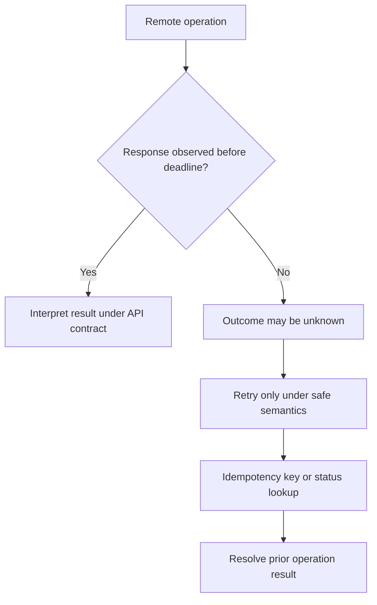

# 10. Distribution, Failure, and Consistency

## Distribution changes the failure model
A remote call can be delayed, duplicated by retries, rejected, partially processed, or completed while its response is lost. A caller may not distinguish a slow process from a failed process. Failures are partial: one node can fail while others work, or a process can be alive but unable to reach its database. In asynchronous systems, delay alone cannot prove permanent failure.

State the fault model: crash-stop processes, network loss/delay/partition, disk failure, correlated infrastructure failure, or Byzantine behavior. Most service designs assume non-Byzantine components but still need crash and communication failure handling.

## Safety and liveness
**Safety** means nothing forbidden happens, such as conflicting values both being committed as the unique decision. **Liveness** means something good eventually happens, such as a request completing. A system can preserve safety by refusing writes during uncertainty and lose liveness; it can accept conflicting writes to preserve availability and later reconcile them.

## Consistency models
- **Linearizability:** each operation appears atomic between invocation and response and respects real-time order.
- **Sequential consistency:** operations appear in a total order respecting each process's program order, but not necessarily real-time order.
- **Causal consistency:** causally related operations are observed in causal order; concurrent operations may differ.
- **Eventual consistency:** if updates stop and reconciliation continues under the model's assumptions, replicas converge. Interim read behavior is not defined by this phrase alone.
- **Read-your-writes:** a client sees its own successful updates within the defined session scope.

These are not merely stronger/weaker marketing labels; they define what clients can observe and what coordination may be required.

## CAP and PACELC
CAP says that during a network partition, a distributed read/write object cannot guarantee both linearizability and availability for every request under the formal model. Partition tolerance is not something a real networked system can turn off. The practical question is which operations can proceed and what consistency is promised during a partition.

CAP does not mean a system permanently chooses only two letters, nor does it cover all normal-operation trade-offs. PACELC highlights that even without a partition, latency-versus-consistency trade-offs can matter. Treat these as reasoning tools, not product labels.

Primary source: Gilbert and Lynch, [CAP paper](https://groups.csail.mit.edu/tds/papers/Gilbert/Brewer2.pdf).

## Replication and quorum intuition
Replication stores copies across nodes. Synchronous replication waits for specified acknowledgments; asynchronous replication acknowledges earlier and catches replicas up later. Always state which replicas and what acknowledgment means.

For N replicas, read quorum R and write quorum W with R + W > N intersect in a simple fixed-membership model. Intersection alone does not guarantee linearizability: version selection, concurrent writes, leader rules, reconfiguration and failure semantics matter.

## Clocks and causality
Wall clocks can differ through skew, drift and adjustment. Timestamps do not automatically prove causal order. Lamport clocks preserve the implication that if A causally precedes B, then L(A) < L(B), but the reverse does not prove causality. Vector clocks can help distinguish causal order from concurrency when metadata is propagated correctly. Use monotonic clocks for elapsed time.

## Conflict resolution and CRDTs
Multi-writer systems may accept concurrent updates. Conflict resolution can use application-specific merge logic, last-writer-wins registers, version vectors or CRDTs. CRDT guarantees depend on the data type and operation algebra; they do not make arbitrary business operations conflict-free. Last-writer-wins can discard a legitimate update if timestamps or tie-breaking do not reflect domain intent.

## Timeout after commit
~~~mermaid
sequenceDiagram
  participant C as Client
  participant S as Service
  participant D as Database
  C->>S: Submit command
  S->>D: Commit transaction
  D-->>S: Commit acknowledged
  S--xC: Response lost
  Note over C,D: Timeout does not reveal whether commit happened
  C->>S: Retry with same idempotency key
  S->>D: Resolve prior result safely
  D-->>S: Original result
  S-->>C: Return original result
~~~

Uncertainty must be handled in the API and state model, not merely by increasing timeout values.

## Further reading
- Gilbert and Lynch, [CAP paper](https://groups.csail.mit.edu/tds/papers/Gilbert/Brewer2.pdf).
- Lamport, [Time, Clocks, and the Ordering of Events](https://lamport.azurewebsites.net/pubs/time-clocks.pdf).
- Brewer, [CAP Twelve Years Later](https://doi.org/10.1109/MC.2012.37).

## 10.1A Partial failure: a timeout is evidence, not a verdict

Suppose service A sends a request to service B and waits 300 ms. No response arrives. Several states are consistent with the observation:

1. The request never reached B.
2. B received it but has not started processing.
3. B is processing but slower than expected.
4. B completed the operation but its response was lost.
5. B responded, but an intermediary or client failed before observing it.

The caller cannot infer which state occurred from the timeout alone. This is why retries, cancellation, idempotency, deadlines and durable operation identifiers are correctness mechanisms rather than mere client-library settings.

A failure detector is an algorithm that suspects a node based on observations such as missed heartbeats or late responses. In a fully asynchronous model, no finite delay proves that a process has crashed: a slow process and a failed process can look identical. Practical systems use timeouts as a trade-off, then rely on a protocol to remain safe when suspicions are wrong.

## 10.1B Failure domains and correlated failure

Redundancy helps only when replicas do not share the failure being mitigated. Two processes on one host share host failure; two hosts in one zone may share power or network failure; two regions can still share credentials, control planes, software defects or a global data corruption event. Model independent and correlated failure separately.

A useful fault inventory lists process, host, rack/zone, region, network path, identity provider, configuration service, control plane, operator error, data corruption and dependency outage. For each, specify detection, containment, degraded behavior, recovery, and how recovery correctness is verified.

## 10.2A CAP theorem: the exact question

CAP is not a general claim that every distributed architecture permanently chooses two of three desirable properties. In the formal model, when a partition separates clients or replicas, a distributed read/write object cannot guarantee both linearizability and availability for every request. Availability in this statement means each request to a non-failing node eventually receives a response; it does not mean the response is useful or current in a business sense.

A system may choose to reject or delay some operations during a partition to preserve a single coherent history. Another system may accept operations on both sides and reconcile later, but then it cannot promise that every read is linearizable during the partition. Different operations in the same product may make different choices: a profile view may tolerate staleness while a money transfer may not.

## 10.2B PACELC and the cost of coordination

PACELC adds a second question: if there is no partition, does the system favor lower latency or stronger consistency? A geographically distributed write that waits for remote coordination may have higher latency than a local write. An asynchronous write may return sooner but permit stale reads or conflict. This is a workload-specific trade-off, not a universal classification of entire products.

## 10.3A Read guarantees are client contracts

“Strong consistency” is too vague without the operation and boundary. Ask:
- Is the write acknowledged only after durable commit?
- Does a subsequent read on the same client observe that write?
- Can two clients concurrently update the same value?
- What happens during leader change or partition?
- Is order guaranteed across keys, partitions or only within one partition?
- Can a successful read later be superseded by an older value?

Session guarantees such as read-your-writes and monotonic reads can be useful even when a system does not offer global linearizability. They need an implementation strategy such as sticky routing, version tokens, causal metadata, or waiting for a replica to catch up.

## 10.4A Quorum intersection is necessary intuition, not a complete proof

For N fixed replicas, read quorum R and write quorum W intersect when R + W > N. This means a read quorum and a write quorum share at least one replica in that simplified model. It does not say which value the reader chooses, whether the intersecting replica has the newest committed value, or whether writes were serialized. A protocol must define versions, conflict rules, leader epochs, concurrent write handling, and membership changes.

For example, N=3, R=2, W=2 creates pairwise intersection. But if writes can be accepted concurrently by different leaders or replicas use incompatible version rules, intersection by itself does not establish a linearizable register. Treat quorum arithmetic as one part of the protocol, not the whole guarantee.

## 10.5A Logical clocks and vector clocks

A Lamport clock increments on local events and is advanced on receipt of a message so that causally ordered events receive increasing values. If A happened-before B, then L(A) < L(B). However, L(A) < L(B) does not prove A happened-before B; the clock imposes a total tie-broken ordering that may order concurrent events.

A vector clock carries one logical counter per participant (or an equivalent compact representation). Comparing vectors can distinguish “before,” “after,” and “concurrent” when the full causal metadata is available. Vector clocks grow with membership and are difficult in open or very large systems, so practical systems use bounded or specialized causal metadata.

Neither logical nor wall-clock timestamps automatically solve business conflict resolution. The merge rule must preserve the domain invariant.

## 10.6A CRDTs: convergence is not business correctness

A CRDT is designed so replicas can merge updates according to mathematical properties that guarantee convergence under its model. State-based CRDTs commonly rely on a join operation with properties such as associativity, commutativity and idempotence; operation-based designs have their own delivery assumptions.

A set that merges independent additions can be a good fit. A bank balance with arbitrary concurrent debits is not automatically safe just because it is stored in a CRDT. The application still needs to preserve invariants such as non-negative balance or unique allocation. Choose the data type and its allowed operations around the invariant, not around the label “eventually consistent.”

## Further reading
- [CAP paper by Gilbert and Lynch](https://groups.csail.mit.edu/tds/papers/Gilbert/Brewer2.pdf).
- Lamport, [Time, Clocks, and the Ordering of Events](https://lamport.azurewebsites.net/pubs/time-clocks.pdf).
- [Raft paper and resources](https://raft.github.io/).

## From uncertainty to explicit guarantees

The absence of a response is an observation about the communication path, not proof that the remote operation did not commit. This distinction is foundational to retry-safe distributed systems.

---

[Back to textbook contents](../../README.md) · [Curriculum](../../CURRICULUM.md) · [Roadmap](../../ROADMAP.md)
