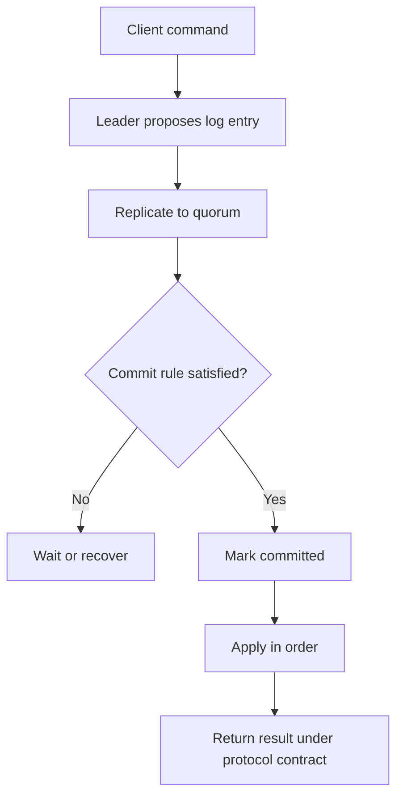

# 11. Replication, Coordination, and Distributed Transactions

## Leader election is not enough
A leader coordinates writes or a replicated state machine. Election chooses a candidate, but the complete protocol must prevent stale leaders from committing conflicting state. A paused process may resume after its lease expired; believing it is leader does not make that belief valid.

Consensus algorithms such as Raft and Paxos coordinate agreement despite specified failures. Guarantees depend on assumptions including non-Byzantine participants, durable state, quorum membership and correct implementation. Raft separates leader election, log replication and safety; it is not simply the node with the most votes. See [Raft resources](https://raft.github.io/).


## 11.1A Replicated state machine model

A common use of consensus is to replicate an ordered log of commands. If replicas apply the same deterministic commands in the same committed order from the same initial state, their state machines can converge to the same state. Consensus chooses which log entries are committed; application logic still must be deterministic and side effects must be handled carefully.

A command may be appended to a leader's local log before it is committed. A client acknowledgment should reflect the protocol's commit rule, not merely local receipt. If a leader fails, a new leader must be elected according to rules that preserve committed entries. Acknowledging before the required replication point can lose data after failover.

## 11.1B Raft at a conceptual level

Raft divides the problem into leader election, log replication and safety:

1. Each server is a follower unless it times out waiting for a valid leader heartbeat.
2. A follower can become a candidate, increment its term and request votes.
3. A candidate wins only under the election rules, normally requiring a majority.
4. The leader receives client commands and appends log entries.
5. It replicates entries to followers; commitment follows the protocol's rules for terms and replication.
6. Followers apply committed entries in order.
7. A new term and leader change must preserve the committed log prefix.

A term acts as an epoch that helps distinguish stale leadership. Majority intersection is central to safety, but not the whole proof: voting restrictions, log freshness, commit rules and membership transitions are also necessary. The original Raft paper explains the complete algorithm and assumptions: [Ongaro and Ousterhout](https://web.stanford.edu/~ouster/cgi-bin/papers/raft-atc14.pdf).

## 11.1C Paxos and consensus guarantees

Paxos describes agreement through proposers, acceptors and learners, with phases that establish a proposal number and then attempt acceptance. Its safety depends on quorum intersection and rules requiring later proposers to preserve previously accepted values. Multi-Paxos amortizes leadership/phase work for a sequence of decisions.

Raft and Paxos are different presentations and protocol families, not interchangeable implementation details. Both require careful persistence and membership handling. Consensus can make a replicated log agree on order; it does not automatically make external side effects transactional or make an application-level workflow correct.

### Replicated state machine at a glance



Consensus algorithms differ in their exact rules, but the critical distinction is between receiving a command, replicating a log entry, committing it, applying it, and acknowledging the client. These are not interchangeable events.

## 11.5A Consensus, replication, and transactions are different problems

These concepts are related but should not be conflated:
- **Replication** keeps copies of data or state on multiple nodes.
- **Consensus** lets participants agree on a value or ordered decision under a stated failure model.
- **Leader election** selects a coordinator but needs a protocol that fences stale leaders.
- **Distributed transaction** coordinates atomic effects across multiple transactional participants.
- **Workflow orchestration** advances a multi-step business process and may use compensation rather than global atomicity.

A replicated database may use consensus internally, but that does not mean a transaction spanning two independent databases is atomic. A saga can coordinate business steps without consensus over one global state. Select the mechanism based on the invariant that must be preserved.

## 11.5B Quorums, terms, and epochs

A quorum is a set of participants sufficient for a protocol decision. Majority quorums intersect in a fixed membership set, which helps prevent incompatible decisions from both being accepted. The protocol must also define what a vote means, which state is persisted before responding, how old terms are rejected, and how membership changes occur.

A **term** or **epoch** is a monotonically advancing generation used to distinguish authority over time. A fencing token extends this idea to a protected resource: the resource rejects an operation from an older generation after a newer one has been accepted. Tokens must be ordered and checked atomically with the protected mutation.

A lease based only on elapsed time has assumptions about clocks, pauses, and renewal. Fencing is stronger when the resource enforces it, because a stale process can resume after believing its lease is still valid.

## 11.5C Failure recovery and durable protocol state

Consensus protocols rely on durable state such as terms, votes, and log entries. Restarting a node must not erase state whose persistence is required by the algorithm. Storage ordering and acknowledgement semantics are part of correctness, not merely performance tuning.

After restart, a node may need to recover its log, compare its state with peers, receive missing entries, or install a snapshot. Snapshotting bounds replay cost but requires a well-defined relationship between the snapshot's last included index/term and the retained log. Incorrect truncation can discard entries required for safe recovery.

Operational procedures should never manually edit protocol metadata or independently promote a replica unless the system's documented recovery procedure explicitly supports it.

## 11.5D Split brain, fencing, and failover

Split brain means more than two processes both claiming to be leaders. The dangerous condition is that multiple authorities can accept incompatible writes to the same logical resource. A safe failover path must ensure that an old authority cannot continue committing after a new authority takes over.

Useful safeguards include quorum-backed leadership, terms or epochs, storage-side fencing, single-writer routing, and explicit recovery of in-flight operations. DNS or load-balancer changes alone do not fence a stale writer; old connections and direct network paths may remain active.

## 11.5E Two-phase commit details

In a typical two-phase commit protocol, the coordinator asks each participant to prepare. A participant that votes yes promises it can later commit and durably records enough state to honor that promise. The coordinator durably records the final decision before informing participants. Participants may need to retain locks or prepared state while waiting for the decision.

The difficult case is uncertainty: a prepared participant may not know whether the coordinator decided commit or abort. A timeout does not automatically make unilateral abort safe. Recovery depends on durable coordinator logs and a protocol for learning the decision. Two-phase commit can block under coordinator or network failures; it is not equivalent to a non-blocking saga.

## 11.5F Saga design details

For every saga step, define:
- The forward action and its durable state transition.
- An idempotency key and duplicate behavior.
- Retryable versus terminal errors.
- Timeout and uncertain-outcome handling.
- A compensation action, if one exists.
- The state to expose while the workflow is incomplete.
- Manual intervention and reconciliation paths.

Compensation is a new domain action, not necessarily a rollback. A cancellation may incur fees; a refund may happen after a charge; a reservation may expire rather than be directly undone. Sagas therefore need explicit business states such as Pending, Reserved, PaymentAuthorized, Confirmed, Compensating, Failed, and Completed, with valid transitions enforced.

### Two-phase commit or saga?

| Concern | Two-phase commit | Saga |
|---|---|---|
| Atomicity model | Coordinates one transaction across participating resources | Sequences local commits and compensating actions |
| Failure behavior | Participants may wait for coordinator recovery | Workflow may remain partially complete while retry or compensation runs |
| Visibility | Presents one atomic outcome when the protocol completes | Intermediate business states may be visible |
| Main requirement | Participants support a common transaction protocol | The business process can define valid intermediate states and compensations |
| Typical fit | A bounded transaction where atomic commit is required and supported | A longer workflow across independently owned services |

A saga is not equivalent to a global transaction: other requests may observe intermediate state, so domain transitions still need concurrency controls.

### Idempotency and deduplication boundaries

At-least-once delivery can repeat a step. Store a message or operation identity with the business effect in the same transactional boundary, or use an equivalent durable protocol that closes the crash window. A broker's exactly-once feature applies only to its documented scope; it does not automatically make arbitrary database writes, emails, payments, or external API calls happen exactly once. Name the boundary and define reconciliation for uncertain outcomes.

## 11.5G Distributed lock decision checklist

Before introducing a distributed lock, ask:
1. Is the lock protecting correctness or only avoiding duplicate effort?
2. Can the protected resource enforce a version or fencing token?
3. What happens if the holder pauses beyond lease expiry?
4. How are acquisition, renewal, release, and crash recovery handled?
5. Can an operation complete after the caller times out?
6. Is the critical section idempotent?
7. Could partitioning the resource or using a conditional update eliminate the lock?

A lock adds a coordination dependency and can become a bottleneck. Prefer the simplest mechanism that preserves the invariant.

## 11.5H Membership changes and quorum reasoning

A quorum intersection argument depends on the configured membership and protocol. Changing replica membership while writes are in flight can create configurations whose quorums do not intersect safely unless reconfiguration is part of the protocol. Do not treat “majority of current nodes” as a universal algorithm. Joint consensus or equivalent protocol rules are needed for safe transitions in systems that use them.

## 11.5I Coordination review checklist

- What exact state or decision must participants agree on?
- What failures and timing assumptions does the protocol tolerate?
- What durable evidence lets a restarted participant recover its role?
- Can a stale leader or expired lock holder still write?
- Does the protected resource validate fencing or generation tokens?
- What happens if the coordinator fails after prepare but before decision?
- Can saga steps and compensations be repeated safely?
- Are intermediate business states visible and documented?
- Are membership changes protocol-safe?
- How is recovery tested under pauses, partitions, duplicate messages and restarts?


## 11.6 Worked failure timeline: why a lease needs fencing

Assume worker A acquires a lease to update a shared resource. A pauses for a long garbage-collection event or loses network connectivity. Its lease expires, worker B acquires a new lease, and then A resumes. A local belief that its lease is valid is not proof that it still owns the resource.

### The stale-owner failure

| Time | Worker A | Lease coordinator | Worker B / protected resource |
|---|---|---|---|
| T1 | Acquires lease | Grants lease to A | Resource accepts A's work |
| T2 | Pauses before sending a write | Lease expires | |
| T3 | Still paused | Grants a new lease to B | B begins work |
| T4 | Resumes and sends its delayed write | | Without fencing, resource may accept stale A's write after B's newer write |

The lease service can correctly grant ownership to B and still fail to stop A from acting. The dangerous boundary is the protected resource: it must reject operations from an obsolete owner.

### Use a monotonically increasing fencing token

Each ownership grant receives a strictly increasing token, such as 41 for A and 42 for B. The protected resource atomically records the greatest accepted token and rejects any operation carrying a smaller token. Once it has accepted token 42, a delayed operation with token 41 is rejected even if worker A has resumed and believes it still owns the lease.

```text
A receives token 41 -> pauses
B receives token 42 -> resource accepts token 42
A resumes with token 41 -> resource rejects stale operation
```

Fencing works only when the protected resource validates the token at the same atomic boundary as the mutation. Merely attaching a token to a log message, checking it in a separate service call, or relying on worker-side timers does not protect the final write. Tokens must be ordered, bound to the correct resource scope, and persisted or enforced according to the resource's failure model.

### When fencing is unavailable

If the downstream resource cannot validate fencing tokens, prefer a native conditional update/version check, a single-writer protocol enforced at the resource, or a design where duplicate work is harmless. A distributed lock may still reduce duplicate effort, but do not claim it guarantees correctness against paused or partitioned owners without a downstream enforcement mechanism.

### Validation checklist

- [ ] Pause a lease holder beyond lease expiry, then resume it after another holder takes over.
- [ ] Verify the protected resource rejects stale-token mutations atomically.
- [ ] Test coordinator restart, delayed messages, clock skew and duplicate retries.
- [ ] Confirm tokens cannot be reused across unrelated resources or reset during recovery.
- [ ] Verify that failover and operational tooling cannot bypass the fencing check.
- [ ] Record rejected stale operations and test that legitimate new-owner work still succeeds.

## Further reading
- [Raft paper and resources](https://raft.github.io/).
- Fischer, Lynch and Paterson, [consensus impossibility result](https://doi.org/10.1145/3149.214121).
- [Raft paper (USENIX)](https://web.stanford.edu/~ouster/cgi-bin/papers/raft-atc14.pdf).


---

[Back to textbook contents](../../README.md) · [Curriculum](../../CURRICULUM.md) · [Roadmap](../../ROADMAP.md)
