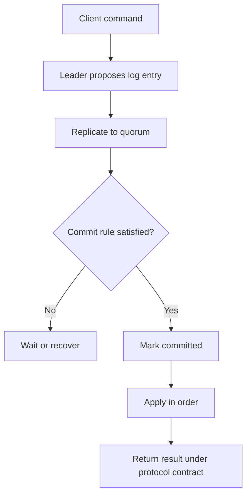

# 11. Replication, Coordination, and Distributed Transactions

## Leader election is not enough
A leader coordinates writes or a replicated state machine. Election chooses a candidate, but the complete protocol must prevent stale leaders from committing conflicting state. A paused process may resume after its lease expired; believing it is leader does not make that belief valid.

Consensus algorithms such as Raft and Paxos coordinate agreement despite specified failures. Guarantees depend on assumptions including non-Byzantine participants, durable state, quorum membership and correct implementation. Raft separates leader election, log replication and safety; it is not simply the node with the most votes. See [Raft resources](https://raft.github.io/).

## Leases and fencing tokens
A lease grants ownership for a bounded interval under a clock or coordination model. A paused process can outlive its lease from its own perspective. Fencing tokens address stale ownership by attaching an ordered token to operations; the protected resource rejects tokens older than the latest accepted token. The resource must enforce fencing—having a lock service issue tokens is insufficient if the database accepts stale writes.

## Distributed locks
A distributed lock is useful only when ownership and expiry semantics match the protected operation. A lock alone may not prevent stale writes during partitions, pauses or lease expiry. Prefer idempotent operations and resource-enforced version checks where possible.

## Two-phase commit
Two-phase commit coordinates a transaction across participants:
1. **Prepare:** participants prepare and record enough state to commit or abort.
2. **Decision:** the coordinator records and communicates commit or abort.

2PC can preserve atomic commit under its assumptions, but a participant may block while coordinator or communication is unavailable. Logging, recovery, timeouts and coordinator failover matter.

## Sagas and compensation
A saga decomposes a business workflow into local transactions with compensating actions. Compensation is not always a perfect inverse: a shipped parcel cannot literally be unshipped, and a refund is a new business event rather than erasure of a charge. Sagas trade one global atomic commit for explicit workflow state, retries, idempotency and compensation.

Orchestration centralizes workflow decisions; choreography distributes reactions through events. Both need explicit timeouts, duplicate handling, terminal states and observability.

## Idempotency and deduplication
At-least-once delivery can produce duplicates. Deduplication stores a message ID or business idempotency key with the effect. To close crash windows, the deduplication record and business state change should be atomic in one transactional boundary or coordinated by an equivalent protocol.

A broker's exactly-once feature generally applies to a defined scope. It does not automatically make arbitrary external side effects exactly once. Always name the boundary and failure model.

## Reconfiguration and split brain
Membership changes alter which nodes form a quorum. Safe protocols constrain how old and new configurations overlap. Independently changing replica membership can create two groups that each believe they have authority. Split brain is conflicting authority that permits divergent commits, not merely duplicate leader processes.

## 11.5A Consensus, replication, and transactions are different problems

These concepts are related but should not be conflated:
- **Replication** keeps copies of data or state on multiple nodes.
- **Consensus** lets participants agree on a value or ordered decision under a stated failure model.
- **Leader election** selects a coordinator but needs a protocol that fences stale leaders.
- **Distributed transaction** coordinates atomic effects across multiple transactional participants.
- **Workflow orchestration** advances a multi-step business process and may use compensation rather than global atomicity.

A replicated database may use consensus internally, but that does not mean a transaction spanning two independent databases is atomic. A saga can coordinate business steps without consensus over one global state. Select the mechanism based on the invariant that must be preserved.

## 11.5B Quorums, terms, and epochs

A quorum is a set of participants sufficient for a protocol decision. Majority quorums intersect in a fixed membership set, which helps prevent incompatible decisions from both being accepted. The protocol must also define what a vote means, which state is persisted before responding, how old terms are rejected, and how membership changes occur.

A **term** or **epoch** is a monotonically advancing generation used to distinguish authority over time. A fencing token extends this idea to a protected resource: the resource rejects an operation from an older generation after a newer one has been accepted. Tokens must be ordered and checked atomically with the protected mutation.

A lease based only on elapsed time has assumptions about clocks, pauses, and renewal. Fencing is stronger when the resource enforces it, because a stale process can resume after believing its lease is still valid.

## 11.5C Failure recovery and durable protocol state

Consensus protocols rely on durable state such as terms, votes, and log entries. Restarting a node must not erase state whose persistence is required by the algorithm. Storage ordering and acknowledgement semantics are part of correctness, not merely performance tuning.

After restart, a node may need to recover its log, compare its state with peers, receive missing entries, or install a snapshot. Snapshotting bounds replay cost but requires a well-defined relationship between the snapshot's last included index/term and the retained log. Incorrect truncation can discard entries required for safe recovery.

Operational procedures should never manually edit protocol metadata or independently promote a replica unless the system's documented recovery procedure explicitly supports it.

## 11.5D Split brain, fencing, and failover

Split brain means more than two processes both claiming to be leaders. The dangerous condition is that multiple authorities can accept incompatible writes to the same logical resource. A safe failover path must ensure that an old authority cannot continue committing after a new authority takes over.

Useful safeguards include quorum-backed leadership, terms or epochs, storage-side fencing, single-writer routing, and explicit recovery of in-flight operations. DNS or load-balancer changes alone do not fence a stale writer; old connections and direct network paths may remain active.

## 11.5E Two-phase commit details

In a typical two-phase commit protocol, the coordinator asks each participant to prepare. A participant that votes yes promises it can later commit and durably records enough state to honor that promise. The coordinator durably records the final decision before informing participants. Participants may need to retain locks or prepared state while waiting for the decision.

The difficult case is uncertainty: a prepared participant may not know whether the coordinator decided commit or abort. A timeout does not automatically make unilateral abort safe. Recovery depends on durable coordinator logs and a protocol for learning the decision. Two-phase commit can block under coordinator or network failures; it is not equivalent to a non-blocking saga.

## 11.5F Saga design details

For every saga step, define:
- The forward action and its durable state transition.
- An idempotency key and duplicate behavior.
- Retryable versus terminal errors.
- Timeout and uncertain-outcome handling.
- A compensation action, if one exists.
- The state to expose while the workflow is incomplete.
- Manual intervention and reconciliation paths.

Compensation is a new domain action, not necessarily a rollback. A cancellation may incur fees; a refund may happen after a charge; a reservation may expire rather than be directly undone. Sagas therefore need explicit business states such as Pending, Reserved, PaymentAuthorized, Confirmed, Compensating, Failed, and Completed, with valid transitions enforced.

## 11.5G Distributed lock decision checklist

Before introducing a distributed lock, ask:
1. Is the lock protecting correctness or only avoiding duplicate effort?
2. Can the protected resource enforce a version or fencing token?
3. What happens if the holder pauses beyond lease expiry?
4. How are acquisition, renewal, release, and crash recovery handled?
5. Can an operation complete after the caller times out?
6. Is the critical section idempotent?
7. Could partitioning the resource or using a conditional update eliminate the lock?

A lock adds a coordination dependency and can become a bottleneck. Prefer the simplest mechanism that preserves the invariant.

## 11.6 Consensus, leadership and distributed transaction boundaries

### Consensus is agreement on an ordered history

Consensus protocols help a set of participants agree on decisions despite specified failures. Replicated state machine designs commonly use consensus to agree on a command order, then apply that order to replicas. Consensus does not automatically make arbitrary external side effects exactly once: a command handler that sends an email or charges a payment must still handle retries and the boundary between committed log state and external action.

Leader election alone is not consensus over application state. A system needs protocol rules for terms/epochs, votes, log or state replication, commit decisions, membership changes and recovery. The safety property is that conflicting histories are not both committed; liveness depends on timing and a sufficiently available quorum under the protocol's assumptions.

### Leases, epochs and fencing

A lease grants ownership for a time interval under specific clock and coordination assumptions. A client may pause or lose connectivity and continue acting after its lease has expired. Therefore, a lease alone does not necessarily stop a stale owner from modifying an external resource.

A fencing token is a monotonically increasing generation/epoch attached to operations. The resource being protected must reject tokens older than the latest accepted token. If the resource does not validate the token, the fencing mechanism cannot protect it. This is why “we have a distributed lock” is not enough to establish correctness.

### Two-phase commit versus Saga

Two-phase commit (2PC) coordinates participants through a prepare phase and a commit/abort decision. It can provide atomic transaction semantics across participating transactional resources, but participants may hold prepared state while waiting for the coordinator or recovery decision. Coordinator durability, participant recovery, timeouts and operational diagnosis matter.

A Saga decomposes a long workflow into local transactions with compensating actions or forward recovery. It avoids one global database transaction but does not make the workflow instantaneously atomic: intermediate states are visible, compensations can fail, and some actions are not truly reversible. Use an explicit state machine, idempotent steps, deadlines, retry policy, manual intervention paths and audit history.

Choose 2PC when participating resources support the required protocol and atomicity is worth the coupling/availability cost. Choose a Saga when the business process can tolerate intermediate states and has well-defined compensation or forward-recovery semantics. Neither pattern is universally superior.

### Distributed locks are coordination tools, not the final invariant

A lock may prevent cooperating workers from intentionally doing the same work, but correctness can still fail if a client pauses, a lease expires, the lock service partitions, or the protected resource accepts stale operations. Use lock ownership tokens and resource-side fencing when stale writers are dangerous. Prefer database uniqueness constraints or atomic conditional updates when they can enforce the invariant more simply.

### Membership changes and quorum reasoning

A quorum intersection argument depends on the configured membership and protocol. Changing replica membership while writes are in flight can create configurations whose quorums do not intersect safely unless reconfiguration is part of the protocol. Do not treat “majority of current nodes” as a universal algorithm. Joint consensus or equivalent protocol rules are needed for safe transitions in systems that use them.

### Coordination review checklist

- What exact state or decision must participants agree on?
- What failures and timing assumptions does the protocol tolerate?
- What durable evidence lets a restarted participant recover its role?
- Can a stale leader or expired lock holder still write?
- Does the protected resource validate fencing or generation tokens?
- What happens if the coordinator fails after prepare but before decision?
- Can saga steps and compensations be repeated safely?
- Are intermediate business states visible and documented?
- Are membership changes protocol-safe?
- How is recovery tested under pauses, partitions, duplicate messages and restarts?

## Further reading
- [Raft paper and resources](https://raft.github.io/).
- Fischer, Lynch and Paterson, [consensus impossibility result](https://doi.org/10.1145/3149.214121).
- [Raft paper (USENIX)](https://web.stanford.edu/~ouster/cgi-bin/papers/raft-atc14.pdf).

## 11.1A Replicated state machine model

A common use of consensus is to replicate an ordered log of commands. If replicas apply the same deterministic commands in the same committed order from the same initial state, their state machines can converge to the same state. Consensus chooses which log entries are committed; application logic still must be deterministic and side effects must be handled carefully.

A command may be appended to a leader's local log before it is committed. A client acknowledgment should reflect the protocol's commit rule, not merely local receipt. If a leader fails, a new leader must be elected according to rules that preserve committed entries. Acknowledging before the required replication point can lose data after failover.

## 11.1B Raft at a conceptual level

Raft divides the problem into leader election, log replication and safety:

1. Each server is a follower unless it times out waiting for a valid leader heartbeat.
2. A follower can become a candidate, increment its term and request votes.
3. A candidate wins only under the election rules, normally requiring a majority.
4. The leader receives client commands and appends log entries.
5. It replicates entries to followers; commitment follows the protocol's rules for terms and replication.
6. Followers apply committed entries in order.
7. A new term and leader change must preserve the committed log prefix.

A term acts as an epoch that helps distinguish stale leadership. Majority intersection is central to safety, but not the whole proof: voting restrictions, log freshness, commit rules and membership transitions are also necessary. The original Raft paper explains the complete algorithm and assumptions: [Ongaro and Ousterhout](https://web.stanford.edu/~ouster/cgi-bin/papers/raft-atc14.pdf).

## 11.1C Paxos and consensus guarantees

Paxos describes agreement through proposers, acceptors and learners, with phases that establish a proposal number and then attempt acceptance. Its safety depends on quorum intersection and rules requiring later proposers to preserve previously accepted values. Multi-Paxos amortizes leadership/phase work for a sequence of decisions.

Raft and Paxos are different presentations and protocol families, not interchangeable implementation details. Both require careful persistence and membership handling. Consensus can make a replicated log agree on order; it does not automatically make external side effects transactional or make an application-level workflow correct.

## 11.2A Lock ownership versus resource correctness

Consider worker A acquires a lease and pauses. Its lease expires; worker B acquires a new lease and writes a newer value. A resumes and writes its stale value. Even if the lock service correctly transferred ownership, the resource can be corrupted unless it rejects A's stale operation. A fencing token makes the ordering visible to the resource: A has token 41, B token 42, and writes with a token older than the latest accepted token are rejected.

If the resource cannot enforce a fencing or version condition, the lock may be suitable only for efficiency (avoiding duplicate work), not for protecting a correctness-critical invariant.

## 11.4A Choosing between 2PC and a saga

| Concern | Two-phase commit | Saga |
|---|---|---|
| Atomicity model | One coordinated transaction across participants | Sequence of local commits with compensations |
| Failure behavior | Participants may block awaiting coordinator recovery | Workflow remains partially progressed until retry/compensation |
| Visibility | Usually presents one atomic outcome when protocol completes | Intermediate states can be visible |
| Compensation | Not the main model | Explicit business compensation required |
| Fit | Participants support a common transaction protocol and atomicity is required | Long-running business process across independently owned services |

A saga does not provide the same isolation as a global transaction. Concurrent workflows can observe intermediate state, so reservation, inventory and payment flows need domain-level state transitions and concurrency controls.

## Replicated state machine at a glance

Consensus algorithms differ in their exact rules, but the critical distinction is between receiving a command, replicating a log entry, committing it, applying it, and acknowledging the client. These are not interchangeable events.

---

[Back to textbook contents](../../README.md) · [Curriculum](../../CURRICULUM.md) · [Roadmap](../../ROADMAP.md)
