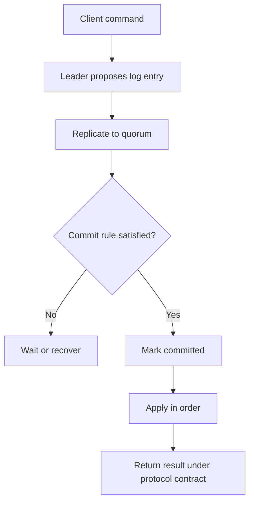

# 11. Replication, Coordination, and Distributed Transactions

## Leader election is not enough
A leader coordinates writes or a replicated state machine. Election chooses a candidate, but the complete protocol must prevent stale leaders from committing conflicting state. A paused process may resume after its lease expired; believing it is leader does not make that belief valid.

Consensus algorithms such as Raft and Paxos coordinate agreement despite specified failures. Guarantees depend on assumptions including non-Byzantine participants, durable state, quorum membership and correct implementation. Raft separates leader election, log replication and safety; it is not simply the node with the most votes. See [Raft resources](https://raft.github.io/).

## Leases and fencing tokens
A lease grants ownership for a bounded interval under a clock or coordination model. A paused process can outlive its lease from its own perspective. Fencing tokens address stale ownership by attaching an ordered token to operations; the protected resource rejects tokens older than the latest accepted token. The resource must enforce fencing—having a lock service issue tokens is insufficient if the database accepts stale writes.

## Distributed locks
A distributed lock is useful only when ownership and expiry semantics match the protected operation. A lock alone may not prevent stale writes during partitions, pauses or lease expiry. Prefer idempotent operations and resource-enforced version checks where possible.

## Two-phase commit
Two-phase commit coordinates a transaction across participants:
1. **Prepare:** participants prepare and record enough state to commit or abort.
2. **Decision:** the coordinator records and communicates commit or abort.

2PC can preserve atomic commit under its assumptions, but a participant may block while coordinator or communication is unavailable. Logging, recovery, timeouts and coordinator failover matter.

## Sagas and compensation
A saga decomposes a business workflow into local transactions with compensating actions. Compensation is not always a perfect inverse: a shipped parcel cannot literally be unshipped, and a refund is a new business event rather than erasure of a charge. Sagas trade one global atomic commit for explicit workflow state, retries, idempotency and compensation.

Orchestration centralizes workflow decisions; choreography distributes reactions through events. Both need explicit timeouts, duplicate handling, terminal states and observability.

## Idempotency and deduplication
At-least-once delivery can produce duplicates. Deduplication stores a message ID or business idempotency key with the effect. To close crash windows, the deduplication record and business state change should be atomic in one transactional boundary or coordinated by an equivalent protocol.

A broker's exactly-once feature generally applies to a defined scope. It does not automatically make arbitrary external side effects exactly once. Always name the boundary and failure model.

## Reconfiguration and split brain
Membership changes alter which nodes form a quorum. Safe protocols constrain how old and new configurations overlap. Independently changing replica membership can create two groups that each believe they have authority. Split brain is conflicting authority that permits divergent commits, not merely duplicate leader processes.

## Further reading
- [Raft paper and resources](https://raft.github.io/).
- Fischer, Lynch and Paterson, [consensus impossibility result](https://doi.org/10.1145/3149.214121).

## 11.1A Replicated state machine model

A common use of consensus is to replicate an ordered log of commands. If replicas apply the same deterministic commands in the same committed order from the same initial state, their state machines can converge to the same state. Consensus chooses which log entries are committed; application logic still must be deterministic and side effects must be handled carefully.

A command may be appended to a leader's local log before it is committed. A client acknowledgment should reflect the protocol's commit rule, not merely local receipt. If a leader fails, a new leader must be elected according to rules that preserve committed entries. Acknowledging before the required replication point can lose data after failover.

## 11.1B Raft at a conceptual level

Raft divides the problem into leader election, log replication and safety:

1. Each server is a follower unless it times out waiting for a valid leader heartbeat.
2. A follower can become a candidate, increment its term and request votes.
3. A candidate wins only under the election rules, normally requiring a majority.
4. The leader receives client commands and appends log entries.
5. It replicates entries to followers; commitment follows the protocol's rules for terms and replication.
6. Followers apply committed entries in order.
7. A new term and leader change must preserve the committed log prefix.

A term acts as an epoch that helps distinguish stale leadership. Majority intersection is central to safety, but not the whole proof: voting restrictions, log freshness, commit rules and membership transitions are also necessary. The original Raft paper explains the complete algorithm and assumptions: [Ongaro and Ousterhout](https://web.stanford.edu/~ouster/cgi-bin/papers/raft-atc14.pdf).

## 11.1C Paxos and consensus guarantees

Paxos describes agreement through proposers, acceptors and learners, with phases that establish a proposal number and then attempt acceptance. Its safety depends on quorum intersection and rules requiring later proposers to preserve previously accepted values. Multi-Paxos amortizes leadership/phase work for a sequence of decisions.

Raft and Paxos are different presentations and protocol families, not interchangeable implementation details. Both require careful persistence and membership handling. Consensus can make a replicated log agree on order; it does not automatically make external side effects transactional or make an application-level workflow correct.

## 11.2A Lock ownership versus resource correctness

Consider worker A acquires a lease and pauses. Its lease expires; worker B acquires a new lease and writes a newer value. A resumes and writes its stale value. Even if the lock service correctly transferred ownership, the resource can be corrupted unless it rejects A's stale operation. A fencing token makes the ordering visible to the resource: A has token 41, B token 42, and writes with a token older than the latest accepted token are rejected.

If the resource cannot enforce a fencing or version condition, the lock may be suitable only for efficiency (avoiding duplicate work), not for protecting a correctness-critical invariant.

## 11.4A Choosing between 2PC and a saga

| Concern | Two-phase commit | Saga |
|---|---|---|
| Atomicity model | One coordinated transaction across participants | Sequence of local commits with compensations |
| Failure behavior | Participants may block awaiting coordinator recovery | Workflow remains partially progressed until retry/compensation |
| Visibility | Usually presents one atomic outcome when protocol completes | Intermediate states can be visible |
| Compensation | Not the main model | Explicit business compensation required |
| Fit | Participants support a common transaction protocol and atomicity is required | Long-running business process across independently owned services |

A saga does not provide the same isolation as a global transaction. Concurrent workflows can observe intermediate state, so reservation, inventory and payment flows need domain-level state transitions and concurrency controls.

## Further reading
- [Raft paper (USENIX)](https://web.stanford.edu/~ouster/cgi-bin/papers/raft-atc14.pdf).
- Fischer, Lynch and Paterson, [consensus impossibility result](https://doi.org/10.1145/3149.214121).

## Replicated state machine at a glance

Consensus algorithms differ in their exact rules, but the critical distinction is between receiving a command, replicating a log entry, committing it, applying it, and acknowledging the client. These are not interchangeable events.

---

[Back to textbook contents](../../README.md) · [Curriculum](../../CURRICULUM.md) · [Roadmap](../../ROADMAP.md)
