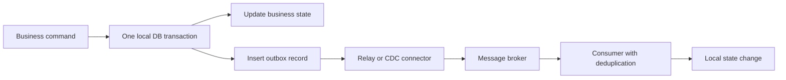

# 12. Messaging, Streams, and Asynchronous Workflows

## Queue, pub-sub and event log
A queue distributes work among consumers, often with one consumer in a group handling each message. Publish-subscribe delivers an event to multiple subscribers. An event log retains an ordered sequence within a partition and permits consumers to read at their own pace or replay history. Products may combine these models but differ in retention, ordering and acknowledgment semantics.

Asynchrony reduces temporal coupling: producers need not wait for consumers to finish. It does not remove dependency; it changes when errors appear and how progress is observed.

## Kafka concepts
Kafka organizes records into topics and partitions. Offsets identify positions within a partition; order is defined within a partition, not globally across all partitions. A consumer group distributes partitions among members, and reassignment can cause pauses or duplicate processing depending on offset and effect coordination. Replication protects partitions according to configured policies. Consumer lag is a gap in progress, but a lag count alone does not show age or business impact. See [Kafka design documentation](https://kafka.apache.org/documentation/#design).

## Delivery semantics
- **At-most-once:** messages may be lost but are not redelivered under the stated semantics.
- **At-least-once:** retries/recovery avoid loss under assumptions but can create duplicates.
- **Exactly-once:** a scoped guarantee that a logical effect is reflected once within a defined protocol boundary.

A consumer that commits a database update then crashes before committing its offset will see replay. Committing the offset first can lose the effect. Correctness requires coordination or idempotent effects.

## Retry, poison events and replay
Retries help transient faults but can block progress or amplify load. Use bounded retry, backoff, jitter and a dead-letter/quarantine path for repeatedly failing events. A dead-letter queue needs monitoring, ownership, correction and replay procedures. Replay can repeat side effects, so event identity must be distinct from delivery attempt.

## Outbox, inbox and CDC
A service that updates a database and publishes an event faces a dual-write problem: the database can commit while publication fails, or publication can happen while the transaction rolls back. A transactional outbox writes business state and an outbox row in one local transaction; a relay publishes later. The relay may publish duplicates, so consumers still need idempotency.

An inbox/deduplication record can be committed atomically with local state changes. Change Data Capture (CDC) captures database changes, often from transaction logs, but introduces connector lag, schema evolution, snapshot and recovery considerations.

## Schema evolution and event sourcing
Event schemas need compatibility rules. Additive optional fields are often easier to evolve than changing a field's meaning or type. A schema registry supports governance but cannot ensure consumers interpret events correctly.

Event sourcing stores domain events as authoritative state history; current state is derived by replay or projections. It can support audit and rebuilds but adds event versioning, replay, retention, privacy deletion and debugging challenges. An event log is not automatically event sourcing.

CQRS separates command handling from query models. It can support asymmetric workloads but introduces projection lag and duplicated models. Use it when that trade-off is justified.

## Stream processing and backpressure
Stream processors handle continuous records, often using event time, processing time, windows, state and checkpoints. Late events complicate windows; watermarks estimate event-time progress and do not prove no earlier event can arrive. Recovery must coordinate input positions and operator state.

If producers outpace consumers, backlog grows. Define retention, admission control, prioritization and behavior when backlog age exceeds business usefulness.

## 12.1A Delivery, acknowledgement, and offset boundaries

A message broker's delivery guarantee must be read together with its acknowledgement and retention rules. A message can be delivered to a consumer before the broker knows the consumer's work is durable. Acknowledging too early can lose the effect; acknowledging after the effect can cause redelivery if the consumer crashes in between.

For a Kafka consumer writing to an external database, a common failure window is:
1. Read record at offset n.
2. Commit the database transaction.
3. Crash before committing offset n.
4. Restart and read offset n again.

The second processing attempt must be harmless or deduplicated. If the offset is committed before the database transaction, a crash can skip the effect. Kafka transactions can coordinate Kafka input offsets and Kafka output records within their supported boundary, but arbitrary external database writes need a separate strategy.

## 12.1B Partition ordering and consumer groups

Ordering is normally guaranteed only within a partition. Records with the same key are often routed to the same partition, which can preserve per-key order under the producer and partitioning contract. Expanding partition count can change key-to-partition mapping for some partitioners, so ordering assumptions and state ownership must be reviewed during topology changes.

A consumer group assigns partitions to members; a partition is not ordinarily processed concurrently by multiple members of the same group at one moment, but rebalances, retries, and application-level parallelism can still create duplicate or out-of-order business effects. If a consumer dispatches records to a worker pool and commits offsets before those workers finish in order, completion order can differ from partition order.

Decide whether order is required globally, per tenant, per entity, or not at all. Global order is expensive and often unnecessary. A partition key is part of the domain design because it determines both locality and the unit of ordered processing.

## 12.1C Consumer lag: count, age, and drain time

Lag is often measured as the difference between the latest available offset and a consumer's committed or processed offset. The exact metric depends on the monitoring system. Offset lag is not the same as elapsed time: a million records may represent seconds for a high-throughput topic or hours for a low-volume topic.

Track:
- Lag by partition and consumer group.
- Age of the oldest unprocessed record where available.
- Ingress and processing rates.
- Retry and dead-letter rates.
- Rebalance frequency and duration.
- Time required to drain backlog at current net processing capacity.

If arrivals continue at rate λ and consumers process at rate μ, backlog shrinks only when μ exceeds λ. If the backlog is B records and net drain rate is μ−λ, a rough drain-time estimate is B/(μ−λ), assuming rates remain stable and no partition bottleneck dominates.

## 12.1D Poison messages, retry topics, and dead-letter queues

A poison message consistently fails because of invalid data, incompatible schema, a deterministic code defect, or an unavailable dependency. Repeatedly retrying it in place can block later records or consume resources indefinitely.

A retry strategy should distinguish transient failures from permanent failures. Delayed retry topics or queues can allow later records to progress, but they may change ordering. A dead-letter queue is not a disposal bin: it needs alerting, an owner, retention, access controls, root-cause correction, and a safe replay procedure.

When replaying, preserve the original event identity and record the replay attempt separately. Otherwise deduplication may either fail to protect side effects or incorrectly suppress an intentional repair operation.

## 12.1E Event time, processing time, and watermarks

**Event time** is when the event is said to have occurred in the source domain. **Processing time** is when the stream processor handles it. Network delay, offline clients, retries, and backfills can make these differ substantially.

A window based on processing time answers a different question from a window based on event time. A **watermark** estimates how far event time has progressed and helps the engine decide when a window can be finalized. It is not proof that no older event will ever arrive; late-event handling and allowed lateness must be specified.

Stream state must be checkpointed or reconstructed consistently with input progress. If operator state advances but input offsets do not, replay may duplicate state updates; if offsets advance without state being durable, records can be lost from the computation. Exactly-once stream-processing claims depend on the engine's checkpoint and sink integration boundaries.

## 12.1F Schema evolution, retention, and replay

An event can remain in a log longer than the producer or consumer version that created it. Schema compatibility must therefore consider old retained records as well as live producers. Consumers should define behavior for unknown fields, missing optional fields, unknown enum values, and versioned semantics.

Retention is a correctness decision. If required events expire before a slow consumer recovers, replay may be impossible without an archive or source-of-truth rebuild. Compaction retains selected records according to a key-based policy and is not equivalent to retaining every historical event.

Privacy and deletion requirements need special attention in append-only logs. Possible strategies include minimizing personal data in events, storing references to erasable records, using explicit tombstones where appropriate, or controlling encryption keys, subject to applicable law and the system's audit needs.

## 12.1G Transactional outbox and inbox pattern

The outbox solves a local dual-write problem: the business row and an outbox record are committed in one database transaction. A relay publishes outbox records later and tracks progress. A crash after publication but before marking the record sent can cause a duplicate publication; consumers must still be idempotent.

An inbox stores processed message identifiers and the local effect in one transaction. A unique constraint on the message identity can prevent concurrent duplicate processing from applying the effect twice. The deduplication key must include the correct producer/tenant/domain scope to avoid collisions, and its retention must cover the redelivery and replay horizon.

## 12.1H Message-system design checklist

- What is the unit of ordering?
- What does producer acknowledgement guarantee?
- When is consumer progress considered committed?
- Can a message be delivered more than once?
- How are poison records handled without silently losing them?
- What is the retention and replay horizon?
- How are schema changes rolled out?
- How is consumer lag measured in age and drain time?
- Are side effects atomic with deduplication?
- How are partition expansion and consumer rebalances handled?
- Who owns dead-letter records and operational recovery?

## 12.2 Message brokers and delivery semantics in depth

A broker is not merely a network buffer. It defines persistence, routing, acknowledgement, redelivery, ordering scope, retention, consumer coordination, and operational recovery. When choosing a broker or log, ask what is persisted before acknowledgement, how ownership changes, what a consumer can replay, and which failures may duplicate or delay work.

### Queue, pub/sub, and durable log compared

A work queue commonly distributes each message to one competing worker in a consumer group. Pub/sub delivers a publication to multiple independent subscriptions. A durable log retains an ordered sequence within each partition so consumers can track offsets and replay retained history. Products often combine these models, but the delivery and retention contract still matters.

A queue is useful when work should be claimed and completed; pub/sub when independent subscribers need their own delivery; a log when replay and consumer-controlled position are central. None automatically makes business effects exactly once.

### At-most-once, at-least-once, and effectively-once effects

- **At-most-once:** a message may be lost, but the broker/consumer contract avoids redelivery after the chosen acknowledgement point.
- **At-least-once:** a message is retried until acknowledged under the system's delivery policy; duplicates are possible.
- **Effectively-once business outcome:** duplicates are made harmless through idempotency, deduplication, transactions or a protocol that atomically couples progress with effects.

“Exactly once” is always scoped. A broker may atomically commit consumed offsets and produced records inside its own transaction model, while an external payment provider or database update remains outside that transaction. Explain the boundary instead of using “exactly once” as an end-to-end guarantee.

### Acknowledgement boundaries and the dual-write problem

If a consumer writes to a database and then acknowledges the message, a crash between those steps may cause the database effect to happen twice. If it acknowledges first and then crashes before the database write, the effect may be lost. Common solutions include idempotent database updates, a deduplication/inbox record in the same transaction as the effect, or an outbox for publishing after a local transaction.

The deduplication key must identify the logical operation and be retained for at least the relevant replay/redelivery horizon. Deduplication storage itself needs capacity, cleanup and concurrency semantics.

### Ordering and partitions

A partitioned log usually preserves order within one partition, not across the entire topic. Partition keys should group events whose relative order matters, such as all events for one account or order. A hot key can concentrate traffic on one partition and defeat horizontal scaling.

Increasing partition count can change key-to-partition mapping in some partitioners and may affect ordering expectations. Consumer-group rebalances temporarily move partition ownership; consumers should handle revoked partitions, commit progress carefully, and avoid overlapping side effects when ownership changes.

### Retry topics, dead-letter queues, and poison messages

A retry policy should distinguish transient failures (temporary network error, rate limit, unavailable dependency) from permanent failures (invalid schema, impossible domain state). Use bounded attempts, exponential backoff with jitter, and a defined terminal path. Immediate requeue can create a hot loop that starves healthy messages.

A dead-letter queue is not a repair strategy by itself. It needs an owner, alerting, reason metadata, retention, inspection, replay tooling and safe reprocessing rules. Replaying a message can repeat an external side effect; require idempotency or an explicit compensating action.

### Backpressure and consumer lag

Lag count alone can be misleading: one million tiny messages may be easier than one thousand large or expensive messages. Track lag age, incoming rate, successful processing rate, retry rate, batch size, processing latency, and estimated drain time. If arrival rate remains above service rate, lag grows without bound unless admission or production is controlled.

Bound consumer concurrency, database connection use, batch size, and in-flight messages. A larger prefetch window may improve throughput but increases memory use and the amount of work that may be repeated after a crash.

### Event time and stream processing

Stream processors distinguish event time (when the event happened) from processing time (when the processor handled it). Events can arrive late or out of order due to retries, network delays and source behavior. Windows aggregate events over a time interval; watermarks express the processor's estimate of how far event time has progressed, not proof that no older event can ever arrive.

Late-event policy may update a result, emit corrections, or drop events after a configured horizon. Stateful operators need checkpointing, state recovery, replay-safe sinks, and a plan for schema changes. “Streaming” does not mean every event is processed instantly or in strict global order.

### Messaging architecture checklist

- What is the durability point for producer acknowledgement?
- What does acknowledgement mean for consumer progress?
- Can duplicate delivery repeat a business effect?
- What is the ordering scope and partition-key strategy?
- How are retries bounded and classified?
- Who repairs dead-lettered or poison messages?
- What happens during consumer rebalance or restart?
- Is lag measured by age and drain time as well as count?
- Can a slow consumer apply backpressure safely?
- What are the event-time, late-data, replay and schema-evolution rules?

## 12.3 Event sourcing, CQRS and schema governance

Event-driven architecture, event sourcing and Command Query Responsibility Segregation (CQRS) are related but distinct concepts. A system can publish domain events without storing its full state as an event log; it can use CQRS without event sourcing; and it can use an event log as infrastructure without making every message a domain event.

### Events, commands and state changes

A **command** requests that something happen and may be rejected by business rules. An **event** records that something happened. Commands are usually directed to a responsible handler; events may be consumed by multiple interested subscribers. Treating a command as an event can obscure whether it is a request, a fact, or a failed attempt.

A domain event should represent a meaningful fact in the business domain, such as OrderPlaced or PaymentCaptured, rather than exposing every internal method call. It should carry a stable event identity, event type, schema/version information, occurrence metadata, and the domain identifiers needed for safe processing. Avoid including sensitive fields unless consumers need them and policy permits their distribution.

### Event sourcing versus event notification

With **event sourcing**, the append-only event history is the authoritative record from which current state can be rebuilt or derived. This requires explicit event evolution, deterministic or version-aware replay, snapshots or projections for performance, and controls for correcting historical mistakes.

With **event notification**, an event tells other components that something changed, while the producer's database remains the authoritative current state. Consumers may fetch the current state from the producer or use the event payload as a projection input. The event log is not necessarily sufficient to reconstruct the producer's full state.

Do not adopt event sourcing merely because the architecture already uses a broker. Event sourcing changes data modeling, debugging, migration, privacy/deletion, replay and operational responsibilities. It can be valuable when the event history is itself a domain requirement, but it can be unnecessary complexity for ordinary CRUD state.

### CQRS: separate models only when the trade-off is justified

CQRS separates command handling from query handling, often using different models or stores optimized for each. The command side protects invariants and accepts changes; the query side exposes read-optimized projections. A separate read model can improve query flexibility and scale, but introduces asynchronous propagation, projection lag, rebuild procedures and operational complexity.

If the command side commits a change before the projection is updated, a subsequent read may return old data. The system must define whether it needs read-your-writes, how clients learn projection status, and whether a command response returns the authoritative result or only acceptance. A correlation ID or committed version can help a read path wait for the relevant projection state when needed.

### Projection rebuilds and replay

A projection is derived state. Rebuilding it requires a known source of truth, a reproducible transformation, bounded processing capacity and a cutover strategy. If events are replayed while new events arrive, the rebuild process must define how it catches up without missing or double-applying changes.

A safe approach may build a new projection separately, record the source offset/version at the start, replay a consistent range, catch up to the live stream, validate counts and invariants, then switch readers. The exact protocol depends on broker and database capabilities. Replaying into the live projection without idempotency or version checks can duplicate effects.

### Schema registry and compatibility policy

A schema registry can store and validate event/message schemas and enforce configured compatibility rules. It does not automatically make every producer and consumer compatible: compatibility depends on the chosen policy, serialization format, default values, reader/writer behavior and deployment order.

Common compatibility goals include:
- **Backward compatibility:** a newer consumer can read data written with an older schema, under the selected format and policy.
- **Forward compatibility:** an older consumer can read data written with a newer schema, under the selected format and policy.
- **Full compatibility:** both directions hold for the selected schema versions.
- **Transitive compatibility:** compatibility is checked against a broader history of versions, not only the immediately previous schema.

These labels are defined differently by some tools and formats; state the registry's exact policy. Additive optional fields are often easier to evolve than renaming/removing fields or changing types, but defaults, required fields, enums and semantic changes can still break consumers.

### Event-data privacy and retention

Events are replicated data. Once a sensitive value is copied into a durable log, it may remain in broker retention, consumer databases, backups, analytics, dead-letter queues and exported files. Minimize payloads, prefer references to sensitive data where appropriate, restrict consumer access, define retention and deletion behavior, and avoid putting secrets or unnecessary personal information in immutable event histories.

If a business requirement demands erasure or correction, determine whether the event log can be legally/technically amended, whether payloads can be cryptographically erased, or whether events must avoid containing the sensitive data in the first place. These are architectural choices that must be made before the event becomes widely replicated.

### Event architecture review checklist

- Are commands distinguished from facts/events?
- Is the authoritative source of state explicit?
- Is event sourcing genuinely required, or is event notification enough?
- If CQRS is used, what consistency and read-your-writes behavior does the query side provide?
- Can projections be rebuilt and switched without losing or duplicating updates?
- Are events versioned and validated under an explicit compatibility policy?
- Can replay cause duplicate external side effects?
- Are event IDs, aggregate versions and correlation metadata sufficient for diagnosis?
- Are sensitive fields minimized across logs, retries, DLQs and projections?
- Are retention, deletion and schema deprecation policies defined?

## 12.4 Worked failure timeline: a consumer crashes around a database commit

Assume a consumer receives OrderPaid(order-481) and must update an order database. The broker offset and the database transaction are separate durable state unless the architecture explicitly coordinates them.

### Timeline A: database commit happens before offset commit

| Time | Consumer / database | Broker |
|---|---|---|
| T1 | Reads event at offset 812 | Offset 812 is delivered |
| T2 | Applies the order update and commits | Offset 812 remains uncommitted |
| T3 | Process crashes before committing its offset | |
| T4 | A replacement consumer resumes from the last committed offset | Delivers offset 812 again |
| T5 | Handler runs again | Duplicate delivery is possible |

Without protection, the business effect may be applied twice. A successful database commit does not atomically advance the broker offset.

### Timeline B: offset commit happens before database commit

| Time | Consumer / database | Broker |
|---|---|---|
| T1 | Reads event at offset 812 | Offset 812 is delivered |
| T2 | Commits offset 812 | Broker records progress |
| T3 | Process crashes before the database effect commits | |
| T4 | Replacement consumer resumes after offset 812 | Event may never be processed again |

This ordering can lose the business effect. Moving the acknowledgement earlier trades duplicates for loss; it does not eliminate the atomicity gap.

### Safer patterns

**Pattern 1 — Inbox/deduplication record in the same database transaction**

Use a stable event or operation ID with a unique constraint. In one local database transaction, insert the inbox record and apply the business mutation. If the ID already exists, treat the delivery as a duplicate and avoid repeating the effect. Commit the broker offset only after the database transaction commits. A crash may cause redelivery, but the database transaction makes the duplicate harmless.

**Pattern 2 — Make the business mutation intrinsically idempotent**

If the update represents a set-to-state operation or a conditional transition, a repeated application may naturally have the same result. Verify that all side effects—including emails, payments, counters and downstream publications—are also safe; a database update that is idempotent does not make external effects idempotent.

**Pattern 3 — Keep processing and output inside one supported transactional boundary**

Some broker ecosystems can atomically commit consumed offsets and produced records within the broker's own transaction model. This can provide strong guarantees for broker-to-broker processing when configured and consumed correctly. It does not automatically include an arbitrary external database or payment provider.

**Pattern 4 — Transactional outbox for downstream publication**

When a service changes database state and must publish an event, write the state change and an outbox row in the same local transaction. A separate publisher delivers the outbox event and records progress. Publication may be repeated after a crash, so consumers still need idempotency or deduplication.

### Exactly-once is a boundary claim

Always state exactly what is made atomic: producer retries, broker log records, consumer offsets, database effects, or an external business action. A broker's exactly-once feature is not proof of exactly-once effects across every external system. The end-to-end outcome depends on the participating systems and the protocol that joins their durable state.

### Validation checklist

- [ ] Identify the event ID and the business-operation ID; know whether they are the same.
- [ ] Inject a crash after the database commit but before offset commit.
- [ ] Inject a crash before the database commit after the message has been fetched.
- [ ] Verify inbox deduplication and the business mutation share one transaction.
- [ ] Test concurrent duplicate deliveries and consumer rebalances.
- [ ] Set deduplication retention to cover the real replay/redelivery horizon.
- [ ] Observe retry rate, duplicate detections, processing lag and stuck outbox rows.
- [ ] Document the exact transactional boundary and any external effects outside it.

## Further reading
- Apache Kafka [design](https://kafka.apache.org/documentation/#design) and [delivery semantics](https://kafka.apache.org/documentation/#semantics).
- Debezium [outbox event router](https://debezium.io/documentation/reference/stable/transformations/outbox-event-router.html).
- [CloudEvents specification](https://cloudevents.io/).

## Reliable publication with a transactional outbox

The outbox closes the gap between the local database commit and recording the intent to publish. The relay can still publish more than once, so consumers must make the business effect idempotent or deduplicate it within the same transaction as the effect.

---

[Back to textbook contents](../../README.md) · [Curriculum](../../CURRICULUM.md) · [Roadmap](../../ROADMAP.md)
