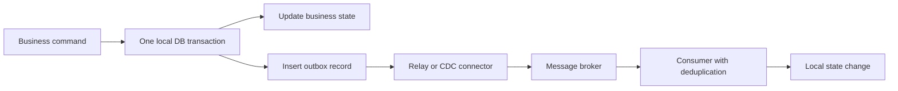

# 12. Messaging, Streams, and Asynchronous Workflows

## Queue, pub-sub and event log
A queue distributes work among consumers, often with one consumer in a group handling each message. Publish-subscribe delivers an event to multiple subscribers. An event log retains an ordered sequence within a partition and permits consumers to read at their own pace or replay history. Products may combine these models but differ in retention, ordering and acknowledgment semantics.

Asynchrony reduces temporal coupling: producers need not wait for consumers to finish. It does not remove dependency; it changes when errors appear and how progress is observed.

## Kafka concepts
Kafka organizes records into topics and partitions. Offsets identify positions within a partition; order is defined within a partition, not globally across all partitions. A consumer group distributes partitions among members, and reassignment can cause pauses or duplicate processing depending on offset and effect coordination. Replication protects partitions according to configured policies. Consumer lag is a gap in progress, but a lag count alone does not show age or business impact. See [Kafka design documentation](https://kafka.apache.org/documentation/#design).

## Delivery semantics
- **At-most-once:** messages may be lost but are not redelivered under the stated semantics.
- **At-least-once:** retries/recovery avoid loss under assumptions but can create duplicates.
- **Exactly-once:** a scoped guarantee that a logical effect is reflected once within a defined protocol boundary.

A consumer that commits a database update then crashes before committing its offset will see replay. Committing the offset first can lose the effect. Correctness requires coordination or idempotent effects.

## Retry, poison events and replay
Retries help transient faults but can block progress or amplify load. Use bounded retry, backoff, jitter and a dead-letter/quarantine path for repeatedly failing events. A dead-letter queue needs monitoring, ownership, correction and replay procedures. Replay can repeat side effects, so event identity must be distinct from delivery attempt.

## Outbox, inbox and CDC
A service that updates a database and publishes an event faces a dual-write problem: the database can commit while publication fails, or publication can happen while the transaction rolls back. A transactional outbox writes business state and an outbox row in one local transaction; a relay publishes later. The relay may publish duplicates, so consumers still need idempotency.

An inbox/deduplication record can be committed atomically with local state changes. Change Data Capture (CDC) captures database changes, often from transaction logs, but introduces connector lag, schema evolution, snapshot and recovery considerations.

## Schema evolution and event sourcing
Event schemas need compatibility rules. Additive optional fields are often easier to evolve than changing a field's meaning or type. A schema registry supports governance but cannot ensure consumers interpret events correctly.

Event sourcing stores domain events as authoritative state history; current state is derived by replay or projections. It can support audit and rebuilds but adds event versioning, replay, retention, privacy deletion and debugging challenges. An event log is not automatically event sourcing.

CQRS separates command handling from query models. It can support asymmetric workloads but introduces projection lag and duplicated models. Use it when that trade-off is justified.

## Stream processing and backpressure
Stream processors handle continuous records, often using event time, processing time, windows, state and checkpoints. Late events complicate windows; watermarks estimate event-time progress and do not prove no earlier event can arrive. Recovery must coordinate input positions and operator state.

If producers outpace consumers, backlog grows. Define retention, admission control, prioritization and behavior when backlog age exceeds business usefulness.

## 12.1A Delivery, acknowledgement, and offset boundaries

A message broker's delivery guarantee must be read together with its acknowledgement and retention rules. A message can be delivered to a consumer before the broker knows the consumer's work is durable. Acknowledging too early can lose the effect; acknowledging after the effect can cause redelivery if the consumer crashes in between.

For a Kafka consumer writing to an external database, a common failure window is:
1. Read record at offset n.
2. Commit the database transaction.
3. Crash before committing offset n.
4. Restart and read offset n again.

The second processing attempt must be harmless or deduplicated. If the offset is committed before the database transaction, a crash can skip the effect. Kafka transactions can coordinate Kafka input offsets and Kafka output records within their supported boundary, but arbitrary external database writes need a separate strategy.

## 12.1B Partition ordering and consumer groups

Ordering is normally guaranteed only within a partition. Records with the same key are often routed to the same partition, which can preserve per-key order under the producer and partitioning contract. Expanding partition count can change key-to-partition mapping for some partitioners, so ordering assumptions and state ownership must be reviewed during topology changes.

A consumer group assigns partitions to members; a partition is not ordinarily processed concurrently by multiple members of the same group at one moment, but rebalances, retries, and application-level parallelism can still create duplicate or out-of-order business effects. If a consumer dispatches records to a worker pool and commits offsets before those workers finish in order, completion order can differ from partition order.

Decide whether order is required globally, per tenant, per entity, or not at all. Global order is expensive and often unnecessary. A partition key is part of the domain design because it determines both locality and the unit of ordered processing.

## 12.1C Consumer lag: count, age, and drain time

Lag is often measured as the difference between the latest available offset and a consumer's committed or processed offset. The exact metric depends on the monitoring system. Offset lag is not the same as elapsed time: a million records may represent seconds for a high-throughput topic or hours for a low-volume topic.

Track:
- Lag by partition and consumer group.
- Age of the oldest unprocessed record where available.
- Ingress and processing rates.
- Retry and dead-letter rates.
- Rebalance frequency and duration.
- Time required to drain backlog at current net processing capacity.

If arrivals continue at rate λ and consumers process at rate μ, backlog shrinks only when μ exceeds λ. If the backlog is B records and net drain rate is μ−λ, a rough drain-time estimate is B/(μ−λ), assuming rates remain stable and no partition bottleneck dominates.

## 12.1D Poison messages, retry topics, and dead-letter queues

A poison message consistently fails because of invalid data, incompatible schema, a deterministic code defect, or an unavailable dependency. Repeatedly retrying it in place can block later records or consume resources indefinitely.

A retry strategy should distinguish transient failures from permanent failures. Delayed retry topics or queues can allow later records to progress, but they may change ordering. A dead-letter queue is not a disposal bin: it needs alerting, an owner, retention, access controls, root-cause correction, and a safe replay procedure.

When replaying, preserve the original event identity and record the replay attempt separately. Otherwise deduplication may either fail to protect side effects or incorrectly suppress an intentional repair operation.

## 12.1E Event time, processing time, and watermarks

**Event time** is when the event is said to have occurred in the source domain. **Processing time** is when the stream processor handles it. Network delay, offline clients, retries, and backfills can make these differ substantially.

A window based on processing time answers a different question from a window based on event time. A **watermark** estimates how far event time has progressed and helps the engine decide when a window can be finalized. It is not proof that no older event will ever arrive; late-event handling and allowed lateness must be specified.

Stream state must be checkpointed or reconstructed consistently with input progress. If operator state advances but input offsets do not, replay may duplicate state updates; if offsets advance without state being durable, records can be lost from the computation. Exactly-once stream-processing claims depend on the engine's checkpoint and sink integration boundaries.

## 12.1F Schema evolution, retention, and replay

An event can remain in a log longer than the producer or consumer version that created it. Schema compatibility must therefore consider old retained records as well as live producers. Consumers should define behavior for unknown fields, missing optional fields, unknown enum values, and versioned semantics.

Retention is a correctness decision. If required events expire before a slow consumer recovers, replay may be impossible without an archive or source-of-truth rebuild. Compaction retains selected records according to a key-based policy and is not equivalent to retaining every historical event.

Privacy and deletion requirements need special attention in append-only logs. Possible strategies include minimizing personal data in events, storing references to erasable records, using explicit tombstones where appropriate, or controlling encryption keys, subject to applicable law and the system's audit needs.

## 12.1G Transactional outbox and inbox pattern

The outbox solves a local dual-write problem: the business row and an outbox record are committed in one database transaction. A relay publishes outbox records later and tracks progress. A crash after publication but before marking the record sent can cause a duplicate publication; consumers must still be idempotent.

An inbox stores processed message identifiers and the local effect in one transaction. A unique constraint on the message identity can prevent concurrent duplicate processing from applying the effect twice. The deduplication key must include the correct producer/tenant/domain scope to avoid collisions, and its retention must cover the redelivery and replay horizon.

## 12.1H Message-system design checklist

- What is the unit of ordering?
- What does producer acknowledgement guarantee?
- When is consumer progress considered committed?
- Can a message be delivered more than once?
- How are poison records handled without silently losing them?
- What is the retention and replay horizon?
- How are schema changes rolled out?
- How is consumer lag measured in age and drain time?
- Are side effects atomic with deduplication?
- How are partition expansion and consumer rebalances handled?
- Who owns dead-letter records and operational recovery?

## Further reading
- Apache Kafka [design](https://kafka.apache.org/documentation/#design) and [delivery semantics](https://kafka.apache.org/documentation/#semantics).
- Debezium [outbox event router](https://debezium.io/documentation/reference/stable/transformations/outbox-event-router.html).
- [CloudEvents specification](https://cloudevents.io/).

## Reliable publication with a transactional outbox

The outbox closes the gap between the local database commit and recording the intent to publish. The relay can still publish more than once, so consumers must make the business effect idempotent or deduplicate it within the same transaction as the effect.

---

[Back to textbook contents](../../README.md) · [Curriculum](../../CURRICULUM.md) · [Roadmap](../../ROADMAP.md)
