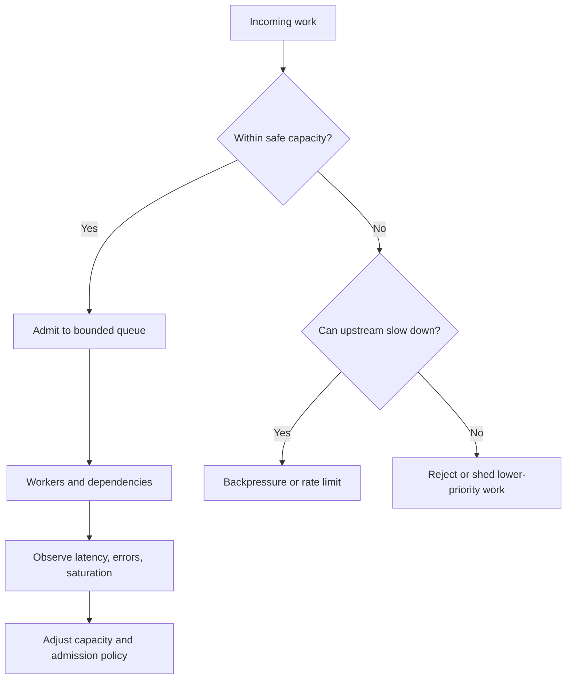

# 13. Scaling, Load Distribution, and Overload

## Scaling follows the constrained resource
Vertical scaling adds resources to a node; horizontal scaling adds nodes. Neither guarantees linear improvement. Shared locks, serial work, network traffic, hot keys, coordination and fixed-size dependencies limit gains. Amdahl's law captures one limit: accelerating only part of a workload cannot eliminate the serial fraction.

Stateless application instances are easier to scale because any healthy instance can serve a request. State still exists and needs deliberate shared or partitioned ownership.

## Load balancing and consistent hashing
Round-robin, least-connections, weighted routing, locality-aware routing and consistent hashing solve different problems. Health checks are imperfect observations: a process can answer a health endpoint but fail real requests.

Consistent hashing maps keys and nodes into a hash space; virtual nodes can improve distribution when nodes have unequal capacity. Rebalancing changes ownership and may trigger data movement. Hot keys remain hot even when the hash function distributes keys uniformly.

## Partitioning and skew
A useful partition key balances load while preserving locality for common queries. Tenant ID can be convenient, but one very large tenant may dominate a shard. Time-based keys can make recent writes hot. Salting spreads writes but complicates reads and aggregation. Uniform key count is not uniform work: one frequently updated record can dominate millions of rarely accessed records.

## Tail latency and fan-out
Latency is a distribution. p50 is the median; p95 and p99 reveal slow experiences. A request that depends on many independent calls can have poor tail behavior even if each dependency is usually fast. If all 20 calls must finish and each has a 99% chance of meeting a threshold, the chance all 20 meet it is approximately 0.99^20 = 81.8%. Independence is an assumption; correlated failure can be worse.

## Saturation and queue buildup
When arrivals exceed service capacity persistently, backlog grows. Even below nominal capacity, high utilization and variable service times can create large waiting times. A queue absorbs short bursts but adds latency and memory use. Bound queues and define rejection or load-shedding behavior.

## Overload controls
- **Admission control:** accept work only when capacity or policy allows.
- **Rate limiting:** cap work by client, tenant, resource or time window.
- **Backpressure:** signal upstream to slow down.
- **Load shedding:** reject lower-priority work to preserve critical paths.
- **Graceful degradation:** preserve core behavior while dropping optional work.
- **Bulkheads:** isolate pools so one workload cannot consume all resources.
- **Autoscaling:** add capacity based on signals, accounting for startup and warm-up delay.

Retries can worsen overload. Use bounded attempts and retry budgets, and avoid independent retry loops at every layer.

## Autoscaling and bottleneck diagnosis
Autoscaling depends on metrics, decision intervals, provisioning, startup and readiness. It cannot protect against every sudden burst and may overwhelm a fixed-capacity database as application replicas grow. Observe CPU, memory, I/O, network, queue depth, connection waits, lock waits, cache misses, query plans, errors and tail latency together.

A CPU-bound bottleneck may need algorithmic improvement; a lock bottleneck can worsen with more threads; a downstream cap may need admission control rather than more application instances.

## 13.1A Amdahl's law and the limits of parallelism

If fraction p of a workload can be parallelized and fraction 1−p remains serial, an idealized speedup with N processors is:

Speedup = 1 / ((1−p) + p/N)

If 90% of a task is parallelizable and 10% is serial, infinite parallelism cannot exceed 10× speedup under this model. Real systems add communication, synchronization, scheduling and contention overhead, so measured speedup can be lower.

This explains why adding application replicas may not help when every request serializes on one database row, global lock, coordinator, or downstream API quota. Identify the serial or shared bottleneck before scaling out.

## 13.1B Load balancing, health, and locality

A load balancer chooses among candidate destinations using a policy such as round-robin, least connections, weighted routing, consistent hashing, or locality-aware selection. Each policy optimizes a different proxy for load. Least connections may be misleading when requests have very different costs; round-robin can distribute request counts evenly while CPU work is highly uneven.

Health checks have detection delay and can flap. A shallow process check may pass while the service cannot reach its database. A deep check may cause every instance to be marked unhealthy during a shared dependency outage, removing all destinations and worsening the incident. Use liveness and readiness for different purposes, apply hysteresis where supported, and avoid coupling restart policy to every transient downstream failure.

Locality-aware routing can reduce network latency and transfer costs but risks overloading a nearby zone while other capacity sits idle. Cross-zone failover should be included in capacity calculations, not treated as an unlimited escape path.

## 13.1C Consistent hashing and virtual nodes

Consistent hashing maps keys and node identities into a circular or ordered hash space. A key is assigned according to a rule such as the next node clockwise. Adding or removing a node ideally remaps only a fraction of keys rather than reshuffling all keys.

Virtual nodes give each physical node multiple positions in the hash space, improving distribution when node capacities differ. They do not solve workload skew: a single very popular key can still overload its owner. Rebalancing may require data transfer, cache warm-up, state migration and careful handling of requests during ownership changes.

## 13.1D Rate limiting algorithms

Common algorithms have different burst behavior:
- **Fixed window:** counts requests in fixed time buckets; traffic near a boundary can effectively double the allowed rate over a short interval.
- **Sliding log:** records request timestamps for a precise rolling window, at higher memory cost.
- **Sliding-window counter:** approximates a rolling window with bounded state.
- **Token bucket:** tokens accumulate up to a capacity; requests consume tokens, allowing controlled bursts while limiting long-term rate.
- **Leaky bucket:** smooths output or queue release toward a configured rate; implementations differ in whether excess work is queued or rejected.

A limit must define its key (user, tenant, API key, IP, resource), scope (instance or global), window, burst capacity, and rejection behavior. Per-instance limits multiply with instance count unless coordinated. A global distributed limiter adds coordination latency and can itself become a dependency.

## 13.1E Retry storms and cascading failure

A slow dependency causes timeouts; clients retry; retries increase load; increased load makes the dependency slower; more requests time out. This positive feedback loop can cascade across services.

Controls include:
- Deadlines propagated across service boundaries.
- Exponential backoff with jitter.
- Retry budgets tied to original traffic.
- Concurrency limits and bounded queues.
- Circuit breakers where they fit the failure pattern.
- Load shedding for optional or low-priority work.
- Avoiding retries for permanent errors or unsafe operations.
- Staggering periodic jobs and refreshes.

A circuit breaker does not fix a dependency or guarantee correctness. It is a local policy that can stop repeatedly spending resources on a failing path; half-open probes, reset behavior and fallback semantics must be designed.

## 13.1F Autoscaling signal design

CPU may be a poor autoscaling signal for a service waiting on database connections. Queue depth may be more useful for background workers, while request concurrency or latency may be useful for an API. Metrics should be causally related to the constrained resource and not so noisy that scaling oscillates.

Scaling delay includes metric collection, decision intervals, provisioning, image pull, application startup, cache warm-up and readiness. Scale-in also needs care: terminate workers gracefully, stop accepting new work, finish or release in-flight tasks, and avoid removing too much capacity simultaneously.

A useful autoscaling design includes minimum and maximum bounds, cooldown or stabilization behavior, scale-in safety, dependency capacity, and a fallback when the platform cannot provision new instances.

## 13.1G Capacity and overload review

Test at normal load, expected peak, burst, overload, dependency slowdown, instance loss, and recovery. Record throughput, p50/p95/p99 latency, errors, queue wait, backlog age, CPU, memory, network, connection waits and downstream saturation. A test that measures only successful requests can hide requests rejected or timed out during the run.

## Further reading
- Google SRE [Handling Overload](https://sre.google/sre-book/handling-overload/).
- Google SRE [Addressing Cascading Failures](https://sre.google/sre-book/addressing-cascading-failures/).

## Overload control should happen before queues explode

Adding instances can help only when the constrained resource scales with them. If a database, lock, hot key or downstream quota is the bottleneck, more application replicas can make the overload worse.

---

[Back to textbook contents](../../README.md) · [Curriculum](../../CURRICULUM.md) · [Roadmap](../../ROADMAP.md)
