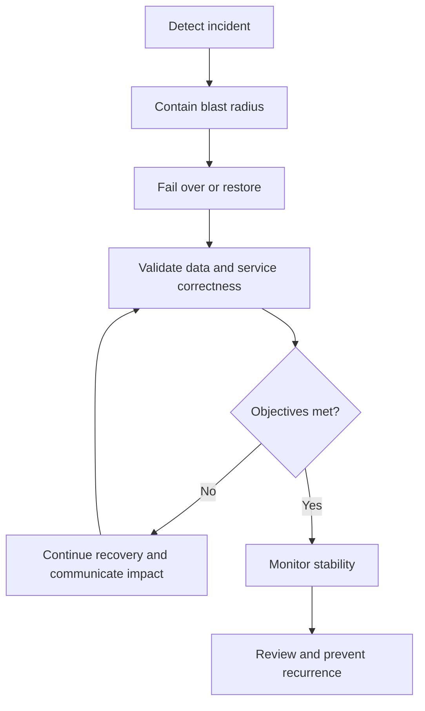

# 14. Reliability, Recovery, and Service Objectives

## Redundancy is not recovery
Redundancy provides alternative resources when one fails; recovery restores service or data after disruption. A replica can reproduce corrupted writes, a backup can be unusable, and failover can route traffic to a region missing recent data. Reliable systems need failure containment, correct failover, recoverable state and tested procedures.

## Availability, reliability and durability
Availability measures whether a service is usable under a defined criterion. Reliability describes correct operation over time and conditions. Durability concerns persistence of acknowledged committed state. A service can be available while returning stale data, or durable while temporarily unavailable.

For a simple series system with independent required dependencies, end-to-end availability is approximately the product of component availabilities. Three required dependencies at 99.9% each yield 0.999^3 ≈ 99.7003%. Independence is often false, and caching/fallback can change the model, but the calculation shows how synchronous dependencies accumulate risk.

## Resilience mechanisms
- **Timeouts:** bound waiting; do not prove the remote operation failed.
- **Retries:** recover transient faults but can amplify load and duplicate effects.
- **Circuit breakers:** temporarily stop calls to a failing dependency.
- **Bulkheads:** isolate resource pools or workloads.
- **Fallbacks:** provide alternate behavior, which must remain correct and safe.
- **Load shedding:** preserve critical work during overload.
- **Health checks:** guide routing/restart decisions; poor probes can cause flapping or restart storms.

Patterns interact. Aggressive retries plus short timeouts and poorly tuned breakers can cause oscillation or suppress recoverable traffic.

## SLI, SLO, SLA and error budget
An SLI is a measured indicator, such as the fraction of eligible requests that succeed within a latency threshold. An SLO is a target over a defined window. An SLA is an external agreement that may include consequences if targets are missed.

For a 99.9% success SLO over a defined window, the error budget is 0.1% of eligible requests for that window. Request-based budgets depend on traffic volume; time-based availability budgets depend on the downtime definition. Objectives should shape release and reliability decisions, not merely appear on dashboards.

## Recovery objectives
- **RTO:** target time to restore service after disruption.
- **RPO:** acceptable data-loss window expressed in time.

Near-zero RPO may require synchronous remote replication or another durable remote-commit strategy, increasing latency and potentially reducing availability during network problems. Asynchronous replication can acknowledge sooner but may lose recent changes during regional failure depending on the acknowledgment contract.

Backups, replication and failover solve different problems. Replication can copy deletion or corruption; backups provide historical recovery points; failover redirects traffic but does not validate data integrity.

## Zones, regions and disaster recovery
Multiple zones can protect against some localized infrastructure failures. Multiple regions protect against broader outages but add global routing, replication, consistency, failover, cost and operational complexity. Active-active needs explicit ownership and conflict semantics; active-passive still needs tested promotion, data freshness and rollback procedures.

## Chaos engineering and incident learning
A controlled resilience experiment starts with a hypothesis, measurable steady state, bounded blast radius, abort criteria and a way to interpret results. Randomly killing production components without safety constraints is not chaos engineering.

Post-incident reviews should identify contributing conditions and systemic controls, not stop at individual actions. Track detection time, mitigation time, customer impact, recovery correctness and follow-up effectiveness.

## 14.1A Reliability is an end-to-end property

A service can be locally reliable while the user journey is unreliable. If a synchronous request requires several independent dependencies, each dependency adds a possible failure point. For a simple series model with availability values A1 through An, end-to-end availability is approximately the product of those values. This approximation assumes independence and that every dependency is required.

Fallbacks, caches, replicas and alternate paths can change the model, but only if they work under the same failure and load conditions. A fallback that calls the same failing dependency is not a real alternate path. A cache fallback may preserve reads but not writes, so the degraded contract must be explicit.

## 14.1B Timeouts, retries, circuit breakers, and bulkheads

A timeout bounds waiting. It should fit inside an end-to-end deadline and account for connection acquisition, remote processing, and cleanup. A timeout that is too short can reject healthy but slow work; one that is too long can retain resources and increase queueing.

Retries are useful for transient failures only when the operation is safe to repeat. Use bounded attempts, exponential backoff, jitter, deadlines, and retry budgets. Retrying a non-idempotent write after an uncertain timeout can duplicate effects.

A circuit breaker tracks failures or slow calls and temporarily prevents new calls to a dependency. Common states are closed, open and half-open, but thresholds and behavior vary by implementation. A breaker can prevent resource waste; it cannot repair the dependency or determine whether a timed-out write committed.

Bulkheads isolate resource pools or workload classes so one failing dependency or tenant cannot consume every worker, connection, or queue slot. Isolation needs capacity planning: overly small pools can reject useful work, while shared downstream dependencies can still be overwhelmed.

## 14.1C Graceful degradation and criticality

Define which capabilities are essential and which can be reduced during an incident. A commerce system might preserve checkout and order status while temporarily disabling recommendations or expensive personalization. Degradation should be deliberate, visible where appropriate, and safe for business invariants.

Prioritization requires bounded queues and resource reservations. If optional background work can consume all database connections, the critical path is not actually protected. Separate concurrency limits, priorities, quotas and dependency budgets can help.

Fallback data must be safe for the operation. Serving a stale public product description may be acceptable; serving stale authorization or inventory data can create security or correctness failures. Each fallback needs a freshness and correctness contract.

## 14.1D Redundancy, replication, backup, and restore

These mechanisms protect against different failures:
- Redundancy provides alternate capacity.
- Replication maintains copies, often for availability or data-loss reduction.
- Backups preserve recoverable historical state.
- Point-in-time recovery reconstructs state to a chosen time using base backups and logs where supported.
- Integrity checks detect corruption.
- Restore exercises prove that the recovery procedure works.

Replication can immediately propagate accidental deletion or corrupted writes. A backup can be useless if it shares the compromised credentials or failure domain. Protect backup credentials separately, test restoration regularly, and verify application-level invariants after recovery.

## 14.1E Recovery objectives and runbooks

RTO and RPO must be attached to a defined scenario and scope. “Recover within one hour” should specify whether that means the first health response, core writes restored, all regions restored, or the entire backlog drained. RPO should state which writes count as acknowledged and what data loss is acceptable.

A recovery runbook should define:
- Trigger and decision authority.
- Preconditions and safety checks.
- Steps to promote, restore or redirect.
- How to prevent old writers from returning.
- How to validate data freshness and integrity.
- How to handle in-flight or uncertain operations.
- Communication and escalation.
- Rollback or failback criteria.
- Evidence that recovery is complete.

Runbooks should be exercised under realistic constraints. A procedure that depends on one unavailable administrator, expired credentials, or undocumented manual knowledge is a reliability risk.

## 14.1F Incident response and learning

During an incident, separate detection, diagnosis, mitigation, recovery and prevention. Mitigation reduces current harm; root-cause analysis explains contributing conditions; prevention changes the system so the same class of failure is less likely or less damaging.

Useful measures include time to detect, time to mitigate, time to recover, affected users/operations, data integrity impact, and follow-up completion. Avoid treating mean time metrics as complete summaries: distributions and severe outliers matter.

A blameless review does not mean no accountability. It means understanding why actions appeared reasonable given the information and controls available, then improving detection, guardrails, architecture and procedures.

## 14.1G Chaos experiments and game days

A safe experiment defines a hypothesis, expected steady state, target failure, scope, monitoring, abort conditions, and recovery plan. Begin in a controlled environment and expand blast radius only when evidence supports it. Test dependency latency, connection exhaustion, zone loss, process restart, stale credentials, backup restore, and failover where appropriate.

A successful experiment is not simply “the service stayed up.” It should verify correctness, error budgets, recovery objectives, and whether alerts and runbooks led to the expected response. Experiments should not create uncontrolled risk for customers.

## 14.2 Recovery engineering: failure detection is not recovery

A failover mechanism is only one part of recovery. A complete recovery path must detect the problem, decide whether to fail over, move or redirect traffic, ensure the destination has valid state, restore capacity, verify correctness, and avoid oscillation when the original component returns. Each step has its own delay and failure modes.

### Availability math and dependency composition

For a serial request path in which every dependency must succeed, end-to-end availability is approximately the product of dependency availabilities when failures are independent. If three required dependencies each have availability 99.9%, the rough combined availability is (0.999^3 approx 99.70\%). Real failures are often correlated, so this calculation is a useful first approximation, not a guarantee.

Redundancy helps only if it reduces the relevant failure probability. Two replicas in one zone may share power, networking, credentials, a control plane or a bad rollout. A redundant application with one database remains dependent on that database unless the data layer has its own recovery strategy.

### RTO and RPO are measurable requirements

- **Recovery Time Objective (RTO):** the target maximum time to restore a service or capability after disruption.
- **Recovery Point Objective (RPO):** the target maximum amount of data loss measured in time.

These are not synonyms for failover time and replication lag. RTO includes detection, decision, restoration, validation and traffic recovery. RPO depends on the durable recovery point and the actual failure. An asynchronous replica may have low typical lag but still lose a larger amount of acknowledged data under a particular failure.

Define RTO/RPO per business capability and failure scenario. A read-only catalog, order placement, payment ledger and analytics pipeline may have different acceptable recovery targets.

### Backup, replication and restore solve different problems

Replication can improve availability when a node fails, but it can also replicate accidental deletion, corruption or malicious changes. Backups provide a separate recovery path, while point-in-time recovery can restore a database to a chosen point if the required backups and logs are retained and intact.

A backup is not proven useful until restore has been tested. Test data integrity, permissions, key availability, dependencies, restore throughput, runbooks and the time required to bring the restored system online. Include recovery capacity in planning: restoring a large dataset may compete with production traffic for I/O and network bandwidth.

### Failover, fencing and split brain

If two nodes both believe they are active, they may accept conflicting writes. A leader election alone is insufficient if the old leader can still access the resource. Use epochs, terms, leases with well-defined assumptions, and fencing at the resource that protects the invariant. After failover, validate that stale actors cannot continue mutating authoritative state.

Failback is also a protocol: reconcile or discard divergent state according to an explicit policy, validate the returning node, and reintroduce it gradually. Automatic failback without state reconciliation can reintroduce corruption or oscillation.

### Graceful degradation and criticality

Classify operations by criticality and dependencies. During overload or partial failure, preserve the smallest correct core workflow and disable optional work deliberately. For example, an e-commerce system may keep checkout and order persistence available while temporarily disabling recommendations or nonessential analytics. This requires explicit fallback semantics and clear user-visible status.

Stale data is an acceptable fallback only when the domain permits it. A stale product description may be harmless; stale authorization, inventory reservation or account balance may violate correctness. Degradation must be designed per operation, not enabled as a global “return cached data” switch.

### Incident response and recovery validation

Runbooks should state symptoms, impact, safe checks, mitigation choices, escalation, rollback/failover criteria and verification steps. Use automation for deterministic low-risk steps, but add safeguards for destructive actions and ambiguous state. After recovery, verify user-visible success, error rates, data integrity, queue drain, replica convergence and resource headroom.

Practice failure scenarios such as zone loss, exhausted connection pools, corrupt configuration, expired certificates, full disks, unavailable identity provider, delayed queue consumers, and failed restore. Game days should test the recovery mechanism and the team's ability to reason about its guarantees.

### Recovery design checklist

- Which failure scenarios have explicit RTO/RPO?
- Is the failure detector reliable enough for the action it triggers?
- Can two actors both believe they are active?
- Is acknowledged data durable across the intended failure?
- Are backups isolated from the failures they are meant to recover from?
- Has a full restore been timed and validated?
- Is there spare capacity for the surviving region/zone?
- Which features can be safely degraded?
- How is failback performed without reintroducing stale state?
- What evidence proves the user-visible service and data are healthy again?

## 14.3 Worked SLO and error-budget example

Suppose an API has a monthly availability SLO of 99.9%, measured over eligible requests. The error-budget fraction is (1 - 0.999 = 0.001), or 0.1% of eligible requests. If the service receives 50 million eligible requests in the measurement window, the illustrative budget is 50,000 unsuccessful requests. This request-based calculation is appropriate only if the SLI definition counts eligible requests and treats failures consistently.

If the service has a time-based SLO instead, the budget is based on the time window and allowed unavailability. Do not mix a request-based budget with a time-based availability calculation without stating the SLI.

### Burn rate

Burn rate compares the observed error rate with the error rate allowed by the SLO. For a 99.9% target, the allowed error fraction is 0.1%. If 1% of eligible requests fail over a chosen window, the observed error rate is ten times the budget rate: a burn rate of 10 for that window.

A short window can detect a severe outage quickly but may be noisy at low traffic. A longer window reduces noise but may delay detection. Multi-window alerting uses windows and thresholds selected for the service's criticality, SLO period and response process. There is no single alert threshold that is correct for every service.

### Budget policy should change engineering behavior

An error budget is useful only when the team has agreed how to act on it. Possible policies include pausing risky releases during a fast burn, prioritizing reliability work when the budget is exhausted, or reducing rollout size until the service stabilizes. The policy should distinguish user-impacting failures from events excluded by the SLI definition and should not encourage hiding errors by changing the measurement.

### SLO review checklist

- Is the SLI based on real user outcomes and eligible traffic?
- Are failures, timeouts, partial responses and dependency errors classified consistently?
- Is the SLO window explicit?
- Is the error budget calculated from the actual SLI and window?
- Are burn-rate alerts tied to a response action?
- Can low traffic or missing telemetry make the SLI look healthier than reality?
- Are deployments and configuration changes correlated with SLO changes?
- Does budget policy lead to specific engineering choices?
- Are exclusions documented and resistant to gaming?
- Is the SLO reviewed when user expectations or architecture changes?

## Further reading
- Google [Site Reliability Engineering book](https://sre.google/sre-book/table-of-contents/).
- Google [SRE Workbook: Error Budget Policy](https://sre.google/workbook/error-budget-policy/).
- AWS [Well-Architected Framework](https://docs.aws.amazon.com/wellarchitected/latest/framework/welcome.html).

## Recovery is a chain, not a single failover switch

A service is not recovered merely because a health endpoint turns green. Verify that data is sufficiently current, critical operations work, dependencies are healthy, and the system can sustain expected traffic.

---

[Back to textbook contents](../../README.md) · [Curriculum](../../CURRICULUM.md) · [Roadmap](../../ROADMAP.md)
