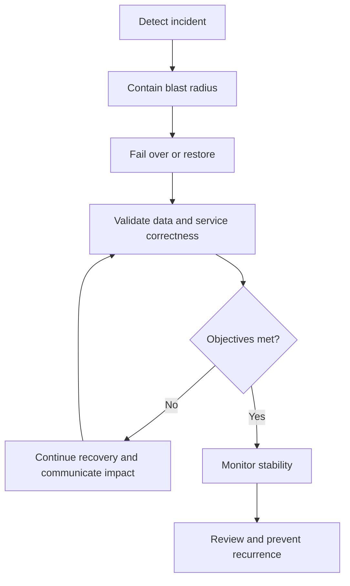

# 14. Reliability, Recovery, and Service Objectives

## Redundancy is not recovery
Redundancy provides alternative resources when one fails; recovery restores service or data after disruption. A replica can reproduce corrupted writes, a backup can be unusable, and failover can route traffic to a region missing recent data. Reliable systems need failure containment, correct failover, recoverable state and tested procedures.

## Availability, reliability and durability
Availability measures whether a service is usable under a defined criterion. Reliability describes correct operation over time and conditions. Durability concerns persistence of acknowledged committed state. A service can be available while returning stale data, or durable while temporarily unavailable.

For a simple series system with independent required dependencies, end-to-end availability is approximately the product of component availabilities. Three required dependencies at 99.9% each yield 0.999^3 ≈ 99.7003%. Independence is often false, and caching/fallback can change the model, but the calculation shows how synchronous dependencies accumulate risk.

## Resilience mechanisms
- **Timeouts:** bound waiting; do not prove the remote operation failed.
- **Retries:** recover transient faults but can amplify load and duplicate effects.
- **Circuit breakers:** temporarily stop calls to a failing dependency.
- **Bulkheads:** isolate resource pools or workloads.
- **Fallbacks:** provide alternate behavior, which must remain correct and safe.
- **Load shedding:** preserve critical work during overload.
- **Health checks:** guide routing/restart decisions; poor probes can cause flapping or restart storms.

Patterns interact. Aggressive retries plus short timeouts and poorly tuned breakers can cause oscillation or suppress recoverable traffic.

## SLI, SLO, SLA and error budget
An SLI is a measured indicator, such as the fraction of eligible requests that succeed within a latency threshold. An SLO is a target over a defined window. An SLA is an external agreement that may include consequences if targets are missed.

For a 99.9% success SLO over a defined window, the error budget is 0.1% of eligible requests for that window. Request-based budgets depend on traffic volume; time-based availability budgets depend on the downtime definition. Objectives should shape release and reliability decisions, not merely appear on dashboards.

## Recovery objectives
- **RTO:** target time to restore service after disruption.
- **RPO:** acceptable data-loss window expressed in time.

Near-zero RPO may require synchronous remote replication or another durable remote-commit strategy, increasing latency and potentially reducing availability during network problems. Asynchronous replication can acknowledge sooner but may lose recent changes during regional failure depending on the acknowledgment contract.

Backups, replication and failover solve different problems. Replication can copy deletion or corruption; backups provide historical recovery points; failover redirects traffic but does not validate data integrity.

## Zones, regions and disaster recovery
Multiple zones can protect against some localized infrastructure failures. Multiple regions protect against broader outages but add global routing, replication, consistency, failover, cost and operational complexity. Active-active needs explicit ownership and conflict semantics; active-passive still needs tested promotion, data freshness and rollback procedures.

## Chaos engineering and incident learning
A controlled resilience experiment starts with a hypothesis, measurable steady state, bounded blast radius, abort criteria and a way to interpret results. Randomly killing production components without safety constraints is not chaos engineering.

Post-incident reviews should identify contributing conditions and systemic controls, not stop at individual actions. Track detection time, mitigation time, customer impact, recovery correctness and follow-up effectiveness.

## Further reading
- Google [Site Reliability Engineering book](https://sre.google/sre-book/table-of-contents/).
- Google [SRE Workbook: Error Budget Policy](https://sre.google/workbook/error-budget-policy/).
- AWS [Well-Architected Framework](https://docs.aws.amazon.com/wellarchitected/latest/framework/welcome.html).

## Recovery is a chain, not a single failover switch

A service is not recovered merely because a health endpoint turns green. Verify that data is sufficiently current, critical operations work, dependencies are healthy, and the system can sustain expected traffic.

---

[Back to textbook contents](../../README.md) · [Curriculum](../../CURRICULUM.md) · [Roadmap](../../ROADMAP.md)
