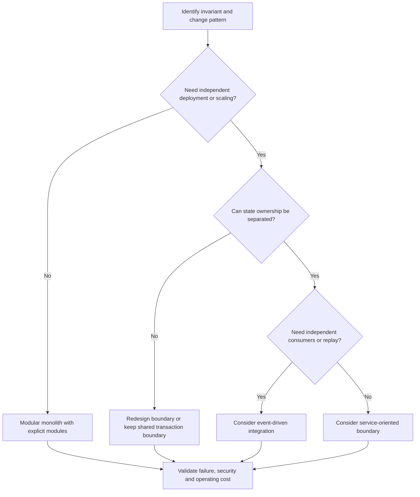
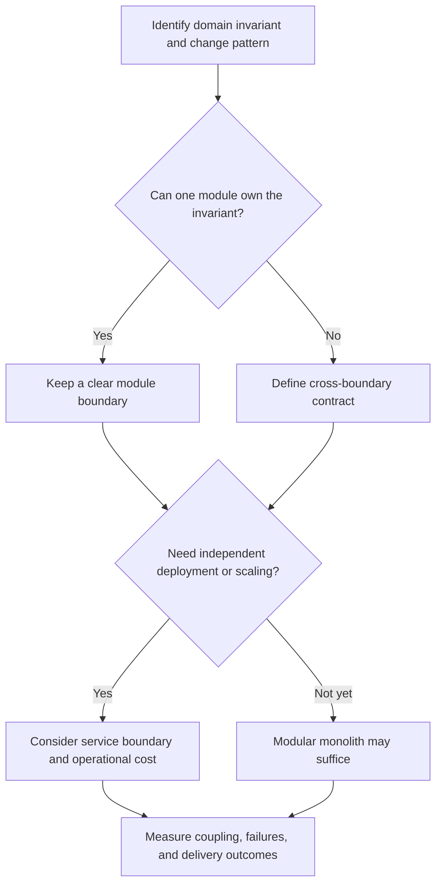

# 15. Architectural Boundaries and Evolution

## Boundaries around change and invariants
A module or service boundary should make responsibility, ownership and invariants clearer. Domain-driven design uses bounded contexts to identify where a model and its language are consistent. “Customer” can mean different things in identity, billing and support; forcing all domains to share one model may create coupling.

Service boundaries should consider data ownership, transaction boundaries, team ownership, scaling profile, security, deployment cadence and failure containment. If two services constantly need synchronous round trips or distributed transactions to preserve one invariant, the boundary may be wrong or the workflow needs a different contract.

## 15.1A Domain boundaries and bounded contexts

A bounded context is a boundary within which a domain model and its language have a consistent meaning. The same word can represent different concepts in different contexts: a “customer” in billing may be the legal payer, while a “customer” in support may be the person contacting the help desk.

A context map makes relationships explicit: which context owns a concept, which depends on another, where translation occurs, and where integration contracts are needed. A shared database schema or shared model library can accidentally force contexts to evolve together.

An **anti-corruption layer** translates between an external or legacy model and the local domain model, keeping upstream naming, lifecycle and assumptions from leaking through the boundary. It is useful when integrating with a model the team does not control; it adds mapping code and another contract to maintain, so do not create one for a simple stable interface without a real semantic mismatch.

Domain boundaries should be tested against real change and invariant patterns. A service boundary is not justified merely because a noun exists in the business domain; it should clarify ownership, change, or operational responsibility.

## 15.1B Coupling dimensions

Coupling is multidimensional:
- **Code coupling:** direct dependency on classes, libraries, or internal implementation.
- **Data coupling:** shared schema or direct reads/writes to another component's tables.
- **Temporal coupling:** one component must be available at the exact moment another needs it.
- **Deployment coupling:** components must be released together.
- **Semantic coupling:** consumers rely on undocumented meaning or assumptions.
- **Operational coupling:** components share scarce pools, credentials, or failure domains.

A network boundary may reduce code and deployment coupling while increasing temporal and operational coupling. Asynchronous messaging can reduce temporal coupling but introduce schema, replay, ordering and eventual-consistency concerns. The goal is not to remove all coupling; it is to choose and manage the coupling that supports the system's goals.

## 15.1C Modular monolith as an evolutionary strategy

A modular monolith can enforce package/module boundaries, explicit interfaces, dependency direction and private data access while deploying as one unit. It retains in-process calls and often simpler transactions and local debugging.

Useful guardrails include:
- Each module owns its domain logic and data access.
- Cross-module calls use published interfaces.
- Internal tables are not casually accessed by other modules.
- Dependency cycles are detected and prevented.
- Integration tests verify module contracts.
- Shared utilities do not become a dumping ground for domain behavior.

A modular monolith is not automatically well-modularized. It can still have a shared database with hidden coupling, cyclic dependencies and global mutable state. Architecture tests and code review can keep boundaries meaningful.

## 15.1D Extracting a service safely

Before extraction, identify the capability and its authoritative data. Then define an API or event contract, establish ownership, observe current usage, and plan migration and rollback.

A typical migration might:
1. Create the new service and compatible contract.
2. Route a small subset of traffic to it.
3. Establish a source-of-truth strategy for data.
4. Backfill and verify existing records.
5. Shift reads and writes in controlled stages.
6. Remove legacy paths only after evidence shows they are unused.
7. Retain rollback criteria until correctness and operations are proven.

Dual writes are dangerous because one write can succeed while the other fails. If dual writes are unavoidable temporarily, track divergence, define repair, and make the migration window explicit. A strangler route is not sufficient without a data consistency strategy.

## 15.1E Architecture Decision Records and reversibility

An ADR records context, decision, alternatives, consequences, assumptions and revisit triggers. Decisions differ in reversibility. A library choice may be easy to change; a public API, data model, tenant boundary or globally distributed write protocol can be expensive to reverse after adoption.

Prefer small experiments and reversible choices when uncertainty is high. Where an irreversible choice is necessary, invest more in evidence, failure analysis and review. Do not confuse “we can rewrite it later” with a real migration plan.

## 15.1F Technical debt and evolutionary fitness

Technical debt is a trade-off with future cost, not simply code that looks old. Track the debt's cause, impact, affected systems, risk, mitigation and trigger for repayment. Some debt is rational when a deadline or uncertainty makes a temporary solution valuable; unrecorded debt tends to become accidental architecture.

Architecture fitness functions are repeatable checks that help preserve desired properties. Examples include tests that prevent dependency cycles, checks that forbid direct cross-module database access, latency budgets in performance tests, security policy checks, and restore drills. A fitness function should measure a meaningful property and avoid becoming a brittle proxy that teams optimize at the expense of the real goal.

## 15.1G Control plane and data plane failure behavior

The data plane handles ordinary user traffic; the control plane configures or changes routing, scheduling, identity policy or other behavior. Ask what happens when the control plane is unavailable: do existing data-plane instances continue using last-known-good configuration, do certificates expire, can new workloads start, and can emergency changes be applied?

Keeping the data plane running during control-plane disruption improves resilience but requires bounded configuration staleness and safe fallback rules. Last-known-good state must itself be authenticated, versioned and protected against rollback to unsafe configuration.

## 15.1H Service discovery and configuration are runtime dependencies

Service discovery answers how a caller finds a current instance or endpoint. Common approaches include DNS-based discovery, a platform-provided service name, a registry queried by clients, or a proxy/load balancer that performs discovery on behalf of callers. Each approach has different caching, health, propagation and failure semantics.

A registry entry can be stale. A discovered endpoint may fail between lookup and connection; discovery therefore does not remove the need for timeouts, retries under safe semantics, connection draining, and health-aware routing. DNS TTLs and registry refresh intervals trade lookup load against how quickly clients observe changes. Existing pooled connections may outlive a discovery update.

Configuration changes are also distributed state changes. Define configuration ownership, schema and validation, rollout order, versioning, audit, rollback, and behavior when the configuration service is unavailable. A service should reject invalid configuration before activation and should define whether it keeps last-known-good configuration or fails closed. Security-sensitive policy may require a different fallback from a noncritical feature flag.

Do not treat configuration and secrets as interchangeable. Configuration may identify a secret reference, but secret material needs stricter access, rotation, redaction and audit controls. Dynamic configuration should have bounded propagation time and observability so operators can determine which version each instance is using.

## 15.1I Architectural styles and when they fit

An architectural style organizes responsibilities, dependencies, communication and state ownership. A style is not a diagram to copy: the decision depends on invariants, change patterns, team structure, deployment requirements, workload shape and the operational capability available.

### Layered and N-tier architecture

Layered architecture separates responsibilities such as presentation, application/use cases, domain rules and infrastructure. Its value comes from enforcing dependency direction and keeping policy separate from implementation details. If every layer merely forwards calls, or if higher layers reach through lower layers arbitrarily, the structure adds indirection without providing a useful boundary.

N-tier architecture commonly deploys presentation, application and data tiers separately. A deployment boundary adds network latency, identity, independent failure and versioning concerns. Logical layers do not necessarily need separate machines or services.

### Client-server architecture

Clients request capabilities from a server that owns some state or behavior. The client may be a browser, mobile application, desktop application or another service. This style requires a clear trust boundary: clients are untrusted, network calls can fail, and client-side validation cannot replace server-side validation or authorization.

### Monolith and modular monolith

A monolith is deployed as one unit; a modular monolith maintains explicit internal modules within that deployment. A modular monolith can preserve in-process calls, straightforward local transactions and simpler operations while enforcing domain ownership. It is often a good starting point when independent deployment is not yet necessary.

The risk is not that a monolith is inherently bad; it is that internal boundaries decay, shared tables become implicit APIs, or all modules become coupled to the same release. Enforce module dependencies, own data access deliberately, and measure change coupling before extracting services.

### Service-oriented architecture and microservices

SOA groups capabilities behind service contracts and has historically included a variety of enterprise integration approaches. Microservices emphasize independently deployable services with explicit ownership, often including ownership of their data. There is no universal service-size rule.

Microservices can improve independent release, scaling and team autonomy when boundaries are stable. They also make network calls fallible, introduce contract evolution, distributed tracing, duplicated or replicated data, asynchronous consistency, deployment coordination, and higher operational cost. A service boundary is justified by an independent reason—such as ownership, scaling, security or change cadence—not merely because a noun exists in the domain.

If two services frequently require synchronous round trips or distributed transactions to preserve one invariant, reconsider the boundary or explicitly model the workflow and its consistency contract.

### Event-driven architecture

Event-driven systems communicate using events, commonly through a broker or durable log. Producers and consumers can evolve and progress independently, and one event may support multiple consumers. The cost is that effects become asynchronous: delivery can be delayed or duplicated, ordering has a scope, replay may re-trigger side effects, and failures need dead-letter or repair paths.

Distinguish a **command** (request that an owner attempt an action) from an **event** (fact that something happened). Define event ownership, schema evolution, retention, ordering, idempotency and replay behavior. Avoid implicit event cycles where each consumer emits events that trigger one another indefinitely.

### Workflow orchestration and choreography

**Orchestration** centralizes workflow progression in a coordinator, making transitions and recovery policy easier to inspect but potentially concentrating complexity in that coordinator. **Choreography** lets services react to events, reducing central control but making end-to-end behavior harder to follow. Both approaches need explicit timeouts, retry and duplicate handling, terminal states, compensation where appropriate, and observability. Choose based on workflow complexity and ownership rather than assuming one is inherently more scalable.

### Hexagonal architecture, ports-and-adapters, and clean architecture

These approaches put domain/application policy behind interfaces (ports) and use adapters for databases, HTTP, queues or external providers. The goal is dependency inversion: business rules should not be forced to depend on a framework or vendor SDK. This helps when rules are important and infrastructure changes or testing boundaries matter. It becomes ceremony if every simple function gets a needless interface and abstraction.

### Pipe-and-filter and dataflow architecture

A pipeline sends data through stages that validate, enrich, transform, aggregate or route it. It suits ETL, media processing, batch work and stream processing. Each stage needs a contract for input/output schema, capacity, buffering, retry, poison records, partial progress and observability. Parallel processing can reorder completion; preserve order only where required and at the smallest necessary scope.

### Serverless and function-oriented architecture

Functions or managed event handlers run in response to requests, schedules or events while the provider manages much of the execution environment. This can reduce server administration and scale intermittent workloads, but introduces execution limits, quotas, startup behavior, concurrency limits, event delivery semantics, local-state constraints and provider-specific integrations. Serverless is an execution/deployment model, not a claim that operations or servers no longer exist.

### Space-based, peer-to-peer, and other specialized styles

A space-based architecture distributes processing and state across cooperating units, often using replication or partitioned in-memory data to reduce centralized bottlenecks. It can help particular high-throughput workloads but makes state synchronization, persistence, failover and consistency more demanding.

Peer-to-peer designs let participants act as both clients and servers, avoiding a single central data path in some systems. Discovery, membership, trust, churn, abuse resistance and global consistency become central concerns. These specialized styles should be selected for a workload that benefits from their properties, not used as defaults.

### CQRS and event sourcing are patterns, not synonyms for microservices

CQRS separates command and query models; event sourcing treats a sequence of domain events as authoritative history. Either can be used in a monolith or distributed system. They can support different read models, audit history and replay, but add projection lag, event-schema evolution, migration, replay safety and operational complexity. Use them when those capabilities solve a real problem.

### Architecture style decision table

| Design question | Direction to investigate |
|---|---|
| Must a business invariant be updated atomically across related concepts? | Keep ownership and transaction semantics clear; avoid splitting the invariant prematurely. |
| Do modules need independent release, scaling, security or ownership? | Consider service boundaries after measuring coupling and operational readiness. |
| Must consumers progress independently or replay history? | Consider events/logs with explicit delivery, ordering and retention contracts. |
| Is domain policy entangled with infrastructure details? | Consider dependency inversion and ports-and-adapters. |
| Is work naturally a sequence of transformations? | Consider pipe-and-filter/dataflow with bounded stages and explicit recovery. |
| Is demand intermittent and event-triggered? | Consider managed functions after checking quotas, cold starts, state and observability. |
| Is centralized coordination the actual bottleneck? | Evaluate specialized distributed styles only after modeling consistency and failure costs. |

A real system often combines styles: for example, a layered modular monolith may publish events for integration, use a CDN and API gateway at the edge, and deploy selected workloads as functions. Explain the style at each boundary instead of assigning one fashionable label to the entire system.

## Choosing and evolving a boundary

The purpose of a boundary is to make change and invariants manageable. Independent deployment is useful only when the operational cost and distributed coordination are justified.

## Further reading
- Microsoft Azure Architecture Center, [Architecture styles](https://learn.microsoft.com/en-us/azure/architecture/guide/architecture-styles) and [Microservices architecture style](https://learn.microsoft.com/en-us/azure/architecture/guide/architecture-styles/microservices).
- Fowler, [Microservices](https://martinfowler.com/articles/microservices.html).
- Fowler, [Strangler Fig Application](https://martinfowler.com/bliki/StranglerFigApplication.html).
- Microsoft [Cloud Design Patterns](https://learn.microsoft.com/en-us/azure/architecture/patterns/).

---

[Back to textbook contents](../../README.md) · [Curriculum](../../CURRICULUM.md) · [Roadmap](../../ROADMAP.md)
