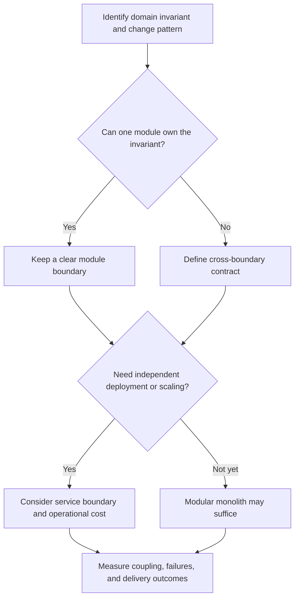

# 15. Architectural Boundaries and Evolution

## Boundaries around change and invariants
A module or service boundary should make responsibility, ownership and invariants clearer. Domain-driven design uses bounded contexts to identify where a model and its language are consistent. “Customer” can mean different things in identity, billing and support; forcing all domains to share one model may create coupling.

Service boundaries should consider data ownership, transaction boundaries, team ownership, scaling profile, security, deployment cadence and failure containment. If two services constantly need synchronous round trips or distributed transactions to preserve one invariant, the boundary may be wrong or the workflow needs a different contract.

## Monolith, modular monolith and microservices
A monolith deploys as one unit. A modular monolith keeps internal boundaries within that deployment. Microservices permit independent deployment and scaling but require discovery, network resilience, versioned contracts, data ownership, observability and operational maturity.

Microservices are not an automatic scalability strategy. If boundaries are unstable or the team cannot operate distributed infrastructure, a modular monolith may provide better change velocity and reliability. Explicit module boundaries make later extraction easier.

## Data ownership and composition
Private data stores support service ownership and reduce accidental cross-service writes, but complicate cross-domain queries. API composition or materialized read models can combine information at the cost of extra calls or eventual consistency. A shared database can be a pragmatic transition, but ungoverned cross-service schema access creates hidden coupling.

## Orchestration and choreography
Orchestration centralizes workflow progression in a coordinator. Choreography lets services react to events. Orchestration makes transitions visible but can create a complex coordinator; choreography avoids central control but can obscure end-to-end behavior. Both need timeouts, retries, duplicate handling, terminal states, compensation and observability.

## CQRS, event sourcing and outbox
CQRS separates command handling from query models. Event sourcing stores domain events as authoritative history. The outbox pattern atomically records a business update and an event to publish in one local transaction. They solve different problems and should not be bundled automatically.

Use CQRS when read/write models materially differ; event sourcing when history is central; outbox when dual-write reliability matters. Each adds operational and cognitive cost.

## Sidecars, service meshes, control and data planes
A sidecar places supporting behavior next to an application. A service mesh may provide traffic policy, service identity and telemetry, but adds control-plane dependencies and configuration complexity. Do not move business semantics into infrastructure merely because it can intercept traffic.

The data plane handles ordinary production traffic. The control plane configures, schedules or changes the data plane. A control-plane outage need not stop existing traffic if the system is designed to retain safe configuration, but the desired behavior must be explicit.

## Migration and technical debt
The strangler pattern gradually routes selected functionality from a legacy system to a replacement. It needs a routing boundary, data synchronization strategy, rollback plan, observability and retirement criteria. Dual writes and dual reads create consistency risks; migration phases should be explicit and measurable.

Technical debt is the future cost created by constraints, shortcuts, unclear ownership and deferred maintenance. Record why a compromise was made, what conditions make it harmful, and what signal should trigger revisiting it.

## 15.1A Domain boundaries and bounded contexts

A bounded context is a boundary within which a domain model and its language have a consistent meaning. The same word can represent different concepts in different contexts: a “customer” in billing may be the legal payer, while a “customer” in support may be the person contacting the help desk.

A context map makes relationships explicit: which context owns a concept, which depends on another, where translation occurs, and where integration contracts are needed. A shared database schema or shared model library can accidentally force contexts to evolve together.

Domain boundaries should be tested against real change and invariant patterns. A service boundary is not justified merely because a noun exists in the business domain; it should clarify ownership, change, or operational responsibility.

## 15.1B Coupling dimensions

Coupling is multidimensional:
- **Code coupling:** direct dependency on classes, libraries, or internal implementation.
- **Data coupling:** shared schema or direct reads/writes to another component's tables.
- **Temporal coupling:** one component must be available at the exact moment another needs it.
- **Deployment coupling:** components must be released together.
- **Semantic coupling:** consumers rely on undocumented meaning or assumptions.
- **Operational coupling:** components share scarce pools, credentials, or failure domains.

A network boundary may reduce code and deployment coupling while increasing temporal and operational coupling. Asynchronous messaging can reduce temporal coupling but introduce schema, replay, ordering and eventual-consistency concerns. The goal is not to remove all coupling; it is to choose and manage the coupling that supports the system's goals.

## 15.1C Modular monolith as an evolutionary strategy

A modular monolith can enforce package/module boundaries, explicit interfaces, dependency direction and private data access while deploying as one unit. It retains in-process calls and often simpler transactions and local debugging.

Useful guardrails include:
- Each module owns its domain logic and data access.
- Cross-module calls use published interfaces.
- Internal tables are not casually accessed by other modules.
- Dependency cycles are detected and prevented.
- Integration tests verify module contracts.
- Shared utilities do not become a dumping ground for domain behavior.

A modular monolith is not automatically well-modularized. It can still have a shared database with hidden coupling, cyclic dependencies and global mutable state. Architecture tests and code review can keep boundaries meaningful.

## 15.1D Extracting a service safely

Before extraction, identify the capability and its authoritative data. Then define an API or event contract, establish ownership, observe current usage, and plan migration and rollback.

A typical migration might:
1. Create the new service and compatible contract.
2. Route a small subset of traffic to it.
3. Establish a source-of-truth strategy for data.
4. Backfill and verify existing records.
5. Shift reads and writes in controlled stages.
6. Remove legacy paths only after evidence shows they are unused.
7. Retain rollback criteria until correctness and operations are proven.

Dual writes are dangerous because one write can succeed while the other fails. If dual writes are unavoidable temporarily, track divergence, define repair, and make the migration window explicit. A strangler route is not sufficient without a data consistency strategy.

## 15.1E Architecture Decision Records and reversibility

An ADR records context, decision, alternatives, consequences, assumptions and revisit triggers. Decisions differ in reversibility. A library choice may be easy to change; a public API, data model, tenant boundary or globally distributed write protocol can be expensive to reverse after adoption.

Prefer small experiments and reversible choices when uncertainty is high. Where an irreversible choice is necessary, invest more in evidence, failure analysis and review. Do not confuse “we can rewrite it later” with a real migration plan.

## 15.1F Technical debt and evolutionary fitness

Technical debt is a trade-off with future cost, not simply code that looks old. Track the debt's cause, impact, affected systems, risk, mitigation and trigger for repayment. Some debt is rational when a deadline or uncertainty makes a temporary solution valuable; unrecorded debt tends to become accidental architecture.

Architecture fitness functions are repeatable checks that help preserve desired properties. Examples include tests that prevent dependency cycles, checks that forbid direct cross-module database access, latency budgets in performance tests, security policy checks, and restore drills. A fitness function should measure a meaningful property and avoid becoming a brittle proxy that teams optimize at the expense of the real goal.

## 15.1G Control plane and data plane failure behavior

The data plane handles ordinary user traffic; the control plane configures or changes routing, scheduling, identity policy or other behavior. Ask what happens when the control plane is unavailable: do existing data-plane instances continue using last-known-good configuration, do certificates expire, can new workloads start, and can emergency changes be applied?

Keeping the data plane running during control-plane disruption improves resilience but requires bounded configuration staleness and safe fallback rules. Last-known-good state must itself be authenticated, versioned and protected against rollback to unsafe configuration.

## Further reading
- Fowler, [Microservices](https://martinfowler.com/articles/microservices.html).
- Fowler, [Strangler Fig Application](https://martinfowler.com/bliki/StranglerFigApplication.html).
- Microsoft [Cloud Design Patterns](https://learn.microsoft.com/en-us/azure/architecture/patterns/).

## Choosing and evolving a boundary

The purpose of a boundary is to make change and invariants manageable. Independent deployment is useful only when the operational cost and distributed coordination are justified.

---

[Back to textbook contents](../../README.md) · [Curriculum](../../CURRICULUM.md) · [Roadmap](../../ROADMAP.md)
