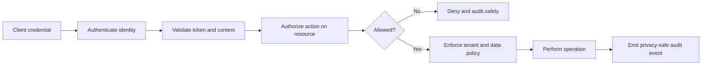

# 16. Security, Identity, and Privacy

## 16.1 Security is an architectural property
Security controls should follow assets, actors, threats and trust boundaries. A threat model asks what must be protected, who might attack it, what capabilities they have, and what mitigations reduce likelihood or impact. It should be revisited as data flows, integrations and deployment topology change.

## 16.1A Threat modeling as a repeatable design activity

Threat modeling is most useful before a design is fixed and whenever a major trust boundary or data flow changes. A practical workflow is:
1. Identify assets, sensitive operations, actors, and data classifications.
2. Draw data flows and trust boundaries.
3. Enumerate threats against each boundary and asset.
4. Estimate impact and likelihood under a stated attacker capability.
5. Select preventive, detective, and recovery controls.
6. Record residual risk, owner, and verification evidence.

STRIDE is one common threat-categorization aid: spoofing, tampering, repudiation, information disclosure, denial of service, and elevation of privilege. It is a prompt list, not a guarantee that every threat has been found. Abuse cases and business-specific threats are also important.

## 16.1B Identity lifecycle and credential validation

Identity and access management (IAM) governs human and workload identities, authenticators, entitlements, lifecycle, revocation and audit. Treat IAM and identity-provider services as dependencies with their own availability and recovery requirements. Identity is more than a token: consider enrollment, authentication, session refresh, privilege change, credential rotation, revocation, account recovery, and termination. A former employee or compromised service account must lose access through a defined revocation process.

For a signed JWT, validation generally includes signature verification using a trusted key, allowed algorithm policy, issuer, audience, expiry and not-before times where present, intended token type, and required claims. Key discovery and rotation must be bounded and trusted. Do not accept an algorithm merely because the token header names it. A valid signature proves the token was signed by a trusted key; it does not prove the requested resource access is authorized.

Access tokens should have appropriate audience and lifetime. Refresh tokens need stronger protection and rotation/reuse handling according to the identity system. Never place secrets or sensitive personal data in a token merely because it is signed; signed claims are often readable by token holders.

## 16.1C Sessions, cookies, and browser threats

Browser session design must consider theft, fixation, cross-site request forgery (CSRF), cross-site scripting (XSS), and logout/revocation. Secure cookie attributes such as HttpOnly, Secure, and an appropriate SameSite policy reduce specific risks but do not replace output encoding, CSRF controls where needed, or server-side authorization.

A bearer token is usable by whoever possesses it. Keep it out of URLs, logs, analytics, crash reports, and browser storage choices that expose it to scripts where possible. The right design depends on application architecture and threat model; there is no single cookie or token storage strategy that is safe for every application.

## 16.1D Authorization models and object-level checks

RBAC is useful when permissions map naturally to organizational roles. ABAC can express decisions based on subject, resource, action, and environmental attributes. ReBAC models authorization through relationships such as owner, member, manager, or collaborator. Systems may combine these models.

The common failure is checking only whether a user has a broad role, without checking whether that user may access this specific object in this tenant or state. Enforce object-level authorization on every relevant operation, including list, search, export, background job, administrative API, and direct object-storage access. Deny by default and test negative cases explicitly.

## 16.1E Secrets, keys, and cryptographic boundaries

A secret manager reduces hard-coded secret exposure but does not eliminate access-control risk. Define which workload identity may retrieve each secret, how rotation propagates, how old and new credentials overlap, and how emergency revocation works.

Encryption at rest depends on key custody, permissions, backups, and rotation. Envelope encryption commonly encrypts data with a data-encryption key and protects that key with a key-encryption key managed by a key service. Loss or revocation of the wrong key can make data unrecoverable; key backup and recovery must be designed alongside data backup.

TLS certificate renewal, trust-root changes, signing-key rotation, and database credential rotation are production workflows. Test them before expiry rather than treating them as one-time configuration.

## 16.1F Tenant isolation across layers

Tenant isolation is an end-to-end invariant. A tenant boundary must be enforced consistently in:
- API authorization and service-to-service calls.
- Database predicates, row-level policies, and background queries.
- Cache keys and invalidation messages.
- Object-storage keys and signed URLs.
- Message topics, consumer filters, and replay tools.
- Search indexes, analytics exports, logs, and support tooling.
- Backups, restore procedures, and administrative access.

A tenant identifier supplied by a client is input, not proof of membership. Derive the authorized tenant scope from authenticated identity and policy, then apply it consistently. Test cross-tenant reads and writes using adversarial identifiers and alternate access paths.

## 16.1G Privacy lifecycle and data minimization

Privacy engineering starts with purpose and data inventory. For each field, document why it is collected, who can access it, where it is copied, how long it is retained, and how deletion or correction propagates.

Data minimization reduces both breach impact and operational complexity. Avoid collecting sensitive fields “just in case.” Pseudonymization can reduce direct identification but does not necessarily make data anonymous if it can be linked back. Encryption protects confidentiality under key assumptions; it does not itself define a lawful purpose or retention period.

Deletion workflows must account for replicas, caches, derived indexes, event logs, analytics, exports, backups, and legal retention exceptions. Where immediate physical deletion from immutable backups is not feasible, document the policy, access restrictions, expiry timeline, and restoration-time deletion replay.

## 16.1H Authorization caching, revocation, and stale privilege

Authorization decisions are often tempting to cache because policy evaluation or relationship lookup may be expensive. The cache is safe only when its key represents the full decision context and its staleness is acceptable for the operation. Depending on the policy model, relevant dimensions can include subject, action, resource, tenant, resource state, environment attributes, and a policy or relationship version. Omitting a dimension can turn a performance optimization into a cross-user or cross-tenant authorization bypass.

A short TTL bounds some stale-decision windows but does not make them harmless. If an administrator removes access at time (t_0), a cached allow may remain usable until expiry unless revocation actively invalidates it or the protected operation checks a newer policy/version. Choose an explicit revocation contract: for example, bounded staleness for low-risk reads, synchronous policy checks for high-risk mutations, or versioned decisions invalidated through a reliable change stream. Document what happens when the policy service or invalidation channel is unavailable; fail-open behavior can preserve availability while violating the security invariant.

Keep response caching separate from decision caching. A cache hit must not bypass the current request's authorization check. For shared HTTP/CDN caches, define cacheability per route and ensure every response-changing input is represented in the cache key or disallowed. Authenticated, personalized, tenant-specific, or sensitive responses should not be shared by default. HTTP `no-cache` means revalidation is required before reuse; it does not mean the response cannot be stored. `no-store` prohibits storage by compliant caches, but changing a directive does not purge objects already stored.

**Example:** A user is removed from a project but a project-membership decision is cached for five minutes. If a high-risk export endpoint trusts that cached allow, revocation is delayed for up to five minutes unless invalidation/version checks intervene. Decide whether that delay is acceptable, enforce the policy at the export operation, and test the exact revocation path—including a lost invalidation event and a cache node that is temporarily partitioned.

Test at least: role or membership removal, account disablement, tenant switch, policy-version change, invalidation loss/replay, cache outage, and requests through the actual CDN/proxy/application path. Record the expected maximum revocation delay and alert on violations. See OWASP's [Authorization Cheat Sheet](https://cheatsheetseries.owasp.org/cheatsheets/Authorization_Cheat_Sheet.html) and [Web Cache Security Cheat Sheet](https://cheatsheetseries.owasp.org/cheatsheets/Web_Cache_Security_Cheat_Sheet.html).

## 16.1I Security logging and incident readiness

Security logs should record principal, action, target, outcome, timestamp, correlation context, and policy decision where appropriate, while excluding passwords, access tokens, cryptographic keys, and unnecessary sensitive payloads. Logs need integrity protection, access control, retention, and time synchronization appropriate to the investigation.

Design for credential compromise: revoke or rotate credentials, contain affected workloads, identify actions performed, preserve evidence, and restore trusted configuration. Detection without a practiced response path is incomplete protection.

## 16.1J Security design review checklist

- What are the assets and trust boundaries?
- Who authenticates each caller, and how are credentials revoked?
- Where is object-level authorization enforced?
- Can tenant scope be bypassed through another API or background workflow?
- What is the blast radius of a stolen service identity?
- How are secrets and keys rotated and recovered?
- Which data is logged, copied, retained, or deleted?
- What happens if the identity provider is unavailable?
- How are rate limits and expensive operations protected?
- Which negative and cross-tenant tests prove the policy?

## 16.1K OAuth 2.0, OpenID Connect, and token roles in practice

OAuth 2.0 is an authorization framework for delegated access. OpenID Connect (OIDC) adds an authentication layer with an ID token and standardized identity claims. JWT is a token representation that may be used for different purposes; a JWT is not automatically an OAuth access token or an OIDC ID token.

Keep the token roles separate:
- **Access token:** presented to a resource server; validate the intended audience, issuer, lifetime, permissions/scopes and token type according to the profile.
- **ID token:** communicates authentication information to the OIDC client; validate it according to OIDC rules and do not use it as a general API access token.
- **Refresh token:** used with the authorization server to obtain new tokens; protect it as a high-value credential and follow rotation/reuse detection rules supported by the provider.

For browser-based and native public clients, Authorization Code with PKCE is the common modern pattern; the client must validate state and, in OIDC, nonce as appropriate to the flow. Client Credentials is for a confidential client acting as itself, not a substitute for end-user authentication. Avoid legacy flows unless a documented constraint requires them.

Scopes are not a complete authorization decision. The resource server may still need object-level, tenant-level and relationship checks. Token validation also needs key rotation, trusted issuer metadata, algorithm allow-lists, clock-skew policy, and failure behavior when keys cannot be refreshed. Do not log raw tokens.

## 16.2 Threat modeling a system architecture

Threat modeling is a structured way to ask what can go wrong, which assets and trust boundaries matter, and which controls reduce risk. It should begin while architecture is being shaped, not after deployment. A threat model is an explicit set of assumptions and decisions that can be updated when a new component, data flow or trust relationship is introduced.

### Identify assets, actors and trust boundaries

List assets such as credentials, personal data, payment instructions, tenant records, signing keys, service availability and audit evidence. Identify actors: end users, administrators, service identities, third-party providers, compromised clients and automated workers. Draw data flows and mark boundaries where data crosses a browser, edge, service, queue, database, cloud account or external organization.

A trust boundary is not necessarily a network boundary. Two services inside the same cluster may have different permissions and data ownership; two components in one process may have different levels of trust. Every boundary should answer who can call, what identity is asserted, which data may cross, and how the receiver validates it.

### Abuse cases and control mapping

Ask how an attacker or faulty caller could read another tenant's object, escalate privileges, replay a command, exhaust expensive resources, trick the service into calling an internal endpoint, poison a cache, misuse a webhook, or alter a deployment artifact. Map each threat to preventive controls, detection signals, and recovery steps.

For example, SSRF defenses should constrain destinations and redirect behavior, validate resolved addresses where appropriate, and protect metadata endpoints; a URL syntax check alone is not enough. API resource-abuse defenses may need payload caps, pagination, query complexity limits, concurrency quotas and per-tenant budgets—not only request-per-second limits.

### Authentication, authorization and identity propagation

Authentication establishes which principal is making a request; authorization decides whether that principal may perform the action on the specific resource under current policy. Role-based access control (RBAC) assigns permissions through roles; attribute-based access control (ABAC) evaluates attributes such as subject, resource, action and context. Relationship-based models can express access derived from ownership or sharing relationships.

Do not assume that a valid JWT means the caller is authorized. Validate issuer, audience, expiry, token purpose and cryptographic profile; then perform the resource-level policy check. When identity crosses service boundaries, define whether the caller's identity is delegated, exchanged for a service token, or represented as a trusted assertion. Never trust client-supplied identity headers without a protected, verified propagation path.

### Zero trust, least privilege and service identity

Zero trust means do not grant implicit trust solely because a request originates on an internal network. Authenticate and authorize principals, minimize permissions, and evaluate access according to the resource and context. This does not mean every request must call a central policy server synchronously; policy caching and local enforcement can be designed with explicit freshness and revocation trade-offs.

Service identity and mutual TLS can authenticate workloads and protect traffic between services, but transport identity does not replace application authorization. Rotate credentials, define trust roots, limit certificate scope and lifetime, and plan for identity-provider or certificate-authority outages.

### Secrets, encryption and key lifecycle

Encryption in transit and at rest protects different exposure paths. Key management must define generation, storage, access, rotation, backup, revocation and destruction. Rotation needs overlap where old and new keys coexist, and services must reload credentials without causing a fleet-wide reconnect storm.

Secrets should not be embedded in container images, source repositories, build logs, crash dumps or ordinary application telemetry. Access should be auditable and narrowly scoped. If a secret is exposed, revoking it is not enough if the same credential was copied into multiple systems; identify all uses and rotate the full dependency chain.

### Multi-tenant isolation and privacy lifecycle

Tenant isolation should be enforced at every layer: API authorization, cache keys, database queries, object-storage paths, search filters, background jobs, analytics exports and operational tools. A tenant ID supplied by the client is an input, not proof of authority. Use explicit tenant context derived from an authenticated identity and propagate it safely.

Privacy requires data minimization, purpose limitation, retention, deletion, export, access logging and control over derived copies. Deleting a source row may not delete caches, search indexes, analytics tables, backups or event logs immediately. Define what deletion means for each storage class, the allowed delay, and any legal retention exception.

### Security design checklist

- What assets are most sensitive and what are the abuse cases?
- Where are the trust boundaries, including internal service boundaries?
- Is every resource access authorized at the resource owner?
- Can a tenant identifier, object ID or forwarded header be spoofed?
- Are API cost, payload size and concurrency bounded?
- How are secrets and signing keys rotated and revoked?
- What happens when identity or key-distribution dependencies fail?
- Can sensitive data leak through logs, caches, search, backups or analytics?
- How are security events correlated and investigated?
- Is there a tested response for credential compromise or tenant-isolation failure?

## 16.3 API threat patterns: object access, business flows and resource exhaustion

API security is not only about validating tokens or encrypting transport. Many serious API failures occur after a caller has authenticated: the application may authorize the wrong object, expose fields the caller should not see, permit a privileged action, or allow a valid operation to consume unlimited resources.

The OWASP API Security Top 10 (2023) is a useful awareness taxonomy. It is not a complete threat model and should not be treated as a substitute for analyzing the product's own assets, abuse cases and business rules.

### Object-level and function-level authorization

**Broken Object Level Authorization (BOLA)** occurs when a caller can access or modify an object merely by changing an identifier, without a correct permission check for that object. Every endpoint that reads, updates, deletes, exports or triggers actions on a resource ID must check the caller's permission against the actual resource and tenant.

**Broken Function Level Authorization** occurs when a caller can invoke an operation reserved for a different role or privilege level, such as an administrative endpoint. Hiding a button in the UI or using an obscure URL does not enforce authorization. The server must enforce the policy for every route and method.

### Property-level authorization and mass assignment

A caller may be allowed to update a profile but not fields such as role, tenant ID, account status, billing plan or verification state. Binding an arbitrary request object directly to an internal domain/entity object can let untrusted fields mutate properties the user should not control.

Use explicit request DTOs or allow-lists, validate writable fields by operation and role, and construct responses from an explicit output model. Do not rely on hiding sensitive fields in the UI. Test both unauthorized reads of response properties and unauthorized writes to protected properties.

### Injection and unsafe interpretation

Injection occurs when untrusted data is interpreted as instructions in a language or execution context rather than treated as data. Examples include SQL/NoSQL query injection, operating-system command injection, template injection and unsafe expression evaluation. The root cause is usually a boundary that mixes code or query structure with untrusted values.

Use parameterized queries or prepared statements for data values. When a query must vary by identifier or sort direction, use a strict allow-list because many query APIs cannot parameterize identifiers as ordinary values. Avoid constructing shell commands from user input; prefer APIs that pass arguments without a shell. Keep template auto-escaping enabled and apply context-appropriate output encoding. Input validation is useful for business constraints, but it is not a substitute for separating data from executable syntax.

Test injection at each interpreter boundary, including filters, search expressions, report generation, webhook processing, administrative tools and background jobs. Also review stored data when it is later interpreted by a different component: data accepted safely by one layer can become dangerous when passed to a shell, template engine or query builder downstream. For additional implementation-specific defenses, consult OWASP's [Injection Prevention Cheat Sheet](https://cheatsheetseries.owasp.org/cheatsheets/Injection_Prevention_Cheat_Sheet.html) and [SQL Injection Prevention Cheat Sheet](https://cheatsheetseries.owasp.org/cheatsheets/SQL_Injection_Prevention_Cheat_Sheet.html).

### Sensitive business flows and resource consumption

Some abuse is not a conventional permission failure. An attacker may legitimately authenticate and call a public flow—ticket purchase, trial creation, password reset, bulk export, SMS delivery or expensive search—at a rate that harms the business or exhausts a paid dependency.

Apply controls based on the business risk and resource cost:
- Bound request body, page size, query complexity, upload size, fan-out and execution time.
- Rate-limit by suitable identities and business objects, not only source IP.
- Apply concurrency limits and quotas to expensive operations and paid downstream APIs.
- Add anti-automation or abuse detection where the threat requires it.
- Preserve fairness across tenants and avoid a global budget that lets one tenant starve others.
- Record rejection and abuse signals without logging credentials or sensitive payloads.

Rate limiting is not always sufficient. A low-frequency request can still be expensive, and automated abuse can distribute traffic across many accounts. Model the cost and intended business behavior of the flow.

### Server-side request forgery and unsafe upstream APIs

SSRF occurs when an application makes a network request using attacker-influenced destination data and can be induced to reach resources the attacker cannot access directly. URL validation must account for schemes, DNS resolution, redirects, IP address forms, private/link-local ranges and changes between validation and connection. A simple string prefix check is not a robust defense.

Prefer explicit destination allow-lists where possible, restrict egress at the network layer, revalidate redirect targets, and prevent the fetcher from reaching metadata endpoints or internal control planes unless required. The webhook publisher has the same risk when it calls customer-supplied URLs.

External API responses are also untrusted input. Validate response schemas, sizes, redirects, timeouts and content types; treat external error bodies and URLs as untrusted; and avoid forwarding credentials to a different origin. A trusted provider can still return malformed, delayed or unexpectedly large responses.

### API inventory and compatibility as security controls

Old, undocumented or shadow endpoints can remain reachable after a new version launches. Maintain an inventory of public, partner and internal APIs, their owners, authentication requirements, data sensitivity, supported versions and retirement dates. Use traffic logs and deployment metadata to find unused endpoints, while ensuring that discovery itself does not expose secrets.

A deprecation plan should include consumer identification, communication, migration time, monitoring and a removal test. Keeping every historical endpoint indefinitely expands the attack surface and makes security policy inconsistent.

### API security test matrix

| Test | Expected invariant |
|---|---|
| Change a resource ID to another tenant's ID | No unauthorized data access or side effect |
| Add protected fields to a valid update request | Server ignores or rejects fields the caller cannot modify |
| Invoke an administrative operation with a normal user token | Operation is denied and safely audited |
| Request huge pages, deeply nested queries or large payloads | Resource limits are enforced before unbounded work |
| Repeat a costly business action from many accounts | Abuse controls protect the business flow and shared dependencies |
| Supply an internal/private destination to a URL-fetching feature | Request is blocked according to the egress policy |
| Return malformed or oversized data from an upstream API | Consumer validates and fails safely within bounded resources |
| Supply query syntax or shell metacharacters in untrusted fields | Values remain data; no unauthorized query or command executes |
| Call an obsolete or undocumented API version | Access and retirement policy remains enforced |

### API threat review checklist

- Is authorization checked for the specific object, property and function?
- Can request binding modify fields outside the caller's authority?
- Are expensive business flows protected against automated abuse?
- Are payload size, query complexity, concurrency and paid downstream calls bounded?
- Are user-controlled URLs protected against SSRF and redirect/DNS tricks?
- Are external API responses treated as untrusted?
- Is the API inventory owned, monitored and periodically pruned?
- Do negative authorization tests cover multiple tenants and roles?
- Are errors and audit events useful without exposing sensitive data?

## 16.4 Worked threat model: tenant-scoped document export

Assume a multi-tenant SaaS application lets a user search documents and request an asynchronous export as a downloadable archive. The export worker reads from a database and object storage, writes a generated file, and notifies the requester when it is ready. The key security invariant is: **a principal may export only documents that the current authorization policy permits them to access in their tenant and resource state**.

### Map the export flow and trust boundaries

| Element | Security significance | Boundary or control question |
|---|---|---|
| Browser/client | Untrusted request parameters, document IDs and forwarded headers | Is identity authenticated, and is tenant scope derived from trusted identity/policy rather than accepted from a client field? |
| API gateway/edge | Authentication integration, request limits and routing | Which identity claims are validated here, and which authorization checks must still occur in the service? |
| Document API and database | Authoritative metadata and access policy | Does every search, list, direct-ID read and export-selection query enforce object-level and tenant-level authorization? |
| Queue and export worker | Delayed execution may outlive the user's original session or permissions | Is tenant and requester context authenticated and integrity-protected, and is authorization rechecked when the job runs? |
| Object storage and download link | Generated archive can expose many records at once | Is the object path tenant-scoped, access-controlled and short-lived where a signed URL is used? |
| Logs, audit and support tools | May expose metadata or allow privileged access | Are access decisions auditable without logging document contents, credentials or unnecessary personal data? |

### Abuse cases and controls

| Abuse case | Preventive control | Detection and recovery evidence |
|---|---|---|
| User changes a document ID to another tenant's ID | Object-level authorization at each read/export path; deny by default | Negative cross-tenant tests and audit event for denied access |
| User submits another tenant ID in the request body | Derive authorized tenant scope from identity and policy; treat client tenant ID only as a requested scope to validate | Tests spoofed tenant IDs across list, search and export APIs |
| User is authorized when creating a job but loses access before execution | Recheck current policy at execution time or explicitly document a justified snapshot-of-authorization contract | Test permission revocation between enqueue and worker execution |
| Queue message is forged or altered | Authenticate producer/consumer identities, restrict queue ACLs, validate message schema and tenant/resource references | Alerts for invalid producer identity, malformed payloads and unexpected tenant context |
| Download URL is leaked or remains valid too long | Short expiry, narrow object scope, least-privilege access and safe response headers | Audit downloads, test expiration and revoke/delete objects according to policy |
| Export request exhausts CPU, storage or queue capacity | Per-tenant quotas, bounded concurrency, maximum export size and rate/cost limits | Per-tenant rejected work, queue age, export duration and storage growth |
| Logs or support tooling reveal other tenants' data | Minimize logged fields, enforce operator access, audit privileged reads and redact sensitive content | Periodic access review and tested incident response for exposure |

### Authorization is checked at each boundary

Passing gateway authentication does not prove permission to export a particular document. A valid tenant ID does not prove membership. A queue message does not become trusted merely because it came from an internal network. A generated object is still protected data even after it leaves the database.

Carry the minimum context needed to execute the job, bind it to an authenticated producer and a stable job ID, and validate every resource reference against the authorized scope. Define whether permission changes cancel queued jobs, prevent new export generation, revoke existing downloads, or trigger deletion of previously generated artifacts. These are policy decisions that need explicit semantics.

### Verification matrix

- [ ] User from tenant A cannot read, search, export or download tenant B's documents by changing IDs or filters.
- [ ] Authorization is enforced consistently across synchronous API, queue consumer, object storage and support/admin tools.
- [ ] Revoking access after enqueue has the documented effect when the worker later executes.
- [ ] Duplicate queue deliveries do not create inconsistent export state or bypass authorization.
- [ ] Export size, concurrency and tenant budgets prevent one tenant from exhausting shared capacity.
- [ ] Signed URLs cannot access a different object and expire within the defined policy.
- [ ] Audit records capture requester, tenant, decision, resource scope and job outcome without exposing document contents or credentials.
- [ ] Data retention and deletion cover source records, generated archives, replicas, backups and logs according to the applicable policy.

## A request crosses trust boundaries

Authentication, token validation, authorization and tenant isolation are separate checks. Passing one must not imply the others. Audit records should capture enough for investigation without logging credentials or unnecessary sensitive payloads.

## Further reading
- IETF [RFC 9700 — OAuth 2.0 Security BCP](https://www.rfc-editor.org/rfc/rfc9700.html).
- OpenID Foundation [specifications](https://openid.net/developers/specs/).
- NIST [Cybersecurity Framework](https://www.nist.gov/cyberframework).
- OWASP [API Security Top 10 (2023)](https://api-security.owasp.org/editions/2023/en/0x00-header/) — object/function/property authorization, resource consumption, SSRF, inventory and unsafe upstream API risks.

---

[Back to textbook contents](../../README.md) · [Curriculum](../../CURRICULUM.md) · [Roadmap](../../ROADMAP.md)
