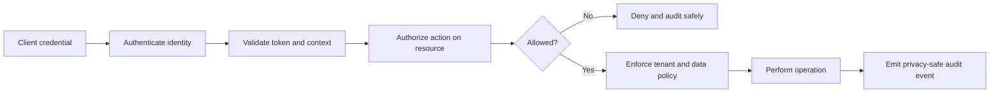

# 16. Security, Identity, and Privacy

## Security is an architectural property
Security controls should follow assets, actors, threats and trust boundaries. A threat model asks what must be protected, who might attack it, what capabilities they have, and what mitigations reduce likelihood or impact. It should be revisited as data flows, integrations and deployment topology change.

## Authentication and authorization
Authentication establishes an identity or credential; authorization decides what that identity may do to a resource. A valid login does not imply permission to read every tenant's data. Enforce authorization at the boundary where the protected operation occurs, not only in the UI.

RBAC assigns permissions through roles. ABAC evaluates attributes such as subject, resource, action and context. Both require clear policy ownership, default-deny behavior, and testing for privilege escalation.

## Sessions, OAuth, OIDC and JWT
A session is server- or client-associated state used to maintain authenticated interaction. Cookies are a browser mechanism for carrying values and need secure attributes, scope and CSRF considerations.

OAuth 2.0 is an authorization framework; OpenID Connect adds an identity layer. JWT is a token format, not an authentication protocol by itself. Token validation must check signature or other applicable protection, issuer, audience, expiry, intended use and relevant claims. Never trust a decoded token merely because its JSON is readable. See [OAuth 2.0 Security Best Current Practice](https://www.rfc-editor.org/rfc/rfc9700.html) and [OpenID Connect specifications](https://openid.net/developers/specs/).

## Encryption and secrets
TLS protects communication in transit; encryption at rest protects stored data under defined key and access assumptions. Neither replaces authorization, secure endpoint configuration or key management. Secrets need controlled distribution, rotation, access auditing and emergency revocation. Avoid embedding credentials in images, logs, source code or client-side applications.

## Least privilege and zero trust
Least privilege grants only the access required for a task. Zero-trust principles avoid treating network location alone as proof of trust; authenticate and authorize requests based on identity, context and policy. Service-to-service identity and authorization should remain meaningful even inside a private network.

## API abuse and tenant isolation
Protect against brute force, credential stuffing, resource exhaustion, oversized payloads, expensive queries, injection and automated abuse. Rate limits need scope and fairness rules; a global limit can allow one tenant to starve others.

Multi-tenant isolation spans application authorization, database queries, cache keys, object paths, queues, logs, backups and administrative tools. A tenant ID filter in one API is not a complete isolation strategy. Test cross-tenant access explicitly.

## Privacy, audit and retention
Collect only data with a defined purpose, restrict access, classify sensitive fields, and set retention/deletion policies. Audit logs should support investigation without becoming a secondary store of secrets. Data deletion must consider replicas, caches, search indexes, analytics copies and backups, with documented exceptions and timelines.

## 16.1A Threat modeling as a repeatable design activity

Threat modeling is most useful before a design is fixed and whenever a major trust boundary or data flow changes. A practical workflow is:
1. Identify assets, sensitive operations, actors, and data classifications.
2. Draw data flows and trust boundaries.
3. Enumerate threats against each boundary and asset.
4. Estimate impact and likelihood under a stated attacker capability.
5. Select preventive, detective, and recovery controls.
6. Record residual risk, owner, and verification evidence.

STRIDE is one common threat-categorization aid: spoofing, tampering, repudiation, information disclosure, denial of service, and elevation of privilege. It is a prompt list, not a guarantee that every threat has been found. Abuse cases and business-specific threats are also important.

## 16.1B Identity lifecycle and credential validation

Identity is more than a token. Consider enrollment, authentication, session refresh, privilege change, credential rotation, revocation, account recovery, and termination. A former employee or compromised service account must lose access through a defined revocation process.

For a signed JWT, validation generally includes signature verification using a trusted key, allowed algorithm policy, issuer, audience, expiry and not-before times where present, intended token type, and required claims. Key discovery and rotation must be bounded and trusted. Do not accept an algorithm merely because the token header names it. A valid signature proves the token was signed by a trusted key; it does not prove the requested resource access is authorized.

Access tokens should have appropriate audience and lifetime. Refresh tokens need stronger protection and rotation/reuse handling according to the identity system. Never place secrets or sensitive personal data in a token merely because it is signed; signed claims are often readable by token holders.

## 16.1C Sessions, cookies, and browser threats

Browser session design must consider theft, fixation, cross-site request forgery (CSRF), cross-site scripting (XSS), and logout/revocation. Secure cookie attributes such as HttpOnly, Secure, and an appropriate SameSite policy reduce specific risks but do not replace output encoding, CSRF controls where needed, or server-side authorization.

A bearer token is usable by whoever possesses it. Keep it out of URLs, logs, analytics, crash reports, and browser storage choices that expose it to scripts where possible. The right design depends on application architecture and threat model; there is no single cookie or token storage strategy that is safe for every application.

## 16.1D Authorization models and object-level checks

RBAC is useful when permissions map naturally to organizational roles. ABAC can express decisions based on subject, resource, action, and environmental attributes. ReBAC models authorization through relationships such as owner, member, manager, or collaborator. Systems may combine these models.

The common failure is checking only whether a user has a broad role, without checking whether that user may access this specific object in this tenant or state. Enforce object-level authorization on every relevant operation, including list, search, export, background job, administrative API, and direct object-storage access. Deny by default and test negative cases explicitly.

## 16.1E Secrets, keys, and cryptographic boundaries

A secret manager reduces hard-coded secret exposure but does not eliminate access-control risk. Define which workload identity may retrieve each secret, how rotation propagates, how old and new credentials overlap, and how emergency revocation works.

Encryption at rest depends on key custody, permissions, backups, and rotation. Envelope encryption commonly encrypts data with a data-encryption key and protects that key with a key-encryption key managed by a key service. Loss or revocation of the wrong key can make data unrecoverable; key backup and recovery must be designed alongside data backup.

TLS certificate renewal, trust-root changes, signing-key rotation, and database credential rotation are production workflows. Test them before expiry rather than treating them as one-time configuration.

## 16.1F Tenant isolation across layers

Tenant isolation is an end-to-end invariant. A tenant boundary must be enforced consistently in:
- API authorization and service-to-service calls.
- Database predicates, row-level policies, and background queries.
- Cache keys and invalidation messages.
- Object-storage keys and signed URLs.
- Message topics, consumer filters, and replay tools.
- Search indexes, analytics exports, logs, and support tooling.
- Backups, restore procedures, and administrative access.

A tenant identifier supplied by a client is input, not proof of membership. Derive the authorized tenant scope from authenticated identity and policy, then apply it consistently. Test cross-tenant reads and writes using adversarial identifiers and alternate access paths.

## 16.1G Privacy lifecycle and data minimization

Privacy engineering starts with purpose and data inventory. For each field, document why it is collected, who can access it, where it is copied, how long it is retained, and how deletion or correction propagates.

Data minimization reduces both breach impact and operational complexity. Avoid collecting sensitive fields “just in case.” Pseudonymization can reduce direct identification but does not necessarily make data anonymous if it can be linked back. Encryption protects confidentiality under key assumptions; it does not itself define a lawful purpose or retention period.

Deletion workflows must account for replicas, caches, derived indexes, event logs, analytics, exports, backups, and legal retention exceptions. Where immediate physical deletion from immutable backups is not feasible, document the policy, access restrictions, expiry timeline, and restoration-time deletion replay.

## 16.1H Security logging and incident readiness

Security logs should record principal, action, target, outcome, timestamp, correlation context, and policy decision where appropriate, while excluding passwords, access tokens, cryptographic keys, and unnecessary sensitive payloads. Logs need integrity protection, access control, retention, and time synchronization appropriate to the investigation.

Design for credential compromise: revoke or rotate credentials, contain affected workloads, identify actions performed, preserve evidence, and restore trusted configuration. Detection without a practiced response path is incomplete protection.

## 16.1I Security design review checklist

- What are the assets and trust boundaries?
- Who authenticates each caller, and how are credentials revoked?
- Where is object-level authorization enforced?
- Can tenant scope be bypassed through another API or background workflow?
- What is the blast radius of a stolen service identity?
- How are secrets and keys rotated and recovered?
- Which data is logged, copied, retained, or deleted?
- What happens if the identity provider is unavailable?
- How are rate limits and expensive operations protected?
- Which negative and cross-tenant tests prove the policy?

## Further reading
- IETF [RFC 9700 — OAuth 2.0 Security BCP](https://www.rfc-editor.org/rfc/rfc9700.html).
- OpenID Foundation [specifications](https://openid.net/developers/specs/).
- NIST [Cybersecurity Framework](https://www.nist.gov/cyberframework).

## A request crosses trust boundaries

Authentication, token validation, authorization and tenant isolation are separate checks. Passing one must not imply the others. Audit records should capture enough for investigation without logging credentials or unnecessary sensitive payloads.

---

[Back to textbook contents](../../README.md) · [Curriculum](../../CURRICULUM.md) · [Roadmap](../../ROADMAP.md)
