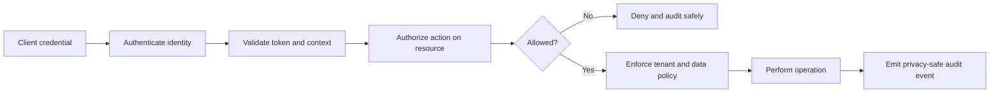

# 16. Security, Identity, and Privacy

## Security is an architectural property
Security controls should follow assets, actors, threats and trust boundaries. A threat model asks what must be protected, who might attack it, what capabilities they have, and what mitigations reduce likelihood or impact. It should be revisited as data flows, integrations and deployment topology change.

## Authentication and authorization
Authentication establishes an identity or credential; authorization decides what that identity may do to a resource. A valid login does not imply permission to read every tenant's data. Enforce authorization at the boundary where the protected operation occurs, not only in the UI.

RBAC assigns permissions through roles. ABAC evaluates attributes such as subject, resource, action and context. Both require clear policy ownership, default-deny behavior, and testing for privilege escalation.

## Sessions, OAuth, OIDC and JWT
A session is server- or client-associated state used to maintain authenticated interaction. Cookies are a browser mechanism for carrying values and need secure attributes, scope and CSRF considerations.

OAuth 2.0 is an authorization framework; OpenID Connect adds an identity layer. JWT is a token format, not an authentication protocol by itself. Token validation must check signature or other applicable protection, issuer, audience, expiry, intended use and relevant claims. Never trust a decoded token merely because its JSON is readable. See [OAuth 2.0 Security Best Current Practice](https://www.rfc-editor.org/rfc/rfc9700.html) and [OpenID Connect specifications](https://openid.net/developers/specs/).

## Encryption and secrets
TLS protects communication in transit; encryption at rest protects stored data under defined key and access assumptions. Neither replaces authorization, secure endpoint configuration or key management. Secrets need controlled distribution, rotation, access auditing and emergency revocation. Avoid embedding credentials in images, logs, source code or client-side applications.

## Least privilege and zero trust
Least privilege grants only the access required for a task. Zero-trust principles avoid treating network location alone as proof of trust; authenticate and authorize requests based on identity, context and policy. Service-to-service identity and authorization should remain meaningful even inside a private network.

## API abuse and tenant isolation
Protect against brute force, credential stuffing, resource exhaustion, oversized payloads, expensive queries, injection and automated abuse. Rate limits need scope and fairness rules; a global limit can allow one tenant to starve others.

Multi-tenant isolation spans application authorization, database queries, cache keys, object paths, queues, logs, backups and administrative tools. A tenant ID filter in one API is not a complete isolation strategy. Test cross-tenant access explicitly.

## Privacy, audit and retention
Collect only data with a defined purpose, restrict access, classify sensitive fields, and set retention/deletion policies. Audit logs should support investigation without becoming a secondary store of secrets. Data deletion must consider replicas, caches, search indexes, analytics copies and backups, with documented exceptions and timelines.

## Further reading
- IETF [RFC 9700 — OAuth 2.0 Security BCP](https://www.rfc-editor.org/rfc/rfc9700.html).
- OpenID Foundation [specifications](https://openid.net/developers/specs/).
- NIST [Cybersecurity Framework](https://www.nist.gov/cyberframework).

## A request crosses trust boundaries

Authentication, token validation, authorization and tenant isolation are separate checks. Passing one must not imply the others. Audit records should capture enough for investigation without logging credentials or unnecessary sensitive payloads.

---

[Back to textbook contents](../../README.md) · [Curriculum](../../CURRICULUM.md) · [Roadmap](../../ROADMAP.md)
